# qualify_claim_evidence

**Entry point:** `qualify_claim_evidence` (`api`)
**Source:** [documentation_claim_evidence](../modules/documentation_claim_evidence.md)
**Modules touched:** [documentation_claim_evidence](../modules/documentation_claim_evidence.md), [knowledge_graph](../modules/knowledge_graph.md), [validation](../modules/validation.md)

## Call sequence

> Static overview in presentation order, not runtime execution order. Arrows retain captured callers; representative internal continuations and boundary examples precede repeated helper detail.

```mermaid
sequenceDiagram
    participant p0 as qualify_claim_evidence
    participant p1 as _identifier
    participant p2 as _portable_path
    participant p3 as _section_locator
    participant p4 as _normalize_graph_query
    participant p5 as _safe_evidence_link
    participant p6 as _internal_evidence_ref
    participant p7 as _freshness
    participant p8 as _current_lifecycle_review
    participant p9 as _analyzer_bounds
    participant p10 as _text
    participant p11 as DocumentationClaimEvidenceError
    participant p12 as _mapping
    participant p13 as _bound
    participant p14 as _exact_fields
    participant p15 as require_portable_relative_path
    participant p16 as _enum
    participant p17 as _string_list
    participant p18 as _reason
    participant p19 as require_trimmed_text
    participant p20 as require_exact_choice
    participant p21 as _default_path_error
    participant p22 as _bound_record
    participant p23 as _check_path_collision
    participant p24 as require_portable_path_component
    participant p25 as require_nonempty_text
    participant p26 as _nonnegative_int
    participant p27 as require_nonnegative_int
    participant p28 as is_supported_relationship_kind
    participant p29 as str (src/llm_wiki_cli/services…py:qualify_claim_evidence)
    participant p30 as service.get_concept
    p0->>p1: _identifier
    p0->>p2: _portable_path
    p0->>p3: _section_locator
    p0->>p4: _normalize_graph_query
    p0->>p5: _safe_evidence_link
    p0->>p6: _internal_evidence_ref
    p0->>p7: _freshness
    p0->>p8: _current_lifecycle_review
    p0->>p9: _analyzer_bounds
    p0->>p10: _text
    p0->>p11: DocumentationClaimEvidenceError
    p0->>p12: _mapping
    p0->>p13: _bound
    p4->>p14: _exact_fields
    p2->>p15: require_portable_relative_path
    p4->>p16: _enum
    p4->>p17: _string_list
    p7->>p18: _reason
    p10->>p19: require_trimmed_text
    p16->>p20: require_exact_choice
    p15->>p21: _default_path_error
    p13->>p22: _bound_record
    p15->>p23: _check_path_collision
    p15->>p24: require_portable_path_component
    p19->>p25: require_nonempty_text
    p22->>p26: _nonnegative_int
    p26->>p27: require_nonnegative_int
    p4->>p28: is_supported_relationship_kind
    p0-->>p29: str (src/llm_wiki_cli/services…py:qualify_claim_evidence)(...)
    p0-->>p30: service.get_concept(query)
```

<!-- Auto-generated from static call edges. Dashed arrows are external or unresolved calls. Reviewed runtime conditions and side effects belong in Behavior. -->

> Call sequence diagram shows 30 of 273 interactions; 243 omitted to keep the visualization within the 30-interaction and generated-diagram limits, with uncertain identities omitted rather than inferred.

> Captured boundary calls: external 1 of 85 (84 omitted); unresolved 1 of 70 (69 omitted). These counts cover the captured static trace.

Omitted captured detail, grouped by actual caller occurrence and target module:

| Caller | Parent step | Target module | Kind | Omitted interactions |
| --- | --- | --- | --- | --- |
| `src/llm_wiki_cli/services/documentation_claim_evidence.py:_identifier` | 2 | [src/llm_wiki_cli/services/documentation_claim_evidence.py](../modules/documentation_claim_evidence.md) | internal | 2 |
| `src/llm_wiki_cli/services/validation.py:require_nonempty_text` | 5 | - | external | 1 |
| `src/llm_wiki_cli/services/validation.py:require_nonempty_text` | 5 | - | unresolved | 1 |
| `src/llm_wiki_cli/services/validation.py:require_nonempty_text` | 5 | [src/llm_wiki_cli/services/validation.py](../modules/validation.md) | internal | 1 |
| `src/llm_wiki_cli/services/validation.py:contains_control_character` | 8 | - | unresolved | 1 |
| `src/llm_wiki_cli/services/documentation_claim_evidence.py:_text` | 3 | [src/llm_wiki_cli/services/documentation_claim_evidence.py](../modules/documentation_claim_evidence.md) | internal | 1 |
| `src/llm_wiki_cli/services/documentation_claim_evidence.py:_identifier` | 2 | - | unresolved | 1 |
| `src/llm_wiki_cli/services/documentation_claim_evidence.py:_portable_path` | 13 | [src/llm_wiki_cli/services/documentation_claim_evidence.py](../modules/documentation_claim_evidence.md) | internal | 2 |
> Omission summary shows 8 of 73 groups; 65 further groups are not expanded here. Counts above include all omitted interactions.
> Detailed flow queries retain their own coverage and limits; omitted paths may execute at runtime.

> Trace truncated at the depth limit; deeper calls are omitted.

## Data flow

<!-- Auto-generated static analysis. Treat values and boundaries as best-effort hints, not runtime proof. -->

### Analysis coverage

**Effect analysis partially available.** Flow assembly and source effect analysis are separate; empty observations do not prove an empty handler body.

Source steps: 119; effect analysis evaluated: 69, partial: 4, unavailable: 46. Counts include steps omitted from the displayed trace.

Collector observations for 73 source steps with known totals: observed: 320, emitted: 307, omitted: 13. Unavailable totals are excluded.

- Callable record unavailable; the selected entry symbol has no represented callable body.
- Effect collector omitted observations before flow assembly; displayed effects are partial.
- Effect collector totals unavailable; observed counts cover captured records only.

| Step | Callable record | Effect analysis | Collector totals | Observed | Emitted | Omitted |
|---|---|---|---|---:|---:|---:|
| `qualify_claim_evidence` | `available` | `evaluated` | `available` | `17` | `17` | `0` |
| `_identifier` | `available` | `evaluated` | `available` | `3` | `3` | `0` |
| `_text` | `available` | `evaluated` | `available` | `3` | `3` | `0` |
| `require_trimmed_text` | `available` | `evaluated` | `available` | `4` | `4` | `0` |
| `require_nonempty_text` | `available` | `evaluated` | `available` | `8` | `8` | `0` |
| `isinstance (src/llm_wiki_cli/services….py:require_nonempty_text)` | `not_applicable` | `not_applicable` | `not_applicable` | — | — | — |
| `value.strip` | `not_applicable` | `not_applicable` | `not_applicable` | — | — | — |
| `contains_control_character` | `available` | `evaluated` | `available` | `5` | `5` | `0` |
| `pattern.search` | `not_applicable` | `not_applicable` | `not_applicable` | — | — | — |
| `DocumentationClaimEvidenceError` | `unavailable` | `unavailable` | `unavailable` | — | — | — |
| `_SAFE_ID_RE.fullmatch` | `not_applicable` | `not_applicable` | `not_applicable` | — | — | — |
| `DocumentationClaimEvidenceError` | `unavailable` | `unavailable` | `unavailable` | — | — | — |

```mermaid
flowchart LR
    s1["1. qualify_claim_evidence"]
    s2["2. _identifier"]
    s3["3. _text"]
    s4["4. require_trimmed_text"]
    s5["5. require_nonempty_text"]
    s6["6. isinstance (src/llm_wiki_cli/services….py:require_nonempty_text)"]
    s7["7. value.strip"]
    s8["8. contains_control_character"]
    s9["9. pattern.search"]
    s10["10. DocumentationClaimEvidenceError"]
    s11["11. _SAFE_ID_RE.fullmatch"]
    s12["12. DocumentationClaimEvidenceError"]
    s1 -->|"_identifier(claim_id, 'claim_id')"| s2
    s2 -->|"_text(value, field_name)"| s3
    s3 -->|"require_trimmed_text(value, error=DocumentationClaimEvidenceError(...))"| s4
    s4 -->|"require_nonempty_text(value, error=error, require_trimmed=True, reject_control_characters=reject_control_characters)"| s5
    s5 -. "isinstance (src/llm_wiki_cli/services….py:require_nonempty_text)(value, str)" .-> s6
    s5 -. "value.strip(data not statically known)" .-> s7
    s5 -->|"contains_control_character(parsed, reject_delete_character=reject_delete_character)"| s8
    s8 -. "pattern.search(value)" .-> s9
    s3 -->|"DocumentationClaimEvidenceError(...)"| s10
    s2 -. "_SAFE_ID_RE.fullmatch(text)" .-> s11
    s2 -->|"DocumentationClaimEvidenceError(...)"| s12
    click s1 "../modules/documentation_claim_evidence.md"
    click s2 "../modules/documentation_claim_evidence.md"
    click s3 "../modules/documentation_claim_evidence.md"
    click s4 "../modules/validation.md"
    click s5 "../modules/validation.md"
    click s8 "../modules/validation.md"
    click s10 "../modules/documentation_claim_evidence.md"
    click s12 "../modules/documentation_claim_evidence.md"
```

### Step data

| Step | Inputs | Reads | Writes | Returns |
|---|---|---|---|---|
| `qualify_claim_evidence` | `service: DocumentationGraphQueryService`, `claim_id: str`, `canonical_page: str`, `concept_query: str`, `section_locator: str \| None`, `graph_query: Mapping[str, Any] \| None`, `safe_evidence_link: str \| None`, `internal_evidence_ref: str \| None` | `DocumentationQueryError`, `Mapping`, `_UNEVALUATED_FRESHNESS_DISCLOSURE`, `DocumentationQueryError`, `DocumentationQueryError`, `CLAIM_EVIDENCE_SCHEMA_VERSION` | `bounds[...]`, `bounds[...]` | `record` |
| `_identifier` | `value: object`, `field_name: str` | - | - | `text` |
| `_text` | `value: object`, `field_name: str` | - | - | `require_trimmed_text(...)` |
| `require_trimmed_text` | `value: object`, `error: Exception`, `reject_control_characters: bool` | - | - | `require_nonempty_text(...)` |
| `require_nonempty_text` | `value: object`, `error: Exception`, `trim_error: Exception \| None`, `normalize: bool`, `require_trimmed: bool`, `reject_control_characters: bool`, `reject_delete_character: bool` | - | - | `parsed` |
| `isinstance (src/llm_wiki_cli/services….py:require_nonempty_text)` | - | - | - | - |
| `value.strip` | - | - | - | - |
| `contains_control_character` | `value: str`, `reject_delete_character: bool` | `_ASCII_CONTROL_DELETE`, `_ASCII_CONTROL` | - | `...` |
| `pattern.search` | - | - | - | - |
| `DocumentationClaimEvidenceError` | - | - | - | - |
| `_SAFE_ID_RE.fullmatch` | - | - | - | - |
| `DocumentationClaimEvidenceError` | - | - | - | - |

### Call data

| From | To | Line | Call |
|---|---|---:|---|
| qualify_claim_evidence | _identifier | 238 | `_identifier(claim_id, 'claim_id')` |
| _identifier | _text | 1362 | `_text(value, field_name)` |
| _text | require_trimmed_text | 1390 | `require_trimmed_text(value, error=DocumentationClaimEvidenceError(...))` |
| require_trimmed_text | require_nonempty_text | 696 | `require_nonempty_text(value, error=error, require_trimmed=True, reject_control_characters=reject_control_characters)` |
| require_nonempty_text | isinstance (src/llm_wiki_cli/services….py:require_nonempty_text) | 623 | `isinstance(value, str)` |
| require_nonempty_text | value.strip | 625 | `value.strip(data not statically known)` |
| require_nonempty_text | contains_control_character | 631 | `contains_control_character(parsed, reject_delete_character=reject_delete_character)` |
| contains_control_character | pattern.search | 685 | `pattern.search(value)` |
| _text | DocumentationClaimEvidenceError | 1392 | `DocumentationClaimEvidenceError(...)` |
| _identifier | _SAFE_ID_RE.fullmatch | 1363 | `_SAFE_ID_RE.fullmatch(text)` |
| _identifier | DocumentationClaimEvidenceError | 1364 | `DocumentationClaimEvidenceError(...)` |

### Boundary effects

*No boundary-effect observations were captured in this static trace.*

### Static analysis gaps

| Kind | Step | Target | Line |
|---|---|---|---:|
| external_call | `require_nonempty_text` | `isinstance` | 623 |
| unresolved_call | `require_nonempty_text` | `value.strip` | 625 |
| unresolved_call | `contains_control_character` | `pattern.search` | 685 |
| unresolved_call | `_identifier` | `_SAFE_ID_RE.fullmatch` | 1363 |
| step_limit | `qualify_claim_evidence` | `first 12 steps` | 0 |
| truncated_flow | `qualify_claim_evidence` | `depth limit` | 0 |

## Behavior

This flow starts at `qualify_claim_evidence` and is classified as `api`. The generated call and data-flow sections are bounded static projections; runtime conditions and side effects require source-level confirmation.
