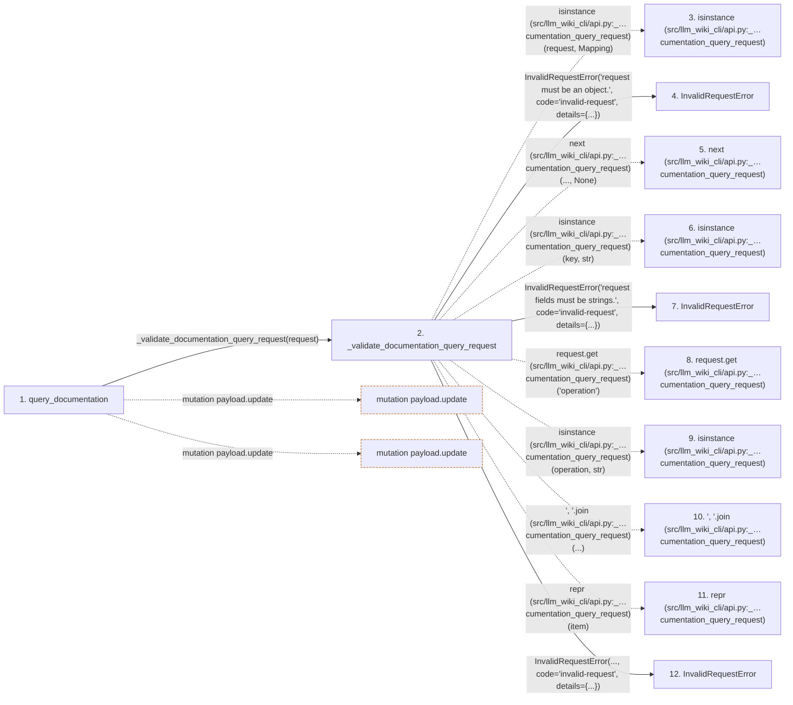

# query_documentation

**Entry point:** `query_documentation` (`api`)
**Source:** [api](../modules/api.md)
**Modules touched:** [api](../modules/api.md), [common](../modules/common.md), [config](../modules/config.md), [context_packet](../modules/context_packet.md), and 29 more

**Complete modules touched:**

- [api](../modules/api.md)
- [common](../modules/common.md)
- [config](../modules/config.md)
- [context_packet](../modules/context_packet.md)
- [documentation_queries](../modules/documentation_queries.md)
- [documentation_query_builder](../modules/documentation_query_builder.md)
- [filesystem_guard](../modules/filesystem_guard.md)
- [implementation_evidence](../modules/implementation_evidence.md)
- [io](../modules/io.md)
- [knowledge_artifacts](../modules/knowledge_artifacts.md)
- [knowledge_consumption](../modules/knowledge_consumption.md)
- [knowledge_envelope](../modules/knowledge_envelope.md)
- [knowledge_evidence](../modules/knowledge_evidence.md)
- [knowledge_freshness](../modules/knowledge_freshness.md)
- [knowledge_loader](../modules/knowledge_loader.md)
- [knowledge_storage](../modules/knowledge_storage.md)
- [knowledge_storage_io](../modules/knowledge_storage_io.md)
- [knowledge_verification](../modules/knowledge_verification.md)
- [maintenance_evidence](../modules/maintenance_evidence.md)
- [maintenance_protocol](../modules/maintenance_protocol.md)
- [maintenance_shapes](../modules/maintenance_shapes.md)
- [maintenance_state](../modules/maintenance_state.md)
- [maintenance_status](../modules/maintenance_status.md)
- [manifest_storage](../modules/manifest_storage.md)
- [markdown_sections](../modules/markdown_sections.md)
- [python_implementation](../modules/python_implementation.md)
- [section_ownership](../modules/section_ownership.md)
- [source_selection](../modules/source_selection.md)
- [source_snapshot](../modules/source_snapshot.md)
- [sync_manifest](../modules/sync_manifest.md)
- [validation](../modules/validation.md)
- [verification_contracts](../modules/verification_contracts.md)
- [wiki_surface](../modules/wiki_surface.md)

## Call sequence

> Static overview in presentation order, not runtime execution order. Arrows retain captured callers; siblings are shown before deeper helper detail.

```mermaid
sequenceDiagram
    participant p0 as query_documentation
    participant p1 as _validate_documentation_query_request
    participant p2 as _impact_query
    participant p3 as _normalize_query_input
    participant p4 as normalize_concept_coordinate
    participant p5 as request.get (src/llm_wiki_cli/api.py:query_documentation)
    participant p6 as validate_exact_page_coordinate
    participant p7 as InvalidRequestError
    participant p8 as str (src/llm_wiki_cli/api.py:query_documentation)
    participant p9 as normalize_supplied_paths
    participant p10 as normalize_documentation_query_text
    participant p11 as _require_full_inventory_opt_in
    participant p12 as build_documentation_query_service
    participant p13 as _snapshot_query_service
    participant p14 as service.get_concept (src/llm_wiki_cli/api.py:query_documentation)
    participant p15 as _normalize_query_choice
    participant p16 as _normalize_query_values
    participant p17 as service.related_concepts
    participant p18 as _surface_query
    participant p19 as tuple (src/llm_wiki_cli/api.py:query_documentation)
    p0->>p1: _validate_documentation_query_request
    p0->>p2: _impact_query
    p0->>p3: _normalize_query_input
    p0->>p4: normalize_concept_coordinate
    p0-->>p5: request.get (src/llm_wiki_cli/api.py:query_documentation)('value')
    p0->>p6: validate_exact_page_coordinate
    p0-->>p5: request.get (src/llm_wiki_cli/api.py:query_documentation)('value')
    p0->>p7: InvalidRequestError
    p0-->>p8: str (src/llm_wiki_cli/api.py:query_documentation)(exc)
    p0->>p3: _normalize_query_input
    p0->>p9: normalize_supplied_paths
    p0-->>p5: request.get (src/llm_wiki_cli/api.py:query_documentation)('value')
    p0->>p3: _normalize_query_input
    p0->>p10: normalize_documentation_query_text
    p0-->>p5: request.get (src/llm_wiki_cli/api.py:query_documentation)('value')
    p0->>p11: _require_full_inventory_opt_in
    p0->>p12: build_documentation_query_service
    p0->>p13: _snapshot_query_service
    p0-->>p14: service.get_concept (src/llm_wiki_cli/api.py:query_documentation)(value)
    p0->>p15: _normalize_query_choice
    p0-->>p5: request.get (src/llm_wiki_cli/api.py:query_documentation)('direction', 'both')
    p0->>p16: _normalize_query_values
    p0-->>p5: request.get (src/llm_wiki_cli/api.py:query_documentation)('kinds')
    p0-->>p17: service.related_concepts(value, direction=direction, kinds=kinds)
    p0->>p18: _surface_query
    p0->>p15: _normalize_query_choice
    p0-->>p5: request.get (src/llm_wiki_cli/api.py:query_documentation)('direction', 'both')
    p0->>p16: _normalize_query_values
    p0-->>p5: request.get (src/llm_wiki_cli/api.py:query_documentation)('kinds')
    p0-->>p19: tuple (src/llm_wiki_cli/api.py:query_documentation)(CORE_RELATIONSHIP_KINDS)
```

<!-- Auto-generated from static call edges. Dashed arrows are external or unresolved calls. Reviewed runtime conditions and side effects belong in Behavior. -->

> Call sequence diagram shows 30 of 1981 interactions; 1951 omitted to keep the visualization within the 30-interaction and generated-diagram limits, with uncertain identities omitted rather than inferred.

> Captured boundary calls: external 2 of 759 (757 omitted); unresolved 10 of 495 (485 omitted). These counts cover the captured static trace.

Omitted captured detail, grouped by actual caller occurrence and target module:

| Caller | Parent step | Target module | Kind | Omitted interactions |
| --- | --- | --- | --- | --- |
| `src/llm_wiki_cli/api.py:_validate_documentation_query_request` | 2 | - | external | 11 |
| `src/llm_wiki_cli/api.py:_validate_documentation_query_request` | 2 | [src/llm_wiki_cli/api.py](../modules/api.md) | internal | 12 |
| `src/llm_wiki_cli/api.py:_validate_documentation_query_request` | 2 | - | unresolved | 10 |
| `src/llm_wiki_cli/api.py:_normalize_query_limit` | 16 | [src/llm_wiki_cli/api.py](../modules/api.md) | internal | 1 |
| `src/llm_wiki_cli/api.py:_normalize_query_input` | 17 | - | unresolved | 1 |
| `src/llm_wiki_cli/api.py:_normalize_query_input` | 17 | [src/llm_wiki_cli/api.py](../modules/api.md) | internal | 1 |
| `src/llm_wiki_cli/api.py:_normalize_query_input` | 17 | - | external | 1 |
| `src/llm_wiki_cli/api.py:_normalize_query_limit` | 16 | [src/llm_wiki_cli/services/documentation_query_builder.py](../modules/documentation_query_builder.md) | internal | 1 |
> Omission summary shows 8 of 467 groups; 459 further groups are not expanded here. Counts above include all omitted interactions.
> Detailed flow queries retain their own coverage and limits; omitted paths may execute at runtime.

> Trace truncated at the depth limit; deeper calls are omitted.

## Data flow

<!-- Auto-generated static analysis. Treat values and boundaries as best-effort hints, not runtime proof. -->

### Step data

| Step | Inputs | Reads | Writes | Returns |
|---|---|---|---|---|
| `query_documentation` | `request: Mapping[str, Any]`, `src_dir: str`, `wiki_dir: str`, `allow_external_src: bool`, `source_selection: str \| Path \| None`, `comparison_policy: str \| None` | `wiki_surface`, `_KNOWLEDGE_QUERY_DIRECTIONS`, `_KNOWLEDGE_QUERY_KINDS`, `_TYPED_QUERY_DIRECTIONS`, `CORE_RELATIONSHIP_KINDS`, `GRAPH_ORIGINS`, `GRAPH_RESOLUTIONS`, `Mapping` | `payload[...]` | `_impact_query(...)`, `_with_query_envelope(...)` |
| `_validate_documentation_query_request` | `request: Mapping[str, Any]` | `Mapping`, `_DOCUMENTATION_QUERY_FIELDS`, `_DOCUMENTATION_QUERY_FIELDS`, `_DOCUMENTATION_QUERY_FIELDS`, `_KNOWLEDGE_QUERY_DIRECTIONS`, `_KNOWLEDGE_QUERY_KINDS`, `_TYPED_QUERY_DIRECTIONS`, `CORE_RELATIONSHIP_KINDS` | - | `(...)` |
| `isinstance (src/llm_wiki_cli/api.py:_…cumentation_query_request)` | - | - | - | - |
| `InvalidRequestError` | - | - | - | - |
| `next (src/llm_wiki_cli/api.py:_…cumentation_query_request)` | - | - | - | - |
| `isinstance (src/llm_wiki_cli/api.py:_…cumentation_query_request)` | - | - | - | - |
| `InvalidRequestError` | - | - | - | - |
| `request.get (src/llm_wiki_cli/api.py:_…cumentation_query_request)` | - | - | - | - |
| `isinstance (src/llm_wiki_cli/api.py:_…cumentation_query_request)` | - | - | - | - |
| `', '.join (src/llm_wiki_cli/api.py:_…cumentation_query_request)` | - | - | - | - |
| `repr (src/llm_wiki_cli/api.py:_…cumentation_query_request)` | - | - | - | - |
| `InvalidRequestError` | - | - | - | - |

### Call data

| From | To | Line | Call |
|---|---|---:|---|
| query_documentation | _validate_documentation_query_request | 3032 | `_validate_documentation_query_request(request)` |
| _validate_documentation_query_request | isinstance (src/llm_wiki_cli/api.py:_…cumentation_query_request) | 2667 | `isinstance(request, Mapping)` |
| _validate_documentation_query_request | InvalidRequestError | 2668 | `InvalidRequestError('request must be an object.', code='invalid-request', details={...})` |
| _validate_documentation_query_request | next (src/llm_wiki_cli/api.py:_…cumentation_query_request) | 2673 | `next(..., None)` |
| _validate_documentation_query_request | isinstance (src/llm_wiki_cli/api.py:_…cumentation_query_request) | 2673 | `isinstance(key, str)` |
| _validate_documentation_query_request | InvalidRequestError | 2675 | `InvalidRequestError('request fields must be strings.', code='invalid-request', details={...})` |
| _validate_documentation_query_request | request.get (src/llm_wiki_cli/api.py:_…cumentation_query_request) | 2680 | `request.get('operation')` |
| _validate_documentation_query_request | isinstance (src/llm_wiki_cli/api.py:_…cumentation_query_request) | 2681 | `isinstance(operation, str)` |
| _validate_documentation_query_request | ', '.join (src/llm_wiki_cli/api.py:_…cumentation_query_request) | 2682 | `', '.join(...)` |
| _validate_documentation_query_request | repr (src/llm_wiki_cli/api.py:_…cumentation_query_request) | 2682 | `repr(item)` |
| _validate_documentation_query_request | InvalidRequestError | 2683 | `InvalidRequestError(..., code='invalid-request', details={...})` |

### Boundary effects

| Kind | Target | Step | Line |
|---|---|---|---:|
| mutation | `payload.update` | `query_documentation` | 3152 |
| mutation | `payload.update` | `query_documentation` | 3176 |

### Static analysis gaps

| Kind | Step | Target | Line |
|---|---|---|---:|
| external_call | `_validate_documentation_query_request` | `isinstance` | 2667 |
| external_call | `_validate_documentation_query_request` | `next` | 2673 |
| external_call | `_validate_documentation_query_request` | `isinstance` | 2673 |
| unresolved_call | `_validate_documentation_query_request` | `request.get` | 2680 |
| external_call | `_validate_documentation_query_request` | `isinstance` | 2681 |
| unresolved_call | `_validate_documentation_query_request` | `', '.join` | 2682 |
| step_limit | `query_documentation` | `first 12 steps` | 0 |
| truncated_flow | `query_documentation` | `depth limit` | 0 |

## Behavior

This flow starts at `query_documentation` and is classified as `api`. The generated call and data-flow sections are bounded static projections; runtime conditions and side effects require source-level confirmation.
