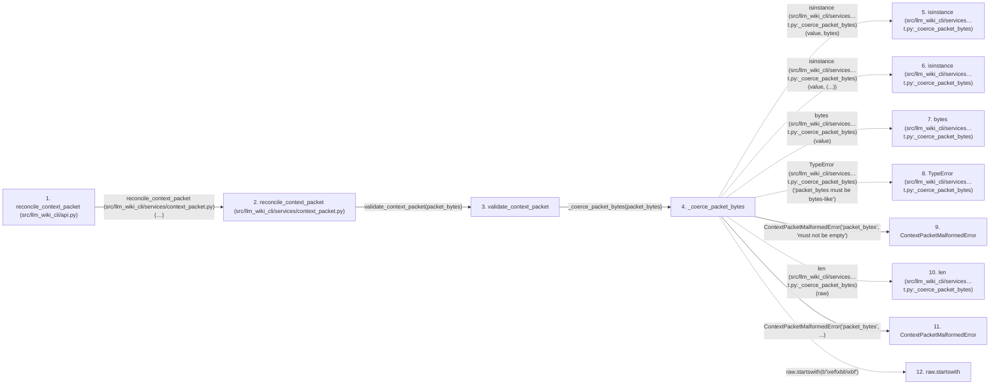

# reconcile_context_packet

**Entry point:** `reconcile_context_packet` (`api`)
**Source:** [api](../modules/api.md)
**Modules touched:** [analysis_compatibility](../modules/analysis_compatibility.md), [api](../modules/api.md), [change_selection](../modules/change_selection.md), [common](../modules/common.md), and 39 more

**Complete modules touched:**

- [analysis_compatibility](../modules/analysis_compatibility.md)
- [api](../modules/api.md)
- [change_selection](../modules/change_selection.md)
- [common](../modules/common.md)
- [config](../modules/config.md)
- [context_packet](../modules/context_packet.md)
- [context_service](../modules/context_service.md)
- [data_flow](../modules/data_flow.md)
- [dependency_versions](../modules/dependency_versions.md)
- [documentation_queries](../modules/documentation_queries.md)
- [documentation_query_builder](../modules/documentation_query_builder.md)
- [entrypoints](../modules/entrypoints.md)
- [extraction_service](../modules/extraction_service.md)
- [filesystem_guard](../modules/filesystem_guard.md)
- [imports](../modules/imports.md)
- [infrastructure_inventory](../modules/infrastructure_inventory.md)
- [infrastructure_sync](../modules/infrastructure_sync.md)
- [io](../modules/io.md)
- [knowledge_consumption](../modules/knowledge_consumption.md)
- [knowledge_envelope](../modules/knowledge_envelope.md)
- [knowledge_evidence](../modules/knowledge_evidence.md)
- [knowledge_freshness](../modules/knowledge_freshness.md)
- [knowledge_loader](../modules/knowledge_loader.md)
- [knowledge_orchestration](../modules/knowledge_orchestration.md)
- [knowledge_storage](../modules/knowledge_storage.md)
- [knowledge_storage_io](../modules/knowledge_storage_io.md)
- [knowledge_verification](../modules/knowledge_verification.md)
- [maintenance_protocol](../modules/maintenance_protocol.md)
- [maintenance_service](../modules/maintenance_service.md)
- [maintenance_status](../modules/maintenance_status.md)
- [packet_field_policy](../modules/packet_field_policy.md)
- [plugins](../modules/plugins.md)
- [python_calls](../modules/python_calls.md)
- [python_implementation](../modules/python_implementation.md)
- [python_imports](../modules/python_imports.md)
- [services_dependencies](../modules/services_dependencies.md)
- [source_selection](../modules/source_selection.md)
- [source_snapshot](../modules/source_snapshot.md)
- [sync_manifest](../modules/sync_manifest.md)
- [validation](../modules/validation.md)
- [wiki_media](../modules/wiki_media.md)
- [wiki_surface](../modules/wiki_surface.md)
- [wiki_surface_index](../modules/wiki_surface_index.md)

## Call sequence

> Static overview in presentation order, not runtime execution order. Arrows retain captured callers; siblings are shown before deeper helper detail.

```mermaid
sequenceDiagram
    participant p0 as reconcile_context_packet (src/llm_wiki_cli/api.py)
    participant p1 as reconcile_context_packet (src/llm_wiki_cli/services/context_packet.py)
    participant p2 as _raise_context_packet_api_error
    participant p3 as validate_context_packet
    participant p4 as _raise_required_knowledge_api_error
    participant p5 as validation.packet.to_payload
    participant p6 as describe_context_packet_error
    participant p7 as build_qualified_context
    participant p8 as leaf
    participant p9 as live_packet.to_payload
    participant p10 as _reconcile_packet_views
    participant p11 as _coerce_packet_bytes
    participant p12 as _normalized_request
    participant p13 as _required_knowledge_failure
    participant p14 as getattr (src/llm_wiki_cli/services…ribe_context_packet_error)
    participant p15 as _strict_json_payload
    participant p16 as _packet_contract_for_request
    participant p17 as _encode_packet_payload
    participant p18 as WorkspaceStateError
    participant p19 as isinstance (src/llm_wiki_cli/services…ribe_context_packet_error)
    participant p20 as _packet_contract_for_schema
    participant p21 as capture_context_read
    participant p22 as str (src/llm_wiki_cli/api.py:_…uired_knowledge_api_error)
    participant p23 as payload.get (src/llm_wiki_cli/services…y:validate_context_packet)
    participant p24 as normalized.get (src/llm_wiki_cli/services…y:build_qualified_context)
    participant p25 as {'source': 'source_snapshot', 'wiki': 'wiki_dir'}.get
    participant p26 as len (src/llm_wiki_cli/services…y:validate_context_packet)
    p0->>p1: reconcile_context_packet (src/llm_wiki_cli/services/context_packet.py)
    p0->>p2: _raise_context_packet_api_error
    p1->>p3: validate_context_packet
    p2->>p4: _raise_required_knowledge_api_error
    p1-->>p5: validation.packet.to_payload
    p2->>p6: describe_context_packet_error
    p1->>p7: build_qualified_context
    p2-->>p8: leaf(failure[...], code=failure[...], details=failure[...])
    p1-->>p9: live_packet.to_payload
    p1->>p10: _reconcile_packet_views
    p3->>p11: _coerce_packet_bytes
    p7->>p12: _normalized_request
    p10->>p3: validate_context_packet
    p4->>p13: _required_knowledge_failure
    p6-->>p14: getattr (src/llm_wiki_cli/services…ribe_context_packet_error)(error, 'field', None)
    p3->>p15: _strict_json_payload
    p7->>p16: _packet_contract_for_request
    p10->>p17: _encode_packet_payload
    p4->>p18: WorkspaceStateError
    p6-->>p19: isinstance (src/llm_wiki_cli/services…ribe_context_packet_error)(error, ContextPacketMalformedError)
    p3->>p20: _packet_contract_for_schema
    p7->>p21: capture_context_read
    p10->>p3: validate_context_packet
    p4-->>p22: str (src/llm_wiki_cli/api.py:_…uired_knowledge_api_error)(exc)
    p6-->>p19: isinstance (src/llm_wiki_cli/services…ribe_context_packet_error)(error, ContextPacketSourceMutationError)
    p3-->>p23: payload.get (src/llm_wiki_cli/services…y:validate_context_packet)('schema_version')
    p7-->>p24: normalized.get (src/llm_wiki_cli/services…y:build_qualified_context)('knowledge_mode')
    p10->>p17: _encode_packet_payload
    p6-->>p25: {'source': 'source_snapshot', 'wiki': 'wiki_dir'}.get(error.facet, error.facet)
    p3-->>p26: len (src/llm_wiki_cli/services…y:validate_context_packet)(raw)
```

<!-- Auto-generated from static call edges. Dashed arrows are external or unresolved calls. Reviewed runtime conditions and side effects belong in Behavior. -->

> Call sequence diagram shows 30 of 2391 interactions; 2361 omitted to keep the visualization within the 30-interaction and generated-diagram limits, with uncertain identities omitted rather than inferred.

> Captured boundary calls: external 5 of 784 (779 omitted); unresolved 6 of 762 (756 omitted). These counts cover the captured static trace.

Omitted captured detail, grouped by actual caller occurrence and target module:

| Caller | Parent step | Target module | Kind | Omitted interactions |
| --- | --- | --- | --- | --- |
| `src/llm_wiki_cli/services/context_packet.py:_coerce_packet_bytes` | 4 | - | external | 5 |
| `src/llm_wiki_cli/services/context_packet.py:_coerce_packet_bytes` | 4 | [src/llm_wiki_cli/services/context_packet.py](../modules/context_packet.md) | internal | 4 |
| `src/llm_wiki_cli/services/context_packet.py:_coerce_packet_bytes` | 4 | - | unresolved | 3 |
| `src/llm_wiki_cli/services/context_packet.py:_strict_json_payload` | 17 | - | unresolved | 1 |
| `src/llm_wiki_cli/services/context_packet.py:_strict_json_payload` | 17 | [src/llm_wiki_cli/services/context_packet.py](../modules/context_packet.md) | internal | 4 |
| `src/llm_wiki_cli/services/context_packet.py:_strict_json_payload` | 17 | - | external | 2 |
| `src/llm_wiki_cli/services/context_packet.py:_validate_json_tree` | 24 | - | external | 1 |
| `src/llm_wiki_cli/services/context_packet.py:_validate_json_tree` | 24 | - | unresolved | 1 |
> Omission summary shows 8 of 519 groups; 511 further groups are not expanded here. Counts above include all omitted interactions.
> Detailed flow queries retain their own coverage and limits; omitted paths may execute at runtime.

> Trace truncated at the depth limit; deeper calls are omitted.

## Data flow

<!-- Auto-generated static analysis. Treat values and boundaries as best-effort hints, not runtime proof. -->

### Step data

| Step | Inputs | Reads | Writes | Returns |
|---|---|---|---|---|
| `reconcile_context_packet (src/llm_wiki_cli/api.py)` | `packet_bytes: bytes \| bytearray \| memoryview`, `src_dir: str`, `wiki_dir: str`, `allow_external_src: bool`, `read_only: bool`, `source_selection: str \| Path \| None`, `comparison_policy: str \| None` | `PathValidationError`, `context_packet_service`, `context_cmd`, `context_cmd` | - | `reconciliation` |
| `reconcile_context_packet (src/llm_wiki_cli/services/context_packet.py)` | `packet_bytes: bytes \| bytearray \| memoryview`, `src_dir: str`, `wiki_dir: str`, `allow_external_src: bool`, `read_only: bool`, `job_request: ExtractionJobRequest \| None`, `plan_reporter: Callable[[ExtractionJobPlan], None] \| None`, `source_selection: str \| Path \| None` | - | - | `_reconcile_packet_views(...)` |
| `validate_context_packet` | `packet_bytes: bytes \| bytearray \| memoryview` | - | - | `ContextPacketValidation(...)` |
| `_coerce_packet_bytes` | `value: bytes \| bytearray \| memoryview` | `_MAX_PACKET_BYTES`, `_MAX_PACKET_BYTES` | - | `raw` |
| `isinstance (src/llm_wiki_cli/services…t.py:_coerce_packet_bytes)` | - | - | - | - |
| `isinstance (src/llm_wiki_cli/services…t.py:_coerce_packet_bytes)` | - | - | - | - |
| `bytes (src/llm_wiki_cli/services…t.py:_coerce_packet_bytes)` | - | - | - | - |
| `TypeError (src/llm_wiki_cli/services…t.py:_coerce_packet_bytes)` | - | - | - | - |
| `ContextPacketMalformedError` | - | - | - | - |
| `len (src/llm_wiki_cli/services…t.py:_coerce_packet_bytes)` | - | - | - | - |
| `ContextPacketMalformedError` | - | - | - | - |
| `raw.startswith` | - | - | - | - |

### Call data

| From | To | Line | Call |
|---|---|---:|---|
| reconcile_context_packet (src/llm_wiki_cli/api.py) | reconcile_context_packet (src/llm_wiki_cli/services/context_packet.py) | 1791 | `context_packet_service.reconcile_context_packet(packet_bytes, src_dir, wiki_dir, allow_external_src=allow_external_src, read_only=read_only, source_selection=source_selection)` |
| reconcile_context_packet (src/llm_wiki_cli/services/context_packet.py) | validate_context_packet | 1801 | `validate_context_packet(packet_bytes)` |
| validate_context_packet | _coerce_packet_bytes | 1712 | `_coerce_packet_bytes(packet_bytes)` |
| _coerce_packet_bytes | isinstance (src/llm_wiki_cli/services…t.py:_coerce_packet_bytes) | 2493 | `isinstance(value, bytes)` |
| _coerce_packet_bytes | isinstance (src/llm_wiki_cli/services…t.py:_coerce_packet_bytes) | 2495 | `isinstance(value, (...))` |
| _coerce_packet_bytes | bytes (src/llm_wiki_cli/services…t.py:_coerce_packet_bytes) | 2496 | `bytes(value)` |
| _coerce_packet_bytes | TypeError (src/llm_wiki_cli/services…t.py:_coerce_packet_bytes) | 2498 | `TypeError('packet_bytes must be bytes-like')` |
| _coerce_packet_bytes | ContextPacketMalformedError | 2500 | `ContextPacketMalformedError('packet_bytes', 'must not be empty')` |
| _coerce_packet_bytes | len (src/llm_wiki_cli/services…t.py:_coerce_packet_bytes) | 2501 | `len(raw)` |
| _coerce_packet_bytes | ContextPacketMalformedError | 2502 | `ContextPacketMalformedError('packet_bytes', ...)` |
| _coerce_packet_bytes | raw.startswith | 2506 | `raw.startswith(b'\xef\xbb\xbf')` |

### Boundary effects

*No boundary effects detected.*

### Static analysis gaps

| Kind | Step | Target | Line |
|---|---|---|---:|
| external_call | `_coerce_packet_bytes` | `isinstance` | 2493 |
| external_call | `_coerce_packet_bytes` | `isinstance` | 2495 |
| external_call | `_coerce_packet_bytes` | `bytes` | 2496 |
| external_call | `_coerce_packet_bytes` | `TypeError` | 2498 |
| unresolved_call | `_coerce_packet_bytes` | `raw.startswith` | 2506 |
| step_limit | `reconcile_context_packet` | `first 12 steps` | 0 |
| truncated_flow | `reconcile_context_packet` | `depth limit` | 0 |

## Behavior

This flow starts at `reconcile_context_packet` and is classified as `api`. The generated call and data-flow sections are bounded static projections; runtime conditions and side effects require source-level confirmation.
