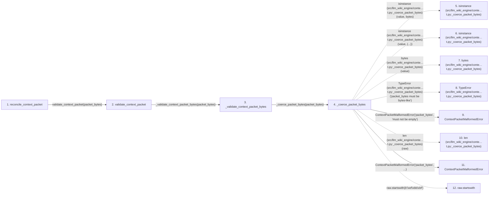

# reconcile_context_packet

**Entry point:** `reconcile_context_packet` (`api`)
**Source:** [context_packet_builder](../modules/context_packet_builder.md)
**Modules touched:** [analysis_capture](../modules/analysis_capture.md), [analysis_compatibility](../modules/analysis_compatibility.md), [canonical_json](../modules/canonical_json.md), and 61 more

**Complete modules touched:**

- [analysis_capture](../modules/analysis_capture.md)
- [analysis_compatibility](../modules/analysis_compatibility.md)
- [canonical_json](../modules/canonical_json.md)
- [change_selection](../modules/change_selection.md)
- [common](../modules/common.md)
- [context_packet](../modules/context_packet.md)
- [context_packet_builder](../modules/context_packet_builder.md)
- [context_request_format](../modules/context_request_format.md)
- [context_service](../modules/context_service.md)
- [data_flow](../modules/data_flow.md)
- [dependency_versions](../modules/dependency_versions.md)
- [dockerfile_parser](../modules/dockerfile_parser.md)
- [documentation_queries](../modules/documentation_queries.md)
- [domain_pack](../modules/domain_pack.md)
- [entrypoints](../modules/entrypoints.md)
- [extraction_service](../modules/extraction_service.md)
- [filesystem_guard](../modules/filesystem_guard.md)
- [gitignore](../modules/gitignore.md)
- [go_calls](../modules/go_calls.md)
- [host](../modules/host.md)
- [imports](../modules/imports.md)
- [infrastructure_inventory](../modules/infrastructure_inventory.md)
- [infrastructure_sync](../modules/infrastructure_sync.md)
- [integrations](../modules/integrations.md)
- [io](../modules/io.md)
- [knowledge_artifacts](../modules/knowledge_artifacts.md)
- [knowledge_consumption](../modules/knowledge_consumption.md)
- [knowledge_envelope](../modules/knowledge_envelope.md)
- [knowledge_evidence](../modules/knowledge_evidence.md)
- [knowledge_freshness](../modules/knowledge_freshness.md)
- [knowledge_generation](../modules/knowledge_generation.md)
- [knowledge_governance](../modules/knowledge_governance.md)
- [knowledge_loader](../modules/knowledge_loader.md)
- [knowledge_model](../modules/knowledge_model.md)
- [knowledge_orchestration](../modules/knowledge_orchestration.md)
- [knowledge_storage](../modules/knowledge_storage.md)
- [knowledge_storage_io](../modules/knowledge_storage_io.md)
- [knowledge_verification](../modules/knowledge_verification.md)
- [maintenance_protocol](../modules/maintenance_protocol.md)
- [maintenance_state](../modules/maintenance_state.md)
- [maintenance_status](../modules/maintenance_status.md)
- [manifest_storage](../modules/manifest_storage.md)
- [pack_interfaces](../modules/pack_interfaces.md)
- [packages](../modules/packages.md)
- [packet_field_policy](../modules/packet_field_policy.md)
- [path_policy](../modules/path_policy.md)
- [plugins](../modules/plugins.md)
- [python_bindings](../modules/python_bindings.md)
- [python_calls](../modules/python_calls.md)
- [python_implementation](../modules/python_implementation.md)
- [python_imports](../modules/python_imports.md)
- [query_request_format](../modules/query_request_format.md)
- [services_dependencies](../modules/services_dependencies.md)
- [source_retirement](../modules/source_retirement.md)
- [source_selection](../modules/source_selection.md)
- [source_snapshot](../modules/source_snapshot.md)
- [sync_manifest](../modules/sync_manifest.md)
- [validation](../modules/validation.md)
- [verification_contracts](../modules/verification_contracts.md)
- [wiki_media](../modules/wiki_media.md)
- [wiki_surface](../modules/wiki_surface.md)
- [wiki_surface_index](../modules/wiki_surface_index.md)
- [yaml_formats](../modules/yaml_formats.md)
- [yaml_syntax](../modules/yaml_syntax.md)

## Call sequence

> Static overview in presentation order, not runtime execution order. Arrows retain captured callers; representative internal continuations and boundary examples precede repeated helper detail.

```mermaid
sequenceDiagram
    participant p0 as reconcile_context_packet
    participant p1 as validate_context_packet
    participant p2 as build_qualified_context
    participant p3 as _reconcile_packet_views
    participant p4 as _validate_context_packet_bytes
    participant p5 as _normalized_request
    participant p6 as _packet_contract_for_request
    participant p7 as capture_context_read
    participant p8 as _reconciliation_facets
    participant p9 as build_context_from_captured_read
    participant p10 as _protocol_success_payload
    participant p11 as ContextPacketReconciliation._from_official_read
    participant p12 as _fit_knowledge_packet_response
    participant p13 as packet_from_captured_response
    participant p14 as _coerce_packet_bytes
    participant p15 as _candidate_packet_size
    participant p16 as uses_builtin_context_source
    participant p17 as _strict_json_payload
    participant p18 as _render_markdown
    participant p19 as _packet_contract_for_schema
    participant p20 as _validate_reconciliation_contract
    participant p21 as _build_legacy_context_from_captured_read
    participant p22 as _build_knowledge_context_from_captured_read
    participant p23 as _validate_packet_shape
    participant p24 as _validate_protocol_request
    participant p25 as _assert_selection_unchanged
    participant p26 as _encode_packet_payload
    participant p27 as _packet_id
    participant p28 as validate_source_root
    participant p29 as isinstance (src/llm_wiki_engine/conte…y:validate_context_packet)
    participant p30 as validation.packet.to_payload
    p0->>p1: validate_context_packet
    p0->>p2: build_qualified_context
    p0->>p3: _reconcile_packet_views
    p1->>p4: _validate_context_packet_bytes
    p2->>p5: _normalized_request
    p2->>p6: _packet_contract_for_request
    p2->>p7: capture_context_read
    p3->>p8: _reconciliation_facets
    p2->>p9: build_context_from_captured_read
    p2->>p10: _protocol_success_payload
    p3->>p11: ContextPacketReconciliation._from_official_read
    p2->>p12: _fit_knowledge_packet_response
    p2->>p13: packet_from_captured_response
    p4->>p14: _coerce_packet_bytes
    p12->>p15: _candidate_packet_size
    p13->>p16: uses_builtin_context_source
    p4->>p17: _strict_json_payload
    p10->>p18: _render_markdown
    p4->>p19: _packet_contract_for_schema
    p11->>p20: _validate_reconciliation_contract
    p9->>p21: _build_legacy_context_from_captured_read
    p9->>p22: _build_knowledge_context_from_captured_read
    p4->>p23: _validate_packet_shape
    p5->>p24: _validate_protocol_request
    p13->>p25: _assert_selection_unchanged
    p4->>p26: _encode_packet_payload
    p4->>p27: _packet_id
    p7->>p28: validate_source_root
    p1-->>p29: isinstance (src/llm_wiki_engine/conte…y:validate_context_packet)(accepted_generators, (...))
    p0-->>p30: validation.packet.to_payload
```

<!-- Auto-generated from static call edges. Dashed arrows are external or unresolved calls. Reviewed runtime conditions and side effects belong in Behavior. -->

> Call sequence diagram shows 30 of 3927 interactions; 3897 omitted to keep the visualization within the 30-interaction and generated-diagram limits, with uncertain identities omitted rather than inferred.

> Captured boundary calls: external 1 of 1280 (1279 omitted); unresolved 1 of 1321 (1320 omitted). These counts cover the captured static trace.

Omitted captured detail, grouped by actual caller occurrence and target module:

| Caller | Parent step | Target module | Kind | Omitted interactions |
| --- | --- | --- | --- | --- |
| `src/llm_wiki_engine/context_packet.py:_coerce_packet_bytes` | 4 | - | external | 5 |
| `src/llm_wiki_engine/context_packet.py:_coerce_packet_bytes` | 4 | [src/llm_wiki_engine/context_packet.py](../modules/context_packet.md) | internal | 4 |
| `src/llm_wiki_engine/context_packet.py:_coerce_packet_bytes` | 4 | - | unresolved | 3 |
| `src/llm_wiki_engine/context_packet.py:_strict_json_payload` | 17 | - | unresolved | 1 |
| `src/llm_wiki_engine/context_packet.py:_strict_json_payload` | 17 | [src/llm_wiki_engine/context_packet.py](../modules/context_packet.md) | internal | 4 |
| `src/llm_wiki_engine/context_packet.py:_strict_json_payload` | 17 | - | external | 2 |
| `src/llm_wiki_engine/context_packet.py:_validate_json_tree` | 24 | - | external | 1 |
| `src/llm_wiki_engine/context_packet.py:_validate_json_tree` | 24 | - | unresolved | 1 |
> Omission summary shows 8 of 917 groups; 909 further groups are not expanded here. Counts above include all omitted interactions.
> Detailed flow queries retain their own coverage and limits; omitted paths may execute at runtime.

> Trace truncated at the depth limit; deeper calls are omitted.

## Data flow

<!-- Auto-generated static analysis. Treat values and boundaries as best-effort hints, not runtime proof. -->

### Analysis coverage

**Effect analysis partially available.** Flow assembly and source effect analysis are separate; empty observations do not prove an empty handler body.

Source steps: 1327; effect analysis evaluated: 895, partial: 48, unavailable: 384. Counts include steps omitted from the displayed trace.

Collector observations for 943 source steps with known totals: observed: 5683, emitted: 5370, omitted: 313. Unavailable totals are excluded.

- Callable record unavailable for one or more source steps; those steps have no represented callable body.
- Effect collector omitted observations before flow assembly; displayed effects are partial.
- Effect collector totals unavailable; observed counts cover captured records only.

| Step | Callable record | Effect analysis | Collector totals | Observed | Emitted | Omitted |
|---|---|---|---|---:|---:|---:|
| `reconcile_context_packet` | `available` | `evaluated` | `available` | `9` | `9` | `0` |
| `validate_context_packet` | `available` | `evaluated` | `available` | `4` | `4` | `0` |
| `_validate_context_packet_bytes` | `available` | `evaluated` | `available` | `2` | `2` | `0` |
| `_coerce_packet_bytes` | `available` | `evaluated` | `available` | `4` | `4` | `0` |
| `isinstance (src/llm_wiki_engine/conte…t.py:_coerce_packet_bytes)` | `not_applicable` | `not_applicable` | `not_applicable` | — | — | — |
| `isinstance (src/llm_wiki_engine/conte…t.py:_coerce_packet_bytes)` | `not_applicable` | `not_applicable` | `not_applicable` | — | — | — |
| `bytes (src/llm_wiki_engine/conte…t.py:_coerce_packet_bytes)` | `not_applicable` | `not_applicable` | `not_applicable` | — | — | — |
| `TypeError (src/llm_wiki_engine/conte…t.py:_coerce_packet_bytes)` | `not_applicable` | `not_applicable` | `not_applicable` | — | — | — |
| `ContextPacketMalformedError` | `unavailable` | `unavailable` | `unavailable` | — | — | — |
| `len (src/llm_wiki_engine/conte…t.py:_coerce_packet_bytes)` | `not_applicable` | `not_applicable` | `not_applicable` | — | — | — |
| `ContextPacketMalformedError` | `unavailable` | `unavailable` | `unavailable` | — | — | — |
| `raw.startswith` | `not_applicable` | `not_applicable` | `not_applicable` | — | — | — |

### Step data

| Step | Inputs | Reads | Writes | Returns |
|---|---|---|---|---|
| `reconcile_context_packet` | `packet_bytes: bytes \| bytearray \| memoryview`, `src_dir: str`, `wiki_dir: str`, `allow_external_src: bool`, `read_only: bool`, `job_request: ExtractionJobRequest \| None`, `plan_reporter: Callable[[ExtractionJobPlan], None] \| None`, `source_selection: str \| Path \| None` | - | - | `_reconcile_packet_views(...)` |
| `validate_context_packet` | `packet_bytes: bytes \| bytearray \| memoryview`, `accepted_generators: Iterable[str] \| None` | - | - | `_validate_context_packet_bytes(...)`, `_validate_context_packet_bytes(...)` |
| `_validate_context_packet_bytes` | `packet_bytes: bytes \| bytearray \| memoryview` | - | - | `ContextPacketValidation(...)` |
| `_coerce_packet_bytes` | `value: bytes \| bytearray \| memoryview` | `_MAX_PACKET_BYTES`, `_MAX_PACKET_BYTES` | - | `raw` |
| `isinstance (src/llm_wiki_engine/conte…t.py:_coerce_packet_bytes)` | - | - | - | - |
| `isinstance (src/llm_wiki_engine/conte…t.py:_coerce_packet_bytes)` | - | - | - | - |
| `bytes (src/llm_wiki_engine/conte…t.py:_coerce_packet_bytes)` | - | - | - | - |
| `TypeError (src/llm_wiki_engine/conte…t.py:_coerce_packet_bytes)` | - | - | - | - |
| `ContextPacketMalformedError` | - | - | - | - |
| `len (src/llm_wiki_engine/conte…t.py:_coerce_packet_bytes)` | - | - | - | - |
| `ContextPacketMalformedError` | - | - | - | - |
| `raw.startswith` | - | - | - | - |

### Call data

| From | To | Line | Call |
|---|---|---:|---|
| reconcile_context_packet | validate_context_packet | 1589 | `validate_context_packet(packet_bytes)` |
| validate_context_packet | _validate_context_packet_bytes | 319 | `_validate_context_packet_bytes(packet_bytes)` |
| _validate_context_packet_bytes | _coerce_packet_bytes | 335 | `_coerce_packet_bytes(packet_bytes)` |
| _coerce_packet_bytes | isinstance (src/llm_wiki_engine/conte…t.py:_coerce_packet_bytes) | 616 | `isinstance(value, bytes)` |
| _coerce_packet_bytes | isinstance (src/llm_wiki_engine/conte…t.py:_coerce_packet_bytes) | 618 | `isinstance(value, (...))` |
| _coerce_packet_bytes | bytes (src/llm_wiki_engine/conte…t.py:_coerce_packet_bytes) | 619 | `bytes(value)` |
| _coerce_packet_bytes | TypeError (src/llm_wiki_engine/conte…t.py:_coerce_packet_bytes) | 621 | `TypeError('packet_bytes must be bytes-like')` |
| _coerce_packet_bytes | ContextPacketMalformedError | 623 | `ContextPacketMalformedError('packet_bytes', 'must not be empty')` |
| _coerce_packet_bytes | len (src/llm_wiki_engine/conte…t.py:_coerce_packet_bytes) | 624 | `len(raw)` |
| _coerce_packet_bytes | ContextPacketMalformedError | 625 | `ContextPacketMalformedError('packet_bytes', ...)` |
| _coerce_packet_bytes | raw.startswith | 629 | `raw.startswith(b'\xef\xbb\xbf')` |

### Boundary effects

*No boundary-effect observations were captured in this static trace.*

### Static analysis gaps

| Kind | Step | Target | Line |
|---|---|---|---:|
| external_call | `_coerce_packet_bytes` | `isinstance` | 616 |
| external_call | `_coerce_packet_bytes` | `isinstance` | 618 |
| external_call | `_coerce_packet_bytes` | `bytes` | 619 |
| external_call | `_coerce_packet_bytes` | `TypeError` | 621 |
| unresolved_call | `_coerce_packet_bytes` | `raw.startswith` | 629 |
| step_limit | `reconcile_context_packet` | `first 12 steps` | 0 |
| truncated_flow | `reconcile_context_packet` | `depth limit` | 0 |

## Behavior

This flow starts at `reconcile_context_packet` and is classified as `api`. The generated call and data-flow sections are bounded static projections; runtime conditions and side effects require source-level confirmation.
