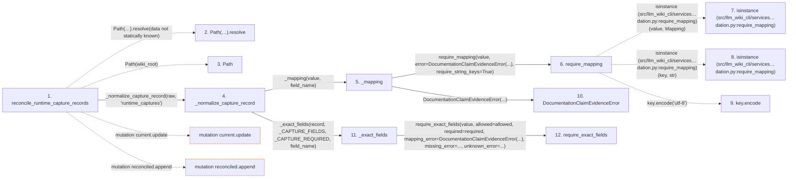

# reconcile_runtime_capture_records

**Entry point:** `reconcile_runtime_capture_records` (`api`)
**Source:** [documentation_claim_evidence](../modules/documentation_claim_evidence.md)
**Modules touched:** [documentation_claim_evidence](../modules/documentation_claim_evidence.md), [knowledge_evidence](../modules/knowledge_evidence.md), [validation](../modules/validation.md)

## Call sequence

> Static overview in presentation order, not runtime execution order. Arrows retain captured callers; representative internal continuations and boundary examples precede repeated helper detail.

```mermaid
sequenceDiagram
    participant p0 as reconcile_runtime_capture_records
    participant p1 as _normalize_capture_record
    participant p2 as _verify_runtime_capture_record
    participant p3 as _capture_section_state
    participant p4 as DocumentationClaimEvidenceError
    participant p5 as _mapping
    participant p6 as _exact_fields
    participant p7 as _capture_result
    participant p8 as _runtime_capture_path
    participant p9 as _native_observation
    participant p10 as _redaction
    participant p11 as _environment
    participant p12 as _identifier
    participant p13 as _optional_identifier
    participant p14 as _optional_locator
    participant p15 as _validate_runtime_capture_content
    participant p16 as _section_locator
    participant p17 as _reject_sensitive_metadata
    participant p18 as _portable_path
    participant p19 as _enum
    participant p20 as _string_list
    participant p21 as _reason
    participant p22 as require_exact_choice
    participant p23 as _text
    participant p24 as require_portable_relative_path
    participant p25 as require_trimmed_text
    participant p26 as _default_path_error
    participant p27 as _check_path_collision
    participant p28 as require_portable_path_component
    participant p29 as Path
    participant p30 as Path(…).resolve
    p0->>p1: _normalize_capture_record
    p0->>p2: _verify_runtime_capture_record
    p0->>p3: _capture_section_state
    p0->>p4: DocumentationClaimEvidenceError
    p1->>p5: _mapping
    p1->>p6: _exact_fields
    p1->>p7: _capture_result
    p1->>p8: _runtime_capture_path
    p1->>p9: _native_observation
    p1->>p10: _redaction
    p1->>p11: _environment
    p1->>p12: _identifier
    p1->>p13: _optional_identifier
    p1->>p14: _optional_locator
    p2->>p15: _validate_runtime_capture_content
    p1->>p16: _section_locator
    p1->>p17: _reject_sensitive_metadata
    p8->>p18: _portable_path
    p7->>p19: _enum
    p10->>p20: _string_list
    p9->>p21: _reason
    p19->>p22: require_exact_choice
    p18->>p23: _text
    p18->>p24: require_portable_relative_path
    p23->>p25: require_trimmed_text
    p24->>p26: _default_path_error
    p24->>p27: _check_path_collision
    p24->>p28: require_portable_path_component
    p0-->>p29: Path(wiki_root)
    p0-->>p30: Path(…).resolve
```

<!-- Auto-generated from static call edges. Dashed arrows are external or unresolved calls. Reviewed runtime conditions and side effects belong in Behavior. -->

> Call sequence diagram shows 30 of 297 interactions; 267 omitted to keep the visualization within the 30-interaction and generated-diagram limits, with uncertain identities omitted rather than inferred.

> Captured boundary calls: external 1 of 89 (88 omitted); unresolved 1 of 81 (80 omitted). These counts cover the captured static trace.

Omitted captured detail, grouped by actual caller occurrence and target module:

| Caller | Parent step | Target module | Kind | Omitted interactions |
| --- | --- | --- | --- | --- |
| `src/llm_wiki_cli/services/documentation_claim_evidence.py:_mapping` | 5 | [src/llm_wiki_cli/services/validation.py](../modules/validation.md) | internal | 1 |
| `src/llm_wiki_cli/services/validation.py:require_mapping` | 6 | - | external | 2 |
| `src/llm_wiki_cli/services/validation.py:require_mapping` | 6 | - | unresolved | 1 |
| `src/llm_wiki_cli/services/documentation_claim_evidence.py:_mapping` | 5 | [src/llm_wiki_cli/services/documentation_claim_evidence.py](../modules/documentation_claim_evidence.md) | internal | 1 |
| `src/llm_wiki_cli/services/documentation_claim_evidence.py:_exact_fields` | 11 | [src/llm_wiki_cli/services/validation.py](../modules/validation.md) | internal | 1 |
| `src/llm_wiki_cli/services/validation.py:require_exact_fields` | 12 | - | external | 9 |
| `src/llm_wiki_cli/services/validation.py:require_exact_fields` | 12 | - | unresolved | 2 |
| `src/llm_wiki_cli/services/documentation_claim_evidence.py:_exact_fields` | 11 | [src/llm_wiki_cli/services/documentation_claim_evidence.py](../modules/documentation_claim_evidence.md) | internal | 3 |
> Omission summary shows 8 of 77 groups; 69 further groups are not expanded here. Counts above include all omitted interactions.
> Detailed flow queries retain their own coverage and limits; omitted paths may execute at runtime.

> Trace truncated at the depth limit; deeper calls are omitted.

## Data flow

<!-- Auto-generated static analysis. Treat values and boundaries as best-effort hints, not runtime proof. -->

### Analysis coverage

**Effect analysis partially available.** Flow assembly and source effect analysis are separate; empty observations do not prove an empty handler body.

Source steps: 128; effect analysis evaluated: 66, partial: 4, unavailable: 58. Counts include steps omitted from the displayed trace.

Collector observations for 70 source steps with known totals: observed: 331, emitted: 318, omitted: 13. Unavailable totals are excluded.

- Callable record unavailable for one or more source steps; those steps have no represented callable body.
- Effect collector omitted observations before flow assembly; displayed effects are partial.
- Effect collector totals unavailable; observed counts cover captured records only.

| Step | Callable record | Effect analysis | Collector totals | Observed | Emitted | Omitted |
|---|---|---|---|---:|---:|---:|
| `reconcile_runtime_capture_records` | `available` | `evaluated` | `available` | `14` | `14` | `0` |
| `Path(…).resolve` | `not_applicable` | `not_applicable` | `not_applicable` | — | — | — |
| `Path` | `not_applicable` | `not_applicable` | `not_applicable` | — | — | — |
| `_normalize_capture_record` | `available` | `evaluated` | `available` | `9` | `9` | `0` |
| `_mapping` | `available` | `evaluated` | `available` | `3` | `3` | `0` |
| `require_mapping` | `available` | `evaluated` | `available` | `8` | `8` | `0` |
| `isinstance (src/llm_wiki_cli/services…dation.py:require_mapping)` | `not_applicable` | `not_applicable` | `not_applicable` | — | — | — |
| `isinstance (src/llm_wiki_cli/services…dation.py:require_mapping)` | `not_applicable` | `not_applicable` | `not_applicable` | — | — | — |
| `key.encode` | `not_applicable` | `not_applicable` | `not_applicable` | — | — | — |
| `DocumentationClaimEvidenceError` | `unavailable` | `unavailable` | `unavailable` | — | — | — |
| `_exact_fields` | `available` | `evaluated` | `available` | `5` | `5` | `0` |
| `require_exact_fields` | `available` | `partial` | `available` | `10` | `9` | `1` |

### Step data

| Step | Inputs | Reads | Writes | Returns |
|---|---|---|---|---|
| `reconcile_runtime_capture_records` | `records: Iterable[Mapping[str, Any]]`, `wiki_root: str \| Path`, `service: DocumentationGraphQueryService \| None` | `DocumentationQueryError`, `Mapping`, `Mapping`, `DocumentationQueryError`, `Mapping`, `Mapping` | `current[...]`, `current[...]` | `tuple(...)` |
| `Path(…).resolve` | - | - | - | - |
| `Path` | - | - | - | - |
| `_normalize_capture_record` | `value: object`, `field_name: str` | `_CAPTURE_FIELDS`, `_CAPTURE_REQUIRED`, `RUNTIME_CAPTURE_SCHEMA_VERSION`, `RUNTIME_CAPTURE_SCHEMA_VERSION`, `_UNINSPECTED_MEDIA_SUFFIXES`, `_UNINSPECTED_MEDIA_LIMITATIONS` | - | `normalized` |
| `_mapping` | `value: object`, `field_name: str` | - | - | `require_mapping(...)` |
| `require_mapping` | `value: object`, `error: Exception`, `require_string_keys: bool`, `key_error: Exception \| None`, `require_utf8_keys: bool`, `utf8_key_error: Exception \| None` | `Mapping` | - | `value` |
| `isinstance (src/llm_wiki_cli/services…dation.py:require_mapping)` | - | - | - | - |
| `isinstance (src/llm_wiki_cli/services…dation.py:require_mapping)` | - | - | - | - |
| `key.encode` | - | - | - | - |
| `DocumentationClaimEvidenceError` | - | - | - | - |
| `_exact_fields` | `value: Mapping[str, Any]`, `allowed: frozenset[str]`, `required: frozenset[str]`, `field_name: str` | - | - | `require_exact_fields(...)` |
| `require_exact_fields` | `value: object`, `allowed: Iterable[str]`, `required: Iterable[str]`, `mapping_error: Exception`, `missing_error: _ErrorFactory`, `unknown_error: _ErrorFactory`, `invalid_error: Callable[[tuple[str, ...], tuple[str, ...]], Exception] \| None`, `stringify_keys: bool` | `Mapping` | - | - |

### Call data

| From | To | Line | Call |
|---|---|---:|---|
| reconcile_runtime_capture_records | Path(…).resolve | 445 | `Path(wiki_root).resolve(data not statically known)` |
| reconcile_runtime_capture_records | Path | 445 | `Path(wiki_root)` |
| reconcile_runtime_capture_records | _normalize_capture_record | 448 | `_normalize_capture_record(raw, 'runtime_captures')` |
| _normalize_capture_record | _mapping | 650 | `_mapping(value, field_name)` |
| _mapping | require_mapping | 1423 | `require_mapping(value, error=DocumentationClaimEvidenceError(...), require_string_keys=True)` |
| require_mapping | isinstance (src/llm_wiki_cli/services…dation.py:require_mapping) | 765 | `isinstance(value, Mapping)` |
| require_mapping | isinstance (src/llm_wiki_cli/services…dation.py:require_mapping) | 769 | `isinstance(key, str)` |
| require_mapping | key.encode | 774 | `key.encode('utf-8')` |
| _mapping | DocumentationClaimEvidenceError | 1425 | `DocumentationClaimEvidenceError(...)` |
| _normalize_capture_record | _exact_fields | 651 | `_exact_fields(record, _CAPTURE_FIELDS, _CAPTURE_REQUIRED, field_name)` |
| _exact_fields | require_exact_fields | 1447 | `require_exact_fields(value, allowed=allowed, required=required, mapping_error=DocumentationClaimEvidenceError(...), missing_error=..., unknown_error=...)` |

### Boundary effects

| Kind | Target | Step | Line |
|---|---|---|---:|
| mutation | `current.update` | `reconcile_runtime_capture_records` | 508 |
| mutation | `reconciled.append` | `reconcile_runtime_capture_records` | 526 |

### Static analysis gaps

| Kind | Step | Target | Line |
|---|---|---|---:|
| unresolved_call | `reconcile_runtime_capture_records` | `Path(wiki_root).resolve` | 445 |
| external_call | `require_mapping` | `isinstance` | 765 |
| external_call | `require_mapping` | `isinstance` | 769 |
| unresolved_call | `require_mapping` | `key.encode` | 774 |
| step_limit | `reconcile_runtime_capture_records` | `first 12 steps` | 0 |
| truncated_flow | `reconcile_runtime_capture_records` | `depth limit` | 0 |

## Behavior

This flow starts at `reconcile_runtime_capture_records` and is classified as `api`. The generated call and data-flow sections are bounded static projections; runtime conditions and side effects require source-level confirmation.
