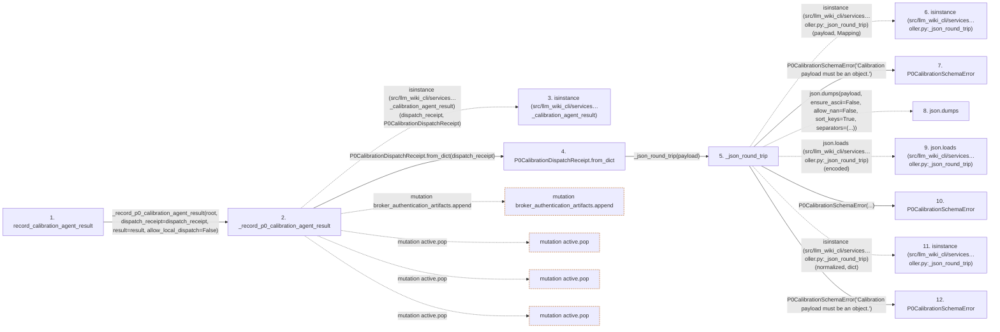

# record_calibration_agent_result

**Entry point:** `record_calibration_agent_result` (`api`)
**Source:** [controller](../modules/controller.md)
**Modules touched:** [broker](../modules/broker.md), [calibration_contracts](../modules/calibration_contracts.md), [controller](../modules/controller.md), [documentation_policy](../modules/documentation_policy.md), and 3 more

**Complete modules touched:**

- [broker](../modules/broker.md)
- [calibration_contracts](../modules/calibration_contracts.md)
- [controller](../modules/controller.md)
- [documentation_policy](../modules/documentation_policy.md)
- [host_broker](../modules/host_broker.md)
- [protected_artifacts](../modules/protected_artifacts.md)
- [validation](../modules/validation.md)

## Call sequence

> Static overview in presentation order, not runtime execution order. Arrows retain captured callers; representative internal continuations and boundary examples precede repeated helper detail.

```mermaid
sequenceDiagram
    participant p0 as record_calibration_agent_result
    participant p1 as _record_p0_calibration_agent_result
    participant p2 as P0CalibrationDispatchReceipt.from_dict
    participant p3 as P0CalibrationAgentResult.from_dict
    participant p4 as _open_store
    participant p5 as _load_run_locked
    participant p6 as _recheck_bound_controls
    participant p7 as _authority_freshness_failure
    participant p8 as _validate_result_import_bindings
    participant p9 as _validate_semantic_result
    participant p10 as _frozen_intake_proposals
    participant p11 as _json_round_trip
    participant p12 as _bound_outbound_roots
    participant p13 as _validate_dispatch_receipt
    participant p14 as _validate_agent_result
    participant p15 as _load_emergency_rejection
    participant p16 as _recover_pending_transaction
    participant p17 as _block_ambiguous_recovery
    participant p18 as _persist_emergency_rejection
    participant p19 as _validate_authority_grant
    participant p20 as _sanitize_outbound_value
    participant p21 as _validate_host_authorization
    participant p22 as _validate_cited_claim
    participant p23 as _assert_outbound_payload_safe
    participant p24 as _unknown_root_entries
    participant p25 as _terminal_transition_locked
    participant p26 as _proposal_claim_records
    participant p27 as _load_control_workspace
    participant p28 as _validate_isolation_attestation
    participant p29 as isinstance (src/llm_wiki_cli/services…_calibration_agent_result)
    participant p30 as store.lock
    p0->>p1: _record_p0_calibration_agent_result
    p1->>p2: P0CalibrationDispatchReceipt.from_dict
    p1->>p3: P0CalibrationAgentResult.from_dict
    p1->>p4: _open_store
    p1->>p5: _load_run_locked
    p1->>p6: _recheck_bound_controls
    p1->>p7: _authority_freshness_failure
    p1->>p8: _validate_result_import_bindings
    p1->>p9: _validate_semantic_result
    p1->>p10: _frozen_intake_proposals
    p2->>p11: _json_round_trip
    p10->>p12: _bound_outbound_roots
    p2->>p13: _validate_dispatch_receipt
    p3->>p14: _validate_agent_result
    p5->>p15: _load_emergency_rejection
    p5->>p16: _recover_pending_transaction
    p5->>p17: _block_ambiguous_recovery
    p5->>p18: _persist_emergency_rejection
    p7->>p19: _validate_authority_grant
    p10->>p20: _sanitize_outbound_value
    p7->>p21: _validate_host_authorization
    p9->>p22: _validate_cited_claim
    p10->>p23: _assert_outbound_payload_safe
    p5->>p24: _unknown_root_entries
    p5->>p25: _terminal_transition_locked
    p9->>p26: _proposal_claim_records
    p6->>p27: _load_control_workspace
    p7->>p28: _validate_isolation_attestation
    p1-->>p29: isinstance (src/llm_wiki_cli/services…_calibration_agent_result)(dispatch_receipt, P0CalibrationDispatchReceipt)
    p1-->>p30: store.lock
```

<!-- Auto-generated from static call edges. Dashed arrows are external or unresolved calls. Reviewed runtime conditions and side effects belong in Behavior. -->

> Call sequence diagram shows 30 of 1719 interactions; 1689 omitted to keep the visualization within the 30-interaction and generated-diagram limits, with uncertain identities omitted rather than inferred.

> Captured boundary calls: external 1 of 367 (366 omitted); unresolved 1 of 605 (604 omitted). These counts cover the captured static trace.

Omitted captured detail, grouped by actual caller occurrence and target module:

| Caller | Parent step | Target module | Kind | Omitted interactions |
| --- | --- | --- | --- | --- |
| `src/llm_wiki_cli/services/calibration/controller.py:_json_round_trip` | 5 | - | external | 4 |
| `src/llm_wiki_cli/services/calibration/controller.py:_json_round_trip` | 5 | [src/llm_wiki_cli/services/calibration/controller.py](../modules/controller.md) | internal | 3 |
| `src/llm_wiki_cli/services/calibration/controller.py:_validate_dispatch_receipt` | 13 | - | unresolved | 20 |
| `src/llm_wiki_cli/services/calibration/controller.py:_validate_dispatch_receipt` | 13 | [src/llm_wiki_cli/services/calibration/controller.py](../modules/controller.md) | internal | 22 |
| `src/llm_wiki_cli/services/calibration/controller.py:_require_uuid` | 16 | [src/llm_wiki_cli/services/validation.py](../modules/validation.md) | internal | 1 |
| `src/llm_wiki_cli/services/validation.py:require_uuid` | 17 | [src/llm_wiki_cli/services/validation.py](../modules/validation.md) | internal | 1 |
| `src/llm_wiki_cli/services/validation.py:require_uuid` | 17 | - | external | 2 |
| `src/llm_wiki_cli/services/calibration/controller.py:_require_uuid` | 16 | [src/llm_wiki_cli/services/calibration/controller.py](../modules/controller.md) | internal | 3 |
> Omission summary shows 8 of 265 groups; 257 further groups are not expanded here. Counts above include all omitted interactions.
> Detailed flow queries retain their own coverage and limits; omitted paths may execute at runtime.

> Trace truncated at the depth limit; deeper calls are omitted.

## Data flow

<!-- Auto-generated static analysis. Treat values and boundaries as best-effort hints, not runtime proof. -->

### Analysis coverage

**Effect analysis partially available.** Flow assembly and source effect analysis are separate; empty observations do not prove an empty handler body.

Source steps: 748; effect analysis evaluated: 451, partial: 0, unavailable: 297. Counts include steps omitted from the displayed trace.

- Callable record unavailable; the selected entry symbol has no represented callable body.
- Effect collector totals unavailable; observed counts cover captured records only.

| Step | Callable record | Effect analysis | Collector totals |
|---|---|---|---|
| `record_calibration_agent_result` | `available` | `evaluated` | `available` |
| `_record_p0_calibration_agent_result` | `available` | `evaluated` | `available` |
| `isinstance (src/llm_wiki_cli/services…_calibration_agent_result)` | `not_applicable` | `not_applicable` | `not_applicable` |
| `P0CalibrationDispatchReceipt.from_dict` | `available` | `evaluated` | `available` |
| `_json_round_trip` | `available` | `evaluated` | `available` |
| `isinstance (src/llm_wiki_cli/services…oller.py:_json_round_trip)` | `not_applicable` | `not_applicable` | `not_applicable` |
| `P0CalibrationSchemaError` | `unavailable` | `unavailable` | `unavailable` |
| `json.dumps` | `not_applicable` | `not_applicable` | `not_applicable` |
| `json.loads (src/llm_wiki_cli/services…oller.py:_json_round_trip)` | `not_applicable` | `not_applicable` | `not_applicable` |
| `P0CalibrationSchemaError` | `unavailable` | `unavailable` | `unavailable` |
| `isinstance (src/llm_wiki_cli/services…oller.py:_json_round_trip)` | `not_applicable` | `not_applicable` | `not_applicable` |
| `P0CalibrationSchemaError` | `unavailable` | `unavailable` | `unavailable` |

### Step data

| Step | Inputs | Reads | Writes | Returns |
|---|---|---|---|---|
| `record_calibration_agent_result` | `root: str \| Path`, `dispatch_receipt: P0CalibrationDispatchReceipt \| Mapping[str, Any]`, `result: P0CalibrationAgentResult \| Mapping[str, Any]` | - | - | `_record_p0_calibration_agent_result(...)` |
| `_record_p0_calibration_agent_result` | `root: str \| Path`, `dispatch_receipt: P0CalibrationDispatchReceipt \| Mapping[str, Any]`, `result: P0CalibrationAgentResult \| Mapping[str, Any]`, `allow_local_dispatch: bool` | `P0CalibrationDispatchReceipt`, `P0CalibrationAgentResult`, `Mapping`, `CALIBRATION_TERMINAL_STATES`, `CALIBRATION_ROLES`, `Mapping`, `_MAX_RESULT_BYTES`, `_ExternalBrokerAuthenticationUnavailable` | `recorded[...]`, `roles[...]`, `receipts[...]`, `results[...]`, `artifacts[...]`, `artifacts[...]`, `receipt_authentications[...]`, `artifacts[...]` | `run`, `_commit_transition(...)`, `_commit_transition(...)` |
| `isinstance (src/llm_wiki_cli/services…_calibration_agent_result)` | - | - | - | - |
| `P0CalibrationDispatchReceipt.from_dict` | `payload: Mapping[str, Any]` | - | - | `cls(...)` |
| `_json_round_trip` | `payload: Mapping[str, Any]` | `Mapping` | - | `normalized` |
| `isinstance (src/llm_wiki_cli/services…oller.py:_json_round_trip)` | - | - | - | - |
| `P0CalibrationSchemaError` | - | - | - | - |
| `json.dumps` | - | - | - | - |
| `json.loads (src/llm_wiki_cli/services…oller.py:_json_round_trip)` | - | - | - | - |
| `P0CalibrationSchemaError` | - | - | - | - |
| `isinstance (src/llm_wiki_cli/services…oller.py:_json_round_trip)` | - | - | - | - |
| `P0CalibrationSchemaError` | - | - | - | - |

### Call data

| From | To | Line | Call |
|---|---|---:|---|
| record_calibration_agent_result | _record_p0_calibration_agent_result | 2610 | `_record_p0_calibration_agent_result(root, dispatch_receipt=dispatch_receipt, result=result, allow_local_dispatch=False)` |
| _record_p0_calibration_agent_result | isinstance (src/llm_wiki_cli/services…_calibration_agent_result) | 2627 | `isinstance(dispatch_receipt, P0CalibrationDispatchReceipt)` |
| _record_p0_calibration_agent_result | P0CalibrationDispatchReceipt.from_dict | 2628 | `P0CalibrationDispatchReceipt.from_dict(dispatch_receipt)` |
| P0CalibrationDispatchReceipt.from_dict | _json_round_trip | 452 | `_json_round_trip(payload)` |
| _json_round_trip | isinstance (src/llm_wiki_cli/services…oller.py:_json_round_trip) | 6865 | `isinstance(payload, Mapping)` |
| _json_round_trip | P0CalibrationSchemaError | 6866 | `P0CalibrationSchemaError('Calibration payload must be an object.')` |
| _json_round_trip | json.dumps | 6868 | `json.dumps(payload, ensure_ascii=False, allow_nan=False, sort_keys=True, separators=(...))` |
| _json_round_trip | json.loads (src/llm_wiki_cli/services…oller.py:_json_round_trip) | 6875 | `json.loads(encoded)` |
| _json_round_trip | P0CalibrationSchemaError | 6877 | `P0CalibrationSchemaError(...)` |
| _json_round_trip | isinstance (src/llm_wiki_cli/services…oller.py:_json_round_trip) | 6880 | `isinstance(normalized, dict)` |
| _json_round_trip | P0CalibrationSchemaError | 6881 | `P0CalibrationSchemaError('Calibration payload must be an object.')` |

### Boundary effects

| Kind | Target | Step | Line |
|---|---|---|---:|
| mutation | `broker_authentication_artifacts.append` | `_record_p0_calibration_agent_result` | 2777 |
| mutation | `active.pop` | `_record_p0_calibration_agent_result` | 2798 |
| mutation | `active.pop` | `_record_p0_calibration_agent_result` | 2908 |
| mutation | `active.pop` | `_record_p0_calibration_agent_result` | 2952 |

### Static analysis gaps

| Kind | Step | Target | Line |
|---|---|---|---:|
| external_call | `_record_p0_calibration_agent_result` | `isinstance` | 2627 |
| external_call | `_json_round_trip` | `isinstance` | 6865 |
| external_call | `_json_round_trip` | `json.dumps` | 6868 |
| external_call | `_json_round_trip` | `json.loads` | 6875 |
| external_call | `_json_round_trip` | `isinstance` | 6880 |
| step_limit | `record_calibration_agent_result` | `first 12 steps` | 0 |
| truncated_flow | `record_calibration_agent_result` | `depth limit` | 0 |

## Behavior

This flow starts at `record_calibration_agent_result` and is classified as `api`. The generated call and data-flow sections are bounded static projections; runtime conditions and side effects require source-level confirmation.
