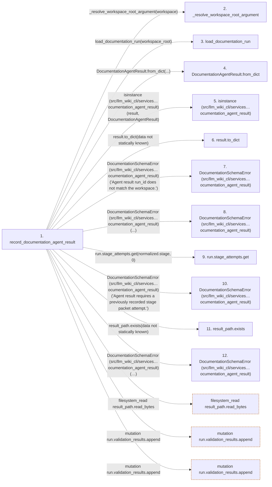

# record_documentation_agent_result

**Entry point:** `record_documentation_agent_result` (`api`)
**Source:** [record](../modules/record.md)
**Modules touched:** [documentation_policy](../modules/documentation_policy.md), [documentation_run_contracts](../modules/documentation_run_contracts.md), [io](../modules/io.md), and 10 more

**Complete modules touched:**

- [documentation_policy](../modules/documentation_policy.md)
- [documentation_run_contracts](../modules/documentation_run_contracts.md)
- [io](../modules/io.md)
- [knowledge_evidence](../modules/knowledge_evidence.md)
- [knowledge_storage](../modules/knowledge_storage.md)
- [knowledge_storage_io](../modules/knowledge_storage_io.md)
- [publication](../modules/publication.md)
- [publication_candidate](../modules/publication_candidate.md)
- [publication_config](../modules/publication_config.md)
- [publication_delivery](../modules/publication_delivery.md)
- [record](../modules/record.md)
- [validation](../modules/validation.md)
- [workspace](../modules/workspace.md)

## Call sequence

> Static overview in presentation order, not runtime execution order. Arrows retain captured callers; representative internal continuations and boundary examples precede repeated helper detail.

```mermaid
sequenceDiagram
    participant p0 as record_documentation_agent_result
    participant p1 as reconcile_publication
    participant p2 as record_publication_evidence
    participant p3 as _merge_agent_findings
    participant p4 as _verify_user_docs_gate
    participant p5 as _preflight_documentation_native_evidence
    participant p6 as _validate_result_work_ids
    participant p7 as _reconcile_imported_page_edits
    participant p8 as _capture_native_evidence_transaction
    participant p9 as _reconcile_documentation_native_evidence
    participant p10 as _rollback_native_evidence_transaction
    participant p11 as _merge_unique
    participant p12 as _reconcile_semantic_readiness
    participant p13 as _record_review_ledger_iteration
    participant p14 as _has_unresolved_high_findings
    participant p15 as _review_adjustment_state
    participant p16 as _hashes (src/llm_wiki_cli/services…tation_run/publication.py)
    participant p17 as _documents
    participant p18 as _read_tree
    participant p19 as _binding
    participant p20 as _absolute_path
    participant p21 as _tree_paths
    participant p22 as split_delivery_tree
    participant p23 as _public_hashes
    participant p24 as _validated_checkpoint
    participant p25 as _portable
    participant p26 as hash_bytes (src/llm_wiki_cli/services/documentation_policy.py)
    participant p27 as _workspace_path (src/llm_wiki_cli/services…entation_run/workspace.py)
    participant p28 as _finding_text_values
    participant p29 as isinstance (src/llm_wiki_cli/services….py:reconcile_publication)
    participant p30 as _resolve_workspace_root_argument
    p0->>p1: reconcile_publication
    p0->>p2: record_publication_evidence
    p0->>p3: _merge_agent_findings
    p0->>p4: _verify_user_docs_gate
    p0->>p5: _preflight_documentation_native_evidence
    p0->>p6: _validate_result_work_ids
    p0->>p7: _reconcile_imported_page_edits
    p0->>p8: _capture_native_evidence_transaction
    p0->>p9: _reconcile_documentation_native_evidence
    p0->>p10: _rollback_native_evidence_transaction
    p0->>p11: _merge_unique
    p0->>p12: _reconcile_semantic_readiness
    p0->>p13: _record_review_ledger_iteration
    p0->>p14: _has_unresolved_high_findings
    p0->>p15: _review_adjustment_state
    p1->>p16: _hashes (src/llm_wiki_cli/services…tation_run/publication.py)
    p1->>p17: _documents
    p17->>p18: _read_tree
    p17->>p19: _binding
    p18->>p20: _absolute_path
    p18->>p21: _tree_paths
    p18->>p22: split_delivery_tree
    p22->>p23: _public_hashes
    p22->>p24: _validated_checkpoint
    p21->>p25: _portable
    p2->>p26: hash_bytes (src/llm_wiki_cli/services/documentation_policy.py)
    p2->>p27: _workspace_path (src/llm_wiki_cli/services…entation_run/workspace.py)
    p3->>p28: _finding_text_values
    p1-->>p29: isinstance (src/llm_wiki_cli/services….py:reconcile_publication)(actor, str)
    p0-->>p30: _resolve_workspace_root_argument(workspace)
```

<!-- Auto-generated from static call edges. Dashed arrows are external or unresolved calls. Reviewed runtime conditions and side effects belong in Behavior. -->

> Call sequence diagram shows 30 of 658 interactions; 628 omitted to keep the visualization within the 30-interaction and generated-diagram limits, with uncertain identities omitted rather than inferred.

> Captured boundary calls: external 1 of 82 (81 omitted); unresolved 1 of 503 (502 omitted). These counts cover the captured static trace.

Omitted captured detail, grouped by actual caller occurrence and target module:

| Caller | Parent step | Target module | Kind | Omitted interactions |
| --- | --- | --- | --- | --- |
| `src/llm_wiki_cli/services/documentation_run/record.py:record_documentation_agent_result` | 1 | - | unresolved | 88 |
| `src/llm_wiki_cli/services/documentation_run/publication.py:reconcile_publication` | 26 | - | unresolved | 8 |
| `src/llm_wiki_cli/services/documentation_run/publication.py:reconcile_publication` | 26 | - | external | 8 |
| `src/llm_wiki_cli/services/documentation_run/publication.py:reconcile_publication` | 26 | [src/llm_wiki_cli/services/documentation_run/contracts.py](../modules/documentation_run_contracts.md) | internal | 8 |
| `src/llm_wiki_cli/services/documentation_run/publication.py:_hashes` | 39 | [src/llm_wiki_cli/services/documentation_policy.py](../modules/documentation_policy.md) | internal | 1 |
| `src/llm_wiki_cli/services/documentation_policy.py:hash_bytes` | 40 | - | unresolved | 1 |
| `src/llm_wiki_cli/services/documentation_policy.py:hash_bytes` | 40 | - | external | 1 |
| `src/llm_wiki_cli/services/documentation_run/publication.py:_hashes` | 39 | - | unresolved | 1 |
> Omission summary shows 8 of 63 groups; 55 further groups are not expanded here. Counts above include all omitted interactions.
> Detailed flow queries retain their own coverage and limits; omitted paths may execute at runtime.

> Trace truncated at the depth limit; deeper calls are omitted.

## Data flow

<!-- Auto-generated static analysis. Treat values and boundaries as best-effort hints, not runtime proof. -->

### Analysis coverage

**Effect analysis partially available.** Flow assembly and source effect analysis are separate; empty observations do not prove an empty handler body.

Source steps: 74; effect analysis evaluated: 60, partial: 1, unavailable: 13. Counts include steps omitted from the displayed trace.

Collector observations for 61 source steps with known totals: observed: 297, emitted: 287, omitted: 10. Unavailable totals are excluded.

- Callable record unavailable for one or more source steps; those steps have no represented callable body.
- Effect collector omitted observations before flow assembly; displayed effects are partial.
- Effect collector totals unavailable; observed counts cover captured records only.

| Step | Callable record | Effect analysis | Collector totals | Observed | Emitted | Omitted |
|---|---|---|---|---:|---:|---:|
| `record_documentation_agent_result` | `available` | `evaluated` | `available` | `13` | `13` | `0` |
| `_resolve_workspace_root_argument` | `not_applicable` | `not_applicable` | `not_applicable` | — | — | — |
| `load_documentation_run` | `not_applicable` | `not_applicable` | `not_applicable` | — | — | — |
| `DocumentationAgentResult.from_dict` | `not_applicable` | `not_applicable` | `not_applicable` | — | — | — |
| `isinstance (src/llm_wiki_cli/services…ocumentation_agent_result)` | `not_applicable` | `not_applicable` | `not_applicable` | — | — | — |
| `result.to_dict` | `not_applicable` | `not_applicable` | `not_applicable` | — | — | — |
| `DocumentationSchemaError (src/llm_wiki_cli/services…ocumentation_agent_result)` | `not_applicable` | `not_applicable` | `not_applicable` | — | — | — |
| `DocumentationSchemaError (src/llm_wiki_cli/services…ocumentation_agent_result)` | `not_applicable` | `not_applicable` | `not_applicable` | — | — | — |
| `run.stage_attempts.get` | `not_applicable` | `not_applicable` | `not_applicable` | — | — | — |
| `DocumentationSchemaError (src/llm_wiki_cli/services…ocumentation_agent_result)` | `not_applicable` | `not_applicable` | `not_applicable` | — | — | — |
| `result_path.exists` | `not_applicable` | `not_applicable` | `not_applicable` | — | — | — |
| `DocumentationSchemaError (src/llm_wiki_cli/services…ocumentation_agent_result)` | `not_applicable` | `not_applicable` | `not_applicable` | — | — | — |

### Step data

| Step | Inputs | Reads | Writes | Returns |
|---|---|---|---|---|
| `record_documentation_agent_result` | `workspace: str \| Path`, `result: DocumentationAgentResult \| Mapping[str, Any]`, `actor: str \| None` | - | - | `run`, `run`, `run`, `run`, `run`, `run`, `run` |
| `_resolve_workspace_root_argument` | - | - | - | - |
| `load_documentation_run` | - | - | - | - |
| `DocumentationAgentResult.from_dict` | - | - | - | - |
| `isinstance (src/llm_wiki_cli/services…ocumentation_agent_result)` | - | - | - | - |
| `result.to_dict` | - | - | - | - |
| `DocumentationSchemaError (src/llm_wiki_cli/services…ocumentation_agent_result)` | - | - | - | - |
| `DocumentationSchemaError (src/llm_wiki_cli/services…ocumentation_agent_result)` | - | - | - | - |
| `run.stage_attempts.get` | - | - | - | - |
| `DocumentationSchemaError (src/llm_wiki_cli/services…ocumentation_agent_result)` | - | - | - | - |
| `result_path.exists` | - | - | - | - |
| `DocumentationSchemaError (src/llm_wiki_cli/services…ocumentation_agent_result)` | - | - | - | - |

### Call data

| From | To | Line | Call |
|---|---|---:|---|
| record_documentation_agent_result | _resolve_workspace_root_argument | 788 | `_resolve_workspace_root_argument(workspace)` |
| record_documentation_agent_result | load_documentation_run | 789 | `load_documentation_run(workspace_root)` |
| record_documentation_agent_result | DocumentationAgentResult.from_dict | 790 | `DocumentationAgentResult.from_dict(...)` |
| record_documentation_agent_result | isinstance (src/llm_wiki_cli/services…ocumentation_agent_result) | 791 | `isinstance(result, DocumentationAgentResult)` |
| record_documentation_agent_result | result.to_dict | 791 | `result.to_dict(data not statically known)` |
| record_documentation_agent_result | DocumentationSchemaError (src/llm_wiki_cli/services…ocumentation_agent_result) | 794 | `DocumentationSchemaError('Agent result run_id does not match the workspace.')` |
| record_documentation_agent_result | DocumentationSchemaError (src/llm_wiki_cli/services…ocumentation_agent_result) | 798 | `DocumentationSchemaError(...)` |
| record_documentation_agent_result | run.stage_attempts.get | 802 | `run.stage_attempts.get(normalized.stage, 0)` |
| record_documentation_agent_result | DocumentationSchemaError (src/llm_wiki_cli/services…ocumentation_agent_result) | 804 | `DocumentationSchemaError('Agent result requires a previously recorded stage packet attempt.')` |
| record_documentation_agent_result | result_path.exists | 809 | `result_path.exists(data not statically known)` |
| record_documentation_agent_result | DocumentationSchemaError (src/llm_wiki_cli/services…ocumentation_agent_result) | 810 | `DocumentationSchemaError('This stage-packet attempt already has a result; build a new packet before recording another result.')` |

### Boundary effects

| Kind | Target | Step | Line |
|---|---|---|---:|
| filesystem_read | `result_path.read_bytes` | `record_documentation_agent_result` | 1037 |
| mutation | `run.validation_results.append` | `record_documentation_agent_result` | 1064 |
| mutation | `run.validation_results.append` | `record_documentation_agent_result` | 1131 |

### Static analysis gaps

| Kind | Step | Target | Line |
|---|---|---|---:|
| unresolved_call | `record_documentation_agent_result` | `_resolve_workspace_root_argument` | 788 |
| unresolved_call | `record_documentation_agent_result` | `load_documentation_run` | 789 |
| unresolved_call | `record_documentation_agent_result` | `DocumentationAgentResult.from_dict` | 790 |
| unresolved_call | `record_documentation_agent_result` | `isinstance` | 791 |
| unresolved_call | `record_documentation_agent_result` | `result.to_dict` | 791 |
| unresolved_call | `record_documentation_agent_result` | `DocumentationSchemaError` | 794 |
| unresolved_call | `record_documentation_agent_result` | `DocumentationSchemaError` | 798 |
| unresolved_call | `record_documentation_agent_result` | `run.stage_attempts.get` | 802 |
| unresolved_call | `record_documentation_agent_result` | `DocumentationSchemaError` | 804 |
| unresolved_call | `record_documentation_agent_result` | `result_path.exists` | 809 |
| unresolved_call | `record_documentation_agent_result` | `DocumentationSchemaError` | 810 |
| step_limit | `record_documentation_agent_result` | `first 12 steps` | 0 |

## Behavior

This flow starts at `record_documentation_agent_result` and is classified as `api`. The generated call and data-flow sections are bounded static projections; runtime conditions and side effects require source-level confirmation.
