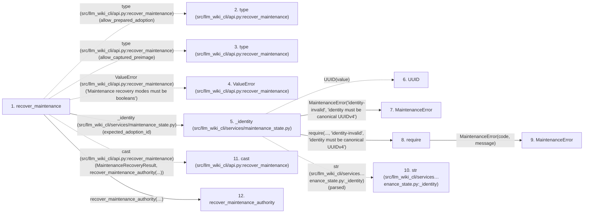

# recover_maintenance

**Entry point:** `recover_maintenance` (`api`)
**Source:** [api](../modules/api.md)
**Modules touched:** [api](../modules/api.md), [common](../modules/common.md), [concept_identity](../modules/concept_identity.md), [config](../modules/config.md), and 29 more

**Complete modules touched:**

- [api](../modules/api.md)
- [common](../modules/common.md)
- [concept_identity](../modules/concept_identity.md)
- [config](../modules/config.md)
- [filesystem_guard](../modules/filesystem_guard.md)
- [immutable](../modules/immutable.md)
- [implementation_evidence](../modules/implementation_evidence.md)
- [infrastructure_sync](../modules/infrastructure_sync.md)
- [io](../modules/io.md)
- [knowledge_artifacts](../modules/knowledge_artifacts.md)
- [knowledge_envelope](../modules/knowledge_envelope.md)
- [knowledge_evidence](../modules/knowledge_evidence.md)
- [knowledge_governance](../modules/knowledge_governance.md)
- [knowledge_graph](../modules/knowledge_graph.md)
- [knowledge_index](../modules/knowledge_index.md)
- [knowledge_model](../modules/knowledge_model.md)
- [knowledge_packs](../modules/knowledge_packs.md)
- [knowledge_reuse](../modules/knowledge_reuse.md)
- [knowledge_storage](../modules/knowledge_storage.md)
- [knowledge_storage_io](../modules/knowledge_storage_io.md)
- [maintenance_projection](../modules/maintenance_projection.md)
- [maintenance_protocol](../modules/maintenance_protocol.md)
- [maintenance_service](../modules/maintenance_service.md)
- [maintenance_shapes](../modules/maintenance_shapes.md)
- [maintenance_state](../modules/maintenance_state.md)
- [manifest_storage](../modules/manifest_storage.md)
- [section_ownership](../modules/section_ownership.md)
- [source_selection](../modules/source_selection.md)
- [source_snapshot](../modules/source_snapshot.md)
- [sync_manifest](../modules/sync_manifest.md)
- [validation](../modules/validation.md)
- [wiki_surface](../modules/wiki_surface.md)
- [wiki_write_basis](../modules/wiki_write_basis.md)

## Call sequence

> Static overview in presentation order, not runtime execution order. Arrows retain captured callers; representative internal continuations and boundary examples precede repeated helper detail.

```mermaid
sequenceDiagram
    participant p0 as recover_maintenance
    participant p1 as _identity (src/llm_wiki_cli/services/maintenance_state.py)
    participant p2 as recover_maintenance_authority
    participant p3 as _validate_wiki_dir
    participant p4 as _absolute_path
    participant p5 as validate_path
    participant p6 as require
    participant p7 as load_recovery_snapshot
    participant p8 as governance_writer_lock
    participant p9 as storage_writer_lock
    participant p10 as load_adoption_marker
    participant p11 as SyncManifest.load
    participant p12 as build_source_snapshot
    participant p13 as hash_source_snapshot
    participant p14 as snapshot_wiki
    participant p15 as _capture_basis
    participant p16 as atomic_write_guarded_bytes
    participant p17 as unlink_guarded_bytes
    participant p18 as ensure_guarded_directory
    participant p19 as guard_maintenance_owner
    participant p20 as _load_recovery_snapshot
    participant p21 as _validate_capture_options
    participant p22 as _unlink_guarded_bytes
    participant p23 as _resolve_snapshot_selection
    participant p24 as _normalize_only_files
    participant p25 as governance_lock
    participant p26 as _atomic_write_guarded_bytes_windows
    participant p27 as _empty_source_snapshot
    participant p28 as _hash_structured
    participant p29 as type (src/llm_wiki_cli/api.py:recover_maintenance)
    participant p30 as intent.get
    p0->>p1: _identity (src/llm_wiki_cli/services/maintenance_state.py)
    p0->>p2: recover_maintenance_authority
    p0->>p3: _validate_wiki_dir
    p2->>p4: _absolute_path
    p3->>p5: validate_path
    p1->>p6: require
    p2->>p7: load_recovery_snapshot
    p2->>p8: governance_writer_lock
    p2->>p9: storage_writer_lock
    p2->>p10: load_adoption_marker
    p2->>p11: SyncManifest.load
    p2->>p12: build_source_snapshot
    p2->>p13: hash_source_snapshot
    p2->>p14: snapshot_wiki
    p2->>p15: _capture_basis
    p2->>p16: atomic_write_guarded_bytes
    p2->>p17: unlink_guarded_bytes
    p2->>p18: ensure_guarded_directory
    p2->>p19: guard_maintenance_owner
    p7->>p20: _load_recovery_snapshot
    p12->>p21: _validate_capture_options
    p17->>p22: _unlink_guarded_bytes
    p12->>p23: _resolve_snapshot_selection
    p12->>p24: _normalize_only_files
    p8->>p25: governance_lock
    p16->>p26: _atomic_write_guarded_bytes_windows
    p12->>p27: _empty_source_snapshot
    p13->>p28: _hash_structured
    p0-->>p29: type (src/llm_wiki_cli/api.py:recover_maintenance)(allow_prepared_adoption)
    p2-->>p30: intent.get('adoption_id')
```

<!-- Auto-generated from static call edges. Dashed arrows are external or unresolved calls. Reviewed runtime conditions and side effects belong in Behavior. -->

> Call sequence diagram shows 30 of 1793 interactions; 1763 omitted to keep the visualization within the 30-interaction and generated-diagram limits, with uncertain identities omitted rather than inferred.

> Captured boundary calls: external 1 of 602 (601 omitted); unresolved 1 of 393 (392 omitted). These counts cover the captured static trace.

Omitted captured detail, grouped by actual caller occurrence and target module:

| Caller | Parent step | Target module | Kind | Omitted interactions |
| --- | --- | --- | --- | --- |
| `src/llm_wiki_cli/api.py:recover_maintenance` | 1 | - | external | 3 |
| `src/llm_wiki_cli/services/maintenance_state.py:_identity` | 5 | - | external | 2 |
| `src/llm_wiki_cli/services/maintenance_state.py:_identity` | 5 | [src/llm_wiki_cli/services/maintenance_shapes.py](../modules/maintenance_shapes.md) | internal | 1 |
| `src/llm_wiki_cli/services/maintenance_shapes.py:require` | 8 | [src/llm_wiki_cli/services/maintenance_shapes.py](../modules/maintenance_shapes.md) | internal | 1 |
| `src/llm_wiki_cli/services/knowledge_storage_io.py:_absolute_path` | 13 | - | external | 4 |
| `src/llm_wiki_cli/services/knowledge_storage_io.py:_absolute_path` | 13 | [src/llm_wiki_cli/services/io.py](../modules/io.md) | internal | 1 |
| `src/llm_wiki_cli/services/io.py:first_unsafe_path_component` | 16 | - | external | 20 |
| `src/llm_wiki_cli/services/io.py:first_unsafe_path_component` | 16 | - | unresolved | 5 |
> Omission summary shows 8 of 419 groups; 411 further groups are not expanded here. Counts above include all omitted interactions.
> Detailed flow queries retain their own coverage and limits; omitted paths may execute at runtime.

> Trace truncated at the depth limit; deeper calls are omitted.

## Data flow

<!-- Auto-generated static analysis. Treat values and boundaries as best-effort hints, not runtime proof. -->

### Step data

| Step | Inputs | Reads | Writes | Returns |
|---|---|---|---|---|
| `recover_maintenance` | `wiki_dir: str`, `recovery_dir: str \| Path`, `expected_adoption_id: str`, `src_dir: str \| None`, `allow_prepared_adoption: bool`, `allow_captured_preimage: bool` | `MaintenanceRecoveryResult` | - | `cast(...)` |
| `type (src/llm_wiki_cli/api.py:recover_maintenance)` | - | - | - | - |
| `type (src/llm_wiki_cli/api.py:recover_maintenance)` | - | - | - | - |
| `ValueError (src/llm_wiki_cli/api.py:recover_maintenance)` | - | - | - | - |
| `_identity (src/llm_wiki_cli/services/maintenance_state.py)` | `value: str` | - | - | - |
| `UUID` | - | - | - | - |
| `MaintenanceError` | - | - | - | - |
| `require` | `condition`, `code`, `message` | - | - | - |
| `MaintenanceError` | - | - | - | - |
| `str (src/llm_wiki_cli/services…enance_state.py:_identity)` | - | - | - | - |
| `cast (src/llm_wiki_cli/api.py:recover_maintenance)` | - | - | - | - |
| `recover_maintenance_authority` | `wiki_dir`, `recovery_dir`, `expected_adoption_id`, `allow_prepared_adoption`, `allow_captured_preimage`, `src_dir` | `MAX_EXPANDED_BYTES`, `MAX_EXPANDED_BYTES`, `ADOPTION_FILENAME`, `ADOPTION_FILENAME`, `ADOPTION_FILENAME` | `basis.source_snapshot` | `{...}` |

### Call data

| From | To | Line | Call |
|---|---|---:|---|
| recover_maintenance | type (src/llm_wiki_cli/api.py:recover_maintenance) | 1659 | `type(allow_prepared_adoption)` |
| recover_maintenance | type (src/llm_wiki_cli/api.py:recover_maintenance) | 1659 | `type(allow_captured_preimage)` |
| recover_maintenance | ValueError (src/llm_wiki_cli/api.py:recover_maintenance) | 1660 | `ValueError('Maintenance recovery modes must be booleans')` |
| recover_maintenance | _identity (src/llm_wiki_cli/services/maintenance_state.py) | 1661 | `_identity(expected_adoption_id)` |
| _identity (src/llm_wiki_cli/services/maintenance_state.py) | UUID | 56 | `UUID(value)` |
| _identity (src/llm_wiki_cli/services/maintenance_state.py) | MaintenanceError | 58 | `MaintenanceError('identity-invalid', 'identity must be canonical UUIDv4')` |
| _identity (src/llm_wiki_cli/services/maintenance_state.py) | require | 61 | `require(..., 'identity-invalid', 'identity must be canonical UUIDv4')` |
| require | MaintenanceError | 27 | `MaintenanceError(code, message)` |
| _identity (src/llm_wiki_cli/services/maintenance_state.py) | str (src/llm_wiki_cli/services…enance_state.py:_identity) | 62 | `str(parsed)` |
| recover_maintenance | cast (src/llm_wiki_cli/api.py:recover_maintenance) | 1662 | `cast(MaintenanceRecoveryResult, recover_maintenance_authority(...))` |
| recover_maintenance | recover_maintenance_authority | 1662 | `recover_maintenance_authority(_validate_wiki_dir(...), recovery_dir=recovery_dir, expected_adoption_id=expected_adoption_id, src_dir=src_dir, allow_prepared_adoption=allow_prepared_adoption, allow_captured_preimage=allow_captured_preimage)` |

### Boundary effects

*No boundary effects detected.*

### Static analysis gaps

| Kind | Step | Target | Line |
|---|---|---|---:|
| external_call | `recover_maintenance` | `type` | 1659 |
| external_call | `recover_maintenance` | `ValueError` | 1660 |
| external_call | `_identity` | `UUID` | 56 |
| external_call | `recover_maintenance` | `cast` | 1662 |
| step_limit | `recover_maintenance` | `first 12 steps` | 0 |
| truncated_flow | `recover_maintenance` | `depth limit` | 0 |

## Behavior

This flow starts at `recover_maintenance` and is classified as `api`. The generated call and data-flow sections are bounded static projections; runtime conditions and side effects require source-level confirmation.
