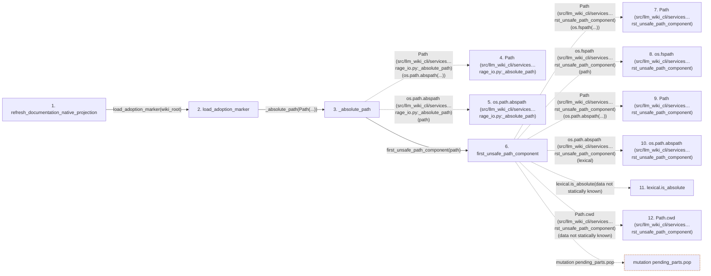

# refresh_documentation_native_projection

**Entry point:** `refresh_documentation_native_projection` (`api`)
**Source:** [documentation_native](../modules/documentation_native.md)
**Modules touched:** [analysis_capture](../modules/analysis_capture.md), [analysis_compatibility](../modules/analysis_compatibility.md), [api_contracts](../modules/api_contracts.md), and 63 more

**Complete modules touched:**

- [analysis_capture](../modules/analysis_capture.md)
- [analysis_compatibility](../modules/analysis_compatibility.md)
- [api_contracts](../modules/api_contracts.md)
- [bootstrap_runtime](../modules/bootstrap_runtime.md)
- [common](../modules/common.md)
- [concept_identity](../modules/concept_identity.md)
- [config](../modules/config.md)
- [context_service](../modules/context_service.md)
- [data_flow](../modules/data_flow.md)
- [documentation_native](../modules/documentation_native.md)
- [entrypoints](../modules/entrypoints.md)
- [extraction_jobs](../modules/extraction_jobs.md)
- [extraction_service](../modules/extraction_service.md)
- [filesystem_guard](../modules/filesystem_guard.md)
- [go_calls](../modules/go_calls.md)
- [immutable](../modules/immutable.md)
- [implementation_evidence](../modules/implementation_evidence.md)
- [imports](../modules/imports.md)
- [infrastructure_inventory](../modules/infrastructure_inventory.md)
- [infrastructure_sync](../modules/infrastructure_sync.md)
- [inventory_cache](../modules/inventory_cache.md)
- [io](../modules/io.md)
- [knowledge_artifacts](../modules/knowledge_artifacts.md)
- [knowledge_consumption](../modules/knowledge_consumption.md)
- [knowledge_envelope](../modules/knowledge_envelope.md)
- [knowledge_evidence](../modules/knowledge_evidence.md)
- [knowledge_freshness](../modules/knowledge_freshness.md)
- [knowledge_generation](../modules/knowledge_generation.md)
- [knowledge_governance](../modules/knowledge_governance.md)
- [knowledge_graph](../modules/knowledge_graph.md)
- [knowledge_index](../modules/knowledge_index.md)
- [knowledge_loader](../modules/knowledge_loader.md)
- [knowledge_model](../modules/knowledge_model.md)
- [knowledge_orchestration](../modules/knowledge_orchestration.md)
- [knowledge_packs](../modules/knowledge_packs.md)
- [knowledge_reuse](../modules/knowledge_reuse.md)
- [knowledge_storage](../modules/knowledge_storage.md)
- [knowledge_storage_io](../modules/knowledge_storage_io.md)
- [knowledge_verification](../modules/knowledge_verification.md)
- [maintenance_evidence](../modules/maintenance_evidence.md)
- [maintenance_projection](../modules/maintenance_projection.md)
- [maintenance_protocol](../modules/maintenance_protocol.md)
- [maintenance_shapes](../modules/maintenance_shapes.md)
- [maintenance_state](../modules/maintenance_state.md)
- [maintenance_status](../modules/maintenance_status.md)
- [manifest_storage](../modules/manifest_storage.md)
- [markdown_sections](../modules/markdown_sections.md)
- [packages](../modules/packages.md)
- [paths](../modules/paths.md)
- [plugins](../modules/plugins.md)
- [progress](../modules/progress.md)
- [python_calls](../modules/python_calls.md)
- [python_contracts](../modules/python_contracts.md)
- [python_implementation](../modules/python_implementation.md)
- [python_imports](../modules/python_imports.md)
- [python_observations](../modules/python_observations.md)
- [section_ownership](../modules/section_ownership.md)
- [source_selection](../modules/source_selection.md)
- [source_snapshot](../modules/source_snapshot.md)
- [sync_manifest](../modules/sync_manifest.md)
- [validation](../modules/validation.md)
- [verification_contracts](../modules/verification_contracts.md)
- [wiki_media](../modules/wiki_media.md)
- [wiki_surface](../modules/wiki_surface.md)
- [wiki_surface_index](../modules/wiki_surface_index.md)
- [wiki_write_basis](../modules/wiki_write_basis.md)

## Call sequence

> Static overview in presentation order, not runtime execution order. Arrows retain captured callers; siblings are shown before deeper helper detail.

```mermaid
sequenceDiagram
    participant p0 as refresh_documentation_native_projection
    participant p1 as load_adoption_marker
    participant p2 as maintenance_write_operation
    participant p3 as nullcontext
    participant p4 as _refresh_documentation_native_projection
    participant p5 as _absolute_path
    participant p6 as _validated_directory
    participant p7 as Path (src/llm_wiki_cli/services…l.py:load_adoption_marker)
    participant p8 as Path (src/llm_wiki_cli/services…intenance_write_operation)
    participant p9 as path.exists (src/llm_wiki_cli/services…l.py:load_adoption_marker)
    participant p10 as guard_maintenance_owner
    participant p11 as _refresh_manifest_version
    participant p12 as path.is_symlink (src/llm_wiki_cli/services…l.py:load_adoption_marker)
    participant p13 as SyncManifest.load
    participant p14 as read_guarded (src/llm_wiki_cli/services/knowledge_storage_io.py)
    participant p15 as DocumentationNativeError
    participant p16 as json.loads (src/llm_wiki_cli/services…l.py:load_adoption_marker)
    participant p17 as governance_writer_lock
    participant p18 as validate_maintenance_adoption
    participant p19 as storage_writer_lock
    participant p20 as canonical_bytes
    participant p21 as _validate_refresh_artifact_basis
    participant p22 as ValueError (src/llm_wiki_cli/services…l.py:load_adoption_marker)
    participant p23 as snapshot_wiki
    p0->>p1: load_adoption_marker
    p0->>p2: maintenance_write_operation
    p0-->>p3: nullcontext
    p0->>p4: _refresh_documentation_native_projection
    p1->>p5: _absolute_path
    p2->>p5: _absolute_path
    p4->>p6: _validated_directory
    p1-->>p7: Path (src/llm_wiki_cli/services…l.py:load_adoption_marker)(wiki_dir)
    p2-->>p8: Path (src/llm_wiki_cli/services…intenance_write_operation)(wiki_dir)
    p4->>p6: _validated_directory
    p1-->>p9: path.exists (src/llm_wiki_cli/services…l.py:load_adoption_marker)
    p2->>p10: guard_maintenance_owner
    p4->>p11: _refresh_manifest_version
    p1-->>p12: path.is_symlink (src/llm_wiki_cli/services…l.py:load_adoption_marker)
    p2->>p1: load_adoption_marker
    p4->>p13: SyncManifest.load
    p1->>p14: read_guarded (src/llm_wiki_cli/services/knowledge_storage_io.py)
    p2->>p10: guard_maintenance_owner
    p4->>p15: DocumentationNativeError
    p1-->>p16: json.loads (src/llm_wiki_cli/services…l.py:load_adoption_marker)(raw, object_pairs_hook=_pairs, parse_constant=_constant)
    p2->>p17: governance_writer_lock
    p4->>p10: guard_maintenance_owner
    p1->>p18: validate_maintenance_adoption
    p2->>p19: storage_writer_lock
    p4->>p15: DocumentationNativeError
    p1->>p20: canonical_bytes
    p2->>p10: guard_maintenance_owner
    p4->>p21: _validate_refresh_artifact_basis
    p1-->>p22: ValueError (src/llm_wiki_cli/services…l.py:load_adoption_marker)('adoption marker must retain canonical immutable bytes')
    p2->>p23: snapshot_wiki
```

<!-- Auto-generated from static call edges. Dashed arrows are external or unresolved calls. Reviewed runtime conditions and side effects belong in Behavior. -->

> Call sequence diagram shows 30 of 4499 interactions; 4469 omitted to keep the visualization within the 30-interaction and generated-diagram limits, with uncertain identities omitted rather than inferred.

> Captured boundary calls: external 5 of 1528 (1523 omitted); unresolved 2 of 1190 (1188 omitted). These counts cover the captured static trace.

Omitted captured detail, grouped by actual caller occurrence and target module:

| Caller | Parent step | Target module | Kind | Omitted interactions |
| --- | --- | --- | --- | --- |
| `src/llm_wiki_cli/services/knowledge_storage_io.py:_absolute_path` | 3 | - | external | 4 |
| `src/llm_wiki_cli/services/knowledge_storage_io.py:_absolute_path` | 3 | [src/llm_wiki_cli/services/io.py](../modules/io.md) | internal | 1 |
| `src/llm_wiki_cli/services/io.py:first_unsafe_path_component` | 6 | - | external | 20 |
| `src/llm_wiki_cli/services/io.py:first_unsafe_path_component` | 6 | - | unresolved | 5 |
| `src/llm_wiki_cli/services/knowledge_storage_io.py:_absolute_path` | 3 | [src/llm_wiki_cli/services/knowledge_storage.py](../modules/knowledge_storage.md) | internal | 1 |
| `src/llm_wiki_cli/services/knowledge_storage_io.py:_absolute_path` | 3 | - | unresolved | 3 |
| `src/llm_wiki_cli/services/knowledge_storage_io.py:read_guarded` | 41 | [src/llm_wiki_cli/services/knowledge_storage_io.py](../modules/knowledge_storage_io.md) | internal | 15 |
| `src/llm_wiki_cli/services/knowledge_storage_io.py:_validate_range` | 42 | - | external | 4 |
> Omission summary shows 8 of 1086 groups; 1078 further groups are not expanded here. Counts above include all omitted interactions.
> Detailed flow queries retain their own coverage and limits; omitted paths may execute at runtime.

> Trace truncated at the depth limit; deeper calls are omitted.

## Data flow

<!-- Auto-generated static analysis. Treat values and boundaries as best-effort hints, not runtime proof. -->

### Step data

| Step | Inputs | Reads | Writes | Returns |
|---|---|---|---|---|
| `refresh_documentation_native_projection` | `source_root: str \| Path`, `wiki_root: str \| Path`, `trust_source_plugins: bool`, `helper_cache_dir: str \| Path \| None`, `source_selection: str \| Path \| None`, `fault_injector: Callable[[CommitStage], None] \| None` | - | - | `_refresh_documentation_native_projection(...)` |
| `load_adoption_marker` | `wiki_dir: str \| Path` | `ADOPTION_FILENAME` | - | `None`, `marker` |
| `_absolute_path` | `path: Path` | - | - | `path` |
| `Path (src/llm_wiki_cli/services…rage_io.py:_absolute_path)` | - | - | - | - |
| `os.path.abspath (src/llm_wiki_cli/services…rage_io.py:_absolute_path)` | - | - | - | - |
| `first_unsafe_path_component` | `path: str \| Path`, `trusted_symlink_uids: Set[int] \| None`, `trusted_symlink_owner: Callable[[Path], bool] \| None` | `stat`, `os` | - | `lexical`, `None`, `current`, `current`, `current`, `current`, `current`, `None` |
| `Path (src/llm_wiki_cli/services…rst_unsafe_path_component)` | - | - | - | - |
| `os.fspath (src/llm_wiki_cli/services…rst_unsafe_path_component)` | - | - | - | - |
| `Path (src/llm_wiki_cli/services…rst_unsafe_path_component)` | - | - | - | - |
| `os.path.abspath (src/llm_wiki_cli/services…rst_unsafe_path_component)` | - | - | - | - |
| `lexical.is_absolute` | - | - | - | - |
| `Path.cwd (src/llm_wiki_cli/services…rst_unsafe_path_component)` | - | - | - | - |

### Call data

| From | To | Line | Call |
|---|---|---:|---|
| refresh_documentation_native_projection | load_adoption_marker | 315 | `load_adoption_marker(wiki_root)` |
| load_adoption_marker | _absolute_path | 85 | `_absolute_path(Path(...))` |
| _absolute_path | Path (src/llm_wiki_cli/services…rage_io.py:_absolute_path) | 49 | `Path(os.path.abspath(...))` |
| _absolute_path | os.path.abspath (src/llm_wiki_cli/services…rage_io.py:_absolute_path) | 49 | `os.path.abspath(path)` |
| _absolute_path | first_unsafe_path_component | 50 | `first_unsafe_path_component(path)` |
| first_unsafe_path_component | Path (src/llm_wiki_cli/services…rst_unsafe_path_component) | 51 | `Path(os.fspath(...))` |
| first_unsafe_path_component | os.fspath (src/llm_wiki_cli/services…rst_unsafe_path_component) | 51 | `os.fspath(path)` |
| first_unsafe_path_component | Path (src/llm_wiki_cli/services…rst_unsafe_path_component) | 59 | `Path(os.path.abspath(...))` |
| first_unsafe_path_component | os.path.abspath (src/llm_wiki_cli/services…rst_unsafe_path_component) | 59 | `os.path.abspath(lexical)` |
| first_unsafe_path_component | lexical.is_absolute | 60 | `lexical.is_absolute(data not statically known)` |
| first_unsafe_path_component | Path.cwd (src/llm_wiki_cli/services…rst_unsafe_path_component) | 66 | `Path.cwd(data not statically known)` |

### Boundary effects

| Kind | Target | Step | Line |
|---|---|---|---:|
| mutation | `pending_parts.pop` | `first_unsafe_path_component` | 71 |

### Static analysis gaps

| Kind | Step | Target | Line |
|---|---|---|---:|
| external_call | `_absolute_path` | `os.path.abspath` | 49 |
| external_call | `first_unsafe_path_component` | `os.fspath` | 51 |
| external_call | `first_unsafe_path_component` | `os.path.abspath` | 59 |
| unresolved_call | `first_unsafe_path_component` | `lexical.is_absolute` | 60 |
| external_call | `first_unsafe_path_component` | `Path.cwd` | 66 |
| step_limit | `refresh_documentation_native_projection` | `first 12 steps` | 0 |
| truncated_flow | `refresh_documentation_native_projection` | `depth limit` | 0 |

## Behavior

This flow starts at `refresh_documentation_native_projection` and is classified as `api`. The generated call and data-flow sections are bounded static projections; runtime conditions and side effects require source-level confirmation.
