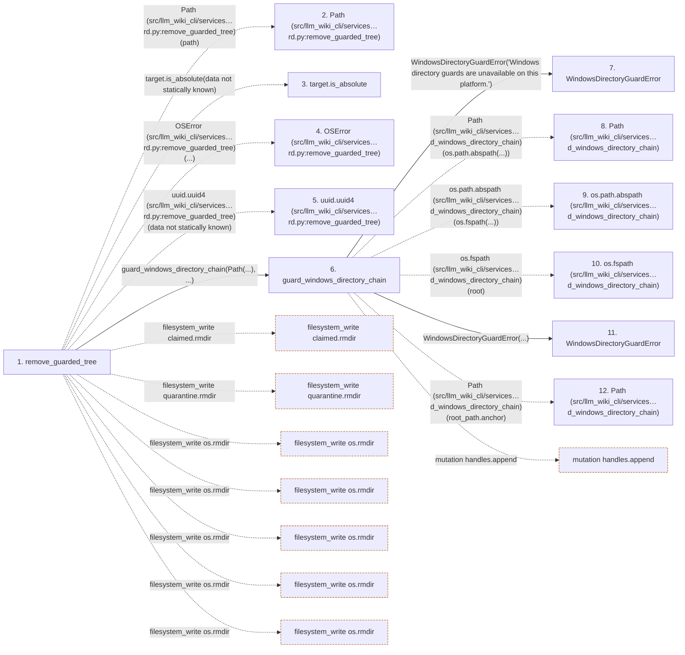

# remove_guarded_tree

**Entry point:** `remove_guarded_tree` (`api`)
**Source:** [filesystem_guard](../modules/filesystem_guard.md)
**Modules touched:** [filesystem_guard](../modules/filesystem_guard.md)

## Call sequence

> Static overview in presentation order, not runtime execution order. Arrows retain captured callers; representative internal continuations and boundary examples precede repeated helper detail.

```mermaid
sequenceDiagram
    participant p0 as remove_guarded_tree
    participant p1 as guard_windows_directory_chain
    participant p2 as windows_object_identity
    participant p3 as _guarded_tree_manifest_windows_path
    participant p4 as _guarded_tree_manifest_posix_fd
    participant p5 as create_private_windows_directory
    participant p6 as move_windows_path_write_through
    participant p7 as WindowsDirectoryGuardError
    participant p8 as windows_object_identity_from_values
    participant p9 as _open_windows_directory_guard
    participant p10 as _guarded_tree_entry_windows_path
    participant p11 as _private_windows_security_attributes
    participant p12 as open_windows_readonly_file
    participant p13 as _verify_windows_handle_restrictive_dacl
    participant p14 as _open_windows_readonly_file_handle
    participant p15 as _current_windows_user_sid
    participant p16 as _windows_sid_string
    participant p17 as _read_posix_descriptor
    participant p18 as _close_windows_handle
    participant p19 as WindowsIdentityUnavailableError
    participant p20 as WindowsObjectIdentity
    participant p21 as _windows_api_path
    participant p22 as _WindowsDirectoryGuardUnavailableError
    participant p23 as WindowsFileGuardError
    participant p24 as WindowsDurabilityError
    participant p25 as WindowsSecurityGuardError
    participant p26 as Path (src/llm_wiki_cli/services…rd.py:remove_guarded_tree)
    participant p27 as target.is_absolute
    participant p28 as OSError (src/llm_wiki_cli/services…rd.py:remove_guarded_tree)
    participant p29 as uuid.uuid4 (src/llm_wiki_cli/services…rd.py:remove_guarded_tree)
    p0->>p1: guard_windows_directory_chain
    p0->>p2: windows_object_identity
    p0->>p3: _guarded_tree_manifest_windows_path
    p0->>p4: _guarded_tree_manifest_posix_fd
    p0->>p5: create_private_windows_directory
    p0->>p6: move_windows_path_write_through
    p0->>p7: WindowsDirectoryGuardError
    p2->>p8: windows_object_identity_from_values
    p1->>p9: _open_windows_directory_guard
    p3->>p10: _guarded_tree_entry_windows_path
    p5->>p11: _private_windows_security_attributes
    p10->>p12: open_windows_readonly_file
    p9->>p13: _verify_windows_handle_restrictive_dacl
    p12->>p14: _open_windows_readonly_file_handle
    p13->>p15: _current_windows_user_sid
    p15->>p16: _windows_sid_string
    p4->>p17: _read_posix_descriptor
    p1->>p18: _close_windows_handle
    p8->>p19: WindowsIdentityUnavailableError
    p8->>p20: WindowsObjectIdentity
    p9->>p21: _windows_api_path
    p9->>p22: _WindowsDirectoryGuardUnavailableError
    p10->>p23: WindowsFileGuardError
    p6->>p24: WindowsDurabilityError
    p11->>p25: WindowsSecurityGuardError
    p0-->>p26: Path (src/llm_wiki_cli/services…rd.py:remove_guarded_tree)(path)
    p0-->>p27: target.is_absolute
    p0-->>p28: OSError (src/llm_wiki_cli/services…rd.py:remove_guarded_tree)(...)
    p0-->>p29: uuid.uuid4 (src/llm_wiki_cli/services…rd.py:remove_guarded_tree)
    p0-->>p26: Path (src/llm_wiki_cli/services…rd.py:remove_guarded_tree)(target.parent.anchor)
```

<!-- Auto-generated from static call edges. Dashed arrows are external or unresolved calls. Reviewed runtime conditions and side effects belong in Behavior. -->

> Call sequence diagram shows 30 of 385 interactions; 355 omitted to keep the visualization within the 30-interaction and generated-diagram limits, with uncertain identities omitted rather than inferred.

> Captured boundary calls: external 4 of 236 (232 omitted); unresolved 1 of 53 (52 omitted). These counts cover the captured static trace.

Omitted captured detail, grouped by actual caller occurrence and target module:

| Caller | Parent step | Target module | Kind | Omitted interactions |
| --- | --- | --- | --- | --- |
| `src/llm_wiki_cli/services/filesystem_guard.py:guard_windows_directory_chain` | 6 | [src/llm_wiki_cli/services/filesystem_guard.py](../modules/filesystem_guard.md) | internal | 7 |
| `src/llm_wiki_cli/services/filesystem_guard.py:guard_windows_directory_chain` | 6 | - | external | 9 |
| `src/llm_wiki_cli/services/filesystem_guard.py:guard_windows_directory_chain` | 6 | - | unresolved | 4 |
| `src/llm_wiki_cli/services/filesystem_guard.py:_open_windows_directory_guard` | 14 | - | external | 14 |
| `src/llm_wiki_cli/services/filesystem_guard.py:_open_windows_directory_guard` | 14 | - | unresolved | 3 |
| `src/llm_wiki_cli/services/filesystem_guard.py:_windows_api_path` | 17 | - | external | 2 |
| `src/llm_wiki_cli/services/filesystem_guard.py:_windows_api_path` | 17 | - | unresolved | 2 |
| `src/llm_wiki_cli/services/filesystem_guard.py:_open_windows_directory_guard` | 14 | [src/llm_wiki_cli/services/filesystem_guard.py](../modules/filesystem_guard.md) | internal | 6 |
> Omission summary shows 8 of 49 groups; 41 further groups are not expanded here. Counts above include all omitted interactions.
> Detailed flow queries retain their own coverage and limits; omitted paths may execute at runtime.

## Data flow

<!-- Auto-generated static analysis. Treat values and boundaries as best-effort hints, not runtime proof. -->

### Analysis coverage

**Effect analysis partially available.** Flow assembly and source effect analysis are separate; empty observations do not prove an empty handler body.

Source steps: 97; effect analysis evaluated: 43, partial: 7, unavailable: 47. Counts include steps omitted from the displayed trace.

Collector observations for 50 source steps with known totals: observed: 355, emitted: 346, omitted: 9. Unavailable totals are excluded.

- Callable record unavailable; the selected entry symbol has no represented callable body.
- Effect collector omitted observations before flow assembly; displayed effects are partial.
- Effect collector totals unavailable; observed counts cover captured records only.

| Step | Callable record | Effect analysis | Collector totals | Observed | Emitted | Omitted |
|---|---|---|---|---:|---:|---:|
| `remove_guarded_tree` | `available` | `evaluated` | `available` | `15` | `15` | `0` |
| `Path (src/llm_wiki_cli/services…rd.py:remove_guarded_tree)` | `not_applicable` | `not_applicable` | `not_applicable` | — | — | — |
| `target.is_absolute` | `not_applicable` | `not_applicable` | `not_applicable` | — | — | — |
| `OSError (src/llm_wiki_cli/services…rd.py:remove_guarded_tree)` | `not_applicable` | `not_applicable` | `not_applicable` | — | — | — |
| `uuid.uuid4 (src/llm_wiki_cli/services…rd.py:remove_guarded_tree)` | `not_applicable` | `not_applicable` | `not_applicable` | — | — | — |
| `guard_windows_directory_chain` | `available` | `evaluated` | `available` | `9` | `9` | `0` |
| `WindowsDirectoryGuardError` | `unavailable` | `unavailable` | `unavailable` | — | — | — |
| `Path (src/llm_wiki_cli/services…d_windows_directory_chain)` | `not_applicable` | `not_applicable` | `not_applicable` | — | — | — |
| `os.path.abspath (src/llm_wiki_cli/services…d_windows_directory_chain)` | `not_applicable` | `not_applicable` | `not_applicable` | — | — | — |
| `os.fspath (src/llm_wiki_cli/services…d_windows_directory_chain)` | `not_applicable` | `not_applicable` | `not_applicable` | — | — | — |
| `WindowsDirectoryGuardError` | `unavailable` | `unavailable` | `unavailable` | — | — | — |
| `Path (src/llm_wiki_cli/services…d_windows_directory_chain)` | `not_applicable` | `not_applicable` | `not_applicable` | — | — | — |

### Step data

| Step | Inputs | Reads | Writes | Returns |
|---|---|---|---|---|
| `remove_guarded_tree` | `path: Path`, `expected_identity: tuple[int, int] \| None`, `expected_manifest: GuardedTreeManifest \| None` | `os`, `os`, `os`, `os` | - | `none` |
| `Path (src/llm_wiki_cli/services…rd.py:remove_guarded_tree)` | - | - | - | - |
| `target.is_absolute` | - | - | - | - |
| `OSError (src/llm_wiki_cli/services…rd.py:remove_guarded_tree)` | - | - | - | - |
| `uuid.uuid4 (src/llm_wiki_cli/services…rd.py:remove_guarded_tree)` | - | - | - | - |
| `guard_windows_directory_chain` | `root: Path`, `relative_components: Sequence[str]`, `create_missing: bool`, `require_restrictive_dacl: bool` | `os`, `WindowsDurabilityError` | - | - |
| `WindowsDirectoryGuardError` | - | - | - | - |
| `Path (src/llm_wiki_cli/services…d_windows_directory_chain)` | - | - | - | - |
| `os.path.abspath (src/llm_wiki_cli/services…d_windows_directory_chain)` | - | - | - | - |
| `os.fspath (src/llm_wiki_cli/services…d_windows_directory_chain)` | - | - | - | - |
| `WindowsDirectoryGuardError` | - | - | - | - |
| `Path (src/llm_wiki_cli/services…d_windows_directory_chain)` | - | - | - | - |

### Call data

| From | To | Line | Call |
|---|---|---:|---|
| remove_guarded_tree | Path (src/llm_wiki_cli/services…rd.py:remove_guarded_tree) | 1804 | `Path(path)` |
| remove_guarded_tree | target.is_absolute | 1805 | `target.is_absolute(data not statically known)` |
| remove_guarded_tree | OSError (src/llm_wiki_cli/services…rd.py:remove_guarded_tree) | 1806 | `OSError(...)` |
| remove_guarded_tree | uuid.uuid4 (src/llm_wiki_cli/services…rd.py:remove_guarded_tree) | 1808 | `uuid.uuid4(data not statically known)` |
| remove_guarded_tree | guard_windows_directory_chain | 1925 | `guard_windows_directory_chain(Path(...), ...)` |
| guard_windows_directory_chain | WindowsDirectoryGuardError | 170 | `WindowsDirectoryGuardError('Windows directory guards are unavailable on this platform.')` |
| guard_windows_directory_chain | Path (src/llm_wiki_cli/services…d_windows_directory_chain) | 174 | `Path(os.path.abspath(...))` |
| guard_windows_directory_chain | os.path.abspath (src/llm_wiki_cli/services…d_windows_directory_chain) | 174 | `os.path.abspath(os.fspath(...))` |
| guard_windows_directory_chain | os.fspath (src/llm_wiki_cli/services…d_windows_directory_chain) | 174 | `os.fspath(root)` |
| guard_windows_directory_chain | WindowsDirectoryGuardError | 176 | `WindowsDirectoryGuardError(...)` |
| guard_windows_directory_chain | Path (src/llm_wiki_cli/services…d_windows_directory_chain) | 179 | `Path(root_path.anchor)` |

### Boundary effects

| Kind | Target | Step | Line |
|---|---|---|---:|
| filesystem_write | `claimed.rmdir` | `remove_guarded_tree` | 1977 |
| filesystem_write | `quarantine.rmdir` | `remove_guarded_tree` | 1990 |
| filesystem_write | `os.rmdir` | `remove_guarded_tree` | 2194 |
| filesystem_write | `os.rmdir` | `remove_guarded_tree` | 2200 |
| filesystem_write | `os.rmdir` | `remove_guarded_tree` | 2219 |
| filesystem_write | `os.rmdir` | `remove_guarded_tree` | 2229 |
| filesystem_write | `os.rmdir` | `remove_guarded_tree` | 2241 |
| mutation | `handles.append` | `guard_windows_directory_chain` | 182 |

### Static analysis gaps

| Kind | Step | Target | Line |
|---|---|---|---:|
| unresolved_call | `remove_guarded_tree` | `target.is_absolute` | 1805 |
| external_call | `remove_guarded_tree` | `OSError` | 1806 |
| external_call | `remove_guarded_tree` | `uuid.uuid4` | 1808 |
| external_call | `guard_windows_directory_chain` | `os.path.abspath` | 174 |
| external_call | `guard_windows_directory_chain` | `os.fspath` | 174 |
| step_limit | `remove_guarded_tree` | `first 12 steps` | 0 |

## Behavior

This flow starts at `remove_guarded_tree` and is classified as `api`. The generated call and data-flow sections are bounded static projections; runtime conditions and side effects require source-level confirmation.
