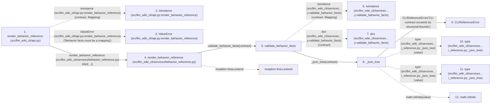

# render_behavior_reference

**Entry point:** `render_behavior_reference` (`api`)
**Source:** [api](../modules/api.md)
**Modules touched:** [api](../modules/api.md), [behavior_reference](../modules/behavior_reference.md), [cli_reference](../modules/cli_reference.md), [knowledge_evidence](../modules/knowledge_evidence.md), and 1 more

**Complete modules touched:**

- [api](../modules/api.md)
- [behavior_reference](../modules/behavior_reference.md)
- [cli_reference](../modules/cli_reference.md)
- [knowledge_evidence](../modules/knowledge_evidence.md)
- [validation](../modules/validation.md)

## Call sequence

> Static overview in presentation order, not runtime execution order. Arrows retain captured callers; representative internal continuations and boundary examples precede repeated helper detail.

```mermaid
sequenceDiagram
    participant p0 as render_behavior_reference (src/llm_wiki_cli/api.py)
    participant p1 as render_behavior_reference (src/llm_wiki_cli/services/behavior_reference.py)
    participant p2 as validate_behavior_facts
    participant p3 as _rows
    participant p4 as _json_tree
    participant p5 as _validate_schema
    participant p6 as _validate_paths
    participant p7 as hash_json
    participant p8 as require_portable_relative_path
    participant p9 as canonical_json_bytes
    participant p10 as _default_path_error
    participant p11 as _check_path_collision
    participant p12 as require_portable_path_component
    participant p13 as _code
    participant p14 as _prose
    participant p15 as _schema
    participant p16 as CLIReferenceError
    participant p17 as sha256_bytes
    participant p18 as _matches_type
    participant p19 as canonical_json_text
    participant p20 as _syntax_key
    participant p21 as _known_syntax
    participant p22 as _remember_syntax
    participant p23 as SharedValidationError
    participant p24 as portable_path_key
    participant p25 as isinstance (src/llm_wiki_cli/api.py:render_behavior_reference)
    participant p26 as key.replace(…).capitalize
    participant p27 as ValueError (src/llm_wiki_cli/api.py:render_behavior_reference)
    participant p28 as dict (src/llm_wiki_cli/api.py:render_behavior_reference)
    participant p29 as isinstance (src/llm_wiki_cli/services…render_behavior_reference)
    participant p30 as key.replace
    p0->>p1: render_behavior_reference (src/llm_wiki_cli/services/behavior_reference.py)
    p1->>p2: validate_behavior_facts
    p1->>p3: _rows
    p2->>p4: _json_tree
    p2->>p5: _validate_schema
    p2->>p6: _validate_paths
    p2->>p7: hash_json
    p6->>p8: require_portable_relative_path
    p7->>p9: canonical_json_bytes
    p8->>p10: _default_path_error
    p8->>p11: _check_path_collision
    p8->>p12: require_portable_path_component
    p1->>p13: _code
    p1->>p14: _prose
    p2->>p15: _schema
    p4->>p16: CLIReferenceError
    p7->>p17: sha256_bytes
    p5->>p18: _matches_type
    p9->>p19: canonical_json_text
    p8->>p20: _syntax_key
    p8->>p21: _known_syntax
    p8->>p22: _remember_syntax
    p10->>p23: SharedValidationError
    p11->>p24: portable_path_key
    p0-->>p25: isinstance (src/llm_wiki_cli/api.py:render_behavior_reference)(contract, Mapping)
    p1-->>p26: key.replace(…).capitalize
    p0-->>p27: ValueError (src/llm_wiki_cli/api.py:render_behavior_reference)('Behavior facts must be a mapping')
    p0-->>p28: dict (src/llm_wiki_cli/api.py:render_behavior_reference)(contract)
    p1-->>p29: isinstance (src/llm_wiki_cli/services…render_behavior_reference)(contract, Mapping)
    p1-->>p30: key.replace('_', ' ')
```

<!-- Auto-generated from static call edges. Dashed arrows are external or unresolved calls. Reviewed runtime conditions and side effects belong in Behavior. -->

> Call sequence diagram shows 30 of 191 interactions; 161 omitted to keep the visualization within the 30-interaction and generated-diagram limits, with uncertain identities omitted rather than inferred.

> Captured boundary calls: external 4 of 78 (74 omitted); unresolved 2 of 51 (49 omitted). These counts cover the captured static trace.

Omitted captured detail, grouped by actual caller occurrence and target module:

| Caller | Parent step | Target module | Kind | Omitted interactions |
| --- | --- | --- | --- | --- |
| `src/llm_wiki_cli/services/behavior_reference.py:validate_behavior_facts` | 5 | - | external | 13 |
| `src/llm_wiki_cli/services/cli_reference.py:_json_tree` | 8 | - | external | 7 |
| `src/llm_wiki_cli/services/cli_reference.py:_json_tree` | 8 | [src/llm_wiki_cli/services/cli_reference.py](../modules/cli_reference.md) | internal | 3 |
| `src/llm_wiki_cli/services/cli_reference.py:_json_tree` | 8 | - | unresolved | 1 |
| `src/llm_wiki_cli/services/behavior_reference.py:validate_behavior_facts` | 5 | - | unresolved | 2 |
| `src/llm_wiki_cli/services/behavior_reference.py:_schema` | 25 | - | external | 2 |
| `src/llm_wiki_cli/services/behavior_reference.py:_schema` | 25 | - | unresolved | 2 |
| `src/llm_wiki_cli/services/cli_reference.py:_validate_schema` | 30 | [src/llm_wiki_cli/services/cli_reference.py](../modules/cli_reference.md) | internal | 12 |
> Omission summary shows 8 of 39 groups; 31 further groups are not expanded here. Counts above include all omitted interactions.
> Detailed flow queries retain their own coverage and limits; omitted paths may execute at runtime.

> Trace truncated at the depth limit; deeper calls are omitted.

## Data flow

<!-- Auto-generated static analysis. Treat values and boundaries as best-effort hints, not runtime proof. -->

### Analysis coverage

**Effect analysis partially available.** Flow assembly and source effect analysis are separate; empty observations do not prove an empty handler body.

Source steps: 63; effect analysis evaluated: 44, partial: 2, unavailable: 17. Counts include steps omitted from the displayed trace.

Collector observations for 46 source steps with known totals: observed: 191, emitted: 180, omitted: 11. Unavailable totals are excluded.

- Callable record unavailable for one or more source steps; those steps have no represented callable body.
- Effect collector omitted observations before flow assembly; displayed effects are partial.
- Effect collector totals unavailable; observed counts cover captured records only.

| Step | Callable record | Effect analysis | Collector totals | Observed | Emitted | Omitted |
|---|---|---|---|---:|---:|---:|
| `render_behavior_reference (src/llm_wiki_cli/api.py)` | `available` | `evaluated` | `available` | `3` | `3` | `0` |
| `isinstance (src/llm_wiki_cli/api.py:render_behavior_reference)` | `not_applicable` | `not_applicable` | `not_applicable` | — | — | — |
| `ValueError (src/llm_wiki_cli/api.py:render_behavior_reference)` | `not_applicable` | `not_applicable` | `not_applicable` | — | — | — |
| `render_behavior_reference (src/llm_wiki_cli/services/behavior_reference.py)` | `available` | `evaluated` | `available` | `4` | `4` | `0` |
| `validate_behavior_facts` | `available` | `evaluated` | `available` | `4` | `4` | `0` |
| `isinstance (src/llm_wiki_cli/services…y:validate_behavior_facts)` | `not_applicable` | `not_applicable` | `not_applicable` | — | — | — |
| `dict (src/llm_wiki_cli/services…y:validate_behavior_facts)` | `not_applicable` | `not_applicable` | `not_applicable` | — | — | — |
| `_json_tree` | `available` | `evaluated` | `available` | `10` | `10` | `0` |
| `CLIReferenceError` | `unavailable` | `unavailable` | `unavailable` | — | — | — |
| `type (src/llm_wiki_cli/services…i_reference.py:_json_tree)` | `not_applicable` | `not_applicable` | `not_applicable` | — | — | — |
| `type (src/llm_wiki_cli/services…i_reference.py:_json_tree)` | `not_applicable` | `not_applicable` | `not_applicable` | — | — | — |
| `math.isfinite` | `not_applicable` | `not_applicable` | `not_applicable` | — | — | — |

### Step data

| Step | Inputs | Reads | Writes | Returns |
|---|---|---|---|---|
| `render_behavior_reference (src/llm_wiki_cli/api.py)` | `contract: Mapping[str, Any]` | `Mapping` | - | `render(...)` |
| `isinstance (src/llm_wiki_cli/api.py:render_behavior_reference)` | - | - | - | - |
| `ValueError (src/llm_wiki_cli/api.py:render_behavior_reference)` | - | - | - | - |
| `render_behavior_reference (src/llm_wiki_cli/services/behavior_reference.py)` | `contract: object` | `Mapping` | - | `...` |
| `validate_behavior_facts` | `contract: object` | `Mapping`, `MAX_BEHAVIOR_FACTS_BYTES`, `skills` | - | - |
| `isinstance (src/llm_wiki_cli/services…y:validate_behavior_facts)` | - | - | - | - |
| `dict (src/llm_wiki_cli/services…y:validate_behavior_facts)` | - | - | - | - |
| `_json_tree` | `value: object`, `depth: int`, `budget` | `_MAX_NODES`, `_MAX_DEPTH` | `budget[...]` | `none`, `none`, `none`, `none` |
| `CLIReferenceError` | - | - | - | - |
| `type (src/llm_wiki_cli/services…i_reference.py:_json_tree)` | - | - | - | - |
| `type (src/llm_wiki_cli/services…i_reference.py:_json_tree)` | - | - | - | - |
| `math.isfinite` | - | - | - | - |

### Call data

| From | To | Line | Call |
|---|---|---:|---|
| render_behavior_reference (src/llm_wiki_cli/api.py) | isinstance (src/llm_wiki_cli/api.py:render_behavior_reference) | 3611 | `isinstance(contract, Mapping)` |
| render_behavior_reference (src/llm_wiki_cli/api.py) | ValueError (src/llm_wiki_cli/api.py:render_behavior_reference) | 3612 | `ValueError('Behavior facts must be a mapping')` |
| render_behavior_reference (src/llm_wiki_cli/api.py) | render_behavior_reference (src/llm_wiki_cli/services/behavior_reference.py) | 3613 | `render(dict(...))` |
| render_behavior_reference (src/llm_wiki_cli/services/behavior_reference.py) | validate_behavior_facts | 230 | `validate_behavior_facts(contract)` |
| validate_behavior_facts | isinstance (src/llm_wiki_cli/services…y:validate_behavior_facts) | 150 | `isinstance(contract, Mapping)` |
| validate_behavior_facts | dict (src/llm_wiki_cli/services…y:validate_behavior_facts) | 151 | `dict(contract)` |
| validate_behavior_facts | _json_tree | 152 | `cli_reference._json_tree(contract)` |
| _json_tree | CLIReferenceError | 291 | `CLIReferenceError('CLI contract exceeds its structural bounds')` |
| _json_tree | type (src/llm_wiki_cli/services…i_reference.py:_json_tree) | 292 | `type(value)` |
| _json_tree | type (src/llm_wiki_cli/services…i_reference.py:_json_tree) | 294 | `type(value)` |
| _json_tree | math.isfinite | 294 | `math.isfinite(value)` |

### Boundary effects

| Kind | Target | Step | Line |
|---|---|---|---:|
| mutation | `lines.extend` | `render_behavior_reference` | 359 |

### Static analysis gaps

| Kind | Step | Target | Line |
|---|---|---|---:|
| external_call | `render_behavior_reference` | `isinstance` | 3611 |
| external_call | `render_behavior_reference` | `ValueError` | 3612 |
| external_call | `validate_behavior_facts` | `isinstance` | 150 |
| external_call | `_json_tree` | `type` | 292 |
| external_call | `_json_tree` | `type` | 294 |
| external_call | `_json_tree` | `math.isfinite` | 294 |
| step_limit | `render_behavior_reference` | `first 12 steps` | 0 |
| truncated_flow | `render_behavior_reference` | `depth limit` | 0 |

## Behavior

This flow starts at `render_behavior_reference` and is classified as `api`. The generated call and data-flow sections are bounded static projections; runtime conditions and side effects require source-level confirmation.
