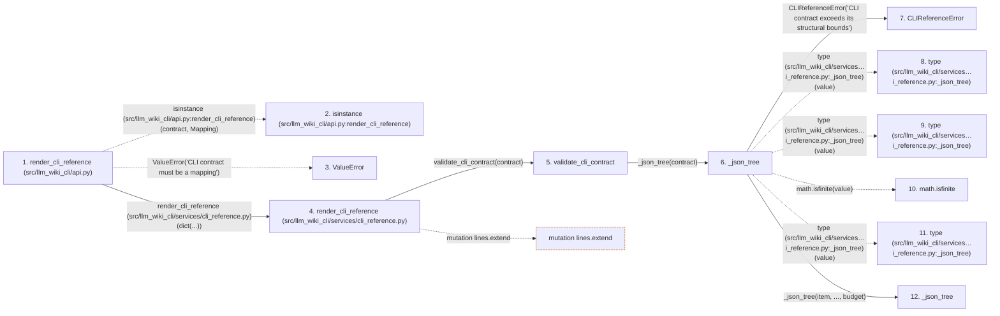

# render_cli_reference

**Entry point:** `render_cli_reference` (`api`)
**Source:** [api](../modules/api.md)
**Modules touched:** [api](../modules/api.md), [cli_reference](../modules/cli_reference.md), [knowledge_evidence](../modules/knowledge_evidence.md)

## Call sequence

> Static overview in presentation order, not runtime execution order. Arrows retain captured callers; representative internal continuations and boundary examples precede repeated helper detail.

```mermaid
sequenceDiagram
    participant p0 as render_cli_reference (src/llm_wiki_cli/api.py)
    participant p1 as render_cli_reference (src/llm_wiki_cli/services/cli_reference.py)
    participant p2 as validate_cli_contract
    participant p3 as _json_tree
    participant p4 as _validate_schema
    participant p5 as _validate_command
    participant p6 as hash_json
    participant p7 as canonical_json_bytes
    participant p8 as _prose
    participant p9 as _code
    participant p10 as CLIReferenceError
    participant p11 as _schema
    participant p12 as sha256_bytes
    participant p13 as _matches_type
    participant p14 as canonical_json_text
    participant p15 as isinstance (src/llm_wiki_cli/api.py:render_cli_reference)
    participant p16 as lines.extend
    participant p17 as ValueError
    participant p18 as dict
    participant p19 as isinstance (src/llm_wiki_cli/services…e.py:render_cli_reference)
    participant p20 as render
    participant p21 as (…).join(…).rstrip
    participant p22 as '\n'.join
    participant p23 as html.escape
    participant p24 as str(…).replace(…).replace
    participant p25 as json.dumps(…).encode
    participant p26 as re.sub(…).replace
    participant p27 as str(…).replace
    participant p28 as json.dumps (src/llm_wiki_cli/services….py:validate_cli_contract)
    participant p29 as re.sub
    participant p30 as str
    p0->>p1: render_cli_reference (src/llm_wiki_cli/services/cli_reference.py)
    p1->>p2: validate_cli_contract
    p2->>p3: _json_tree
    p2->>p4: _validate_schema
    p2->>p5: _validate_command
    p2->>p6: hash_json
    p6->>p7: canonical_json_bytes
    p1->>p8: _prose
    p1->>p9: _code
    p2->>p10: CLIReferenceError
    p2->>p11: _schema
    p6->>p12: sha256_bytes
    p4->>p13: _matches_type
    p7->>p14: canonical_json_text
    p0-->>p15: isinstance (src/llm_wiki_cli/api.py:render_cli_reference)(contract, Mapping)
    p1-->>p16: lines.extend([...])
    p0-->>p17: ValueError('CLI contract must be a mapping')
    p0-->>p18: dict(contract)
    p1-->>p19: isinstance (src/llm_wiki_cli/services…e.py:render_cli_reference)(contract, dict)
    p1-->>p20: render(contract[...])
    p1-->>p21: (…).join(…).rstrip
    p1-->>p22: '\n'.join(lines)
    p8-->>p23: html.escape(value, quote=False)
    p9-->>p24: str(…).replace(…).replace('\n', '\\n')
    p2-->>p25: json.dumps(…).encode('utf-8')
    p8-->>p26: re.sub(…).replace('\n', '<br>')
    p9-->>p27: str(…).replace('\r', '\\r')
    p2-->>p28: json.dumps (src/llm_wiki_cli/services….py:validate_cli_contract)(contract, ensure_ascii=False, allow_nan=False)
    p8-->>p29: re.sub('([\\\\`*_{}\\[\\] |!])', '\\\\\\1', value)
    p9-->>p30: str(value)
```

<!-- Auto-generated from static call edges. Dashed arrows are external or unresolved calls. Reviewed runtime conditions and side effects belong in Behavior. -->

> Call sequence diagram shows 30 of 143 interactions; 113 omitted to keep the visualization within the 30-interaction and generated-diagram limits, with uncertain identities omitted rather than inferred.

> Captured boundary calls: external 8 of 62 (54 omitted); unresolved 8 of 33 (25 omitted). These counts cover the captured static trace.

Omitted captured detail, grouped by actual caller occurrence and target module:

| Caller | Parent step | Target module | Kind | Omitted interactions |
| --- | --- | --- | --- | --- |
| `src/llm_wiki_cli/services/cli_reference.py:_json_tree` | 6 | [src/llm_wiki_cli/services/cli_reference.py](../modules/cli_reference.md) | internal | 4 |
| `src/llm_wiki_cli/services/cli_reference.py:_json_tree` | 6 | - | external | 7 |
| `src/llm_wiki_cli/services/cli_reference.py:_json_tree` | 6 | - | unresolved | 1 |
| `src/llm_wiki_cli/services/cli_reference.py:validate_cli_contract` | 5 | - | external | 2 |
| `src/llm_wiki_cli/services/cli_reference.py:_schema` | 23 | - | external | 2 |
| `src/llm_wiki_cli/services/cli_reference.py:_schema` | 23 | - | unresolved | 2 |
| `src/llm_wiki_cli/services/cli_reference.py:_validate_schema` | 28 | [src/llm_wiki_cli/services/cli_reference.py](../modules/cli_reference.md) | internal | 12 |
| `src/llm_wiki_cli/services/cli_reference.py:_validate_schema` | 28 | - | unresolved | 11 |
> Omission summary shows 8 of 22 groups; 14 further groups are not expanded here. Counts above include all omitted interactions.
> Detailed flow queries retain their own coverage and limits; omitted paths may execute at runtime.

## Data flow

<!-- Auto-generated static analysis. Treat values and boundaries as best-effort hints, not runtime proof. -->

### Analysis coverage

**Effect analysis partially available.** Flow assembly and source effect analysis are separate; empty observations do not prove an empty handler body.

Source steps: 49; effect analysis evaluated: 22, partial: 0, unavailable: 27. Counts include steps omitted from the displayed trace.

Collector observations for 22 source steps with known totals: observed: 102, emitted: 102, omitted: 0. Unavailable totals are excluded.

- Callable record unavailable for one or more source steps; those steps have no represented callable body.
- Effect collector totals unavailable; observed counts cover captured records only.

| Step | Callable record | Effect analysis | Collector totals | Observed | Emitted | Omitted |
|---|---|---|---|---:|---:|---:|
| `render_cli_reference (src/llm_wiki_cli/api.py)` | `available` | `evaluated` | `available` | `3` | `3` | `0` |
| `isinstance (src/llm_wiki_cli/api.py:render_cli_reference)` | `not_applicable` | `not_applicable` | `not_applicable` | — | — | — |
| `ValueError` | `not_applicable` | `not_applicable` | `not_applicable` | — | — | — |
| `render_cli_reference (src/llm_wiki_cli/services/cli_reference.py)` | `available` | `evaluated` | `available` | `3` | `3` | `0` |
| `validate_cli_contract` | `available` | `evaluated` | `available` | `3` | `3` | `0` |
| `_json_tree` | `available` | `evaluated` | `available` | `10` | `10` | `0` |
| `CLIReferenceError` | `unavailable` | `unavailable` | `unavailable` | — | — | — |
| `type (src/llm_wiki_cli/services…i_reference.py:_json_tree)` | `not_applicable` | `not_applicable` | `not_applicable` | — | — | — |
| `type (src/llm_wiki_cli/services…i_reference.py:_json_tree)` | `not_applicable` | `not_applicable` | `not_applicable` | — | — | — |
| `math.isfinite` | `not_applicable` | `not_applicable` | `not_applicable` | — | — | — |
| `type (src/llm_wiki_cli/services…i_reference.py:_json_tree)` | `not_applicable` | `not_applicable` | `not_applicable` | — | — | — |
| `_json_tree` | `available` | `evaluated` | `available` | `10` | `10` | `0` |

### Step data

| Step | Inputs | Reads | Writes | Returns |
|---|---|---|---|---|
| `render_cli_reference (src/llm_wiki_cli/api.py)` | `contract: Mapping[str, Any]` | `Mapping` | - | `render(...)` |
| `isinstance (src/llm_wiki_cli/api.py:render_cli_reference)` | - | - | - | - |
| `ValueError` | - | - | - | - |
| `render_cli_reference (src/llm_wiki_cli/services/cli_reference.py)` | `contract: object` | - | - | `...` |
| `validate_cli_contract` | `contract: object` | `_MAX_BYTES`, `CLIReferenceError` | - | - |
| `_json_tree` | `value: object`, `depth: int`, `budget` | `_MAX_NODES`, `_MAX_DEPTH` | `budget[...]` | `none`, `none`, `none`, `none` |
| `CLIReferenceError` | - | - | - | - |
| `type (src/llm_wiki_cli/services…i_reference.py:_json_tree)` | - | - | - | - |
| `type (src/llm_wiki_cli/services…i_reference.py:_json_tree)` | - | - | - | - |
| `math.isfinite` | - | - | - | - |
| `type (src/llm_wiki_cli/services…i_reference.py:_json_tree)` | - | - | - | - |
| `_json_tree` | `value: object`, `depth: int`, `budget` | `_MAX_NODES`, `_MAX_DEPTH` | `budget[...]` | `none`, `none`, `none`, `none` |

### Call data

| From | To | Line | Call |
|---|---|---:|---|
| render_cli_reference (src/llm_wiki_cli/api.py) | isinstance (src/llm_wiki_cli/api.py:render_cli_reference) | 3562 | `isinstance(contract, Mapping)` |
| render_cli_reference (src/llm_wiki_cli/api.py) | ValueError | 3563 | `ValueError('CLI contract must be a mapping')` |
| render_cli_reference (src/llm_wiki_cli/api.py) | render_cli_reference (src/llm_wiki_cli/services/cli_reference.py) | 3564 | `render(dict(...))` |
| render_cli_reference (src/llm_wiki_cli/services/cli_reference.py) | validate_cli_contract | 540 | `validate_cli_contract(contract)` |
| validate_cli_contract | _json_tree | 462 | `_json_tree(contract)` |
| _json_tree | CLIReferenceError | 300 | `CLIReferenceError('CLI contract exceeds its structural bounds')` |
| _json_tree | type (src/llm_wiki_cli/services…i_reference.py:_json_tree) | 301 | `type(value)` |
| _json_tree | type (src/llm_wiki_cli/services…i_reference.py:_json_tree) | 303 | `type(value)` |
| _json_tree | math.isfinite | 303 | `math.isfinite(value)` |
| _json_tree | type (src/llm_wiki_cli/services…i_reference.py:_json_tree) | 305 | `type(value)` |
| _json_tree | _json_tree | 307 | `_json_tree(item, ..., budget)` |

### Boundary effects

| Kind | Target | Step | Line |
|---|---|---|---:|
| mutation | `lines.extend` | `render_cli_reference` | 550 |

### Static analysis gaps

| Kind | Step | Target | Line |
|---|---|---|---:|
| external_call | `render_cli_reference` | `isinstance` | 3562 |
| external_call | `render_cli_reference` | `ValueError` | 3563 |
| external_call | `_json_tree` | `type` | 301 |
| external_call | `_json_tree` | `type` | 303 |
| external_call | `_json_tree` | `math.isfinite` | 303 |
| external_call | `_json_tree` | `type` | 305 |
| step_limit | `render_cli_reference` | `first 12 steps` | 0 |

## Behavior

This flow starts at `render_cli_reference` and is classified as `api`. The generated call and data-flow sections are bounded static projections; runtime conditions and side effects require source-level confirmation.
