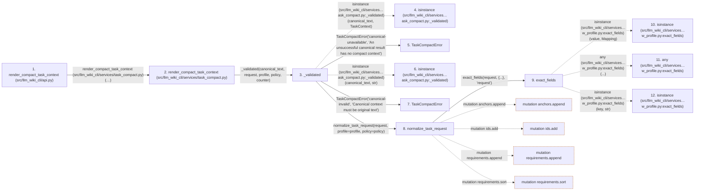

# render_compact_task_context

**Entry point:** `render_compact_task_context` (`api`)
**Source:** [api](../modules/api.md)
**Modules touched:** [api](../modules/api.md), [change_selection](../modules/change_selection.md), [concept_identity](../modules/concept_identity.md), [context_budget](../modules/context_budget.md), and 22 more

**Complete modules touched:**

- [api](../modules/api.md)
- [change_selection](../modules/change_selection.md)
- [concept_identity](../modules/concept_identity.md)
- [context_budget](../modules/context_budget.md)
- [context_packet](../modules/context_packet.md)
- [documentation_queries](../modules/documentation_queries.md)
- [documentation_query_builder](../modules/documentation_query_builder.md)
- [implementation_evidence](../modules/implementation_evidence.md)
- [knowledge_envelope](../modules/knowledge_envelope.md)
- [knowledge_evidence](../modules/knowledge_evidence.md)
- [knowledge_packs](../modules/knowledge_packs.md)
- [knowledge_storage](../modules/knowledge_storage.md)
- [knowledge_storage_io](../modules/knowledge_storage_io.md)
- [maintenance_status](../modules/maintenance_status.md)
- [packet_field_policy](../modules/packet_field_policy.md)
- [storage_receipts](../modules/storage_receipts.md)
- [task_compact](../modules/task_compact.md)
- [task_context](../modules/task_context.md)
- [task_context_v2](../modules/task_context_v2.md)
- [task_contract](../modules/task_contract.md)
- [task_evidence](../modules/task_evidence.md)
- [task_implementation](../modules/task_implementation.md)
- [token_counting](../modules/token_counting.md)
- [validation](../modules/validation.md)
- [wiki_surface](../modules/wiki_surface.md)
- [workflow_profile](../modules/workflow_profile.md)

## Call sequence

> Static overview in presentation order, not runtime execution order. Arrows retain captured callers; siblings are shown before deeper helper detail.

```mermaid
sequenceDiagram
    participant p0 as render_compact_task_context (src/llm_wiki_cli/api.py)
    participant p1 as render_compact_task_context (src/llm_wiki_cli/services/task_compact.py)
    participant p2 as _validated
    participant p3 as normalize_view_options
    participant p4 as _projection
    participant p5 as _accounted_render
    participant p6 as CompactTaskContext
    participant p7 as isinstance (src/llm_wiki_cli/services…ask_compact.py:_validated)
    participant p8 as isinstance (src/llm_wiki_cli/services…py:normalize_view_options)
    participant p9 as deepcopy (src/llm_wiki_cli/services…sk_compact.py:_projection)
    participant p10 as range
    participant p11 as TaskCompactError
    participant p12 as set (src/llm_wiki_cli/services…py:normalize_view_options)
    participant p13 as facts[…][…].items
    participant p14 as render
    participant p15 as all (src/llm_wiki_cli/services…sk_compact.py:_projection)
    participant p16 as counter.count (src/llm_wiki_cli/services…dget.py:_accounted_render)
    participant p17 as type (src/llm_wiki_cli/services…py:normalize_view_options)
    participant p18 as _same
    participant p19 as isinstance (src/llm_wiki_cli/services…dget.py:_accounted_render)
    participant p20 as normalize_task_request
    participant p21 as next
    participant p22 as enumerate (src/llm_wiki_cli/services…sk_compact.py:_projection)
    p0->>p1: render_compact_task_context (src/llm_wiki_cli/services/task_compact.py)
    p1->>p2: _validated
    p1->>p3: normalize_view_options
    p1->>p4: _projection
    p1->>p5: _accounted_render
    p1->>p5: _accounted_render
    p1->>p6: CompactTaskContext
    p1->>p6: CompactTaskContext
    p2-->>p7: isinstance (src/llm_wiki_cli/services…ask_compact.py:_validated)(canonical_text, TaskContext)
    p3-->>p8: isinstance (src/llm_wiki_cli/services…py:normalize_view_options)(value, Mapping)
    p4-->>p9: deepcopy (src/llm_wiki_cli/services…sk_compact.py:_projection)(value)
    p5-->>p10: range(32)
    p2->>p11: TaskCompactError
    p3-->>p12: set (src/llm_wiki_cli/services…py:normalize_view_options)(value)
    p4-->>p13: facts[…][…].items
    p5-->>p14: render(accounting)
    p2-->>p7: isinstance (src/llm_wiki_cli/services…ask_compact.py:_validated)(canonical_text, str)
    p3->>p11: TaskCompactError
    p4-->>p15: all (src/llm_wiki_cli/services…sk_compact.py:_projection)(...)
    p5-->>p16: counter.count (src/llm_wiki_cli/services…dget.py:_accounted_render)(text)
    p2->>p11: TaskCompactError
    p3-->>p17: type (src/llm_wiki_cli/services…py:normalize_view_options)(budget)
    p4->>p18: _same
    p5-->>p19: isinstance (src/llm_wiki_cli/services…dget.py:_accounted_render)(used, bool)
    p2->>p20: normalize_task_request
    p3->>p11: TaskCompactError
    p4-->>p21: next(..., None)
    p5-->>p19: isinstance (src/llm_wiki_cli/services…dget.py:_accounted_render)(used, int)
    p2->>p11: TaskCompactError
    p4-->>p22: enumerate (src/llm_wiki_cli/services…sk_compact.py:_projection)(citations)
```

<!-- Auto-generated from static call edges. Dashed arrows are external or unresolved calls. Reviewed runtime conditions and side effects belong in Behavior. -->

> Call sequence diagram shows 30 of 831 interactions; 801 omitted to keep the visualization within the 30-interaction and generated-diagram limits, with uncertain identities omitted rather than inferred.

> Captured boundary calls: external 12 of 415 (403 omitted); unresolved 3 of 196 (193 omitted). These counts cover the captured static trace.

Omitted captured detail, grouped by actual caller occurrence and target module:

| Caller | Parent step | Target module | Kind | Omitted interactions |
| --- | --- | --- | --- | --- |
| `src/llm_wiki_cli/services/task_contract.py:normalize_task_request` | 8 | [src/llm_wiki_cli/services/workflow_profile.py](../modules/workflow_profile.md) | internal | 20 |
| `src/llm_wiki_cli/services/workflow_profile.py:exact_fields` | 9 | - | external | 5 |
| `src/llm_wiki_cli/services/workflow_profile.py:exact_fields` | 9 | [src/llm_wiki_cli/services/workflow_profile.py](../modules/workflow_profile.md) | internal | 2 |
| `src/llm_wiki_cli/services/task_contract.py:normalize_task_request` | 8 | - | unresolved | 22 |
| `src/llm_wiki_cli/services/task_contract.py:normalize_task_request` | 8 | - | external | 10 |
| `src/llm_wiki_cli/services/workflow_profile.py:bounded_text` | 20 | - | external | 2 |
| `src/llm_wiki_cli/services/workflow_profile.py:bounded_text` | 20 | - | unresolved | 2 |
| `src/llm_wiki_cli/services/workflow_profile.py:bounded_text` | 20 | [src/llm_wiki_cli/services/workflow_profile.py](../modules/workflow_profile.md) | internal | 3 |
> Omission summary shows 8 of 153 groups; 145 further groups are not expanded here. Counts above include all omitted interactions.
> Detailed flow queries retain their own coverage and limits; omitted paths may execute at runtime.

> Trace truncated at the depth limit; deeper calls are omitted.

## Data flow

<!-- Auto-generated static analysis. Treat values and boundaries as best-effort hints, not runtime proof. -->

### Step data

| Step | Inputs | Reads | Writes | Returns |
|---|---|---|---|---|
| `render_compact_task_context (src/llm_wiki_cli/api.py)` | `canonical_text: str`, `request: Mapping[str, Any]`, `view_options: Mapping[str, Any]`, `profile: WorkflowProfile \| Mapping[str, Any] \| None`, `policy: WorkflowPolicy \| None`, `counter: TokenCounter \| None` | - | - | `render(...)` |
| `render_compact_task_context (src/llm_wiki_cli/services/task_compact.py)` | `canonical_text`, `request`, `view_options`, `profile`, `policy`, `counter` | - | - | `CompactTaskContext(...)`, `CompactTaskContext(...)` |
| `_validated` | `canonical_text`, `request`, `profile`, `policy`, `counter` | `TaskContext`, `TASK_REQUEST_SCHEMA_V2` | - | `(...)` |
| `isinstance (src/llm_wiki_cli/services…ask_compact.py:_validated)` | - | - | - | - |
| `TaskCompactError` | - | - | - | - |
| `isinstance (src/llm_wiki_cli/services…ask_compact.py:_validated)` | - | - | - | - |
| `TaskCompactError` | - | - | - | - |
| `normalize_task_request` | `request: Mapping[str, Any]`, `profile: WorkflowProfile \| Mapping[str, Any] \| None`, `policy: WorkflowPolicy \| None` | `TASK_REQUEST_SCHEMA`, `TASK_REQUEST_SCHEMA_V2`, `TASK_KINDS`, `ANCHOR_KINDS`, `canonical_json`, `FACETS`, `MAX_SELECTORS`, `TASK_REQUEST_SCHEMA_V2` | `changes[...]`, `normalized[...]`, `normalized[...]`, `normalized[...]` | `(...)` |
| `exact_fields` | `value: object`, `allowed: set[str]`, `field: str` | `Mapping` | - | `dict(...)` |
| `isinstance (src/llm_wiki_cli/services…w_profile.py:exact_fields)` | - | - | - | - |
| `any (src/llm_wiki_cli/services…w_profile.py:exact_fields)` | - | - | - | - |
| `isinstance (src/llm_wiki_cli/services…w_profile.py:exact_fields)` | - | - | - | - |

### Call data

| From | To | Line | Call |
|---|---|---:|---|
| render_compact_task_context (src/llm_wiki_cli/api.py) | render_compact_task_context (src/llm_wiki_cli/services/task_compact.py) | 1450 | `render(canonical_text, request, view_options=view_options, profile=profile, policy=policy, counter=counter)` |
| render_compact_task_context (src/llm_wiki_cli/services/task_compact.py) | _validated | 473 | `_validated(canonical_text, request, profile, policy, counter)` |
| _validated | isinstance (src/llm_wiki_cli/services…ask_compact.py:_validated) | 169 | `isinstance(canonical_text, TaskContext)` |
| _validated | TaskCompactError | 171 | `TaskCompactError('canonical-unavailable', 'An unsuccessful canonical result has no compact context')` |
| _validated | isinstance (src/llm_wiki_cli/services…ask_compact.py:_validated) | 176 | `isinstance(canonical_text, str)` |
| _validated | TaskCompactError | 177 | `TaskCompactError('canonical-invalid', 'Canonical context must be original text')` |
| _validated | normalize_task_request | 180 | `normalize_task_request(request, profile=profile, policy=policy)` |
| normalize_task_request | exact_fields | 53 | `exact_fields(request, {...}, 'request')` |
| exact_fields | isinstance (src/llm_wiki_cli/services…w_profile.py:exact_fields) | 67 | `isinstance(value, Mapping)` |
| exact_fields | any (src/llm_wiki_cli/services…w_profile.py:exact_fields) | 67 | `any(...)` |
| exact_fields | isinstance (src/llm_wiki_cli/services…w_profile.py:exact_fields) | 67 | `isinstance(key, str)` |

### Boundary effects

| Kind | Target | Step | Line |
|---|---|---|---:|
| mutation | `anchors.append` | `normalize_task_request` | 71 |
| mutation | `ids.add` | `normalize_task_request` | 79 |
| mutation | `requirements.append` | `normalize_task_request` | 89 |
| mutation | `requirements.sort` | `normalize_task_request` | 90 |

### Static analysis gaps

| Kind | Step | Target | Line |
|---|---|---|---:|
| external_call | `_validated` | `isinstance` | 169 |
| external_call | `_validated` | `isinstance` | 176 |
| external_call | `exact_fields` | `isinstance` | 67 |
| external_call | `exact_fields` | `any` | 67 |
| step_limit | `render_compact_task_context` | `first 12 steps` | 0 |
| truncated_flow | `render_compact_task_context` | `depth limit` | 0 |

## Behavior

This flow starts at `render_compact_task_context` and is classified as `api`. The generated call and data-flow sections are bounded static projections; runtime conditions and side effects require source-level confirmation.
