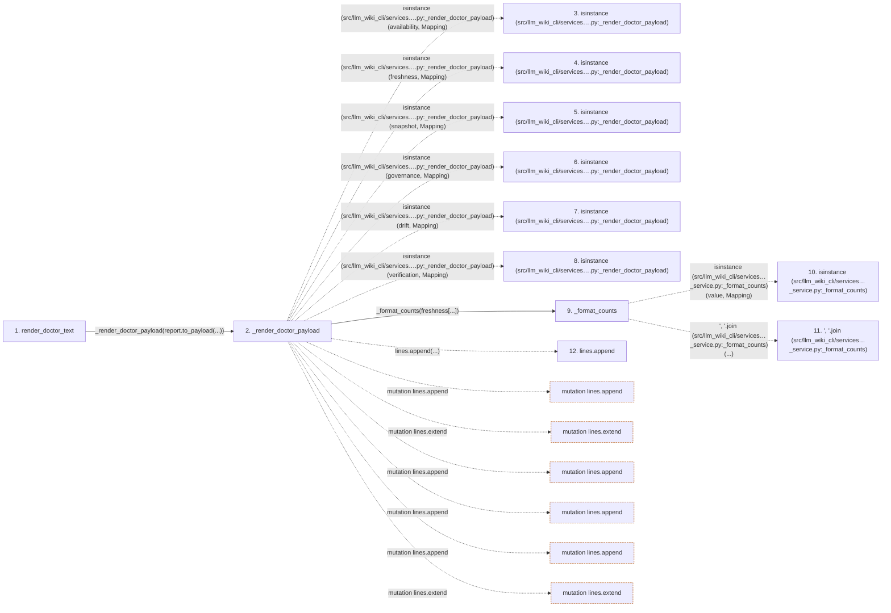

# render_doctor_text

**Entry point:** `render_doctor_text` (`api`)
**Source:** [doctor_service](../modules/doctor_service.md)
**Modules touched:** [doctor_service](../modules/doctor_service.md), [health_summary](../modules/health_summary.md)

## Call sequence

> Static overview in presentation order, not runtime execution order. Arrows retain captured callers; representative internal continuations and boundary examples precede repeated helper detail.

```mermaid
sequenceDiagram
    participant p0 as render_doctor_text
    participant p1 as _render_doctor_payload
    participant p2 as detailed_health_rows
    participant p3 as _format_counts
    participant p4 as summary_cell
    participant p5 as freshness_counts
    participant p6 as _versions
    participant p7 as isinstance (src/llm_wiki_cli/services….py:_render_doctor_payload)
    participant p8 as report.to_payload
    participant p9 as lines.append
    participant p10 as lines.extend
    participant p11 as ', '.join (src/llm_wiki_cli/services….py:_render_doctor_payload)
    participant p12 as '\n'.join
    participant p13 as isinstance (src/llm_wiki_cli/services…_service.py:_format_counts)
    participant p14 as len (src/llm_wiki_cli/services…th_summary.py:summary_cell)
    participant p15 as report.get
    participant p16 as ', '.join (src/llm_wiki_cli/services…_service.py:_format_counts)
    participant p17 as ValueError
    participant p18 as primary.sort
    participant p19 as str
    participant p20 as ' '.join (src/llm_wiki_cli/services…ry.py:detailed_health_rows)
    p0->>p1: _render_doctor_payload
    p1->>p2: detailed_health_rows
    p1->>p3: _format_counts
    p1->>p4: summary_cell
    p2->>p5: freshness_counts
    p2->>p6: _versions
    p1-->>p7: isinstance (src/llm_wiki_cli/services….py:_render_doctor_payload)(availability, Mapping)
    p0-->>p8: report.to_payload(report_schema=report_schema)
    p1-->>p7: isinstance (src/llm_wiki_cli/services….py:_render_doctor_payload)(freshness, Mapping)
    p1-->>p7: isinstance (src/llm_wiki_cli/services….py:_render_doctor_payload)(snapshot, Mapping)
    p1-->>p7: isinstance (src/llm_wiki_cli/services….py:_render_doctor_payload)(governance, Mapping)
    p1-->>p7: isinstance (src/llm_wiki_cli/services….py:_render_doctor_payload)(drift, Mapping)
    p1-->>p7: isinstance (src/llm_wiki_cli/services….py:_render_doctor_payload)(verification, Mapping)
    p1-->>p9: lines.append(...)
    p1-->>p10: lines.extend([...])
    p1-->>p9: lines.append(...)
    p1-->>p9: lines.append(...)
    p1-->>p11: ', '.join (src/llm_wiki_cli/services….py:_render_doctor_payload)(payload[...])
    p1-->>p9: lines.append(...)
    p1-->>p11: ', '.join (src/llm_wiki_cli/services….py:_render_doctor_payload)(payload[...])
    p1-->>p10: lines.extend(...)
    p1-->>p12: '\n'.join(lines)
    p3-->>p13: isinstance (src/llm_wiki_cli/services…_service.py:_format_counts)(value, Mapping)
    p4-->>p14: len (src/llm_wiki_cli/services…th_summary.py:summary_cell)(marker)
    p2-->>p15: report.get('health_details')
    p3-->>p16: ', '.join (src/llm_wiki_cli/services…_service.py:_format_counts)(...)
    p4-->>p17: ValueError('summary cell limit is too small')
    p2-->>p18: primary.sort(key=...)
    p4-->>p19: str(value)
    p2-->>p20: ' '.join (src/llm_wiki_cli/services…ry.py:detailed_health_rows)(...)
```

<!-- Auto-generated from static call edges. Dashed arrows are external or unresolved calls. Reviewed runtime conditions and side effects belong in Behavior. -->

> Call sequence diagram shows 30 of 64 interactions; 34 omitted to keep the visualization within the 30-interaction and generated-diagram limits, with uncertain identities omitted rather than inferred.

> Captured boundary calls: external 10 of 21 (11 omitted); unresolved 14 of 36 (22 omitted). These counts cover the captured static trace.

Omitted captured detail, grouped by actual caller occurrence and target module:

| Caller | Parent step | Target module | Kind | Omitted interactions |
| --- | --- | --- | --- | --- |
| `src/llm_wiki_cli/services/health_summary.py:summary_cell` | 20 | - | external | 4 |
| `src/llm_wiki_cli/services/health_summary.py:summary_cell` | 20 | - | unresolved | 8 |
| `src/llm_wiki_cli/services/health_summary.py:detailed_health_rows` | 36 | - | external | 2 |
| `src/llm_wiki_cli/services/health_summary.py:detailed_health_rows` | 36 | - | unresolved | 6 |
| `src/llm_wiki_cli/services/health_summary.py:freshness_counts` | 47 | - | unresolved | 1 |
| `src/llm_wiki_cli/services/health_summary.py:_versions` | 49 | - | external | 5 |
| `src/llm_wiki_cli/services/health_summary.py:_versions` | 49 | - | unresolved | 7 |
| `src/llm_wiki_cli/services/health_summary.py:detailed_health_rows` | 36 | [src/llm_wiki_cli/services/health_summary.py](../modules/health_summary.md) | internal | 1 |
> Detailed flow queries retain their own coverage and limits; omitted paths may execute at runtime.

## Data flow

<!-- Auto-generated static analysis. Treat values and boundaries as best-effort hints, not runtime proof. -->

### Step data

| Step | Inputs | Reads | Writes | Returns |
|---|---|---|---|---|
| `render_doctor_text` | `report: DoctorReport`, `report_schema: str` | - | - | `_render_doctor_payload(...)` |
| `_render_doctor_payload` | `payload: Mapping[str, Any]` | `Mapping`, `Mapping`, `Mapping`, `Mapping`, `Mapping`, `Mapping` | - | `...` |
| `isinstance (src/llm_wiki_cli/services….py:_render_doctor_payload)` | - | - | - | - |
| `isinstance (src/llm_wiki_cli/services….py:_render_doctor_payload)` | - | - | - | - |
| `isinstance (src/llm_wiki_cli/services….py:_render_doctor_payload)` | - | - | - | - |
| `isinstance (src/llm_wiki_cli/services….py:_render_doctor_payload)` | - | - | - | - |
| `isinstance (src/llm_wiki_cli/services….py:_render_doctor_payload)` | - | - | - | - |
| `isinstance (src/llm_wiki_cli/services….py:_render_doctor_payload)` | - | - | - | - |
| `_format_counts` | `value: object` | `Mapping`, `_FRESHNESS_STATES` | - | `None`, `...` |
| `isinstance (src/llm_wiki_cli/services…_service.py:_format_counts)` | - | - | - | - |
| `', '.join (src/llm_wiki_cli/services…_service.py:_format_counts)` | - | - | - | - |
| `lines.append` | - | - | - | - |

### Call data

| From | To | Line | Call |
|---|---|---:|---|
| render_doctor_text | _render_doctor_payload | 231 | `_render_doctor_payload(report.to_payload(...))` |
| _render_doctor_payload | isinstance (src/llm_wiki_cli/services….py:_render_doctor_payload) | 241 | `isinstance(availability, Mapping)` |
| _render_doctor_payload | isinstance (src/llm_wiki_cli/services….py:_render_doctor_payload) | 242 | `isinstance(freshness, Mapping)` |
| _render_doctor_payload | isinstance (src/llm_wiki_cli/services….py:_render_doctor_payload) | 243 | `isinstance(snapshot, Mapping)` |
| _render_doctor_payload | isinstance (src/llm_wiki_cli/services….py:_render_doctor_payload) | 244 | `isinstance(governance, Mapping)` |
| _render_doctor_payload | isinstance (src/llm_wiki_cli/services….py:_render_doctor_payload) | 245 | `isinstance(drift, Mapping)` |
| _render_doctor_payload | isinstance (src/llm_wiki_cli/services….py:_render_doctor_payload) | 246 | `isinstance(verification, Mapping)` |
| _render_doctor_payload | _format_counts | 248 | `_format_counts(freshness[...])` |
| _format_counts | isinstance (src/llm_wiki_cli/services…_service.py:_format_counts) | 620 | `isinstance(value, Mapping)` |
| _format_counts | ', '.join (src/llm_wiki_cli/services…_service.py:_format_counts) | 622 | `', '.join(...)` |
| _render_doctor_payload | lines.append | 259 | `lines.append(...)` |

### Boundary effects

| Kind | Target | Step | Line |
|---|---|---|---:|
| mutation | `lines.append` | `_render_doctor_payload` | 259 |
| mutation | `lines.extend` | `_render_doctor_payload` | 260 |
| mutation | `lines.append` | `_render_doctor_payload` | 289 |
| mutation | `lines.append` | `_render_doctor_payload` | 291 |
| mutation | `lines.append` | `_render_doctor_payload` | 293 |
| mutation | `lines.extend` | `_render_doctor_payload` | 294 |

### Static analysis gaps

| Kind | Step | Target | Line |
|---|---|---|---:|
| external_call | `_render_doctor_payload` | `isinstance` | 241 |
| external_call | `_render_doctor_payload` | `isinstance` | 242 |
| external_call | `_render_doctor_payload` | `isinstance` | 243 |
| external_call | `_render_doctor_payload` | `isinstance` | 244 |
| external_call | `_render_doctor_payload` | `isinstance` | 245 |
| external_call | `_render_doctor_payload` | `isinstance` | 246 |
| external_call | `_format_counts` | `isinstance` | 620 |
| unresolved_call | `_format_counts` | `', '.join` | 622 |
| step_limit | `render_doctor_text` | `first 12 steps` | 0 |

## Behavior

This flow starts at `render_doctor_text` and is classified as `api`. The generated call and data-flow sections are bounded static projections; runtime conditions and side effects require source-level confirmation.
