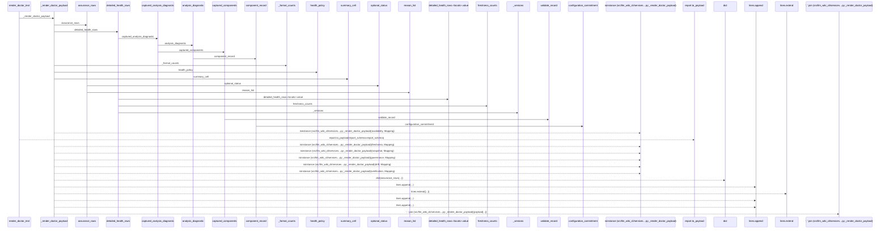
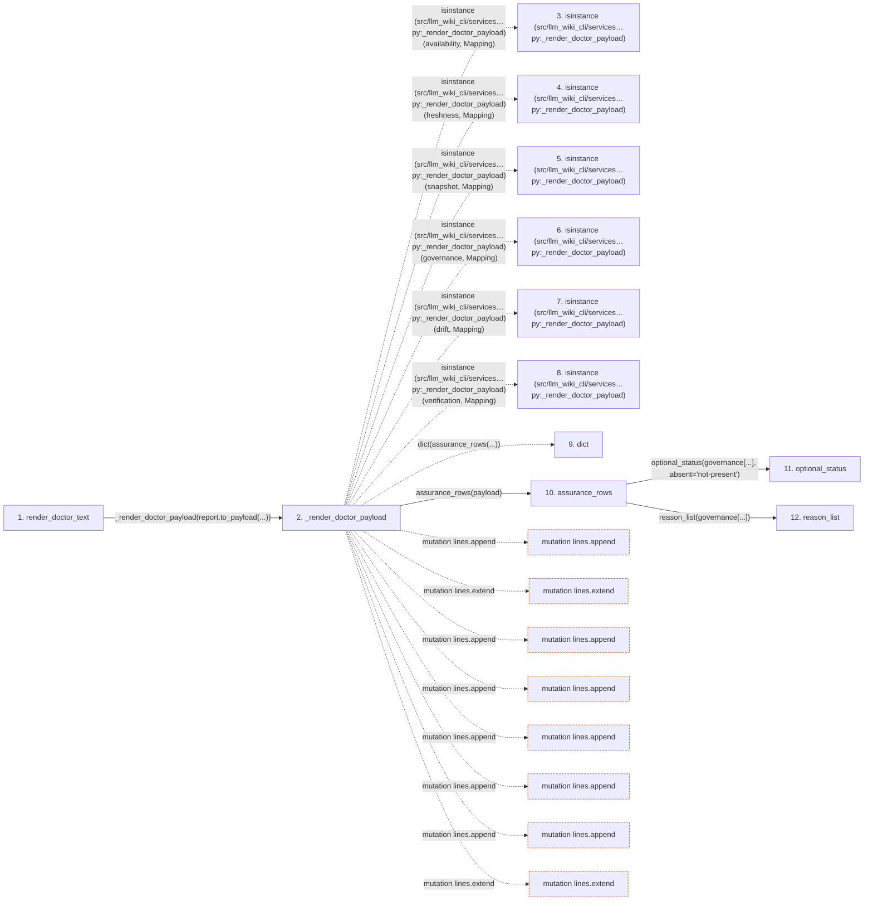

# render_doctor_text

**Entry point:** `render_doctor_text` (`api`)
**Source:** [doctor_service](../modules/doctor_service.md)
**Modules touched:** [analysis_compatibility](../modules/analysis_compatibility.md), [doctor_service](../modules/doctor_service.md), [health_summary](../modules/health_summary.md)

## Call sequence

> Static overview in presentation order, not runtime execution order. Arrows retain captured callers; representative internal continuations and boundary examples precede repeated helper detail.

<!-- Auto-generated from static call edges. Dashed arrows are external or unresolved calls. Reviewed runtime conditions and side effects belong in Behavior. -->

> Call sequence diagram shows 30 of 128 interactions; 98 omitted to keep the visualization within the 30-interaction and generated-diagram limits, with uncertain identities omitted rather than inferred.

> Captured boundary calls: external 7 of 44 (37 omitted); unresolved 6 of 57 (51 omitted). These counts cover the captured static trace.

Omitted captured detail, grouped by actual caller occurrence and target module:

| Caller | Parent step | Target module | Kind | Omitted interactions |
| --- | --- | --- | --- | --- |
| `src/llm_wiki_cli/services/health_summary.py:reason_list` | 12 | - | unresolved | 1 |
| `src/llm_wiki_cli/services/health_summary.py:reason_list` | 12 | - | external | 2 |
| `src/llm_wiki_cli/services/health_summary.py:assurance_rows` | 10 | [src/llm_wiki_cli/services/health_summary.py](../modules/health_summary.md) | internal | 1 |
| `src/llm_wiki_cli/services/doctor_service.py:_format_counts` | 17 | - | external | 1 |
| `src/llm_wiki_cli/services/doctor_service.py:_format_counts` | 17 | - | unresolved | 1 |
| `src/llm_wiki_cli/services/health_summary.py:summary_cell` | 23 | - | external | 7 |
| `src/llm_wiki_cli/services/health_summary.py:summary_cell` | 23 | - | unresolved | 8 |
| `src/llm_wiki_cli/services/doctor_service.py:_render_doctor_payload` | 2 | [src/llm_wiki_cli/services/health_summary.py](../modules/health_summary.md) | internal | 3 |
> Omission summary shows 8 of 26 groups; 18 further groups are not expanded here. Counts above include all omitted interactions.
> Detailed flow queries retain their own coverage and limits; omitted paths may execute at runtime.

> Trace truncated at the depth limit; deeper calls are omitted.

## Data flow

<!-- Auto-generated static analysis. Treat values and boundaries as best-effort hints, not runtime proof. -->

### Step data

| Step | Inputs | Reads | Writes | Returns |
|---|---|---|---|---|
| `render_doctor_text` | `report: DoctorReport`, `report_schema: str` | - | - | `_render_doctor_payload(...)` |
| `_render_doctor_payload` | `payload: Mapping[str, Any]` | `Mapping`, `Mapping`, `Mapping`, `Mapping`, `Mapping`, `Mapping`, `RELEASE_POLICY_UNAVAILABLE`, `ASSURANCE_DISCLOSURE` | - | `...` |
| `isinstance (src/llm_wiki_cli/services…py:_render_doctor_payload)` | - | - | - | - |
| `isinstance (src/llm_wiki_cli/services…py:_render_doctor_payload)` | - | - | - | - |
| `isinstance (src/llm_wiki_cli/services…py:_render_doctor_payload)` | - | - | - | - |
| `isinstance (src/llm_wiki_cli/services…py:_render_doctor_payload)` | - | - | - | - |
| `isinstance (src/llm_wiki_cli/services…py:_render_doctor_payload)` | - | - | - | - |
| `isinstance (src/llm_wiki_cli/services…py:_render_doctor_payload)` | - | - | - | - |
| `dict` | - | - | - | - |
| `assurance_rows` | `report: Mapping` | - | - | `[...]` |
| `optional_status` | `state: str`, `absent: str` | - | - | `...` |
| `reason_list` | `reasons: Sequence[str]`, `limit: int` | - | - | `shown` |

### Call data

| From | To | Line | Call |
|---|---|---:|---|
| render_doctor_text | _render_doctor_payload | 234 | `_render_doctor_payload(report.to_payload(...))` |
| _render_doctor_payload | isinstance (src/llm_wiki_cli/services…py:_render_doctor_payload) | 244 | `isinstance(availability, Mapping)` |
| _render_doctor_payload | isinstance (src/llm_wiki_cli/services…py:_render_doctor_payload) | 245 | `isinstance(freshness, Mapping)` |
| _render_doctor_payload | isinstance (src/llm_wiki_cli/services…py:_render_doctor_payload) | 246 | `isinstance(snapshot, Mapping)` |
| _render_doctor_payload | isinstance (src/llm_wiki_cli/services…py:_render_doctor_payload) | 247 | `isinstance(governance, Mapping)` |
| _render_doctor_payload | isinstance (src/llm_wiki_cli/services…py:_render_doctor_payload) | 248 | `isinstance(drift, Mapping)` |
| _render_doctor_payload | isinstance (src/llm_wiki_cli/services…py:_render_doctor_payload) | 249 | `isinstance(verification, Mapping)` |
| _render_doctor_payload | dict | 250 | `dict(assurance_rows(...))` |
| _render_doctor_payload | assurance_rows | 250 | `assurance_rows(payload)` |
| assurance_rows | optional_status | 74 | `optional_status(governance[...], absent='not-present')` |
| assurance_rows | reason_list | 78 | `reason_list(governance[...])` |

### Boundary effects

| Kind | Target | Step | Line |
|---|---|---|---:|
| mutation | `lines.append` | `_render_doctor_payload` | 265 |
| mutation | `lines.extend` | `_render_doctor_payload` | 266 |
| mutation | `lines.append` | `_render_doctor_payload` | 292 |
| mutation | `lines.append` | `_render_doctor_payload` | 294 |
| mutation | `lines.append` | `_render_doctor_payload` | 296 |
| mutation | `lines.append` | `_render_doctor_payload` | 297 |
| mutation | `lines.append` | `_render_doctor_payload` | 298 |
| mutation | `lines.extend` | `_render_doctor_payload` | 299 |

### Static analysis gaps

| Kind | Step | Target | Line |
|---|---|---|---:|
| external_call | `_render_doctor_payload` | `isinstance` | 244 |
| external_call | `_render_doctor_payload` | `isinstance` | 245 |
| external_call | `_render_doctor_payload` | `isinstance` | 246 |
| external_call | `_render_doctor_payload` | `isinstance` | 247 |
| external_call | `_render_doctor_payload` | `isinstance` | 248 |
| external_call | `_render_doctor_payload` | `isinstance` | 249 |
| step_limit | `render_doctor_text` | `first 12 steps` | 0 |
| truncated_flow | `render_doctor_text` | `depth limit` | 0 |

## Behavior

This flow starts at `render_doctor_text` and is classified as `api`. The generated call and data-flow sections are bounded static projections; runtime conditions and side effects require source-level confirmation.
