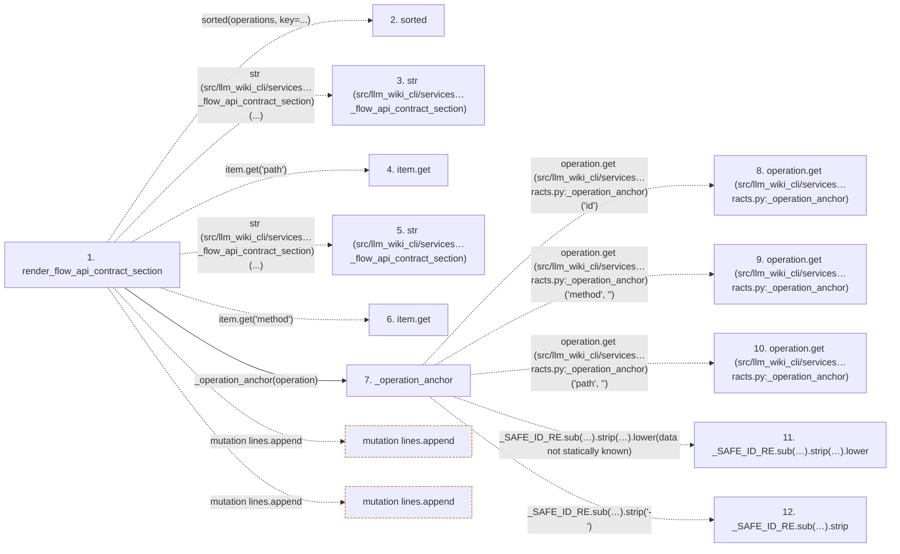

# render_flow_api_contract_section

**Entry point:** `render_flow_api_contract_section` (`api`)
**Source:** [api_contracts](../modules/api_contracts.md)
**Modules touched:** [api_contracts](../modules/api_contracts.md)

## Call sequence

> Static overview in presentation order, not runtime execution order. Arrows retain captured callers; representative internal continuations and boundary examples precede repeated helper detail.

```mermaid
sequenceDiagram
    participant p0 as render_flow_api_contract_section
    participant p1 as sorted
    participant p2 as str (src/llm_wiki_cli/services…_flow_api_contract_section)
    participant p3 as item.get
    participant p4 as _operation_anchor
    participant p5 as operation.get (src/llm_wiki_cli/services…_flow_api_contract_section)
    participant p6 as lines.append
    participant p7 as _md_code
    participant p8 as '\n'.join
    participant p9 as operation.get (src/llm_wiki_cli/services…racts.py:_operation_anchor)
    participant p10 as str(…).replace(…).replace
    participant p11 as str(…).replace
    participant p12 as str (src/llm_wiki_cli/services/api_contracts.py:_md_code)
    participant p13 as _SAFE_ID_RE.sub(…).strip(…).lower
    participant p14 as max
    participant p15 as _SAFE_ID_RE.sub(…).strip
    participant p16 as len
    participant p17 as _SAFE_ID_RE.sub
    participant p18 as re.findall
    participant p19 as str (src/llm_wiki_cli/services…racts.py:_operation_anchor)
    participant p20 as text.startswith
    participant p21 as text.endswith
    p0-->>p1: sorted(operations, key=...)
    p0-->>p2: str (src/llm_wiki_cli/services…_flow_api_contract_section)(...)
    p0-->>p3: item.get('path')
    p0-->>p2: str (src/llm_wiki_cli/services…_flow_api_contract_section)(...)
    p0-->>p3: item.get('method')
    p0->>p4: _operation_anchor
    p0-->>p5: operation.get (src/llm_wiki_cli/services…_flow_api_contract_section)('method')
    p0-->>p5: operation.get (src/llm_wiki_cli/services…_flow_api_contract_section)('path')
    p0-->>p6: lines.append(...)
    p0->>p7: _md_code
    p0-->>p6: lines.append('')
    p0-->>p8: '\n'.join(lines)
    p4-->>p9: operation.get (src/llm_wiki_cli/services…racts.py:_operation_anchor)('id')
    p7-->>p10: str(…).replace(…).replace('\n', ' ')
    p4-->>p9: operation.get (src/llm_wiki_cli/services…racts.py:_operation_anchor)('method', '')
    p7-->>p11: str(…).replace('|', '\\|')
    p4-->>p9: operation.get (src/llm_wiki_cli/services…racts.py:_operation_anchor)('path', '')
    p7-->>p12: str (src/llm_wiki_cli/services/api_contracts.py:_md_code)(value)
    p4-->>p13: _SAFE_ID_RE.sub(…).strip(…).lower
    p7-->>p14: max(..., default=0)
    p4-->>p15: _SAFE_ID_RE.sub(…).strip('-')
    p7-->>p16: len(match)
    p4-->>p17: _SAFE_ID_RE.sub('-', str(...))
    p7-->>p18: re.findall('`+', text)
    p4-->>p19: str (src/llm_wiki_cli/services…racts.py:_operation_anchor)(identity)
    p7-->>p14: max(1, ...)
    p7-->>p20: text.startswith('`')
    p7-->>p21: text.endswith('`')
```

<!-- Auto-generated from static call edges. Dashed arrows are external or unresolved calls. Reviewed runtime conditions and side effects belong in Behavior. -->

> Call sequence diagram shows 28 of 28 interactions; 0 omitted to keep the visualization within the 30-interaction and generated-diagram limits, with uncertain identities omitted rather than inferred.

> Captured boundary calls: external 9 of 9 (0 omitted); unresolved 17 of 17 (0 omitted). These counts cover the captured static trace.
> Detailed flow queries retain their own coverage and limits; omitted paths may execute at runtime.

## Data flow

<!-- Auto-generated static analysis. Treat values and boundaries as best-effort hints, not runtime proof. -->

### Analysis coverage

**Effect analysis evaluated.** Flow assembly and source effect analysis are separate; empty observations do not prove an empty handler body.

Source steps: 3; effect analysis evaluated: 3, partial: 0, unavailable: 0. Counts include steps omitted from the displayed trace.

Collector observations for 3 source steps with known totals: observed: 9, emitted: 9, omitted: 0. Unavailable totals are excluded.

### Step data

| Step | Inputs | Reads | Writes | Returns |
|---|---|---|---|---|
| `render_flow_api_contract_section` | `operations: Sequence[Mapping[str, Any]]` | - | - | `''`, `...` |
| `sorted` | - | - | - | - |
| `str (src/llm_wiki_cli/services…_flow_api_contract_section)` | - | - | - | - |
| `item.get` | - | - | - | - |
| `str (src/llm_wiki_cli/services…_flow_api_contract_section)` | - | - | - | - |
| `item.get` | - | - | - | - |
| `_operation_anchor` | `operation: Mapping[str, Any]` | - | - | `...` |
| `operation.get (src/llm_wiki_cli/services…racts.py:_operation_anchor)` | - | - | - | - |
| `operation.get (src/llm_wiki_cli/services…racts.py:_operation_anchor)` | - | - | - | - |
| `operation.get (src/llm_wiki_cli/services…racts.py:_operation_anchor)` | - | - | - | - |
| `_SAFE_ID_RE.sub(…).strip(…).lower` | - | - | - | - |
| `_SAFE_ID_RE.sub(…).strip` | - | - | - | - |

### Call data

| From | To | Line | Call |
|---|---|---:|---|
| render_flow_api_contract_section | sorted | 2250 | `sorted(operations, key=...)` |
| render_flow_api_contract_section | str (src/llm_wiki_cli/services…_flow_api_contract_section) | 2251 | `str(...)` |
| render_flow_api_contract_section | item.get | 2251 | `item.get('path')` |
| render_flow_api_contract_section | str (src/llm_wiki_cli/services…_flow_api_contract_section) | 2251 | `str(...)` |
| render_flow_api_contract_section | item.get | 2251 | `item.get('method')` |
| render_flow_api_contract_section | _operation_anchor | 2253 | `_operation_anchor(operation)` |
| _operation_anchor | operation.get (src/llm_wiki_cli/services…racts.py:_operation_anchor) | 1983 | `operation.get('id')` |
| _operation_anchor | operation.get (src/llm_wiki_cli/services…racts.py:_operation_anchor) | 1984 | `operation.get('method', '')` |
| _operation_anchor | operation.get (src/llm_wiki_cli/services…racts.py:_operation_anchor) | 1984 | `operation.get('path', '')` |
| _operation_anchor | _SAFE_ID_RE.sub(…).strip(…).lower | 1986 | `_SAFE_ID_RE.sub('-', str(identity)).strip('-').lower(data not statically known)` |
| _operation_anchor | _SAFE_ID_RE.sub(…).strip | 1986 | `_SAFE_ID_RE.sub('-', str(identity)).strip('-')` |

### Boundary effects

| Kind | Target | Step | Line |
|---|---|---|---:|
| mutation | `lines.append` | `render_flow_api_contract_section` | 2255 |
| mutation | `lines.append` | `render_flow_api_contract_section` | 2259 |

### Static analysis gaps

| Kind | Step | Target | Line |
|---|---|---|---:|
| external_call | `render_flow_api_contract_section` | `sorted` | 2250 |
| unresolved_call | `render_flow_api_contract_section` | `item.get` | 2251 |
| unresolved_call | `_operation_anchor` | `operation.get` | 1983 |
| unresolved_call | `_operation_anchor` | `operation.get` | 1984 |
| unresolved_call | `_operation_anchor` | `_SAFE_ID_RE.sub('-', str(identity)).strip('-').lower` | 1986 |
| unresolved_call | `_operation_anchor` | `_SAFE_ID_RE.sub('-', str(identity)).strip` | 1986 |
| step_limit | `render_flow_api_contract_section` | `first 12 steps` | 0 |

## Behavior

This flow starts at `render_flow_api_contract_section` and is classified as `api`. The generated call and data-flow sections are bounded static projections; runtime conditions and side effects require source-level confirmation.
