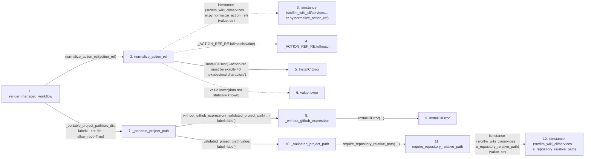

# render_managed_workflow

**Entry point:** `render_managed_workflow` (`api`)
**Source:** [ci_installer](../modules/ci_installer.md)
**Modules touched:** [ci_installer](../modules/ci_installer.md), [validation](../modules/validation.md)

## Call sequence

> Static overview in presentation order, not runtime execution order. Arrows retain captured callers; representative internal continuations and boundary examples precede repeated helper detail.

```mermaid
sequenceDiagram
    participant p0 as render_managed_workflow
    participant p1 as normalize_action_ref
    participant p2 as _portable_project_path
    participant p3 as _workflow_body
    participant p4 as _without_github_expression
    participant p5 as _validated_project_path
    participant p6 as require_repository_relative_path
    participant p7 as require_portable_relative_path
    participant p8 as _default_path_error
    participant p9 as _check_path_collision
    participant p10 as require_portable_path_component
    participant p11 as InstallCiError
    participant p12 as _syntax_key
    participant p13 as _known_syntax
    participant p14 as _remember_syntax
    participant p15 as SharedValidationError
    participant p16 as portable_path_key
    participant p17 as hashlib.sha256
    participant p18 as hashlib.sha256(…).hexdigest
    participant p19 as body.encode
    participant p20 as (…).encode
    participant p21 as isinstance (src/llm_wiki_cli/services…er.py:normalize_action_ref)
    participant p22 as json.dumps
    participant p23 as _ACTION_REF_RE.fullmatch
    participant p24 as value.lower
    participant p25 as isinstance (src/llm_wiki_cli/services…e_repository_relative_path)
    participant p26 as value.strip
    participant p27 as any (src/llm_wiki_cli/services…e_repository_relative_path)
    participant p28 as ord (src/llm_wiki_cli/services…e_repository_relative_path)
    p0->>p1: normalize_action_ref
    p0->>p2: _portable_project_path
    p0->>p3: _workflow_body
    p2->>p4: _without_github_expression
    p2->>p5: _validated_project_path
    p5->>p6: require_repository_relative_path
    p6->>p7: require_portable_relative_path
    p7->>p8: _default_path_error
    p7->>p9: _check_path_collision
    p7->>p10: require_portable_path_component
    p1->>p11: InstallCiError
    p6->>p12: _syntax_key
    p6->>p13: _known_syntax
    p6->>p14: _remember_syntax
    p8->>p15: SharedValidationError
    p9->>p16: portable_path_key
    p0-->>p17: hashlib.sha256(body.encode(...))
    p0-->>p18: hashlib.sha256(…).hexdigest
    p0-->>p19: body.encode('utf-8')
    p0-->>p20: (…).encode('utf-8')
    p1-->>p21: isinstance (src/llm_wiki_cli/services…er.py:normalize_action_ref)(value, str)
    p3-->>p22: json.dumps(src_dir)
    p1-->>p23: _ACTION_REF_RE.fullmatch(value)
    p3-->>p22: json.dumps(wiki_dir)
    p1-->>p24: value.lower
    p6-->>p25: isinstance (src/llm_wiki_cli/services…e_repository_relative_path)(value, str)
    p6-->>p26: value.strip
    p6-->>p27: any (src/llm_wiki_cli/services…e_repository_relative_path)(...)
    p6-->>p28: ord (src/llm_wiki_cli/services…e_repository_relative_path)(character)
    p6-->>p28: ord (src/llm_wiki_cli/services…e_repository_relative_path)(character)
```

<!-- Auto-generated from static call edges. Dashed arrows are external or unresolved calls. Reviewed runtime conditions and side effects belong in Behavior. -->

> Call sequence diagram shows 30 of 97 interactions; 67 omitted to keep the visualization within the 30-interaction and generated-diagram limits, with uncertain identities omitted rather than inferred.

> Captured boundary calls: external 8 of 27 (19 omitted); unresolved 6 of 29 (23 omitted). These counts cover the captured static trace.

Omitted captured detail, grouped by actual caller occurrence and target module:

| Caller | Parent step | Target module | Kind | Omitted interactions |
| --- | --- | --- | --- | --- |
| `src/llm_wiki_cli/services/ci_installer.py:_without_github_expression` | 8 | [src/llm_wiki_cli/services/ci_installer.py](../modules/ci_installer.md) | internal | 1 |
| `src/llm_wiki_cli/services/validation.py:_syntax_key` | 13 | - | external | 6 |
| `src/llm_wiki_cli/services/validation.py:_known_syntax` | 20 | - | unresolved | 2 |
| `src/llm_wiki_cli/services/validation.py:require_repository_relative_path` | 11 | - | unresolved | 4 |
| `src/llm_wiki_cli/services/validation.py:require_repository_relative_path` | 11 | - | external | 3 |
| `src/llm_wiki_cli/services/validation.py:require_portable_relative_path` | 34 | - | external | 4 |
| `src/llm_wiki_cli/services/validation.py:require_portable_relative_path` | 34 | [src/llm_wiki_cli/services/validation.py](../modules/validation.md) | internal | 10 |
| `src/llm_wiki_cli/services/validation.py:_check_path_collision` | 43 | - | unresolved | 2 |
> Omission summary shows 8 of 17 groups; 9 further groups are not expanded here. Counts above include all omitted interactions.
> Detailed flow queries retain their own coverage and limits; omitted paths may execute at runtime.

> Trace truncated at the depth limit; deeper calls are omitted.

## Data flow

<!-- Auto-generated static analysis. Treat values and boundaries as best-effort hints, not runtime proof. -->

### Analysis coverage

**Effect analysis partially available.** Flow assembly and source effect analysis are separate; empty observations do not prove an empty handler body.

Source steps: 42; effect analysis evaluated: 23, partial: 3, unavailable: 16. Counts include steps omitted from the displayed trace.

Collector observations for 26 source steps with known totals: observed: 130, emitted: 115, omitted: 15. Unavailable totals are excluded.

- Callable record unavailable; the selected entry symbol has no represented callable body.
- Effect collector omitted observations before flow assembly; displayed effects are partial.
- Effect collector totals unavailable; observed counts cover captured records only.

| Step | Callable record | Effect analysis | Collector totals | Observed | Emitted | Omitted |
|---|---|---|---|---:|---:|---:|
| `render_managed_workflow` | `available` | `evaluated` | `available` | `5` | `5` | `0` |
| `normalize_action_ref` | `available` | `evaluated` | `available` | `2` | `2` | `0` |
| `isinstance (src/llm_wiki_cli/services…er.py:normalize_action_ref)` | `not_applicable` | `not_applicable` | `not_applicable` | — | — | — |
| `_ACTION_REF_RE.fullmatch` | `not_applicable` | `not_applicable` | `not_applicable` | — | — | — |
| `InstallCiError` | `unavailable` | `unavailable` | `unavailable` | — | — | — |
| `value.lower` | `not_applicable` | `not_applicable` | `not_applicable` | — | — | — |
| `_portable_project_path` | `available` | `evaluated` | `available` | `5` | `5` | `0` |
| `_without_github_expression` | `available` | `evaluated` | `available` | `3` | `3` | `0` |
| `InstallCiError` | `unavailable` | `unavailable` | `unavailable` | — | — | — |
| `_validated_project_path` | `available` | `evaluated` | `available` | `3` | `3` | `0` |
| `require_repository_relative_path` | `available` | `partial` | `available` | `14` | `10` | `4` |
| `isinstance (src/llm_wiki_cli/services…e_repository_relative_path)` | `not_applicable` | `not_applicable` | `not_applicable` | — | — | — |

### Step data

| Step | Inputs | Reads | Writes | Returns |
|---|---|---|---|---|
| `render_managed_workflow` | `action_ref: str`, `src_dir: str`, `wiki_dir: str` | `MANAGED_WORKFLOW_SCHEMA` | - | `...` |
| `normalize_action_ref` | `value: object` | - | - | `value.lower(...)` |
| `isinstance (src/llm_wiki_cli/services…er.py:normalize_action_ref)` | - | - | - | - |
| `_ACTION_REF_RE.fullmatch` | - | - | - | - |
| `InstallCiError` | - | - | - | - |
| `value.lower` | - | - | - | - |
| `_portable_project_path` | `value: object`, `label: str`, `allow_root: bool` | - | - | `'.'`, `_without_github_expression(...)` |
| `_without_github_expression` | `path: str`, `label: str` | - | - | `path` |
| `InstallCiError` | - | - | - | - |
| `_validated_project_path` | `value: object`, `label: str` | - | - | `require_repository_relative_path(...)` |
| `require_repository_relative_path` | `value: object`, `text_error: Exception`, `posix_error: Exception`, `normalized_error: Exception`, `absolute_error: Exception \| None`, `separator_error: Exception \| None`, `control_error: Exception \| None`, `reject_delete_character: bool` | - | - | `cached`, `_remember_syntax(...)` |
| `isinstance (src/llm_wiki_cli/services…e_repository_relative_path)` | - | - | - | - |

### Call data

| From | To | Line | Call |
|---|---|---:|---|
| render_managed_workflow | normalize_action_ref | 217 | `normalize_action_ref(action_ref)` |
| normalize_action_ref | isinstance (src/llm_wiki_cli/services…er.py:normalize_action_ref) | 63 | `isinstance(value, str)` |
| normalize_action_ref | _ACTION_REF_RE.fullmatch | 63 | `_ACTION_REF_RE.fullmatch(value)` |
| normalize_action_ref | InstallCiError | 64 | `InstallCiError('--action-ref must be exactly 40 hexadecimal characters')` |
| normalize_action_ref | value.lower | 65 | `value.lower(data not statically known)` |
| render_managed_workflow | _portable_project_path | 218 | `_portable_project_path(src_dir, label='--src-dir', allow_root=True)` |
| _portable_project_path | _without_github_expression | 100 | `_without_github_expression(_validated_project_path(...), label=label)` |
| _without_github_expression | InstallCiError | 93 | `InstallCiError(...)` |
| _portable_project_path | _validated_project_path | 101 | `_validated_project_path(value, label=label)` |
| _validated_project_path | require_repository_relative_path | 69 | `require_repository_relative_path(value, text_error=InstallCiError(...), posix_error=InstallCiError(...), normalized_error=InstallCiError(...), absolute_error=InstallCiError(...), separator_error=InstallCiError(...), control_error=InstallCiError(...), reject_delete_character=True, leading_backslash_is_absolute=True, portability_error=InstallCiError(...))` |
| require_repository_relative_path | isinstance (src/llm_wiki_cli/services…e_repository_relative_path) | 299 | `isinstance(value, str)` |

### Boundary effects

*No boundary-effect observations were captured in this static trace.*

### Static analysis gaps

| Kind | Step | Target | Line |
|---|---|---|---:|
| external_call | `normalize_action_ref` | `isinstance` | 63 |
| unresolved_call | `normalize_action_ref` | `_ACTION_REF_RE.fullmatch` | 63 |
| unresolved_call | `normalize_action_ref` | `value.lower` | 65 |
| external_call | `require_repository_relative_path` | `isinstance` | 299 |
| step_limit | `render_managed_workflow` | `first 12 steps` | 0 |
| truncated_flow | `render_managed_workflow` | `depth limit` | 0 |

## Behavior

This flow starts at `render_managed_workflow` and is classified as `api`. The generated call and data-flow sections are bounded static projections; runtime conditions and side effects require source-level confirmation.
