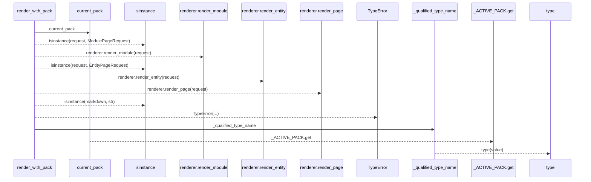
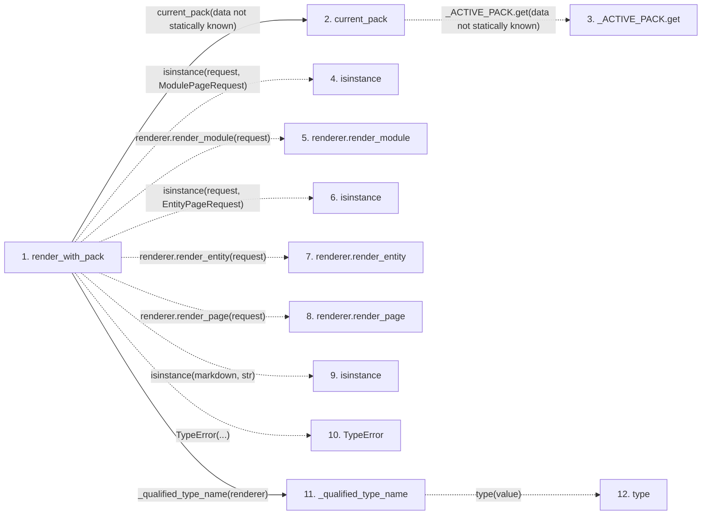

# render_with_pack

**Entry point:** `render_with_pack` (`api`)
**Source:** [domain_pack](../modules/domain_pack.md)
**Modules touched:** [domain_pack](../modules/domain_pack.md)

## Call sequence

> Static overview in presentation order, not runtime execution order. Arrows retain captured callers; representative internal continuations and boundary examples precede repeated helper detail.

<!-- Auto-generated from static call edges. Dashed arrows are external or unresolved calls. Reviewed runtime conditions and side effects belong in Behavior. -->

> Call sequence diagram shows 11 of 11 interactions; 0 omitted to keep the visualization within the 30-interaction and generated-diagram limits, with uncertain identities omitted rather than inferred.

> Captured boundary calls: external 5 of 5 (0 omitted); unresolved 4 of 4 (0 omitted). These counts cover the captured static trace.
> Detailed flow queries retain their own coverage and limits; omitted paths may execute at runtime.

## Data flow

<!-- Auto-generated static analysis. Treat values and boundaries as best-effort hints, not runtime proof. -->

### Analysis coverage

**Effect analysis evaluated.** Flow assembly and source effect analysis are separate; empty observations do not prove an empty handler body.

Source steps: 3; effect analysis evaluated: 3, partial: 0, unavailable: 0. Counts include steps omitted from the displayed trace.

Collector observations for 3 source steps with known totals: observed: 8, emitted: 8, omitted: 0. Unavailable totals are excluded.

### Step data

| Step | Inputs | Reads | Writes | Returns |
|---|---|---|---|---|
| `render_with_pack` | `request: ModulePageRequest \| EntityPageRequest \| PageRequest` | `ModulePageRequest`, `EntityPageRequest` | - | `markdown` |
| `current_pack` | - | `CODE_DOCS_PACK` | - | `...` |
| `_ACTIVE_PACK.get` | - | - | - | - |
| `isinstance` | - | - | - | - |
| `renderer.render_module` | - | - | - | - |
| `isinstance` | - | - | - | - |
| `renderer.render_entity` | - | - | - | - |
| `renderer.render_page` | - | - | - | - |
| `isinstance` | - | - | - | - |
| `TypeError` | - | - | - | - |
| `_qualified_type_name` | `value: object` | - | - | `...` |
| `type` | - | - | - | - |

### Call data

| From | To | Line | Call |
|---|---|---:|---|
| render_with_pack | current_pack | 240 | `current_pack(data not statically known)` |
| current_pack | _ACTIVE_PACK.get | 850 | `_ACTIVE_PACK.get(data not statically known)` |
| render_with_pack | isinstance | 241 | `isinstance(request, ModulePageRequest)` |
| render_with_pack | renderer.render_module | 242 | `renderer.render_module(request)` |
| render_with_pack | isinstance | 243 | `isinstance(request, EntityPageRequest)` |
| render_with_pack | renderer.render_entity | 244 | `renderer.render_entity(request)` |
| render_with_pack | renderer.render_page | 246 | `renderer.render_page(request)` |
| render_with_pack | isinstance | 247 | `isinstance(markdown, str)` |
| render_with_pack | TypeError | 248 | `TypeError(...)` |
| render_with_pack | _qualified_type_name | 249 | `_qualified_type_name(renderer)` |
| _qualified_type_name | type | 750 | `type(value)` |

### Boundary effects

*No boundary-effect observations were captured in this static trace.*

### Static analysis gaps

| Kind | Step | Target | Line |
|---|---|---|---:|
| unresolved_call | `current_pack` | `_ACTIVE_PACK.get` | 850 |
| external_call | `render_with_pack` | `isinstance` | 241 |
| unresolved_call | `render_with_pack` | `renderer.render_module` | 242 |
| external_call | `render_with_pack` | `isinstance` | 243 |
| unresolved_call | `render_with_pack` | `renderer.render_entity` | 244 |
| unresolved_call | `render_with_pack` | `renderer.render_page` | 246 |
| external_call | `render_with_pack` | `isinstance` | 247 |
| external_call | `render_with_pack` | `TypeError` | 248 |
| external_call | `_qualified_type_name` | `type` | 750 |

## Behavior

This flow starts at `render_with_pack` and is classified as `api`. The generated call and data-flow sections are bounded static projections; runtime conditions and side effects require source-level confirmation.
