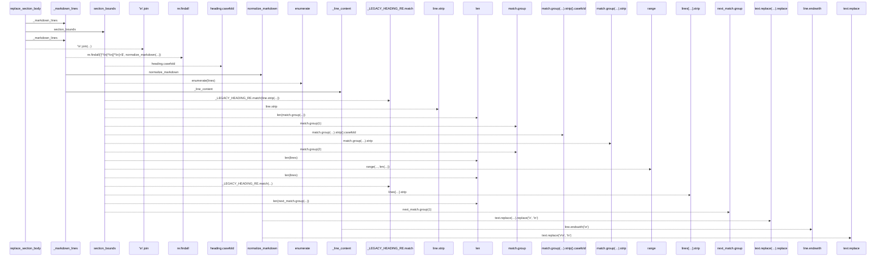
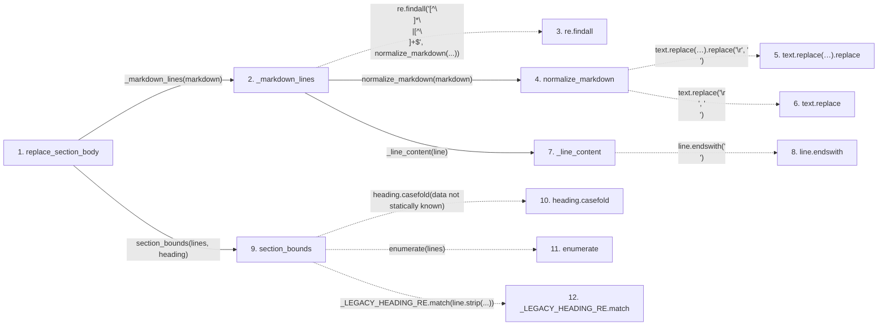

# replace_section_body

**Entry point:** `replace_section_body` (`api`)
**Source:** [markdown_sections](../modules/markdown_sections.md)
**Modules touched:** [markdown_sections](../modules/markdown_sections.md)

## Call sequence

> Static overview in presentation order, not runtime execution order. Arrows retain captured callers; representative internal continuations and boundary examples precede repeated helper detail.

<!-- Auto-generated from static call edges. Dashed arrows are external or unresolved calls. Reviewed runtime conditions and side effects belong in Behavior. -->

> Call sequence diagram shows 26 of 26 interactions; 0 omitted to keep the visualization within the 30-interaction and generated-diagram limits, with uncertain identities omitted rather than inferred.

> Captured boundary calls: external 7 of 7 (0 omitted); unresolved 14 of 14 (0 omitted). These counts cover the captured static trace.
> Detailed flow queries retain their own coverage and limits; omitted paths may execute at runtime.

## Data flow

<!-- Auto-generated static analysis. Treat values and boundaries as best-effort hints, not runtime proof. -->

### Analysis coverage

**Effect analysis evaluated.** Flow assembly and source effect analysis are separate; empty observations do not prove an empty handler body.

Source steps: 6; effect analysis evaluated: 6, partial: 0, unavailable: 0. Counts include steps omitted from the displayed trace.

### Step data

| Step | Inputs | Reads | Writes | Returns |
|---|---|---|---|---|
| `replace_section_body` | `markdown: str`, `heading: str`, `body: str` | - | - | `markdown`, `...` |
| `_markdown_lines` | `markdown: str`, `keepends: bool` | - | - | `...` |
| `re.findall` | - | - | - | - |
| `normalize_markdown` | `text: str` | - | - | `...` |
| `text.replace(…).replace` | - | - | - | - |
| `text.replace` | - | - | - | - |
| `_line_content` | `line: str` | - | - | `...` |
| `line.endswith` | - | - | - | - |
| `section_bounds` | `lines: list[str]`, `heading: str` | - | - | `(...)`, `None` |
| `heading.casefold` | - | - | - | - |
| `enumerate` | - | - | - | - |
| `_LEGACY_HEADING_RE.match` | - | - | - | - |

### Call data

| From | To | Line | Call |
|---|---|---:|---|
| replace_section_body | _markdown_lines | 714 | `_markdown_lines(markdown)` |
| _markdown_lines | re.findall | 218 | `re.findall('[^\\n]*\\n\|[^\\n]+$', normalize_markdown(...))` |
| _markdown_lines | normalize_markdown | 218 | `normalize_markdown(markdown)` |
| normalize_markdown | text.replace(…).replace | 82 | `text.replace('\r\n', '\n').replace('\r', '\n')` |
| normalize_markdown | text.replace | 82 | `text.replace('\r\n', '\n')` |
| _markdown_lines | _line_content | 219 | `_line_content(line)` |
| _line_content | line.endswith | 212 | `line.endswith('\n')` |
| replace_section_body | section_bounds | 715 | `section_bounds(lines, heading)` |
| section_bounds | heading.casefold | 669 | `heading.casefold(data not statically known)` |
| section_bounds | enumerate | 670 | `enumerate(lines)` |
| section_bounds | _LEGACY_HEADING_RE.match | 671 | `_LEGACY_HEADING_RE.match(line.strip(...))` |

### Boundary effects

*No boundary-effect observations were captured in this static trace.*

### Static analysis gaps

| Kind | Step | Target | Line |
|---|---|---|---:|
| external_call | `_markdown_lines` | `re.findall` | 218 |
| unresolved_call | `normalize_markdown` | `text.replace('\r\n', '\n').replace` | 82 |
| unresolved_call | `normalize_markdown` | `text.replace` | 82 |
| unresolved_call | `_line_content` | `line.endswith` | 212 |
| unresolved_call | `section_bounds` | `heading.casefold` | 669 |
| external_call | `section_bounds` | `enumerate` | 670 |
| unresolved_call | `section_bounds` | `_LEGACY_HEADING_RE.match` | 671 |
| step_limit | `replace_section_body` | `first 12 steps` | 0 |

## Behavior

This flow starts at `replace_section_body` and is classified as `api`. The generated call and data-flow sections are bounded static projections; runtime conditions and side effects require source-level confirmation.
