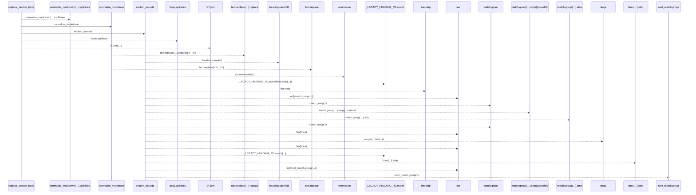
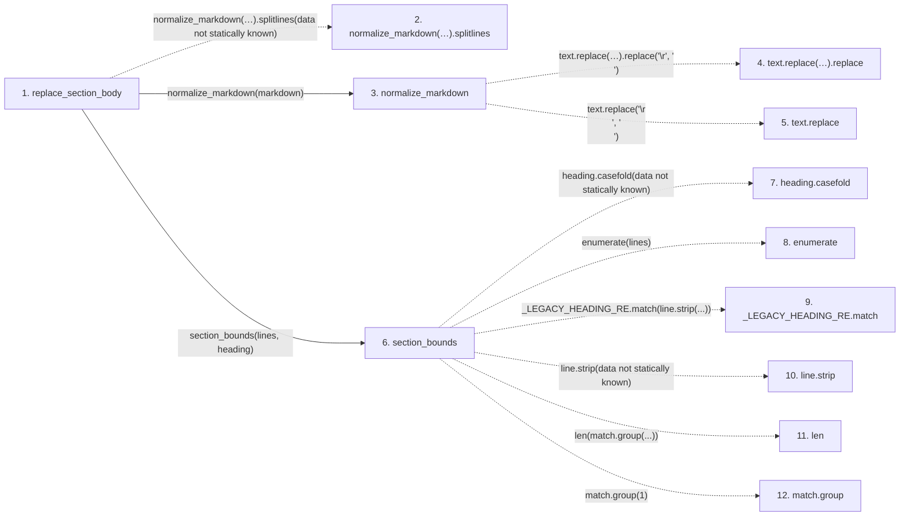

# replace_section_body

**Entry point:** `replace_section_body` (`api`)
**Source:** [markdown_sections](../modules/markdown_sections.md)
**Modules touched:** [markdown_sections](../modules/markdown_sections.md)

## Call sequence

> Static overview in presentation order, not runtime execution order. Arrows retain captured callers; representative internal continuations and boundary examples precede repeated helper detail.

<!-- Auto-generated from static call edges. Dashed arrows are external or unresolved calls. Reviewed runtime conditions and side effects belong in Behavior. -->

> Call sequence diagram shows 23 of 23 interactions; 0 omitted to keep the visualization within the 30-interaction and generated-diagram limits, with uncertain identities omitted rather than inferred.

> Captured boundary calls: external 6 of 6 (0 omitted); unresolved 15 of 15 (0 omitted). These counts cover the captured static trace.
> Detailed flow queries retain their own coverage and limits; omitted paths may execute at runtime.

## Data flow

<!-- Auto-generated static analysis. Treat values and boundaries as best-effort hints, not runtime proof. -->

### Step data

| Step | Inputs | Reads | Writes | Returns |
|---|---|---|---|---|
| `replace_section_body` | `markdown: str`, `heading: str`, `body: str` | - | - | `markdown`, `...` |
| `normalize_markdown(…).splitlines` | - | - | - | - |
| `normalize_markdown` | `text: str` | - | - | `...` |
| `text.replace(…).replace` | - | - | - | - |
| `text.replace` | - | - | - | - |
| `section_bounds` | `lines: list[str]`, `heading: str` | - | - | `(...)`, `None` |
| `heading.casefold` | - | - | - | - |
| `enumerate` | - | - | - | - |
| `_LEGACY_HEADING_RE.match` | - | - | - | - |
| `line.strip` | - | - | - | - |
| `len` | - | - | - | - |
| `match.group` | - | - | - | - |

### Call data

| From | To | Line | Call |
|---|---|---:|---|
| replace_section_body | normalize_markdown(…).splitlines | 706 | `normalize_markdown(markdown).splitlines(data not statically known)` |
| replace_section_body | normalize_markdown | 706 | `normalize_markdown(markdown)` |
| normalize_markdown | text.replace(…).replace | 81 | `text.replace('\r\n', '\n').replace('\r', '\n')` |
| normalize_markdown | text.replace | 81 | `text.replace('\r\n', '\n')` |
| replace_section_body | section_bounds | 707 | `section_bounds(lines, heading)` |
| section_bounds | heading.casefold | 661 | `heading.casefold(data not statically known)` |
| section_bounds | enumerate | 662 | `enumerate(lines)` |
| section_bounds | _LEGACY_HEADING_RE.match | 663 | `_LEGACY_HEADING_RE.match(line.strip(...))` |
| section_bounds | line.strip | 663 | `line.strip(data not statically known)` |
| section_bounds | len | 666 | `len(match.group(...))` |
| section_bounds | match.group | 666 | `match.group(1)` |

### Boundary effects

*No boundary effects detected.*

### Static analysis gaps

| Kind | Step | Target | Line |
|---|---|---|---:|
| unresolved_call | `replace_section_body` | `normalize_markdown(markdown).splitlines` | 706 |
| unresolved_call | `normalize_markdown` | `text.replace('\r\n', '\n').replace` | 81 |
| unresolved_call | `normalize_markdown` | `text.replace` | 81 |
| unresolved_call | `section_bounds` | `heading.casefold` | 661 |
| external_call | `section_bounds` | `enumerate` | 662 |
| unresolved_call | `section_bounds` | `_LEGACY_HEADING_RE.match` | 663 |
| unresolved_call | `section_bounds` | `line.strip` | 663 |
| unresolved_call | `section_bounds` | `match.group` | 666 |
| step_limit | `replace_section_body` | `first 12 steps` | 0 |

## Behavior

This flow starts at `replace_section_body` and is classified as `api`. The generated call and data-flow sections are bounded static projections; runtime conditions and side effects require source-level confirmation.
