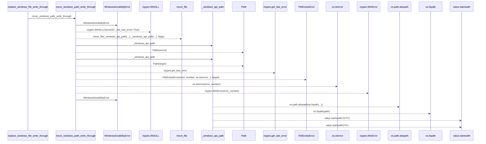
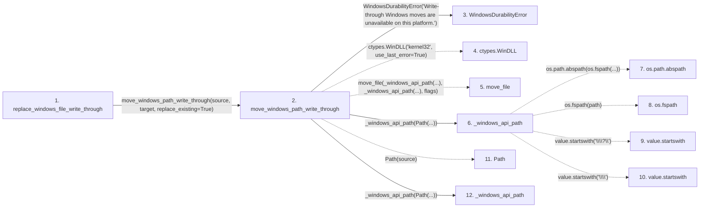

# replace_windows_file_write_through

**Entry point:** `replace_windows_file_write_through` (`api`)
**Source:** [filesystem_guard](../modules/filesystem_guard.md)
**Modules touched:** [filesystem_guard](../modules/filesystem_guard.md)

## Call sequence

> Static overview in presentation order, not runtime execution order. Arrows retain captured callers; representative internal continuations and boundary examples precede repeated helper detail.

<!-- Auto-generated from static call edges. Dashed arrows are external or unresolved calls. Reviewed runtime conditions and side effects belong in Behavior. -->

> Call sequence diagram shows 17 of 17 interactions; 0 omitted to keep the visualization within the 30-interaction and generated-diagram limits, with uncertain identities omitted rather than inferred.

> Captured boundary calls: external 9 of 9 (0 omitted); unresolved 3 of 3 (0 omitted). These counts cover the captured static trace.
> Detailed flow queries retain their own coverage and limits; omitted paths may execute at runtime.

## Data flow

<!-- Auto-generated static analysis. Treat values and boundaries as best-effort hints, not runtime proof. -->

### Analysis coverage

**Effect analysis partially available.** Flow assembly and source effect analysis are separate; empty observations do not prove an empty handler body.

Source steps: 6; effect analysis evaluated: 4, partial: 0, unavailable: 2. Counts include steps omitted from the displayed trace.

- Callable record unavailable; the selected entry symbol has no represented callable body.
- Effect collector totals unavailable; observed counts cover captured records only.

| Step | Callable record | Effect analysis | Collector totals |
|---|---|---|---|
| `replace_windows_file_write_through` | `available` | `evaluated` | `available` |
| `move_windows_path_write_through` | `available` | `evaluated` | `available` |
| `WindowsDurabilityError` | `unavailable` | `unavailable` | `unavailable` |
| `ctypes.WinDLL` | `not_applicable` | `not_applicable` | `not_applicable` |
| `move_file` | `not_applicable` | `not_applicable` | `not_applicable` |
| `_windows_api_path` | `available` | `evaluated` | `available` |
| `os.path.abspath` | `not_applicable` | `not_applicable` | `not_applicable` |
| `os.fspath` | `not_applicable` | `not_applicable` | `not_applicable` |
| `value.startswith` | `not_applicable` | `not_applicable` | `not_applicable` |
| `value.startswith` | `not_applicable` | `not_applicable` | `not_applicable` |
| `Path` | `not_applicable` | `not_applicable` | `not_applicable` |
| `_windows_api_path` | `available` | `evaluated` | `available` |

### Step data

| Step | Inputs | Reads | Writes | Returns |
|---|---|---|---|---|
| `replace_windows_file_write_through` | `source: Path`, `target: Path` | - | - | - |
| `move_windows_path_write_through` | `source: Path`, `target: Path`, `replace_existing: bool` | `os` | `move_file.argtypes`, `move_file.restype` | - |
| `WindowsDurabilityError` | - | - | - | - |
| `ctypes.WinDLL` | - | - | - | - |
| `move_file` | - | - | - | - |
| `_windows_api_path` | `path: Path` | - | - | `value`, `...`, `...` |
| `os.path.abspath` | - | - | - | - |
| `os.fspath` | - | - | - | - |
| `value.startswith` | - | - | - | - |
| `value.startswith` | - | - | - | - |
| `Path` | - | - | - | - |
| `_windows_api_path` | `path: Path` | - | - | `value`, `...`, `...` |

### Call data

| From | To | Line | Call |
|---|---|---:|---|
| replace_windows_file_write_through | move_windows_path_write_through | 685 | `move_windows_path_write_through(source, target, replace_existing=True)` |
| move_windows_path_write_through | WindowsDurabilityError | 701 | `WindowsDurabilityError('Write-through Windows moves are unavailable on this platform.')` |
| move_windows_path_write_through | ctypes.WinDLL | 706 | `ctypes.WinDLL('kernel32', use_last_error=True)` |
| move_windows_path_write_through | move_file | 713 | `move_file(_windows_api_path(...), _windows_api_path(...), flags)` |
| move_windows_path_write_through | _windows_api_path | 714 | `_windows_api_path(Path(...))` |
| _windows_api_path | os.path.abspath | 1310 | `os.path.abspath(os.fspath(...))` |
| _windows_api_path | os.fspath | 1310 | `os.fspath(path)` |
| _windows_api_path | value.startswith | 1311 | `value.startswith('\\\\?\\')` |
| _windows_api_path | value.startswith | 1313 | `value.startswith('\\\\')` |
| move_windows_path_write_through | Path | 714 | `Path(source)` |
| move_windows_path_write_through | _windows_api_path | 715 | `_windows_api_path(Path(...))` |

### Boundary effects

*No boundary-effect observations were captured in this static trace.*

### Static analysis gaps

| Kind | Step | Target | Line |
|---|---|---|---:|
| external_call | `move_windows_path_write_through` | `ctypes.WinDLL` | 706 |
| unresolved_call | `move_windows_path_write_through` | `move_file` | 713 |
| external_call | `_windows_api_path` | `os.path.abspath` | 1310 |
| external_call | `_windows_api_path` | `os.fspath` | 1310 |
| unresolved_call | `_windows_api_path` | `value.startswith` | 1311 |
| unresolved_call | `_windows_api_path` | `value.startswith` | 1313 |
| step_limit | `replace_windows_file_write_through` | `first 12 steps` | 0 |

## Behavior

This flow starts at `replace_windows_file_write_through` and is classified as `api`. The generated call and data-flow sections are bounded static projections; runtime conditions and side effects require source-level confirmation.
