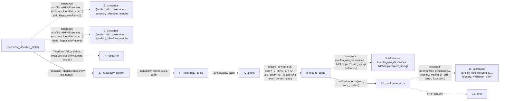

# repository_identities_match

**Entry point:** `repository_identities_match` (`api`)
**Source:** [knowledge_model](../modules/knowledge_model.md)
**Modules touched:** [knowledge_model](../modules/knowledge_model.md), [validation](../modules/validation.md)

## Call sequence

> Static overview in presentation order, not runtime execution order. Arrows retain captured callers; representative internal continuations and boundary examples precede repeated helper detail.

```mermaid
sequenceDiagram
    participant p0 as repository_identities_match
    participant p1 as isinstance (src/llm_wiki_cli/services…epository_identities_match)
    participant p2 as TypeError
    participant p3 as _repository_identity
    participant p4 as _nonempty_string
    participant p5 as _REPOSITORY_IDENTITY_RE.fullmatch
    participant p6 as KnowledgeModelError
    participant p7 as text.lower().endswith
    participant p8 as text.lower
    participant p9 as _string
    participant p10 as require_nonempty_text
    participant p11 as require_string
    participant p12 as isinstance (src/llm_wiki_cli/services…n.py:require_nonempty_text)
    participant p13 as _validation_error
    participant p14 as value.strip
    participant p15 as contains_control_character
    participant p16 as isinstance (src/llm_wiki_cli/services…lidation.py:require_string)
    participant p17 as pattern.search
    participant p18 as value.encode
    participant p19 as isinstance (src/llm_wiki_cli/services…ation.py:_validation_error)
    participant p20 as error
    p0-->>p1: isinstance (src/llm_wiki_cli/services…epository_identities_match)(left, RepositoryRecord)
    p0-->>p1: isinstance (src/llm_wiki_cli/services…epository_identities_match)(right, RepositoryRecord)
    p0-->>p2: TypeError('left and right must be RepositoryRecord values')
    p0->>p3: _repository_identity
    p0->>p3: _repository_identity
    p3->>p4: _nonempty_string
    p3-->>p5: _REPOSITORY_IDENTITY_RE.fullmatch(text)
    p3->>p6: KnowledgeModelError
    p3-->>p7: text.lower().endswith('.git')
    p3-->>p8: text.lower
    p3->>p6: KnowledgeModelError
    p4->>p9: _string
    p4->>p10: require_nonempty_text
    p9->>p11: require_string
    p10-->>p12: isinstance (src/llm_wiki_cli/services…n.py:require_nonempty_text)(value, str)
    p10->>p13: _validation_error
    p10-->>p14: value.strip
    p10->>p13: _validation_error
    p10->>p13: _validation_error
    p10->>p15: contains_control_character
    p10->>p13: _validation_error
    p11-->>p16: isinstance (src/llm_wiki_cli/services…lidation.py:require_string)(value, str)
    p15-->>p17: pattern.search(value)
    p11->>p13: _validation_error
    p11-->>p18: value.encode('utf-8')
    p11->>p13: _validation_error
    p13-->>p19: isinstance (src/llm_wiki_cli/services…ation.py:_validation_error)(error, Exception)
    p13-->>p20: error(context)
```

<!-- Auto-generated from static call edges. Dashed arrows are external or unresolved calls. Reviewed runtime conditions and side effects belong in Behavior. -->

> Call sequence diagram shows 28 of 28 interactions; 0 omitted to keep the visualization within the 30-interaction and generated-diagram limits, with uncertain identities omitted rather than inferred.

> Captured boundary calls: external 6 of 6 (0 omitted); unresolved 7 of 7 (0 omitted). These counts cover the captured static trace.
> Detailed flow queries retain their own coverage and limits; omitted paths may execute at runtime.

## Data flow

<!-- Auto-generated static analysis. Treat values and boundaries as best-effort hints, not runtime proof. -->

### Analysis coverage

**Effect analysis partially available.** Flow assembly and source effect analysis are separate; empty observations do not prove an empty handler body.

Source steps: 16; effect analysis evaluated: 14, partial: 0, unavailable: 2. Counts include steps omitted from the displayed trace.

Collector observations for 14 source steps with known totals: observed: 60, emitted: 60, omitted: 0. Unavailable totals are excluded.

- Callable record unavailable for one or more source steps; those steps have no represented callable body.
- Effect collector totals unavailable; observed counts cover captured records only.

| Step | Callable record | Effect analysis | Collector totals | Observed | Emitted | Omitted |
|---|---|---|---|---:|---:|---:|
| `repository_identities_match` | `available` | `evaluated` | `available` | `8` | `8` | `0` |
| `isinstance (src/llm_wiki_cli/services…epository_identities_match)` | `not_applicable` | `not_applicable` | `not_applicable` | — | — | — |
| `isinstance (src/llm_wiki_cli/services…epository_identities_match)` | `not_applicable` | `not_applicable` | `not_applicable` | — | — | — |
| `TypeError` | `not_applicable` | `not_applicable` | `not_applicable` | — | — | — |
| `_repository_identity` | `available` | `evaluated` | `available` | `3` | `3` | `0` |
| `_nonempty_string` | `available` | `evaluated` | `available` | `4` | `4` | `0` |
| `_string` | `available` | `evaluated` | `available` | `5` | `5` | `0` |
| `require_string` | `available` | `evaluated` | `available` | `5` | `5` | `0` |
| `isinstance (src/llm_wiki_cli/services…lidation.py:require_string)` | `not_applicable` | `not_applicable` | `not_applicable` | — | — | — |
| `_validation_error` | `available` | `evaluated` | `available` | `3` | `3` | `0` |
| `isinstance (src/llm_wiki_cli/services…ation.py:_validation_error)` | `not_applicable` | `not_applicable` | `not_applicable` | — | — | — |
| `error` | `not_applicable` | `not_applicable` | `not_applicable` | — | — | — |

### Step data

| Step | Inputs | Reads | Writes | Returns |
|---|---|---|---|---|
| `repository_identities_match` | `left: RepositoryRecord`, `right: RepositoryRecord` | `RepositoryRecord`, `RepositoryRecord`, `RepositoryIdentitySource`, `RepositoryIdentitySource` | - | `False`, `...` |
| `isinstance (src/llm_wiki_cli/services…epository_identities_match)` | - | - | - | - |
| `isinstance (src/llm_wiki_cli/services…epository_identities_match)` | - | - | - | - |
| `TypeError` | - | - | - | - |
| `_repository_identity` | `value: object`, `path: str` | - | - | `text` |
| `_nonempty_string` | `value: object`, `path: str` | `_NONEMPTY_ERROR` | - | `require_nonempty_text(...)` |
| `_string` | `value: object`, `path: str` | `_STRING_ERROR`, `_UTF8_ERROR` | - | `require_string(...)` |
| `require_string` | `value: object`, `error: _ValidationError`, `utf8_error: _ValidationError \| None`, `error_context: str` | - | - | `value` |
| `isinstance (src/llm_wiki_cli/services…lidation.py:require_string)` | - | - | - | - |
| `_validation_error` | `error: _ValidationError`, `context: str` | - | - | `...` |
| `isinstance (src/llm_wiki_cli/services…ation.py:_validation_error)` | - | - | - | - |
| `error` | - | - | - | - |

### Call data

| From | To | Line | Call |
|---|---|---:|---|
| repository_identities_match | isinstance (src/llm_wiki_cli/services…epository_identities_match) | 528 | `isinstance(left, RepositoryRecord)` |
| repository_identities_match | isinstance (src/llm_wiki_cli/services…epository_identities_match) | 528 | `isinstance(right, RepositoryRecord)` |
| repository_identities_match | TypeError | 531 | `TypeError('left and right must be RepositoryRecord values')` |
| repository_identities_match | _repository_identity | 532 | `_repository_identity(left.identity, 'left.identity')` |
| _repository_identity | _nonempty_string | 1831 | `_nonempty_string(value, path)` |
| _nonempty_string | _string | 1750 | `_string(value, path)` |
| _string | require_string | 1741 | `require_string(value, error=_STRING_ERROR, utf8_error=_UTF8_ERROR, error_context=path)` |
| require_string | isinstance (src/llm_wiki_cli/services…lidation.py:require_string) | 761 | `isinstance(value, str)` |
| require_string | _validation_error | 762 | `_validation_error(error, error_context)` |
| _validation_error | isinstance (src/llm_wiki_cli/services…ation.py:_validation_error) | 95 | `isinstance(error, Exception)` |
| _validation_error | error | 95 | `error(context)` |

### Boundary effects

*No boundary-effect observations were captured in this static trace.*

### Static analysis gaps

| Kind | Step | Target | Line |
|---|---|---|---:|
| external_call | `repository_identities_match` | `isinstance` | 528 |
| external_call | `repository_identities_match` | `TypeError` | 531 |
| external_call | `require_string` | `isinstance` | 761 |
| external_call | `_validation_error` | `isinstance` | 95 |
| unresolved_call | `_validation_error` | `error` | 95 |
| step_limit | `repository_identities_match` | `first 12 steps` | 0 |

## Behavior

This flow starts at `repository_identities_match` and is classified as `api`. The generated call and data-flow sections are bounded static projections; runtime conditions and side effects require source-level confirmation.
