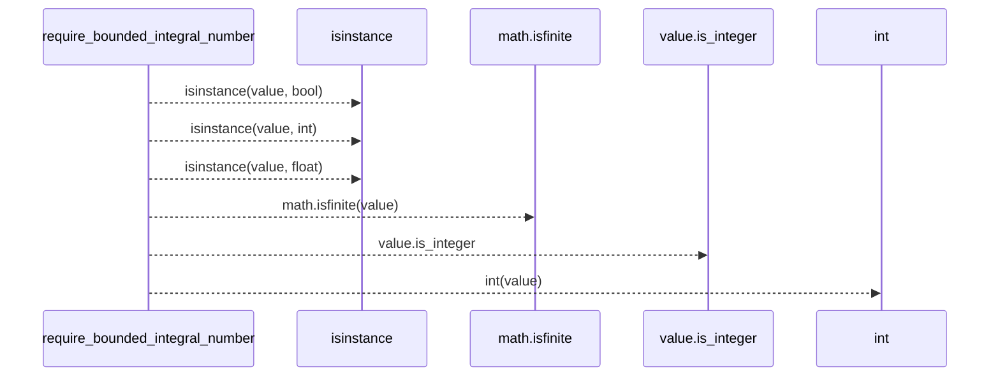
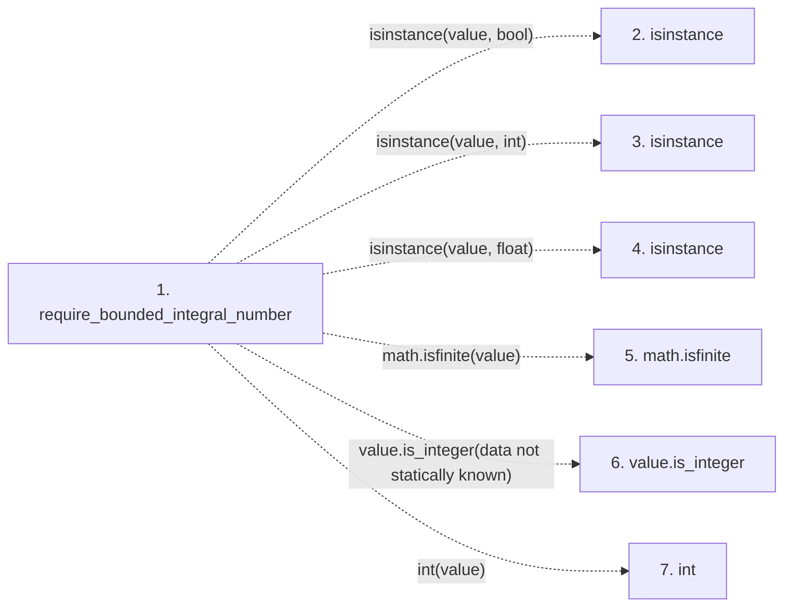

# require_bounded_integral_number

**Entry point:** `require_bounded_integral_number` (`api`)
**Source:** [validation](../modules/validation.md)
**Modules touched:** [validation](../modules/validation.md)

## Call sequence

> Static overview in presentation order, not runtime execution order. Arrows retain captured callers; representative internal continuations and boundary examples precede repeated helper detail.

<!-- Auto-generated from static call edges. Dashed arrows are external or unresolved calls. Reviewed runtime conditions and side effects belong in Behavior. -->

> Call sequence diagram shows 6 of 6 interactions; 0 omitted to keep the visualization within the 30-interaction and generated-diagram limits, with uncertain identities omitted rather than inferred.

> Captured boundary calls: external 5 of 5 (0 omitted); unresolved 1 of 1 (0 omitted). These counts cover the captured static trace.
> Detailed flow queries retain their own coverage and limits; omitted paths may execute at runtime.

## Data flow

<!-- Auto-generated static analysis. Treat values and boundaries as best-effort hints, not runtime proof. -->

### Analysis coverage

**Effect analysis evaluated.** Flow assembly and source effect analysis are separate; empty observations do not prove an empty handler body.

Source steps: 1; effect analysis evaluated: 1, partial: 0, unavailable: 0. Counts include steps omitted from the displayed trace.

Collector observations for 1 source steps with known totals: observed: 7, emitted: 7, omitted: 0. Unavailable totals are excluded.

### Step data

| Step | Inputs | Reads | Writes | Returns |
|---|---|---|---|---|
| `require_bounded_integral_number` | `value: object`, `invalid_error: Exception`, `minimum: int \| None`, `maximum: int \| None`, `bounds_error: Exception \| None`, `zero_error: Exception \| None` | - | - | `parsed` |
| `isinstance` | - | - | - | - |
| `isinstance` | - | - | - | - |
| `isinstance` | - | - | - | - |
| `math.isfinite` | - | - | - | - |
| `value.is_integer` | - | - | - | - |
| `int` | - | - | - | - |

### Call data

| From | To | Line | Call |
|---|---|---:|---|
| require_bounded_integral_number | isinstance | 903 | `isinstance(value, bool)` |
| require_bounded_integral_number | isinstance | 905 | `isinstance(value, int)` |
| require_bounded_integral_number | isinstance | 907 | `isinstance(value, float)` |
| require_bounded_integral_number | math.isfinite | 907 | `math.isfinite(value)` |
| require_bounded_integral_number | value.is_integer | 907 | `value.is_integer(data not statically known)` |
| require_bounded_integral_number | int | 908 | `int(value)` |

### Boundary effects

*No boundary-effect observations were captured in this static trace.*

### Static analysis gaps

| Kind | Step | Target | Line |
|---|---|---|---:|
| external_call | `require_bounded_integral_number` | `isinstance` | 903 |
| external_call | `require_bounded_integral_number` | `isinstance` | 905 |
| external_call | `require_bounded_integral_number` | `isinstance` | 907 |
| external_call | `require_bounded_integral_number` | `math.isfinite` | 907 |
| unresolved_call | `require_bounded_integral_number` | `value.is_integer` | 907 |

## Behavior

This flow starts at `require_bounded_integral_number` and is classified as `api`. The generated call and data-flow sections are bounded static projections; runtime conditions and side effects require source-level confirmation.
