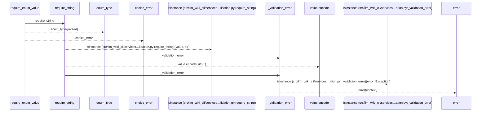
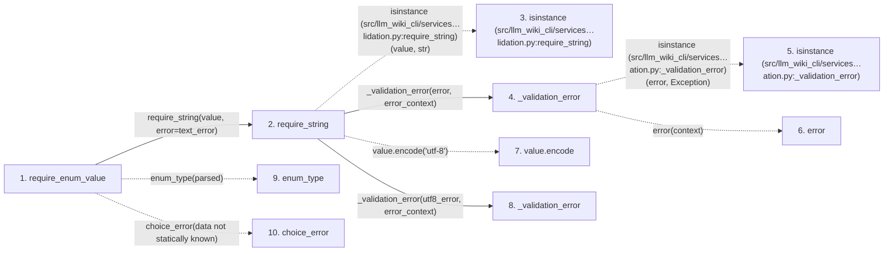

# require_enum_value

**Entry point:** `require_enum_value` (`api`)
**Source:** [validation](../modules/validation.md)
**Modules touched:** [validation](../modules/validation.md)

## Call sequence

> Static overview in presentation order, not runtime execution order. Arrows retain captured callers; representative internal continuations and boundary examples precede repeated helper detail.

<!-- Auto-generated from static call edges. Dashed arrows are external or unresolved calls. Reviewed runtime conditions and side effects belong in Behavior. -->

> Call sequence diagram shows 9 of 9 interactions; 0 omitted to keep the visualization within the 30-interaction and generated-diagram limits, with uncertain identities omitted rather than inferred.

> Captured boundary calls: external 2 of 2 (0 omitted); unresolved 4 of 4 (0 omitted). These counts cover the captured static trace.
> Detailed flow queries retain their own coverage and limits; omitted paths may execute at runtime.

## Data flow

<!-- Auto-generated static analysis. Treat values and boundaries as best-effort hints, not runtime proof. -->

### Analysis coverage

**Effect analysis evaluated.** Flow assembly and source effect analysis are separate; empty observations do not prove an empty handler body.

Source steps: 4; effect analysis evaluated: 4, partial: 0, unavailable: 0. Counts include steps omitted from the displayed trace.

Collector observations for 4 source steps with known totals: observed: 16, emitted: 16, omitted: 0. Unavailable totals are excluded.

### Step data

| Step | Inputs | Reads | Writes | Returns |
|---|---|---|---|---|
| `require_enum_value` | `value: object`, `enum_type: Callable[[str], _EnumValue]`, `text_error: Exception`, `choice_error: Callable[[], Exception]` | - | - | `enum_type(...)` |
| `require_string` | `value: object`, `error: _ValidationError`, `utf8_error: _ValidationError \| None`, `error_context: str` | - | - | `value` |
| `isinstance (src/llm_wiki_cli/services…lidation.py:require_string)` | - | - | - | - |
| `_validation_error` | `error: _ValidationError`, `context: str` | - | - | `...` |
| `isinstance (src/llm_wiki_cli/services…ation.py:_validation_error)` | - | - | - | - |
| `error` | - | - | - | - |
| `value.encode` | - | - | - | - |
| `_validation_error` | `error: _ValidationError`, `context: str` | - | - | `...` |
| `enum_type` | - | - | - | - |
| `choice_error` | - | - | - | - |

### Call data

| From | To | Line | Call |
|---|---|---:|---|
| require_enum_value | require_string | 1127 | `require_string(value, error=text_error)` |
| require_string | isinstance (src/llm_wiki_cli/services…lidation.py:require_string) | 761 | `isinstance(value, str)` |
| require_string | _validation_error | 762 | `_validation_error(error, error_context)` |
| _validation_error | isinstance (src/llm_wiki_cli/services…ation.py:_validation_error) | 95 | `isinstance(error, Exception)` |
| _validation_error | error | 95 | `error(context)` |
| require_string | value.encode | 765 | `value.encode('utf-8')` |
| require_string | _validation_error | 767 | `_validation_error(utf8_error, error_context)` |
| require_enum_value | enum_type | 1129 | `enum_type(parsed)` |
| require_enum_value | choice_error | 1131 | `choice_error(data not statically known)` |

### Boundary effects

*No boundary-effect observations were captured in this static trace.*

### Static analysis gaps

| Kind | Step | Target | Line |
|---|---|---|---:|
| external_call | `require_string` | `isinstance` | 761 |
| external_call | `_validation_error` | `isinstance` | 95 |
| unresolved_call | `_validation_error` | `error` | 95 |
| unresolved_call | `require_string` | `value.encode` | 765 |
| unresolved_call | `require_enum_value` | `enum_type` | 1129 |
| unresolved_call | `require_enum_value` | `choice_error` | 1131 |

## Behavior

This flow starts at `require_enum_value` and is classified as `api`. The generated call and data-flow sections are bounded static projections; runtime conditions and side effects require source-level confirmation.
