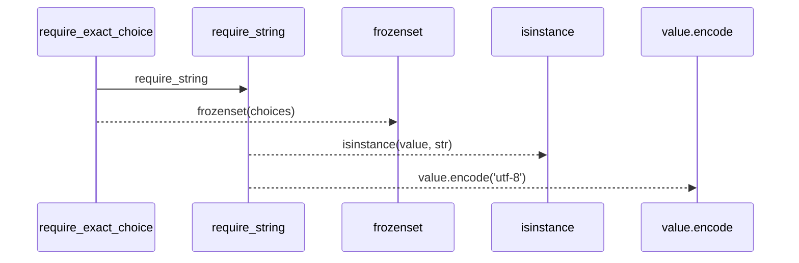
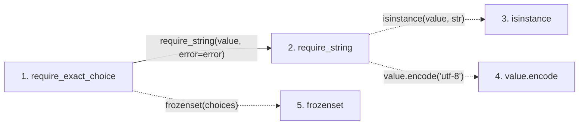

# require_exact_choice

**Entry point:** `require_exact_choice` (`api`)
**Source:** [validation](../modules/validation.md)
**Modules touched:** [validation](../modules/validation.md)

## Call sequence

> Static overview in presentation order, not runtime execution order. Arrows retain captured callers; representative internal continuations and boundary examples precede repeated helper detail.

<!-- Auto-generated from static call edges. Dashed arrows are external or unresolved calls. Reviewed runtime conditions and side effects belong in Behavior. -->

> Call sequence diagram shows 4 of 4 interactions; 0 omitted to keep the visualization within the 30-interaction and generated-diagram limits, with uncertain identities omitted rather than inferred.

> Captured boundary calls: external 2 of 2 (0 omitted); unresolved 1 of 1 (0 omitted). These counts cover the captured static trace.
> Detailed flow queries retain their own coverage and limits; omitted paths may execute at runtime.

## Data flow

<!-- Auto-generated static analysis. Treat values and boundaries as best-effort hints, not runtime proof. -->

### Analysis coverage

**Effect analysis evaluated.** Flow assembly and source effect analysis are separate; empty observations do not prove an empty handler body.

Source steps: 2; effect analysis evaluated: 2, partial: 0, unavailable: 0. Counts include steps omitted from the displayed trace.

Collector observations for 2 source steps with known totals: observed: 8, emitted: 8, omitted: 0. Unavailable totals are excluded.

### Step data

| Step | Inputs | Reads | Writes | Returns |
|---|---|---|---|---|
| `require_exact_choice` | `value: object`, `choices: Iterable[str]`, `error: Exception` | - | - | `parsed` |
| `require_string` | `value: object`, `error: Exception`, `utf8_error: Exception \| None` | - | - | `value` |
| `isinstance` | - | - | - | - |
| `value.encode` | - | - | - | - |
| `frozenset` | - | - | - | - |

### Call data

| From | To | Line | Call |
|---|---|---:|---|
| require_exact_choice | require_string | 1092 | `require_string(value, error=error)` |
| require_string | isinstance | 744 | `isinstance(value, str)` |
| require_string | value.encode | 748 | `value.encode('utf-8')` |
| require_exact_choice | frozenset | 1093 | `frozenset(choices)` |

### Boundary effects

*No boundary-effect observations were captured in this static trace.*

### Static analysis gaps

| Kind | Step | Target | Line |
|---|---|---|---:|
| external_call | `require_string` | `isinstance` | 744 |
| unresolved_call | `require_string` | `value.encode` | 748 |
| external_call | `require_exact_choice` | `frozenset` | 1093 |

## Behavior

This flow starts at `require_exact_choice` and is classified as `api`. The generated call and data-flow sections are bounded static projections; runtime conditions and side effects require source-level confirmation.
