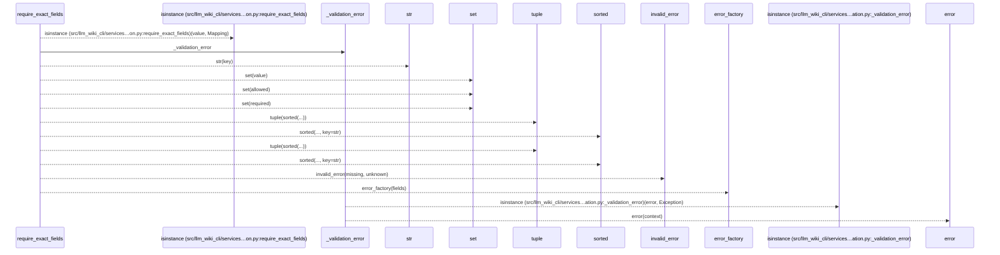
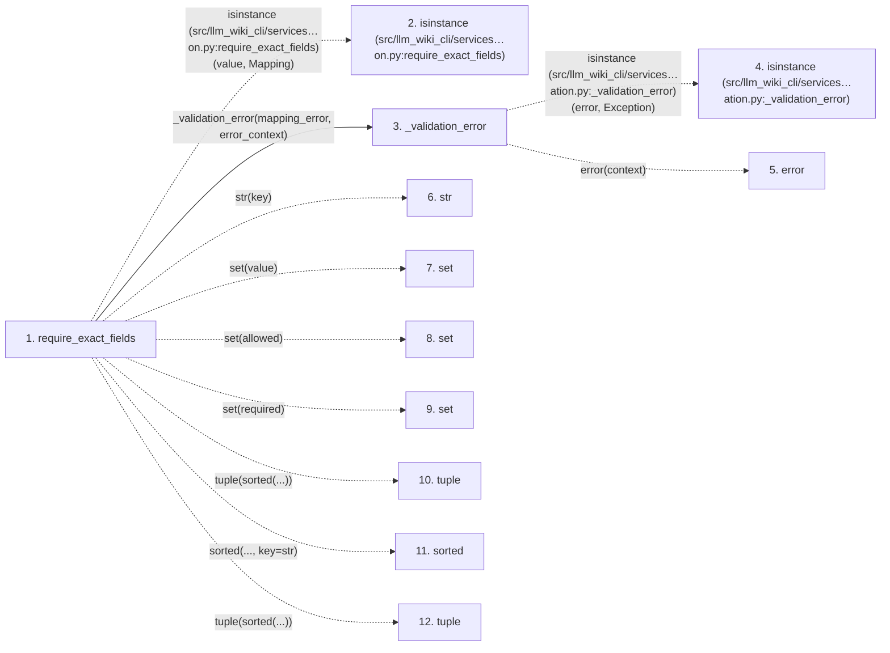

# require_exact_fields

**Entry point:** `require_exact_fields` (`api`)
**Source:** [validation](../modules/validation.md)
**Modules touched:** [validation](../modules/validation.md)

## Call sequence

> Static overview in presentation order, not runtime execution order. Arrows retain captured callers; representative internal continuations and boundary examples precede repeated helper detail.

<!-- Auto-generated from static call edges. Dashed arrows are external or unresolved calls. Reviewed runtime conditions and side effects belong in Behavior. -->

> Call sequence diagram shows 14 of 14 interactions; 0 omitted to keep the visualization within the 30-interaction and generated-diagram limits, with uncertain identities omitted rather than inferred.

> Captured boundary calls: external 10 of 10 (0 omitted); unresolved 3 of 3 (0 omitted). These counts cover the captured static trace.
> Detailed flow queries retain their own coverage and limits; omitted paths may execute at runtime.

## Data flow

<!-- Auto-generated static analysis. Treat values and boundaries as best-effort hints, not runtime proof. -->

### Analysis coverage

**Effect analysis partially available.** Flow assembly and source effect analysis are separate; empty observations do not prove an empty handler body.

Source steps: 2; effect analysis evaluated: 1, partial: 1, unavailable: 0. Counts include steps omitted from the displayed trace.

Collector observations for 2 source steps with known totals: observed: 14, emitted: 12, omitted: 2. Unavailable totals are excluded.

- Effect collector omitted observations before flow assembly; displayed effects are partial.

| Step | Callable record | Effect analysis | Collector totals | Observed | Emitted | Omitted |
|---|---|---|---|---:|---:|---:|
| `require_exact_fields` | `available` | `partial` | `available` | `11` | `9` | `2` |
| `isinstance (src/llm_wiki_cli/services…on.py:require_exact_fields)` | `not_applicable` | `not_applicable` | `not_applicable` | — | — | — |
| `_validation_error` | `available` | `evaluated` | `available` | `3` | `3` | `0` |
| `isinstance (src/llm_wiki_cli/services…ation.py:_validation_error)` | `not_applicable` | `not_applicable` | `not_applicable` | — | — | — |
| `error` | `not_applicable` | `not_applicable` | `not_applicable` | — | — | — |
| `str` | `not_applicable` | `not_applicable` | `not_applicable` | — | — | — |
| `set` | `not_applicable` | `not_applicable` | `not_applicable` | — | — | — |
| `set` | `not_applicable` | `not_applicable` | `not_applicable` | — | — | — |
| `set` | `not_applicable` | `not_applicable` | `not_applicable` | — | — | — |
| `tuple` | `not_applicable` | `not_applicable` | `not_applicable` | — | — | — |
| `sorted` | `not_applicable` | `not_applicable` | `not_applicable` | — | — | — |
| `tuple` | `not_applicable` | `not_applicable` | `not_applicable` | — | — | — |

### Step data

| Step | Inputs | Reads | Writes | Returns |
|---|---|---|---|---|
| `require_exact_fields` | `value: object`, `allowed: Iterable[str]`, `required: Iterable[str]`, `mapping_error: _ValidationError`, `error_context: str`, `missing_error: _ErrorFactory`, `unknown_error: _ErrorFactory`, `invalid_error: Callable[[tuple[str, ...], tuple[str, ...]], Exception] \| None` | `Mapping` | - | - |
| `isinstance (src/llm_wiki_cli/services…on.py:require_exact_fields)` | - | - | - | - |
| `_validation_error` | `error: _ValidationError`, `context: str` | - | - | `...` |
| `isinstance (src/llm_wiki_cli/services…ation.py:_validation_error)` | - | - | - | - |
| `error` | - | - | - | - |
| `str` | - | - | - | - |
| `set` | - | - | - | - |
| `set` | - | - | - | - |
| `set` | - | - | - | - |
| `tuple` | - | - | - | - |
| `sorted` | - | - | - | - |
| `tuple` | - | - | - | - |

### Call data

| From | To | Line | Call |
|---|---|---:|---|
| require_exact_fields | isinstance (src/llm_wiki_cli/services…on.py:require_exact_fields) | 1266 | `isinstance(value, Mapping)` |
| require_exact_fields | _validation_error | 1267 | `_validation_error(mapping_error, error_context)` |
| _validation_error | isinstance (src/llm_wiki_cli/services…ation.py:_validation_error) | 95 | `isinstance(error, Exception)` |
| _validation_error | error | 95 | `error(context)` |
| require_exact_fields | str | 1268 | `str(key)` |
| require_exact_fields | set | 1268 | `set(value)` |
| require_exact_fields | set | 1269 | `set(allowed)` |
| require_exact_fields | set | 1270 | `set(required)` |
| require_exact_fields | tuple | 1271 | `tuple(sorted(...))` |
| require_exact_fields | sorted | 1271 | `sorted(..., key=str)` |
| require_exact_fields | tuple | 1272 | `tuple(sorted(...))` |

### Boundary effects

*No boundary-effect observations were captured in this static trace.*

### Static analysis gaps

| Kind | Step | Target | Line |
|---|---|---|---:|
| external_call | `require_exact_fields` | `isinstance` | 1266 |
| external_call | `_validation_error` | `isinstance` | 95 |
| unresolved_call | `_validation_error` | `error` | 95 |
| external_call | `require_exact_fields` | `sorted` | 1271 |
| step_limit | `require_exact_fields` | `first 12 steps` | 0 |

## Behavior

This flow starts at `require_exact_fields` and is classified as `api`. The generated call and data-flow sections are bounded static projections; runtime conditions and side effects require source-level confirmation.
