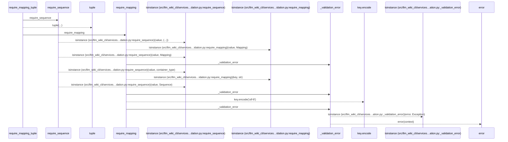
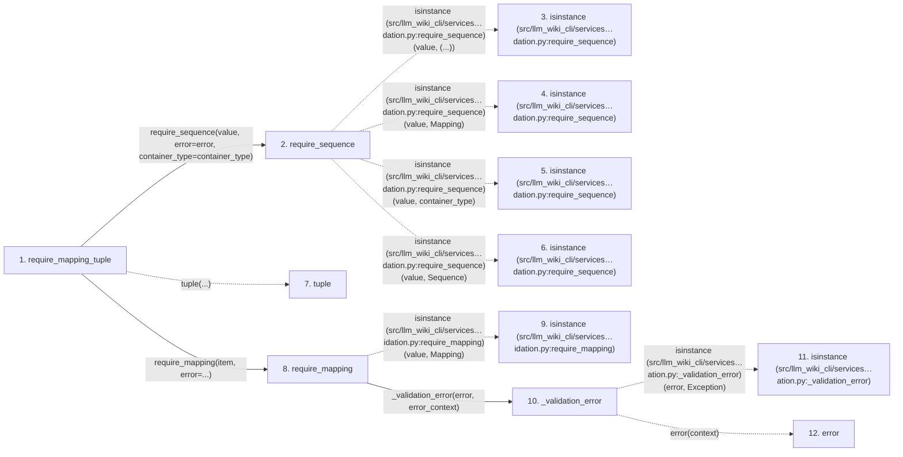

# require_mapping_tuple

**Entry point:** `require_mapping_tuple` (`api`)
**Source:** [validation](../modules/validation.md)
**Modules touched:** [validation](../modules/validation.md)

## Call sequence

> Static overview in presentation order, not runtime execution order. Arrows retain captured callers; representative internal continuations and boundary examples precede repeated helper detail.

<!-- Auto-generated from static call edges. Dashed arrows are external or unresolved calls. Reviewed runtime conditions and side effects belong in Behavior. -->

> Call sequence diagram shows 15 of 15 interactions; 0 omitted to keep the visualization within the 30-interaction and generated-diagram limits, with uncertain identities omitted rather than inferred.

> Captured boundary calls: external 8 of 8 (0 omitted); unresolved 2 of 2 (0 omitted). These counts cover the captured static trace.
> Detailed flow queries retain their own coverage and limits; omitted paths may execute at runtime.

## Data flow

<!-- Auto-generated static analysis. Treat values and boundaries as best-effort hints, not runtime proof. -->

### Analysis coverage

**Effect analysis evaluated.** Flow assembly and source effect analysis are separate; empty observations do not prove an empty handler body.

Source steps: 6; effect analysis evaluated: 6, partial: 0, unavailable: 0. Counts include steps omitted from the displayed trace.

Collector observations for 6 source steps with known totals: observed: 30, emitted: 30, omitted: 0. Unavailable totals are excluded.

### Step data

| Step | Inputs | Reads | Writes | Returns |
|---|---|---|---|---|
| `require_mapping_tuple` | `value: object`, `error: Exception`, `item_error: Exception \| None`, `container_type: type[object] \| tuple[type[object], ...]` | - | - | `tuple(...)` |
| `require_sequence` | `value: object`, `error: Exception`, `container_type: type[object] \| tuple[type[object], ...]`, `reject_mapping: bool` | `Mapping`, `Sequence` | - | `value` |
| `isinstance (src/llm_wiki_cli/services…dation.py:require_sequence)` | - | - | - | - |
| `isinstance (src/llm_wiki_cli/services…dation.py:require_sequence)` | - | - | - | - |
| `isinstance (src/llm_wiki_cli/services…dation.py:require_sequence)` | - | - | - | - |
| `isinstance (src/llm_wiki_cli/services…dation.py:require_sequence)` | - | - | - | - |
| `tuple` | - | - | - | - |
| `require_mapping` | `value: object`, `error: _ValidationError`, `error_context: str`, `require_string_keys: bool`, `key_error: _ValidationError \| None`, `require_utf8_keys: bool`, `utf8_key_error: _ValidationError \| None` | `Mapping` | - | `value` |
| `isinstance (src/llm_wiki_cli/services…idation.py:require_mapping)` | - | - | - | - |
| `_validation_error` | `error: _ValidationError`, `context: str` | - | - | `...` |
| `isinstance (src/llm_wiki_cli/services…ation.py:_validation_error)` | - | - | - | - |
| `error` | - | - | - | - |

### Call data

| From | To | Line | Call |
|---|---|---:|---|
| require_mapping_tuple | require_sequence | 1054 | `require_sequence(value, error=error, container_type=container_type)` |
| require_sequence | isinstance (src/llm_wiki_cli/services…dation.py:require_sequence) | 808 | `isinstance(value, (...))` |
| require_sequence | isinstance (src/llm_wiki_cli/services…dation.py:require_sequence) | 809 | `isinstance(value, Mapping)` |
| require_sequence | isinstance (src/llm_wiki_cli/services…dation.py:require_sequence) | 810 | `isinstance(value, container_type)` |
| require_sequence | isinstance (src/llm_wiki_cli/services…dation.py:require_sequence) | 813 | `isinstance(value, Sequence)` |
| require_mapping_tuple | tuple | 1059 | `tuple(...)` |
| require_mapping_tuple | require_mapping | 1060 | `require_mapping(item, error=...)` |
| require_mapping | isinstance (src/llm_wiki_cli/services…idation.py:require_mapping) | 783 | `isinstance(value, Mapping)` |
| require_mapping | _validation_error | 784 | `_validation_error(error, error_context)` |
| _validation_error | isinstance (src/llm_wiki_cli/services…ation.py:_validation_error) | 95 | `isinstance(error, Exception)` |
| _validation_error | error | 95 | `error(context)` |

### Boundary effects

*No boundary-effect observations were captured in this static trace.*

### Static analysis gaps

| Kind | Step | Target | Line |
|---|---|---|---:|
| external_call | `require_sequence` | `isinstance` | 808 |
| external_call | `require_sequence` | `isinstance` | 809 |
| external_call | `require_sequence` | `isinstance` | 810 |
| external_call | `require_sequence` | `isinstance` | 813 |
| external_call | `require_mapping` | `isinstance` | 783 |
| external_call | `_validation_error` | `isinstance` | 95 |
| unresolved_call | `_validation_error` | `error` | 95 |
| step_limit | `require_mapping_tuple` | `first 12 steps` | 0 |

## Behavior

This flow starts at `require_mapping_tuple` and is classified as `api`. The generated call and data-flow sections are bounded static projections; runtime conditions and side effects require source-level confirmation.
