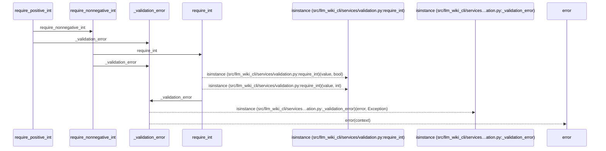
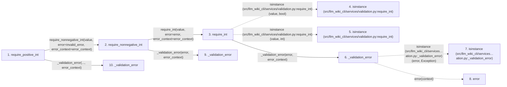

# require_positive_int

**Entry point:** `require_positive_int` (`api`)
**Source:** [validation](../modules/validation.md)
**Modules touched:** [validation](../modules/validation.md)

## Call sequence

> Static overview in presentation order, not runtime execution order. Arrows retain captured callers; representative internal continuations and boundary examples precede repeated helper detail.

<!-- Auto-generated from static call edges. Dashed arrows are external or unresolved calls. Reviewed runtime conditions and side effects belong in Behavior. -->

> Call sequence diagram shows 9 of 9 interactions; 0 omitted to keep the visualization within the 30-interaction and generated-diagram limits, with uncertain identities omitted rather than inferred.

> Captured boundary calls: external 3 of 3 (0 omitted); unresolved 1 of 1 (0 omitted). These counts cover the captured static trace.
> Detailed flow queries retain their own coverage and limits; omitted paths may execute at runtime.

## Data flow

<!-- Auto-generated static analysis. Treat values and boundaries as best-effort hints, not runtime proof. -->

### Analysis coverage

**Effect analysis evaluated.** Flow assembly and source effect analysis are separate; empty observations do not prove an empty handler body.

Source steps: 6; effect analysis evaluated: 6, partial: 0, unavailable: 0. Counts include steps omitted from the displayed trace.

Collector observations for 6 source steps with known totals: observed: 22, emitted: 22, omitted: 0. Unavailable totals are excluded.

### Step data

| Step | Inputs | Reads | Writes | Returns |
|---|---|---|---|---|
| `require_positive_int` | `value: object`, `invalid_error: _ValidationError`, `zero_error: _ValidationError \| None`, `error_context: str` | - | - | `parsed` |
| `require_nonnegative_int` | `value: object`, `error: _ValidationError`, `error_context: str` | - | - | `parsed` |
| `require_int` | `value: object`, `error: _ValidationError`, `error_context: str` | - | - | `value` |
| `isinstance (src/llm_wiki_cli/services/validation.py:require_int)` | - | - | - | - |
| `isinstance (src/llm_wiki_cli/services/validation.py:require_int)` | - | - | - | - |
| `_validation_error` | `error: _ValidationError`, `context: str` | - | - | `...` |
| `isinstance (src/llm_wiki_cli/services…ation.py:_validation_error)` | - | - | - | - |
| `error` | - | - | - | - |
| `_validation_error` | `error: _ValidationError`, `context: str` | - | - | `...` |
| `_validation_error` | `error: _ValidationError`, `context: str` | - | - | `...` |

### Call data

| From | To | Line | Call |
|---|---|---:|---|
| require_positive_int | require_nonnegative_int | 867 | `require_nonnegative_int(value, error=invalid_error, error_context=error_context)` |
| require_nonnegative_int | require_int | 844 | `require_int(value, error=error, error_context=error_context)` |
| require_int | isinstance (src/llm_wiki_cli/services/validation.py:require_int) | 836 | `isinstance(value, bool)` |
| require_int | isinstance (src/llm_wiki_cli/services/validation.py:require_int) | 836 | `isinstance(value, int)` |
| require_int | _validation_error | 837 | `_validation_error(error, error_context)` |
| _validation_error | isinstance (src/llm_wiki_cli/services…ation.py:_validation_error) | 95 | `isinstance(error, Exception)` |
| _validation_error | error | 95 | `error(context)` |
| require_nonnegative_int | _validation_error | 846 | `_validation_error(error, error_context)` |
| require_positive_int | _validation_error | 869 | `_validation_error(..., error_context)` |

### Boundary effects

*No boundary-effect observations were captured in this static trace.*

### Static analysis gaps

| Kind | Step | Target | Line |
|---|---|---|---:|
| external_call | `require_int` | `isinstance` | 836 |
| external_call | `_validation_error` | `isinstance` | 95 |
| unresolved_call | `_validation_error` | `error` | 95 |

## Behavior

This flow starts at `require_positive_int` and is classified as `api`. The generated call and data-flow sections are bounded static projections; runtime conditions and side effects require source-level confirmation.
