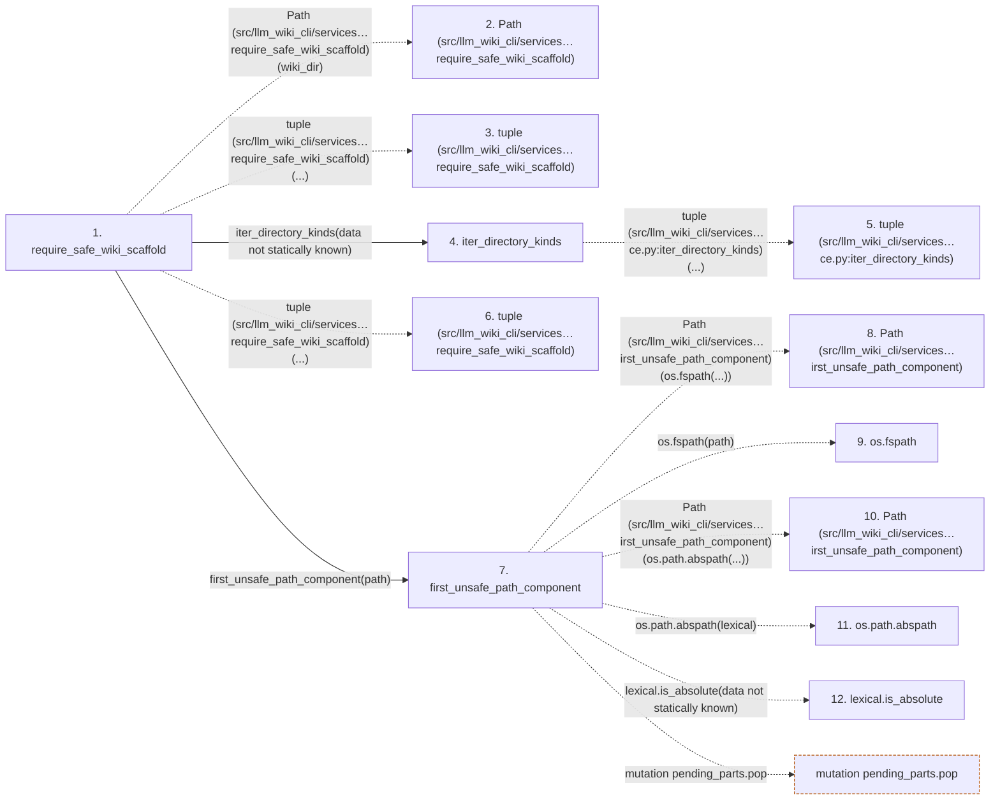

# require_safe_wiki_scaffold

**Entry point:** `require_safe_wiki_scaffold` (`api`)
**Source:** [wiki_lifecycle](../modules/wiki_lifecycle.md)
**Modules touched:** [io](../modules/io.md), [wiki_lifecycle](../modules/wiki_lifecycle.md), [wiki_surface](../modules/wiki_surface.md)

## Call sequence

> Static overview in presentation order, not runtime execution order. Arrows retain captured callers; representative internal continuations and boundary examples precede repeated helper detail.

```mermaid
sequenceDiagram
    participant p0 as require_safe_wiki_scaffold
    participant p1 as iter_directory_kinds
    participant p2 as first_unsafe_path_component
    participant p3 as WikiScaffoldPathError
    participant p4 as Path (src/llm_wiki_cli/services…require_safe_wiki_scaffold)
    participant p5 as directory.exists
    participant p6 as tuple (src/llm_wiki_cli/services…require_safe_wiki_scaffold)
    participant p7 as directory.is_dir
    participant p8 as path.exists
    participant p9 as path.is_file
    participant p10 as tuple (src/llm_wiki_cli/services…ce.py:iter_directory_kinds)
    participant p11 as Path (src/llm_wiki_cli/services…irst_unsafe_path_component)
    participant p12 as os.fspath
    participant p13 as os.path.abspath
    participant p14 as lexical.is_absolute
    participant p15 as Path.cwd
    participant p16 as list
    participant p17 as pending_parts.pop
    participant p18 as current.lstat
    participant p19 as getattr
    participant p20 as stat.S_ISLNK
    participant p21 as bool
    participant p22 as trusted_symlink_owner
    participant p23 as callable
    p0->>p1: iter_directory_kinds
    p0->>p2: first_unsafe_path_component
    p0->>p3: WikiScaffoldPathError
    p0-->>p4: Path (src/llm_wiki_cli/services…require_safe_wiki_scaffold)(wiki_dir)
    p0-->>p5: directory.exists
    p0-->>p6: tuple (src/llm_wiki_cli/services…require_safe_wiki_scaffold)(...)
    p0-->>p6: tuple (src/llm_wiki_cli/services…require_safe_wiki_scaffold)(...)
    p0-->>p7: directory.is_dir
    p0-->>p8: path.exists
    p0-->>p9: path.is_file
    p1-->>p10: tuple (src/llm_wiki_cli/services…ce.py:iter_directory_kinds)(...)
    p2-->>p11: Path (src/llm_wiki_cli/services…irst_unsafe_path_component)(os.fspath(...))
    p2-->>p12: os.fspath(path)
    p2-->>p11: Path (src/llm_wiki_cli/services…irst_unsafe_path_component)(os.path.abspath(...))
    p2-->>p13: os.path.abspath(lexical)
    p2-->>p14: lexical.is_absolute
    p2-->>p15: Path.cwd
    p2-->>p11: Path (src/llm_wiki_cli/services…irst_unsafe_path_component)(absolute.anchor)
    p2-->>p16: list(...)
    p2-->>p17: pending_parts.pop(0)
    p2-->>p18: current.lstat
    p2-->>p19: getattr(metadata, 'st_file_attributes', 0)
    p2-->>p19: getattr(stat, 'FILE_ATTRIBUTE_REPARSE_POINT', 0)
    p2-->>p20: stat.S_ISLNK(metadata.st_mode)
    p2-->>p21: bool(reparse_flag)
    p2-->>p21: bool(...)
    p2-->>p19: getattr(metadata, 'st_uid', None)
    p2-->>p22: trusted_symlink_owner(current)
    p2-->>p23: callable(getattr(...))
    p2-->>p19: getattr(os, 'geteuid', None)
```

<!-- Auto-generated from static call edges. Dashed arrows are external or unresolved calls. Reviewed runtime conditions and side effects belong in Behavior. -->

> Call sequence diagram shows 30 of 38 interactions; 8 omitted to keep the visualization within the 30-interaction and generated-diagram limits, with uncertain identities omitted rather than inferred.

> Captured boundary calls: external 19 of 24 (5 omitted); unresolved 8 of 9 (1 omitted). These counts cover the captured static trace.

Omitted captured detail, grouped by actual caller occurrence and target module:

| Caller | Parent step | Target module | Kind | Omitted interactions |
| --- | --- | --- | --- | --- |
| `src/llm_wiki_cli/services/io.py:first_unsafe_path_component` | 7 | - | external | 5 |
| `src/llm_wiki_cli/services/io.py:first_unsafe_path_component` | 7 | - | unresolved | 1 |
| `src/llm_wiki_cli/services/wiki_lifecycle.py:require_safe_wiki_scaffold` | 1 | [src/llm_wiki_cli/services/wiki_lifecycle.py](../modules/wiki_lifecycle.md) | internal | 2 |
> Detailed flow queries retain their own coverage and limits; omitted paths may execute at runtime.

## Data flow

<!-- Auto-generated static analysis. Treat values and boundaries as best-effort hints, not runtime proof. -->

### Analysis coverage

**Effect analysis partially available.** Flow assembly and source effect analysis are separate; empty observations do not prove an empty handler body.

Source steps: 6; effect analysis evaluated: 3, partial: 0, unavailable: 3. Counts include steps omitted from the displayed trace.

Collector observations for 3 source steps with known totals: observed: 17, emitted: 17, omitted: 0. Unavailable totals are excluded.

- Callable record unavailable; the selected entry symbol has no represented callable body.
- Effect collector totals unavailable; observed counts cover captured records only.

| Step | Callable record | Effect analysis | Collector totals | Observed | Emitted | Omitted |
|---|---|---|---|---:|---:|---:|
| `require_safe_wiki_scaffold` | `available` | `evaluated` | `available` | `1` | `1` | `0` |
| `Path (src/llm_wiki_cli/services…require_safe_wiki_scaffold)` | `not_applicable` | `not_applicable` | `not_applicable` | — | — | — |
| `tuple (src/llm_wiki_cli/services…require_safe_wiki_scaffold)` | `not_applicable` | `not_applicable` | `not_applicable` | — | — | — |
| `iter_directory_kinds` | `available` | `evaluated` | `available` | `2` | `2` | `0` |
| `tuple (src/llm_wiki_cli/services…ce.py:iter_directory_kinds)` | `not_applicable` | `not_applicable` | `not_applicable` | — | — | — |
| `tuple (src/llm_wiki_cli/services…require_safe_wiki_scaffold)` | `not_applicable` | `not_applicable` | `not_applicable` | — | — | — |
| `first_unsafe_path_component` | `available` | `evaluated` | `available` | `14` | `14` | `0` |
| `Path (src/llm_wiki_cli/services…irst_unsafe_path_component)` | `not_applicable` | `not_applicable` | `not_applicable` | — | — | — |
| `os.fspath` | `not_applicable` | `not_applicable` | `not_applicable` | — | — | — |
| `Path (src/llm_wiki_cli/services…irst_unsafe_path_component)` | `not_applicable` | `not_applicable` | `not_applicable` | — | — | — |
| `os.path.abspath` | `not_applicable` | `not_applicable` | `not_applicable` | — | — | — |
| `lexical.is_absolute` | `not_applicable` | `not_applicable` | `not_applicable` | — | — | — |

### Step data

| Step | Inputs | Reads | Writes | Returns |
|---|---|---|---|---|
| `require_safe_wiki_scaffold` | `wiki_dir: Union[str, Path]` | - | - | - |
| `Path (src/llm_wiki_cli/services…require_safe_wiki_scaffold)` | - | - | - | - |
| `tuple (src/llm_wiki_cli/services…require_safe_wiki_scaffold)` | - | - | - | - |
| `iter_directory_kinds` | - | `_PAGE_KINDS` | - | `tuple(...)` |
| `tuple (src/llm_wiki_cli/services…ce.py:iter_directory_kinds)` | - | - | - | - |
| `tuple (src/llm_wiki_cli/services…require_safe_wiki_scaffold)` | - | - | - | - |
| `first_unsafe_path_component` | `path: str \| Path`, `trusted_symlink_uids: Set[int] \| None`, `trusted_symlink_owner: Callable[[Path], bool] \| None` | `stat`, `os` | - | `lexical`, `None`, `current`, `current`, `current`, `current`, `current`, `None` |
| `Path (src/llm_wiki_cli/services…irst_unsafe_path_component)` | - | - | - | - |
| `os.fspath` | - | - | - | - |
| `Path (src/llm_wiki_cli/services…irst_unsafe_path_component)` | - | - | - | - |
| `os.path.abspath` | - | - | - | - |
| `lexical.is_absolute` | - | - | - | - |

### Call data

| From | To | Line | Call |
|---|---|---:|---|
| require_safe_wiki_scaffold | Path (src/llm_wiki_cli/services…require_safe_wiki_scaffold) | 43 | `Path(wiki_dir)` |
| require_safe_wiki_scaffold | tuple (src/llm_wiki_cli/services…require_safe_wiki_scaffold) | 44 | `tuple(...)` |
| require_safe_wiki_scaffold | iter_directory_kinds | 46 | `iter_directory_kinds(data not statically known)` |
| iter_directory_kinds | tuple (src/llm_wiki_cli/services…ce.py:iter_directory_kinds) | 224 | `tuple(...)` |
| require_safe_wiki_scaffold | tuple (src/llm_wiki_cli/services…require_safe_wiki_scaffold) | 49 | `tuple(...)` |
| require_safe_wiki_scaffold | first_unsafe_path_component | 54 | `first_unsafe_path_component(path)` |
| first_unsafe_path_component | Path (src/llm_wiki_cli/services…irst_unsafe_path_component) | 51 | `Path(os.fspath(...))` |
| first_unsafe_path_component | os.fspath | 51 | `os.fspath(path)` |
| first_unsafe_path_component | Path (src/llm_wiki_cli/services…irst_unsafe_path_component) | 59 | `Path(os.path.abspath(...))` |
| first_unsafe_path_component | os.path.abspath | 59 | `os.path.abspath(lexical)` |
| first_unsafe_path_component | lexical.is_absolute | 60 | `lexical.is_absolute(data not statically known)` |

### Boundary effects

| Kind | Target | Step | Line |
|---|---|---|---:|
| mutation | `pending_parts.pop` | `first_unsafe_path_component` | 71 |

### Static analysis gaps

| Kind | Step | Target | Line |
|---|---|---|---:|
| external_call | `first_unsafe_path_component` | `os.fspath` | 51 |
| external_call | `first_unsafe_path_component` | `os.path.abspath` | 59 |
| unresolved_call | `first_unsafe_path_component` | `lexical.is_absolute` | 60 |
| step_limit | `require_safe_wiki_scaffold` | `first 12 steps` | 0 |

## Behavior

This flow starts at `require_safe_wiki_scaffold` and is classified as `api`. The generated call and data-flow sections are bounded static projections; runtime conditions and side effects require source-level confirmation.
