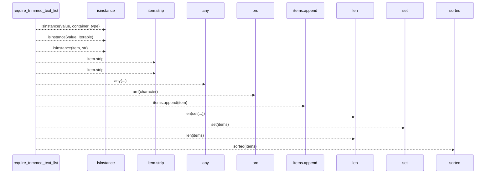
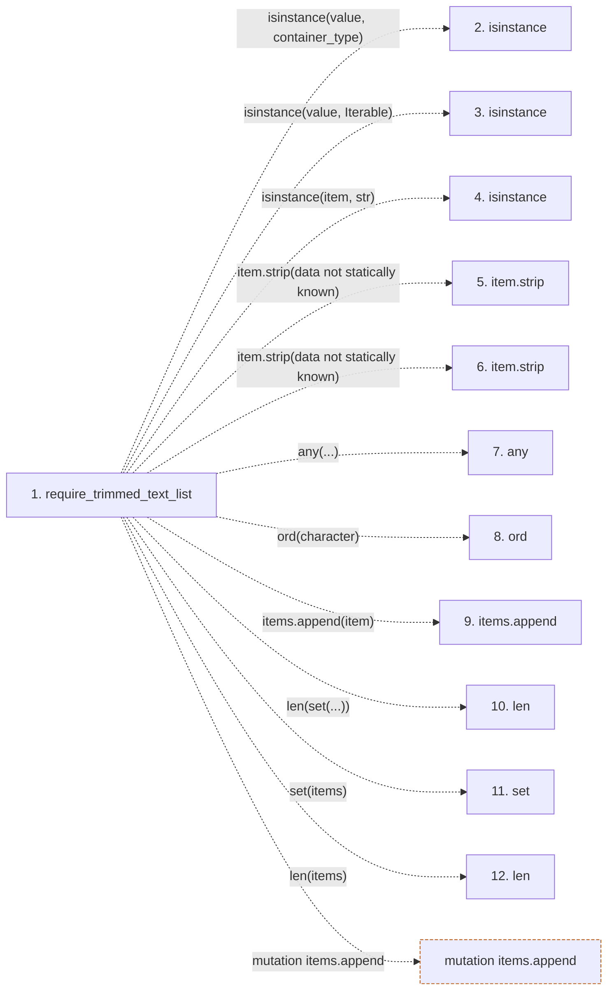

# require_trimmed_text_list

**Entry point:** `require_trimmed_text_list` (`api`)
**Source:** [validation](../modules/validation.md)
**Modules touched:** [validation](../modules/validation.md)

## Call sequence

> Static overview in presentation order, not runtime execution order. Arrows retain captured callers; representative internal continuations and boundary examples precede repeated helper detail.

<!-- Auto-generated from static call edges. Dashed arrows are external or unresolved calls. Reviewed runtime conditions and side effects belong in Behavior. -->

> Call sequence diagram shows 12 of 12 interactions; 0 omitted to keep the visualization within the 30-interaction and generated-diagram limits, with uncertain identities omitted rather than inferred.

> Captured boundary calls: external 9 of 9 (0 omitted); unresolved 3 of 3 (0 omitted). These counts cover the captured static trace.
> Detailed flow queries retain their own coverage and limits; omitted paths may execute at runtime.

## Data flow

<!-- Auto-generated static analysis. Treat values and boundaries as best-effort hints, not runtime proof. -->

### Analysis coverage

**Effect analysis partially available.** Flow assembly and source effect analysis are separate; empty observations do not prove an empty handler body.

Source steps: 1; effect analysis evaluated: 0, partial: 1, unavailable: 0. Counts include steps omitted from the displayed trace.

Collector observations for 1 source steps with known totals: observed: 12, emitted: 11, omitted: 1. Unavailable totals are excluded.

- Effect collector omitted observations before flow assembly; displayed effects are partial.

| Step | Callable record | Effect analysis | Collector totals | Observed | Emitted | Omitted |
|---|---|---|---|---:|---:|---:|
| `require_trimmed_text_list` | `available` | `partial` | `available` | `12` | `11` | `1` |
| `isinstance` | `not_applicable` | `not_applicable` | `not_applicable` | — | — | — |
| `isinstance` | `not_applicable` | `not_applicable` | `not_applicable` | — | — | — |
| `isinstance` | `not_applicable` | `not_applicable` | `not_applicable` | — | — | — |
| `item.strip` | `not_applicable` | `not_applicable` | `not_applicable` | — | — | — |
| `item.strip` | `not_applicable` | `not_applicable` | `not_applicable` | — | — | — |
| `any` | `not_applicable` | `not_applicable` | `not_applicable` | — | — | — |
| `ord` | `not_applicable` | `not_applicable` | `not_applicable` | — | — | — |
| `items.append` | `not_applicable` | `not_applicable` | `not_applicable` | — | — | — |
| `len` | `not_applicable` | `not_applicable` | `not_applicable` | — | — | — |
| `set` | `not_applicable` | `not_applicable` | `not_applicable` | — | — | — |
| `len` | `not_applicable` | `not_applicable` | `not_applicable` | — | — | — |

### Step data

| Step | Inputs | Reads | Writes | Returns |
|---|---|---|---|---|
| `require_trimmed_text_list` | `value: object`, `error: Exception`, `item_error: Exception \| None`, `duplicate_error: Exception \| None`, `sort: bool`, `require_trimmed_items: bool`, `reject_control_characters: bool`, `reject_duplicates: bool` | `Iterable` | - | `...` |
| `isinstance` | - | - | - | - |
| `isinstance` | - | - | - | - |
| `isinstance` | - | - | - | - |
| `item.strip` | - | - | - | - |
| `item.strip` | - | - | - | - |
| `any` | - | - | - | - |
| `ord` | - | - | - | - |
| `items.append` | - | - | - | - |
| `len` | - | - | - | - |
| `set` | - | - | - | - |
| `len` | - | - | - | - |

### Call data

| From | To | Line | Call |
|---|---|---:|---|
| require_trimmed_text_list | isinstance | 718 | `isinstance(value, container_type)` |
| require_trimmed_text_list | isinstance | 718 | `isinstance(value, Iterable)` |
| require_trimmed_text_list | isinstance | 722 | `isinstance(item, str)` |
| require_trimmed_text_list | item.strip | 722 | `item.strip(data not statically known)` |
| require_trimmed_text_list | item.strip | 724 | `item.strip(data not statically known)` |
| require_trimmed_text_list | any | 726 | `any(...)` |
| require_trimmed_text_list | ord | 727 | `ord(character)` |
| require_trimmed_text_list | items.append | 730 | `items.append(item)` |
| require_trimmed_text_list | len | 731 | `len(set(...))` |
| require_trimmed_text_list | set | 731 | `set(items)` |
| require_trimmed_text_list | len | 731 | `len(items)` |

### Boundary effects

| Kind | Target | Step | Line |
|---|---|---|---:|
| mutation | `items.append` | `require_trimmed_text_list` | 730 |

### Static analysis gaps

| Kind | Step | Target | Line |
|---|---|---|---:|
| external_call | `require_trimmed_text_list` | `isinstance` | 718 |
| external_call | `require_trimmed_text_list` | `isinstance` | 722 |
| unresolved_call | `require_trimmed_text_list` | `item.strip` | 722 |
| unresolved_call | `require_trimmed_text_list` | `item.strip` | 724 |
| external_call | `require_trimmed_text_list` | `any` | 726 |
| external_call | `require_trimmed_text_list` | `ord` | 727 |
| step_limit | `require_trimmed_text_list` | `first 12 steps` | 0 |

## Behavior

This flow starts at `require_trimmed_text_list` and is classified as `api`. The generated call and data-flow sections are bounded static projections; runtime conditions and side effects require source-level confirmation.
