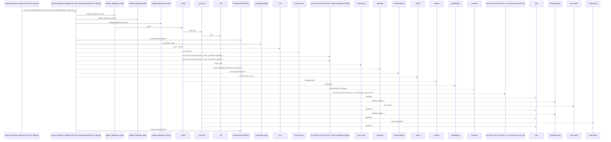
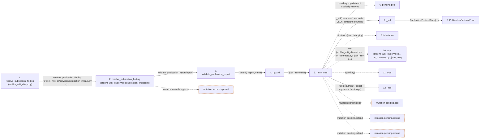

# resolve_publication_finding

**Entry point:** `resolve_publication_finding` (`api`)
**Source:** [api](../modules/api.md)
**Modules touched:** [api](../modules/api.md), [publication_contracts](../modules/publication_contracts.md), [publication_impact](../modules/publication_impact.md)

## Call sequence

> Static overview in presentation order, not runtime execution order. Arrows retain captured callers; representative internal continuations and boundary examples precede repeated helper detail.

<!-- Auto-generated from static call edges. Dashed arrows are external or unresolved calls. Reviewed runtime conditions and side effects belong in Behavior. -->

> Call sequence diagram shows 30 of 42 interactions; 12 omitted to keep the visualization within the 30-interaction and generated-diagram limits, with uncertain identities omitted rather than inferred.

> Captured boundary calls: external 12 of 12 (0 omitted); unresolved 8 of 8 (0 omitted). These counts cover the captured static trace.

Omitted captured detail, grouped by actual caller occurrence and target module:

| Caller | Parent step | Target module | Kind | Omitted interactions |
| --- | --- | --- | --- | --- |
| `src/llm_wiki_cli/services/publication_contracts.py:_fail` | 7 | [src/llm_wiki_cli/services/publication_contracts.py](../modules/publication_contracts.md) | internal | 1 |
| `src/llm_wiki_cli/services/publication_contracts.py:_json_tree` | 5 | [src/llm_wiki_cli/services/publication_contracts.py](../modules/publication_contracts.md) | internal | 3 |
| `src/llm_wiki_cli/services/publication_contracts.py:_guard` | 4 | [src/llm_wiki_cli/services/publication_contracts.py](../modules/publication_contracts.md) | internal | 1 |
| `src/llm_wiki_cli/services/publication_contracts.py:validate_publication_basis` | 24 | [src/llm_wiki_cli/services/publication_contracts.py](../modules/publication_contracts.md) | internal | 1 |
| `src/llm_wiki_cli/services/publication_impact.py:resolve_publication_finding` | 2 | [src/llm_wiki_cli/services/publication_contracts.py](../modules/publication_contracts.md) | internal | 5 |
| `src/llm_wiki_cli/services/publication_contracts.py:validate_publication_reviews` | 39 | [src/llm_wiki_cli/services/publication_contracts.py](../modules/publication_contracts.md) | internal | 1 |
> Detailed flow queries retain their own coverage and limits; omitted paths may execute at runtime.

## Data flow

<!-- Auto-generated static analysis. Treat values and boundaries as best-effort hints, not runtime proof. -->

### Analysis coverage

**Effect analysis partially available.** Flow assembly and source effect analysis are separate; empty observations do not prove an empty handler body.

Source steps: 23; effect analysis evaluated: 15, partial: 0, unavailable: 8. Counts include steps omitted from the displayed trace.

Collector observations for 15 source steps with known totals: observed: 57, emitted: 57, omitted: 0. Unavailable totals are excluded.

- Callable record unavailable for one or more source steps; those steps have no represented callable body.
- Effect collector totals unavailable; observed counts cover captured records only.

| Step | Callable record | Effect analysis | Collector totals | Observed | Emitted | Omitted |
|---|---|---|---|---:|---:|---:|
| `resolve_publication_finding (src/llm_wiki_cli/api.py)` | `available` | `evaluated` | `available` | `8` | `8` | `0` |
| `resolve_publication_finding (src/llm_wiki_cli/services/publication_impact.py)` | `available` | `evaluated` | `available` | `10` | `10` | `0` |
| `validate_publication_report` | `available` | `evaluated` | `available` | `2` | `2` | `0` |
| `_guard` | `available` | `evaluated` | `available` | `4` | `4` | `0` |
| `_json_tree` | `available` | `evaluated` | `available` | `5` | `5` | `0` |
| `pending.pop` | `not_applicable` | `not_applicable` | `not_applicable` | — | — | — |
| `_fail` | `available` | `evaluated` | `available` | `2` | `2` | `0` |
| `PublicationProtocolError` | `unavailable` | `unavailable` | `unavailable` | — | — | — |
| `isinstance` | `not_applicable` | `not_applicable` | `not_applicable` | — | — | — |
| `any (src/llm_wiki_cli/services…on_contracts.py:_json_tree)` | `not_applicable` | `not_applicable` | `not_applicable` | — | — | — |
| `type` | `not_applicable` | `not_applicable` | `not_applicable` | — | — | — |
| `_fail` | `available` | `evaluated` | `available` | `2` | `2` | `0` |

### Step data

| Step | Inputs | Reads | Writes | Returns |
|---|---|---|---|---|
| `resolve_publication_finding (src/llm_wiki_cli/api.py)` | `report: Mapping[str, Any]`, `candidate: Mapping[str, Any]`, `finding_id: str`, `reviewer: str`, `reason: str`, `reviews: Mapping[str, Any] \| None`, `decision: str` | - | - | `resolve(...)` |
| `resolve_publication_finding (src/llm_wiki_cli/services/publication_impact.py)` | `report: Mapping[str, Any]`, `candidate: Mapping[str, Any]`, `finding_id: str`, `reviewer: str`, `reason: str`, `reviews: Mapping[str, Any] \| None`, `decision: str` | `REVIEWS_SCHEMA` | - | `result` |
| `validate_publication_report` | `value: object` | `_report` | - | - |
| `_guard` | `callback`, `value: object` | `PublicationProtocolError` | - | `callback(...)` |
| `_json_tree` | `value: object` | `Mapping` | - | - |
| `pending.pop` | - | - | - | - |
| `_fail` | `field: str`, `message: str` | - | - | - |
| `PublicationProtocolError` | - | - | - | - |
| `isinstance` | - | - | - | - |
| `any (src/llm_wiki_cli/services…on_contracts.py:_json_tree)` | - | - | - | - |
| `type` | - | - | - | - |
| `_fail` | `field: str`, `message: str` | - | - | - |

### Call data

| From | To | Line | Call |
|---|---|---:|---|
| resolve_publication_finding (src/llm_wiki_cli/api.py) | resolve_publication_finding (src/llm_wiki_cli/services/publication_impact.py) | 3581 | `resolve(report, candidate, finding_id=finding_id, reviewer=reviewer, reason=reason, reviews=reviews, decision=decision)` |
| resolve_publication_finding (src/llm_wiki_cli/services/publication_impact.py) | validate_publication_report | 453 | `validate_publication_report(report)` |
| validate_publication_report | _guard | 809 | `_guard(_report, value)` |
| _guard | _json_tree | 789 | `_json_tree(value)` |
| _json_tree | pending.pop | 133 | `pending.pop(data not statically known)` |
| _json_tree | _fail | 136 | `_fail('document', 'exceeds JSON structural bounds')` |
| _fail | PublicationProtocolError | 41 | `PublicationProtocolError(...)` |
| _json_tree | isinstance | 137 | `isinstance(item, Mapping)` |
| _json_tree | any (src/llm_wiki_cli/services…on_contracts.py:_json_tree) | 138 | `any(...)` |
| _json_tree | type | 138 | `type(key)` |
| _json_tree | _fail | 139 | `_fail('document', 'object keys must be strings')` |

### Boundary effects

| Kind | Target | Step | Line |
|---|---|---|---:|
| mutation | `records.append` | `resolve_publication_finding` | 501 |
| mutation | `pending.pop` | `_json_tree` | 133 |
| mutation | `pending.extend` | `_json_tree` | 140 |
| mutation | `pending.extend` | `_json_tree` | 142 |

### Static analysis gaps

| Kind | Step | Target | Line |
|---|---|---|---:|
| external_call | `_json_tree` | `isinstance` | 137 |
| external_call | `_json_tree` | `any` | 138 |
| external_call | `_json_tree` | `type` | 138 |
| step_limit | `resolve_publication_finding` | `first 12 steps` | 0 |

## Behavior

This flow starts at `resolve_publication_finding` and is classified as `api`. The generated call and data-flow sections are bounded static projections; runtime conditions and side effects require source-level confirmation.
