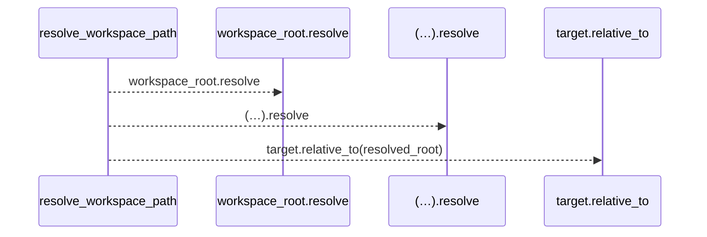
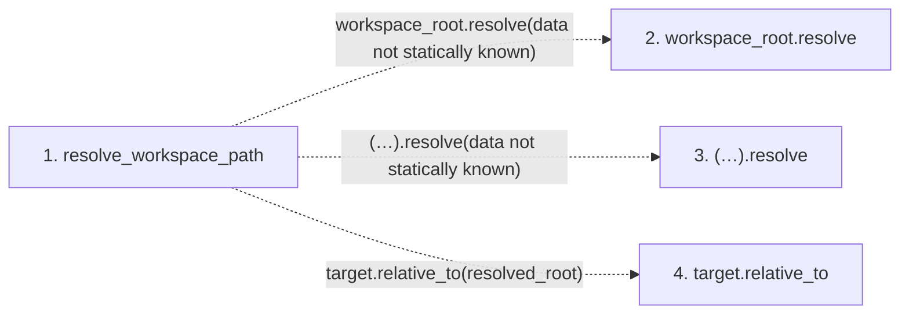

# resolve_workspace_path

**Entry point:** `resolve_workspace_path` (`api`)
**Source:** [validation](../modules/validation.md)
**Modules touched:** [validation](../modules/validation.md)

## Call sequence

> Static overview in presentation order, not runtime execution order. Arrows retain captured callers; representative internal continuations and boundary examples precede repeated helper detail.

<!-- Auto-generated from static call edges. Dashed arrows are external or unresolved calls. Reviewed runtime conditions and side effects belong in Behavior. -->

> Call sequence diagram shows 3 of 3 interactions; 0 omitted to keep the visualization within the 30-interaction and generated-diagram limits, with uncertain identities omitted rather than inferred.

> Captured boundary calls: external 0 of 0 (0 omitted); unresolved 3 of 3 (0 omitted). These counts cover the captured static trace.
> Detailed flow queries retain their own coverage and limits; omitted paths may execute at runtime.

## Data flow

<!-- Auto-generated static analysis. Treat values and boundaries as best-effort hints, not runtime proof. -->

### Analysis coverage

**Effect analysis evaluated.** Flow assembly and source effect analysis are separate; empty observations do not prove an empty handler body.

Source steps: 1; effect analysis evaluated: 1, partial: 0, unavailable: 0. Counts include steps omitted from the displayed trace.

Collector observations for 1 source steps with known totals: observed: 4, emitted: 4, omitted: 0. Unavailable totals are excluded.

### Step data

| Step | Inputs | Reads | Writes | Returns |
|---|---|---|---|---|
| `resolve_workspace_path` | `workspace_root: Path`, `relative: str`, `escape_error: Exception` | - | - | `target` |
| `workspace_root.resolve` | - | - | - | - |
| `(…).resolve` | - | - | - | - |
| `target.relative_to` | - | - | - | - |

### Call data

| From | To | Line | Call |
|---|---|---:|---|
| resolve_workspace_path | workspace_root.resolve | 541 | `workspace_root.resolve(data not statically known)` |
| resolve_workspace_path | (…).resolve | 542 | `(resolved_root / relative).resolve(data not statically known)` |
| resolve_workspace_path | target.relative_to | 544 | `target.relative_to(resolved_root)` |

### Boundary effects

*No boundary-effect observations were captured in this static trace.*

### Static analysis gaps

| Kind | Step | Target | Line |
|---|---|---|---:|
| unresolved_call | `resolve_workspace_path` | `workspace_root.resolve` | 541 |
| unresolved_call | `resolve_workspace_path` | `(resolved_root / relative).resolve` | 542 |
| unresolved_call | `resolve_workspace_path` | `target.relative_to` | 544 |

## Behavior

This flow starts at `resolve_workspace_path` and is classified as `api`. The generated call and data-flow sections are bounded static projections; runtime conditions and side effects require source-level confirmation.
