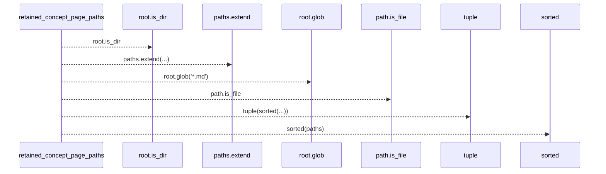
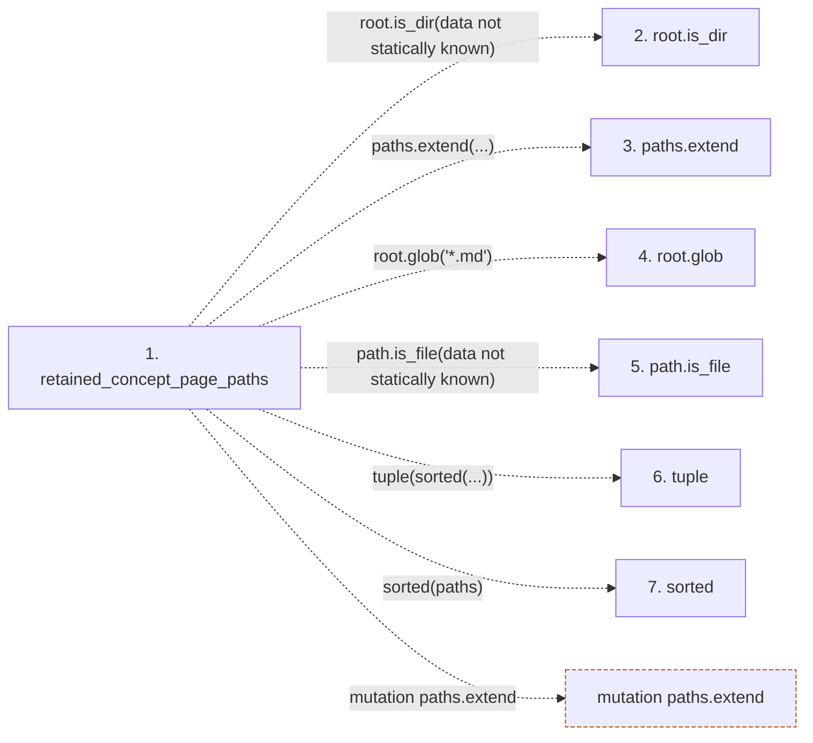

# retained_concept_page_paths

**Entry point:** `retained_concept_page_paths` (`api`)
**Source:** [sync_manifest](../modules/sync_manifest.md)
**Modules touched:** [sync_manifest](../modules/sync_manifest.md)

## Call sequence

> Static overview in presentation order, not runtime execution order. Arrows retain captured callers; representative internal continuations and boundary examples precede repeated helper detail.

<!-- Auto-generated from static call edges. Dashed arrows are external or unresolved calls. Reviewed runtime conditions and side effects belong in Behavior. -->

> Call sequence diagram shows 6 of 6 interactions; 0 omitted to keep the visualization within the 30-interaction and generated-diagram limits, with uncertain identities omitted rather than inferred.

> Captured boundary calls: external 2 of 2 (0 omitted); unresolved 4 of 4 (0 omitted). These counts cover the captured static trace.
> Detailed flow queries retain their own coverage and limits; omitted paths may execute at runtime.

## Data flow

<!-- Auto-generated static analysis. Treat values and boundaries as best-effort hints, not runtime proof. -->

### Analysis coverage

**Effect analysis evaluated.** Flow assembly and source effect analysis are separate; empty observations do not prove an empty handler body.

Source steps: 1; effect analysis evaluated: 1, partial: 0, unavailable: 0. Counts include steps omitted from the displayed trace.

Collector observations for 1 source steps with known totals: observed: 3, emitted: 3, omitted: 0. Unavailable totals are excluded.

### Step data

| Step | Inputs | Reads | Writes | Returns |
|---|---|---|---|---|
| `retained_concept_page_paths` | `wiki_dir: Path` | - | - | `tuple(...)` |
| `root.is_dir` | - | - | - | - |
| `paths.extend` | - | - | - | - |
| `root.glob` | - | - | - | - |
| `path.is_file` | - | - | - | - |
| `tuple` | - | - | - | - |
| `sorted` | - | - | - | - |

### Call data

| From | To | Line | Call |
|---|---|---:|---|
| retained_concept_page_paths | root.is_dir | 732 | `root.is_dir(data not statically known)` |
| retained_concept_page_paths | paths.extend | 734 | `paths.extend(...)` |
| retained_concept_page_paths | root.glob | 735 | `root.glob('*.md')` |
| retained_concept_page_paths | path.is_file | 735 | `path.is_file(data not statically known)` |
| retained_concept_page_paths | tuple | 737 | `tuple(sorted(...))` |
| retained_concept_page_paths | sorted | 737 | `sorted(paths)` |

### Boundary effects

| Kind | Target | Step | Line |
|---|---|---|---:|
| mutation | `paths.extend` | `retained_concept_page_paths` | 734 |

### Static analysis gaps

| Kind | Step | Target | Line |
|---|---|---|---:|
| unresolved_call | `retained_concept_page_paths` | `root.is_dir` | 732 |
| unresolved_call | `retained_concept_page_paths` | `root.glob` | 735 |
| unresolved_call | `retained_concept_page_paths` | `path.is_file` | 735 |
| external_call | `retained_concept_page_paths` | `sorted` | 737 |

## Behavior

This flow starts at `retained_concept_page_paths` and is classified as `api`. The generated call and data-flow sections are bounded static projections; runtime conditions and side effects require source-level confirmation.
