# review_publication_candidate

**Entry point:** `review_publication_candidate` (`api`)
**Source:** [api](../modules/api.md)
**Modules touched:** [api](../modules/api.md), [knowledge_evidence](../modules/knowledge_evidence.md), [publication_candidate](../modules/publication_candidate.md), [publication_contracts](../modules/publication_contracts.md), and 1 more

**Complete modules touched:**

- [api](../modules/api.md)
- [knowledge_evidence](../modules/knowledge_evidence.md)
- [publication_candidate](../modules/publication_candidate.md)
- [publication_contracts](../modules/publication_contracts.md)
- [validation](../modules/validation.md)

## Call sequence

> Static overview in presentation order, not runtime execution order. Arrows retain captured callers; representative internal continuations and boundary examples precede repeated helper detail.

```mermaid
sequenceDiagram
    participant p0 as review_publication_candidate (src/llm_wiki_cli/api.py)
    participant p1 as review_publication_candidate (src/llm_wiki_cli/services/publication_candidate.py)
    participant p2 as validate_publication_receipt
    participant p3 as _sealed
    participant p4 as _json_tree
    participant p5 as hash_json
    participant p6 as validate_publication_basis
    participant p7 as validate_publication_report
    participant p8 as _hash_map
    participant p9 as _validate_review
    participant p10 as _proposal
    participant p11 as _guard
    participant p12 as _fail
    participant p13 as canonical_json_bytes
    participant p14 as _portable
    participant p15 as require_portable_relative_path
    participant p16 as _check_hash
    participant p17 as sha256_bytes
    participant p18 as portable_path_key
    participant p19 as PublicationProtocolError
    participant p20 as canonical_json_text
    participant p21 as _default_path_error
    participant p22 as _syntax_key
    participant p23 as _known_syntax
    participant p24 as _check_path_collision
    participant p25 as require_portable_path_component
    participant p26 as _remember_syntax
    participant p27 as isinstance (src/llm_wiki_cli/api.py:r…iew_publication_candidate)
    participant p28 as json.dumps(…).encode
    participant p29 as ValueError (src/llm_wiki_cli/api.py:r…iew_publication_candidate)
    participant p30 as dict (src/llm_wiki_cli/api.py:r…iew_publication_candidate)
    p0->>p1: review_publication_candidate (src/llm_wiki_cli/services/publication_candidate.py)
    p1->>p2: validate_publication_receipt
    p1->>p3: _sealed
    p2->>p4: _json_tree
    p2->>p5: hash_json
    p2->>p6: validate_publication_basis
    p2->>p7: validate_publication_report
    p2->>p8: _hash_map
    p2->>p9: _validate_review
    p2->>p10: _proposal
    p6->>p11: _guard
    p4->>p12: _fail
    p5->>p13: canonical_json_bytes
    p8->>p14: _portable
    p14->>p15: require_portable_relative_path
    p2->>p16: _check_hash
    p5->>p17: sha256_bytes
    p8->>p18: portable_path_key
    p12->>p19: PublicationProtocolError
    p13->>p20: canonical_json_text
    p15->>p21: _default_path_error
    p15->>p22: _syntax_key
    p15->>p23: _known_syntax
    p15->>p24: _check_path_collision
    p15->>p25: require_portable_path_component
    p15->>p26: _remember_syntax
    p0-->>p27: isinstance (src/llm_wiki_cli/api.py:r…iew_publication_candidate)(receipt, Mapping)
    p2-->>p28: json.dumps(…).encode('utf-8')
    p0-->>p29: ValueError (src/llm_wiki_cli/api.py:r…iew_publication_candidate)('Publication receipt must be a mapping')
    p0-->>p30: dict (src/llm_wiki_cli/api.py:r…iew_publication_candidate)(receipt)
```

<!-- Auto-generated from static call edges. Dashed arrows are external or unresolved calls. Reviewed runtime conditions and side effects belong in Behavior. -->

> Call sequence diagram shows 30 of 230 interactions; 200 omitted to keep the visualization within the 30-interaction and generated-diagram limits, with uncertain identities omitted rather than inferred.

> Captured boundary calls: external 3 of 132 (129 omitted); unresolved 1 of 42 (41 omitted). These counts cover the captured static trace.

Omitted captured detail, grouped by actual caller occurrence and target module:

| Caller | Parent step | Target module | Kind | Omitted interactions |
| --- | --- | --- | --- | --- |
| `src/llm_wiki_cli/services/publication_candidate.py:validate_publication_receipt` | 5 | - | external | 92 |
| `src/llm_wiki_cli/services/publication_contracts.py:_json_tree` | 9 | - | unresolved | 4 |
| `src/llm_wiki_cli/services/publication_contracts.py:_json_tree` | 9 | - | external | 7 |
| `src/llm_wiki_cli/services/publication_contracts.py:_json_tree` | 9 | [src/llm_wiki_cli/services/publication_contracts.py](../modules/publication_contracts.md) | internal | 3 |
| `src/llm_wiki_cli/services/publication_candidate.py:_check_hash` | 33 | - | external | 2 |
| `src/llm_wiki_cli/services/publication_candidate.py:_check_hash` | 33 | - | unresolved | 1 |
| `src/llm_wiki_cli/services/knowledge_evidence.py:sha256_bytes` | 38 | - | unresolved | 1 |
| `src/llm_wiki_cli/services/knowledge_evidence.py:sha256_bytes` | 38 | - | external | 1 |
> Omission summary shows 8 of 33 groups; 25 further groups are not expanded here. Counts above include all omitted interactions.
> Detailed flow queries retain their own coverage and limits; omitted paths may execute at runtime.

> Trace truncated at the depth limit; deeper calls are omitted.

## Data flow

<!-- Auto-generated static analysis. Treat values and boundaries as best-effort hints, not runtime proof. -->

### Analysis coverage

**Effect analysis partially available.** Flow assembly and source effect analysis are separate; empty observations do not prove an empty handler body.

Source steps: 57; effect analysis evaluated: 53, partial: 2, unavailable: 2. Counts include steps omitted from the displayed trace.

Collector observations for 55 source steps with known totals: observed: 174, emitted: 163, omitted: 11. Unavailable totals are excluded.

- Callable record unavailable for one or more source steps; those steps have no represented callable body.
- Effect collector omitted observations before flow assembly; displayed effects are partial.
- Effect collector totals unavailable; observed counts cover captured records only.

| Step | Callable record | Effect analysis | Collector totals | Observed | Emitted | Omitted |
|---|---|---|---|---:|---:|---:|
| `review_publication_candidate (src/llm_wiki_cli/api.py)` | `available` | `evaluated` | `available` | `5` | `5` | `0` |
| `isinstance (src/llm_wiki_cli/api.py:r…iew_publication_candidate)` | `not_applicable` | `not_applicable` | `not_applicable` | — | — | — |
| `ValueError (src/llm_wiki_cli/api.py:r…iew_publication_candidate)` | `not_applicable` | `not_applicable` | `not_applicable` | — | — | — |
| `review_publication_candidate (src/llm_wiki_cli/services/publication_candidate.py)` | `available` | `evaluated` | `available` | `5` | `5` | `0` |
| `validate_publication_receipt` | `available` | `evaluated` | `available` | `8` | `8` | `0` |
| `isinstance (src/llm_wiki_cli/services…idate_publication_receipt)` | `not_applicable` | `not_applicable` | `not_applicable` | — | — | — |
| `ValueError (src/llm_wiki_cli/services…idate_publication_receipt)` | `not_applicable` | `not_applicable` | `not_applicable` | — | — | — |
| `dict (src/llm_wiki_cli/services…idate_publication_receipt)` | `not_applicable` | `not_applicable` | `not_applicable` | — | — | — |
| `_json_tree` | `available` | `evaluated` | `available` | `6` | `6` | `0` |
| `pending.pop` | `not_applicable` | `not_applicable` | `not_applicable` | — | — | — |
| `_fail` | `available` | `evaluated` | `available` | `2` | `2` | `0` |
| `PublicationProtocolError` | `unavailable` | `unavailable` | `unavailable` | — | — | — |

```mermaid
flowchart LR
    s1["1. review_publication_candidate (src/llm_wiki_cli/api.py)"]
    s2["2. isinstance (src/llm_wiki_cli/api.py:r…iew_publication_candidate)"]
    s3["3. ValueError (src/llm_wiki_cli/api.py:r…iew_publication_candidate)"]
    s4["4. review_publication_candidate (src/llm_wiki_cli/services/publication_candidate.py)"]
    s5["5. validate_publication_receipt"]
    s6["6. isinstance (src/llm_wiki_cli/services…idate_publication_receipt)"]
    s7["7. ValueError (src/llm_wiki_cli/services…idate_publication_receipt)"]
    s8["8. dict (src/llm_wiki_cli/services…idate_publication_receipt)"]
    s9["9. _json_tree"]
    s10["10. pending.pop"]
    s11["11. _fail"]
    s12["12. PublicationProtocolError"]
    s1 -. "isinstance (src/llm_wiki_cli/api.py:r…iew_publication_candidate)(receipt, Mapping)" .-> s2
    s1 -. "ValueError (src/llm_wiki_cli/api.py:r…iew_publication_candidate)('Publication receipt must be a mapping')" .-> s3
    s1 -->|"review_publication_candidate (src/llm_wiki_cli/services/publication_candidate.py)(dict(...), reviewer=reviewer, reason=reason)"| s4
    s4 -->|"validate_publication_receipt(receipt)"| s5
    s5 -. "isinstance (src/llm_wiki_cli/services…idate_publication_receipt)(receipt, Mapping)" .-> s6
    s5 -. "ValueError (src/llm_wiki_cli/services…idate_publication_receipt)('Candidate receipt must be a mapping')" .-> s7
    s5 -. "dict (src/llm_wiki_cli/services…idate_publication_receipt)(receipt)" .-> s8
    s5 -->|"_json_tree(receipt)"| s9
    s9 -. "pending.pop(data not statically known)" .-> s10
    s9 -->|"_fail('document', 'exceeds JSON structural bounds')"| s11
    s11 -->|"PublicationProtocolError(...)"| s12
    b0["mutation seen.add"]
    s5 -. "mutation seen.add" .-> b0
    b1["mutation pending.pop"]
    s9 -. "mutation pending.pop" .-> b1
    b2["mutation pending.extend"]
    s9 -. "mutation pending.extend" .-> b2
    b3["mutation pending.extend"]
    s9 -. "mutation pending.extend" .-> b3
    click s1 "../modules/api.md"
    click s4 "../modules/publication_candidate.md"
    click s5 "../modules/publication_candidate.md"
    click s9 "../modules/publication_contracts.md"
    click s11 "../modules/publication_contracts.md"
    click s12 "../modules/publication_contracts.md"
    classDef boundary stroke:#b45309,stroke-dasharray: 4 2
    class b0 boundary
    class b1 boundary
    class b2 boundary
    class b3 boundary
```

### Step data

| Step | Inputs | Reads | Writes | Returns |
|---|---|---|---|---|
| `review_publication_candidate (src/llm_wiki_cli/api.py)` | `receipt: Mapping[str, Any]`, `reviewer: str`, `reason: str` | `Mapping` | - | `review(...)` |
| `isinstance (src/llm_wiki_cli/api.py:r…iew_publication_candidate)` | - | - | - | - |
| `ValueError (src/llm_wiki_cli/api.py:r…iew_publication_candidate)` | - | - | - | - |
| `review_publication_candidate (src/llm_wiki_cli/services/publication_candidate.py)` | `receipt: Mapping[str, Any]`, `reviewer: str`, `reason: str` | `REVIEW_SCHEMA` | - | `proposal` |
| `validate_publication_receipt` | `receipt: Mapping[str, Any]` | `Mapping`, `MAX_TREE_BYTES`, `Mapping`, `_RECEIPT_FIELDS`, `RECEIPT_SCHEMA`, `MAX_FILES` | - | - |
| `isinstance (src/llm_wiki_cli/services…idate_publication_receipt)` | - | - | - | - |
| `ValueError (src/llm_wiki_cli/services…idate_publication_receipt)` | - | - | - | - |
| `dict (src/llm_wiki_cli/services…idate_publication_receipt)` | - | - | - | - |
| `_json_tree` | `value: object` | `_MAX_JSON_NODES`, `Mapping` | - | - |
| `pending.pop` | - | - | - | - |
| `_fail` | `field: str`, `message: str` | - | - | - |
| `PublicationProtocolError` | - | - | - | - |

### Call data

| From | To | Line | Call |
|---|---|---:|---|
| review_publication_candidate (src/llm_wiki_cli/api.py) | isinstance (src/llm_wiki_cli/api.py:r…iew_publication_candidate) | 3661 | `isinstance(receipt, Mapping)` |
| review_publication_candidate (src/llm_wiki_cli/api.py) | ValueError (src/llm_wiki_cli/api.py:r…iew_publication_candidate) | 3662 | `ValueError('Publication receipt must be a mapping')` |
| review_publication_candidate (src/llm_wiki_cli/api.py) | review_publication_candidate (src/llm_wiki_cli/services/publication_candidate.py) | 3663 | `review(dict(...), reviewer=reviewer, reason=reason)` |
| review_publication_candidate (src/llm_wiki_cli/services/publication_candidate.py) | validate_publication_receipt | 577 | `validate_publication_receipt(receipt)` |
| validate_publication_receipt | isinstance (src/llm_wiki_cli/services…idate_publication_receipt) | 313 | `isinstance(receipt, Mapping)` |
| validate_publication_receipt | ValueError (src/llm_wiki_cli/services…idate_publication_receipt) | 314 | `ValueError('Candidate receipt must be a mapping')` |
| validate_publication_receipt | dict (src/llm_wiki_cli/services…idate_publication_receipt) | 315 | `dict(receipt)` |
| validate_publication_receipt | _json_tree | 316 | `_json_tree(receipt)` |
| _json_tree | pending.pop | 135 | `pending.pop(data not statically known)` |
| _json_tree | _fail | 138 | `_fail('document', 'exceeds JSON structural bounds')` |
| _fail | PublicationProtocolError | 43 | `PublicationProtocolError(...)` |

### Boundary effects

| Kind | Target | Step | Line |
|---|---|---|---:|
| mutation | `seen.add` | `validate_publication_receipt` | 464 |
| mutation | `pending.pop` | `_json_tree` | 135 |
| mutation | `pending.extend` | `_json_tree` | 142 |
| mutation | `pending.extend` | `_json_tree` | 144 |

### Static analysis gaps

| Kind | Step | Target | Line |
|---|---|---|---:|
| external_call | `review_publication_candidate` | `isinstance` | 3661 |
| external_call | `review_publication_candidate` | `ValueError` | 3662 |
| external_call | `validate_publication_receipt` | `isinstance` | 313 |
| external_call | `validate_publication_receipt` | `ValueError` | 314 |
| step_limit | `review_publication_candidate` | `first 12 steps` | 0 |
| truncated_flow | `review_publication_candidate` | `depth limit` | 0 |

## Behavior

This flow starts at `review_publication_candidate` and is classified as `api`. The generated call and data-flow sections are bounded static projections; runtime conditions and side effects require source-level confirmation.
