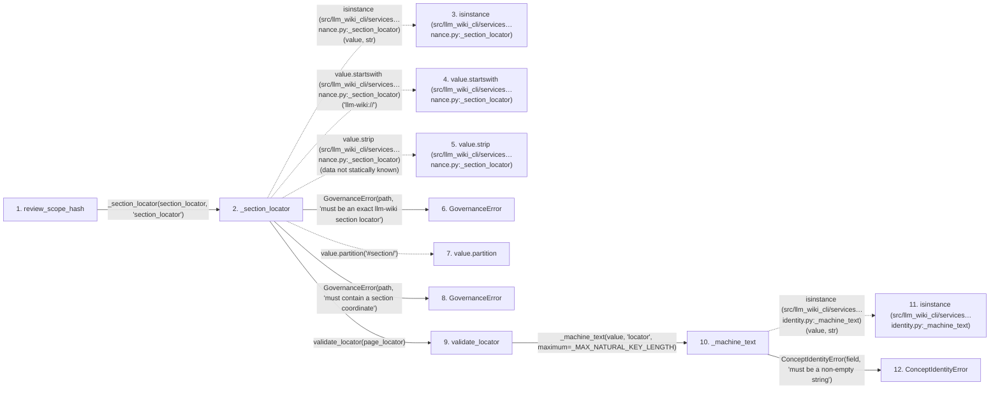

# review_scope_hash

**Entry point:** `review_scope_hash` (`api`)
**Source:** [knowledge_governance](../modules/knowledge_governance.md)
**Modules touched:** [concept_identity](../modules/concept_identity.md), [knowledge_evidence](../modules/knowledge_evidence.md), [knowledge_governance](../modules/knowledge_governance.md), [validation](../modules/validation.md), and 2 more

**Complete modules touched:**

- [concept_identity](../modules/concept_identity.md)
- [knowledge_evidence](../modules/knowledge_evidence.md)
- [knowledge_governance](../modules/knowledge_governance.md)
- [validation](../modules/validation.md)
- [wiki_media](../modules/wiki_media.md)
- [wiki_surface](../modules/wiki_surface.md)

## Call sequence

> Static overview in presentation order, not runtime execution order. Arrows retain captured callers; siblings are shown before deeper helper detail.

```mermaid
sequenceDiagram
    participant p0 as review_scope_hash
    participant p1 as _section_locator
    participant p2 as _section_records_by_locator
    participant p3 as sections.get
    participant p4 as GovernanceError
    participant p5 as section.get (src/llm_wiki_cli/services…ance.py:review_scope_hash)
    participant p6 as is_valid_sha256
    participant p7 as isinstance (src/llm_wiki_cli/services…ance.py:review_scope_hash)
    participant p8 as isinstance (src/llm_wiki_cli/services…nance.py:_section_locator)
    participant p9 as knowledge.extensions.get
    participant p10 as isinstance (src/llm_wiki_cli/services…idence.py:is_valid_sha256)
    participant p11 as value.startswith (src/llm_wiki_cli/services…nance.py:_section_locator)
    participant p12 as isinstance (src/llm_wiki_cli/services…ection_records_by_locator)
    participant p13 as _SHA256_RE.fullmatch
    participant p14 as value.strip (src/llm_wiki_cli/services…nance.py:_section_locator)
    participant p15 as extension.get
    participant p16 as value.partition
    participant p17 as page.get
    participant p18 as validate_locator
    participant p19 as require_no_control_characters
    participant p20 as section.get (src/llm_wiki_cli/services…ection_records_by_locator)
    p0->>p1: _section_locator
    p0->>p2: _section_records_by_locator
    p0-->>p3: sections.get(selected)
    p0->>p4: GovernanceError
    p0-->>p5: section.get (src/llm_wiki_cli/services…ance.py:review_scope_hash)('semantic_hash')
    p0->>p6: is_valid_sha256
    p0->>p4: GovernanceError
    p0-->>p7: isinstance (src/llm_wiki_cli/services…ance.py:review_scope_hash)(semantic_hash, str)
    p1-->>p8: isinstance (src/llm_wiki_cli/services…nance.py:_section_locator)(value, str)
    p2-->>p9: knowledge.extensions.get(SECTION_OWNERSHIP_EXTENSION_KEY)
    p6-->>p10: isinstance (src/llm_wiki_cli/services…idence.py:is_valid_sha256)(value, str)
    p1-->>p11: value.startswith (src/llm_wiki_cli/services…nance.py:_section_locator)('llm-wiki://')
    p2-->>p12: isinstance (src/llm_wiki_cli/services…ection_records_by_locator)(extension, Mapping)
    p6-->>p13: _SHA256_RE.fullmatch(value)
    p1-->>p14: value.strip (src/llm_wiki_cli/services…nance.py:_section_locator)
    p2-->>p15: extension.get('pages')
    p1->>p4: GovernanceError
    p2-->>p12: isinstance (src/llm_wiki_cli/services…ection_records_by_locator)(pages, list)
    p1-->>p16: value.partition(' section/')
    p2-->>p12: isinstance (src/llm_wiki_cli/services…ection_records_by_locator)(page, Mapping)
    p1->>p4: GovernanceError
    p2-->>p17: page.get('sections')
    p1->>p18: validate_locator
    p2-->>p12: isinstance (src/llm_wiki_cli/services…ection_records_by_locator)(sections, list)
    p1->>p4: GovernanceError
    p2-->>p12: isinstance (src/llm_wiki_cli/services…ection_records_by_locator)(section, Mapping)
    p1->>p19: require_no_control_characters
    p2-->>p20: section.get (src/llm_wiki_cli/services…ection_records_by_locator)('locator')
    p1->>p4: GovernanceError
    p2-->>p12: isinstance (src/llm_wiki_cli/services…ection_records_by_locator)(locator, str)
```

<!-- Auto-generated from static call edges. Dashed arrows are external or unresolved calls. Reviewed runtime conditions and side effects belong in Behavior. -->

> Call sequence diagram shows 30 of 121 interactions; 91 omitted to keep the visualization within the 30-interaction and generated-diagram limits, with uncertain identities omitted rather than inferred.

> Captured boundary calls: external 9 of 35 (26 omitted); unresolved 10 of 39 (29 omitted). These counts cover the captured static trace.

Omitted captured detail, grouped by actual caller occurrence and target module:

| Caller | Parent step | Target module | Kind | Omitted interactions |
| --- | --- | --- | --- | --- |
| `src/llm_wiki_cli/services/concept_identity.py:validate_locator` | 9 | [src/llm_wiki_cli/services/concept_identity.py](../modules/concept_identity.md) | internal | 6 |
| `src/llm_wiki_cli/services/concept_identity.py:_machine_text` | 10 | - | external | 6 |
| `src/llm_wiki_cli/services/concept_identity.py:_machine_text` | 10 | [src/llm_wiki_cli/services/concept_identity.py](../modules/concept_identity.md) | internal | 5 |
| `src/llm_wiki_cli/services/concept_identity.py:_machine_text` | 10 | - | unresolved | 3 |
| `src/llm_wiki_cli/services/concept_identity.py:_contains_uri_userinfo` | 25 | - | external | 1 |
| `src/llm_wiki_cli/services/concept_identity.py:_looks_absolute_path` | 27 | - | unresolved | 2 |
| `src/llm_wiki_cli/services/concept_identity.py:validate_locator` | 9 | [src/llm_wiki_cli/services/wiki_surface.py](../modules/wiki_surface.md) | internal | 1 |
| `src/llm_wiki_cli/services/wiki_surface.py:validate_exact_page_coordinate` | 31 | - | external | 4 |
> Omission summary shows 8 of 33 groups; 25 further groups are not expanded here. Counts above include all omitted interactions.
> Detailed flow queries retain their own coverage and limits; omitted paths may execute at runtime.

> Trace truncated at the depth limit; deeper calls are omitted.

## Data flow

<!-- Auto-generated static analysis. Treat values and boundaries as best-effort hints, not runtime proof. -->

### Step data

| Step | Inputs | Reads | Writes | Returns |
|---|---|---|---|---|
| `review_scope_hash` | `knowledge: KnowledgeIndex`, `section_locator: str` | - | - | `semantic_hash` |
| `_section_locator` | `value: object`, `path: str` | `ConceptIdentityError` | - | `value` |
| `isinstance (src/llm_wiki_cli/services…nance.py:_section_locator)` | - | - | - | - |
| `value.startswith (src/llm_wiki_cli/services…nance.py:_section_locator)` | - | - | - | - |
| `value.strip (src/llm_wiki_cli/services…nance.py:_section_locator)` | - | - | - | - |
| `GovernanceError` | - | - | - | - |
| `value.partition` | - | - | - | - |
| `GovernanceError` | - | - | - | - |
| `validate_locator` | `value: object` | `_MAX_NATURAL_KEY_LENGTH`, `WikiSurfaceError` | - | `normalized` |
| `_machine_text` | `value: object`, `field: str`, `maximum: int` | - | - | `value` |
| `isinstance (src/llm_wiki_cli/services…identity.py:_machine_text)` | - | - | - | - |
| `ConceptIdentityError` | - | - | - | - |

### Call data

| From | To | Line | Call |
|---|---|---:|---|
| review_scope_hash | _section_locator | 1549 | `_section_locator(section_locator, 'section_locator')` |
| _section_locator | isinstance (src/llm_wiki_cli/services…nance.py:_section_locator) | 3318 | `isinstance(value, str)` |
| _section_locator | value.startswith (src/llm_wiki_cli/services…nance.py:_section_locator) | 3319 | `value.startswith('llm-wiki://')` |
| _section_locator | value.strip (src/llm_wiki_cli/services…nance.py:_section_locator) | 3322 | `value.strip(data not statically known)` |
| _section_locator | GovernanceError | 3324 | `GovernanceError(path, 'must be an exact llm-wiki section locator')` |
| _section_locator | value.partition | 3328 | `value.partition('#section/')` |
| _section_locator | GovernanceError | 3330 | `GovernanceError(path, 'must contain a section coordinate')` |
| _section_locator | validate_locator | 3332 | `validate_locator(page_locator)` |
| validate_locator | _machine_text | 438 | `_machine_text(value, 'locator', maximum=_MAX_NATURAL_KEY_LENGTH)` |
| _machine_text | isinstance (src/llm_wiki_cli/services…identity.py:_machine_text) | 942 | `isinstance(value, str)` |
| _machine_text | ConceptIdentityError | 943 | `ConceptIdentityError(field, 'must be a non-empty string')` |

### Boundary effects

*No boundary effects detected.*

### Static analysis gaps

| Kind | Step | Target | Line |
|---|---|---|---:|
| external_call | `_section_locator` | `isinstance` | 3318 |
| unresolved_call | `_section_locator` | `value.startswith` | 3319 |
| unresolved_call | `_section_locator` | `value.strip` | 3322 |
| unresolved_call | `_section_locator` | `value.partition` | 3328 |
| external_call | `_machine_text` | `isinstance` | 942 |
| step_limit | `review_scope_hash` | `first 12 steps` | 0 |
| truncated_flow | `review_scope_hash` | `depth limit` | 0 |

## Behavior

This flow starts at `review_scope_hash` and is classified as `api`. The generated call and data-flow sections are bounded static projections; runtime conditions and side effects require source-level confirmation.
