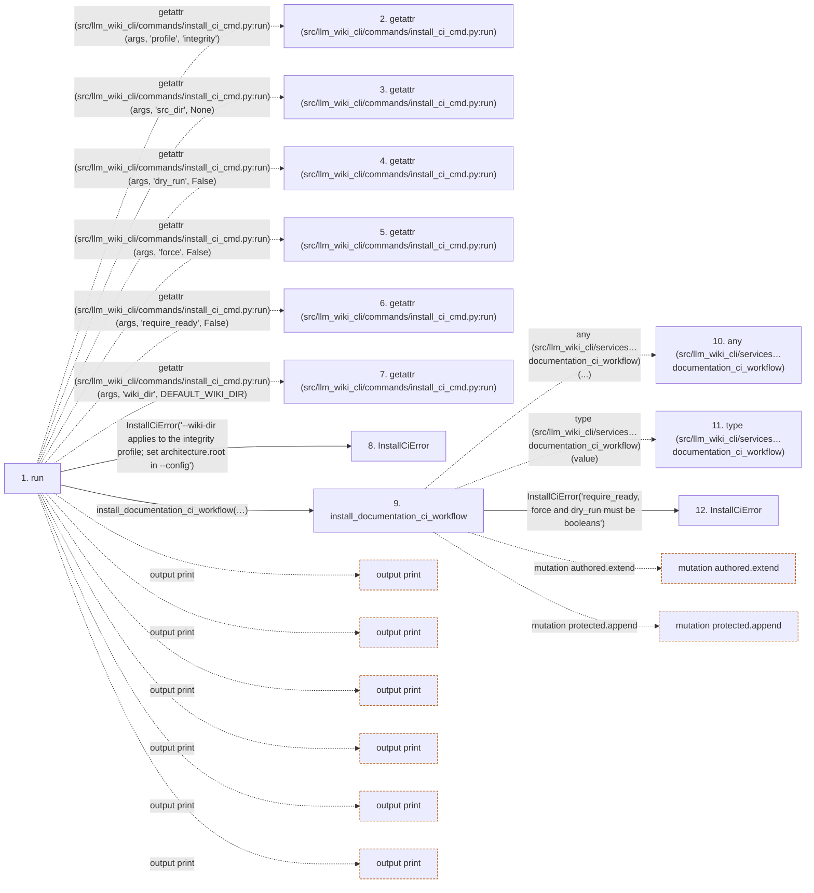

# run

**Entry point:** `run` (`api`)
**Source:** [install_ci_cmd](../modules/install_ci_cmd.md)
**Modules touched:** [ci_installer](../modules/ci_installer.md), [concept_identity](../modules/concept_identity.md), [config](../modules/config.md), [current_contracts](../modules/current_contracts.md), and 15 more

**Complete modules touched:**

- [ci_installer](../modules/ci_installer.md)
- [concept_identity](../modules/concept_identity.md)
- [config](../modules/config.md)
- [current_contracts](../modules/current_contracts.md)
- [filesystem_guard](../modules/filesystem_guard.md)
- [install_ci_cmd](../modules/install_ci_cmd.md)
- [io](../modules/io.md)
- [knowledge_evidence](../modules/knowledge_evidence.md)
- [knowledge_storage](../modules/knowledge_storage.md)
- [knowledge_storage_io](../modules/knowledge_storage_io.md)
- [maintenance_state](../modules/maintenance_state.md)
- [manifest_storage](../modules/manifest_storage.md)
- [publication_config](../modules/publication_config.md)
- [source_selection](../modules/source_selection.md)
- [sync_manifest](../modules/sync_manifest.md)
- [validation](../modules/validation.md)
- [wiki_lifecycle](../modules/wiki_lifecycle.md)
- [wiki_surface](../modules/wiki_surface.md)
- [wiki_write_basis](../modules/wiki_write_basis.md)

## Call sequence

> Static overview in presentation order, not runtime execution order. Arrows retain captured callers; representative internal continuations and boundary examples precede repeated helper detail.

```mermaid
sequenceDiagram
    participant p0 as run
    participant p1 as install_documentation_ci_workflow
    participant p2 as install_ci_workflow
    participant p3 as InstallCiError
    participant p4 as _project_root
    participant p5 as normalize_action_ref
    participant p6 as _portable_project_path
    participant p7 as classify_wiki_lifecycle
    participant p8 as _project_directory
    participant p9 as load_publication_config
    participant p10 as render_managed_workflow
    participant p11 as publication_source_root
    participant p12 as _validate_default_selection_contract
    participant p13 as publication_path
    participant p14 as publication_control_overlap
    participant p15 as _install_workflow
    participant p16 as _documentation_workflow
    participant p17 as _without_github_expression
    participant p18 as locate_exact_repository_path
    participant p19 as _consumer_root
    participant p20 as _validate_workflow_target
    participant p21 as _validated_project_path
    participant p22 as _relative_path
    participant p23 as SyncManifest.load
    participant p24 as is_pristine_wiki_target
    participant p25 as resolve_source_selection
    participant p26 as validate_persisted_source_selection_identity
    participant p27 as is_unmodified_managed_workflow
    participant p28 as read_publication_json
    participant p29 as getattr (src/llm_wiki_cli/commands/install_ci_cmd.py:run)
    participant p30 as authored.extend
    p0->>p1: install_documentation_ci_workflow
    p0->>p2: install_ci_workflow
    p0->>p3: InstallCiError
    p1->>p4: _project_root
    p1->>p5: normalize_action_ref
    p1->>p6: _portable_project_path
    p2->>p7: classify_wiki_lifecycle
    p1->>p8: _project_directory
    p1->>p9: load_publication_config
    p2->>p10: render_managed_workflow
    p1->>p11: publication_source_root
    p1->>p12: _validate_default_selection_contract
    p1->>p13: publication_path
    p1->>p14: publication_control_overlap
    p1->>p15: _install_workflow
    p1->>p16: _documentation_workflow
    p6->>p17: _without_github_expression
    p8->>p18: locate_exact_repository_path
    p9->>p19: _consumer_root
    p15->>p20: _validate_workflow_target
    p6->>p21: _validated_project_path
    p9->>p22: _relative_path
    p12->>p23: SyncManifest.load
    p7->>p24: is_pristine_wiki_target
    p12->>p25: resolve_source_selection
    p12->>p26: validate_persisted_source_selection_identity
    p15->>p27: is_unmodified_managed_workflow
    p9->>p28: read_publication_json
    p0-->>p29: getattr (src/llm_wiki_cli/commands/install_ci_cmd.py:run)(args, 'profile', 'integrity')
    p1-->>p30: authored.extend(...)
```

<!-- Auto-generated from static call edges. Dashed arrows are external or unresolved calls. Reviewed runtime conditions and side effects belong in Behavior. -->

> Call sequence diagram shows 30 of 1312 interactions; 1282 omitted to keep the visualization within the 30-interaction and generated-diagram limits, with uncertain identities omitted rather than inferred.

> Captured boundary calls: external 1 of 447 (446 omitted); unresolved 1 of 298 (297 omitted). These counts cover the captured static trace.

Omitted captured detail, grouped by actual caller occurrence and target module:

| Caller | Parent step | Target module | Kind | Omitted interactions |
| --- | --- | --- | --- | --- |
| `src/llm_wiki_cli/commands/install_ci_cmd.py:run` | 1 | - | external | 15 |
| `src/llm_wiki_cli/services/ci_installer.py:install_documentation_ci_workflow` | 9 | - | external | 3 |
| `src/llm_wiki_cli/services/ci_installer.py:install_documentation_ci_workflow` | 9 | [src/llm_wiki_cli/services/ci_installer.py](../modules/ci_installer.md) | internal | 16 |
| `src/llm_wiki_cli/services/ci_installer.py:_project_root` | 13 | - | unresolved | 2 |
| `src/llm_wiki_cli/services/ci_installer.py:_project_root` | 13 | - | external | 2 |
| `src/llm_wiki_cli/services/ci_installer.py:_project_root` | 13 | [src/llm_wiki_cli/services/ci_installer.py](../modules/ci_installer.md) | internal | 2 |
| `src/llm_wiki_cli/services/ci_installer.py:normalize_action_ref` | 20 | - | external | 1 |
| `src/llm_wiki_cli/services/ci_installer.py:normalize_action_ref` | 20 | - | unresolved | 2 |
> Omission summary shows 8 of 283 groups; 275 further groups are not expanded here. Counts above include all omitted interactions.
> Detailed flow queries retain their own coverage and limits; omitted paths may execute at runtime.

> Trace truncated at the depth limit; deeper calls are omitted.

## Data flow

<!-- Auto-generated static analysis. Treat values and boundaries as best-effort hints, not runtime proof. -->

### Analysis coverage

**Effect analysis partially available.** Flow assembly and source effect analysis are separate; empty observations do not prove an empty handler body.

Source steps: 568; effect analysis evaluated: 321, partial: 18, unavailable: 229. Counts include steps omitted from the displayed trace.

Collector observations for 339 source steps with known totals: observed: 1946, emitted: 1885, omitted: 61. Unavailable totals are excluded.

- Callable record unavailable for one or more source steps; those steps have no represented callable body.
- Effect collector omitted observations before flow assembly; displayed effects are partial.
- Effect collector totals unavailable; observed counts cover captured records only.

| Step | Callable record | Effect analysis | Collector totals | Observed | Emitted | Omitted |
|---|---|---|---|---:|---:|---:|
| `run` | `available` | `evaluated` | `available` | `14` | `14` | `0` |
| `getattr (src/llm_wiki_cli/commands/install_ci_cmd.py:run)` | `not_applicable` | `not_applicable` | `not_applicable` | — | — | — |
| `getattr (src/llm_wiki_cli/commands/install_ci_cmd.py:run)` | `not_applicable` | `not_applicable` | `not_applicable` | — | — | — |
| `getattr (src/llm_wiki_cli/commands/install_ci_cmd.py:run)` | `not_applicable` | `not_applicable` | `not_applicable` | — | — | — |
| `getattr (src/llm_wiki_cli/commands/install_ci_cmd.py:run)` | `not_applicable` | `not_applicable` | `not_applicable` | — | — | — |
| `getattr (src/llm_wiki_cli/commands/install_ci_cmd.py:run)` | `not_applicable` | `not_applicable` | `not_applicable` | — | — | — |
| `getattr (src/llm_wiki_cli/commands/install_ci_cmd.py:run)` | `not_applicable` | `not_applicable` | `not_applicable` | — | — | — |
| `InstallCiError` | `unavailable` | `unavailable` | `unavailable` | — | — | — |
| `install_documentation_ci_workflow` | `available` | `partial` | `available` | `25` | `20` | `5` |
| `any (src/llm_wiki_cli/services…documentation_ci_workflow)` | `not_applicable` | `not_applicable` | `not_applicable` | — | — | — |
| `type (src/llm_wiki_cli/services…documentation_ci_workflow)` | `not_applicable` | `not_applicable` | `not_applicable` | — | — | — |
| `InstallCiError` | `unavailable` | `unavailable` | `unavailable` | — | — | — |

### Step data

| Step | Inputs | Reads | Writes | Returns |
|---|---|---|---|---|
| `run` | `args` | `DEFAULT_WIKI_DIR`, `PUBLICATION_CONFIG_PATH`, `DEFAULT_WIKI_DIR`, `InstallCiError`, `sys` | - | `none`, `none` |
| `getattr (src/llm_wiki_cli/commands/install_ci_cmd.py:run)` | - | - | - | - |
| `getattr (src/llm_wiki_cli/commands/install_ci_cmd.py:run)` | - | - | - | - |
| `getattr (src/llm_wiki_cli/commands/install_ci_cmd.py:run)` | - | - | - | - |
| `getattr (src/llm_wiki_cli/commands/install_ci_cmd.py:run)` | - | - | - | - |
| `getattr (src/llm_wiki_cli/commands/install_ci_cmd.py:run)` | - | - | - | - |
| `getattr (src/llm_wiki_cli/commands/install_ci_cmd.py:run)` | - | - | - | - |
| `InstallCiError` | - | - | - | - |
| `install_documentation_ci_workflow` | `action_ref: str`, `config: str`, `working_directory: str`, `src_dir: str \| None`, `target_dir: str \| None`, `baseline: str \| None`, `reviews: str \| None`, `previous_receipt: str \| None` | `DOCUMENTATION_WORKFLOW_PATH`, `PublicationConfigError`, `DOCUMENTATION_WORKFLOW_PATH` | `inputs[...]`, `inputs[...]`, `inputs[...]`, `inputs[...]` | `_install_workflow(...)` |
| `any (src/llm_wiki_cli/services…documentation_ci_workflow)` | - | - | - | - |
| `type (src/llm_wiki_cli/services…documentation_ci_workflow)` | - | - | - | - |
| `InstallCiError` | - | - | - | - |

### Call data

| From | To | Line | Call |
|---|---|---:|---|
| run | getattr (src/llm_wiki_cli/commands/install_ci_cmd.py:run) | 17 | `getattr(args, 'profile', 'integrity')` |
| run | getattr (src/llm_wiki_cli/commands/install_ci_cmd.py:run) | 18 | `getattr(args, 'src_dir', None)` |
| run | getattr (src/llm_wiki_cli/commands/install_ci_cmd.py:run) | 19 | `getattr(args, 'dry_run', False)` |
| run | getattr (src/llm_wiki_cli/commands/install_ci_cmd.py:run) | 20 | `getattr(args, 'force', False)` |
| run | getattr (src/llm_wiki_cli/commands/install_ci_cmd.py:run) | 21 | `getattr(args, 'require_ready', False)` |
| run | getattr (src/llm_wiki_cli/commands/install_ci_cmd.py:run) | 24 | `getattr(args, 'wiki_dir', DEFAULT_WIKI_DIR)` |
| run | InstallCiError | 25 | `InstallCiError('--wiki-dir applies to the integrity profile; set architecture.root in --config')` |
| run | install_documentation_ci_workflow | 28 | `install_documentation_ci_workflow(action_ref=args.action_ref, src_dir=src_dir, dry_run=dry_run, force=force, config=..., working_directory=..., target_dir=args.target_dir, baseline=args.baseline, reviews=args.reviews, previous_receipt=args.previous_receipt, candidate_review=args.candidate_review, require_ready=require_ready)` |
| install_documentation_ci_workflow | any (src/llm_wiki_cli/services…documentation_ci_workflow) | 366 | `any(...)` |
| install_documentation_ci_workflow | type (src/llm_wiki_cli/services…documentation_ci_workflow) | 366 | `type(value)` |
| install_documentation_ci_workflow | InstallCiError | 367 | `InstallCiError('require_ready, force and dry_run must be booleans')` |

### Boundary effects

| Kind | Target | Step | Line |
|---|---|---|---:|
| output | `print` | `run` | 68 |
| output | `print` | `run` | 72 |
| output | `print` | `run` | 77 |
| output | `print` | `run` | 78 |
| output | `print` | `run` | 82 |
| output | `print` | `run` | 83 |
| mutation | `authored.extend` | `install_documentation_ci_workflow` | 409 |
| mutation | `protected.append` | `install_documentation_ci_workflow` | 417 |

### Static analysis gaps

| Kind | Step | Target | Line |
|---|---|---|---:|
| external_call | `run` | `getattr` | 17 |
| external_call | `run` | `getattr` | 18 |
| external_call | `run` | `getattr` | 19 |
| external_call | `run` | `getattr` | 20 |
| external_call | `run` | `getattr` | 21 |
| external_call | `run` | `getattr` | 24 |
| external_call | `install_documentation_ci_workflow` | `any` | 366 |
| external_call | `install_documentation_ci_workflow` | `type` | 366 |
| step_limit | `run` | `first 12 steps` | 0 |
| truncated_flow | `run` | `depth limit` | 0 |

## Behavior

This flow starts at `run` and is classified as `api`. The generated call and data-flow sections are bounded static projections; runtime conditions and side effects require source-level confirmation.
