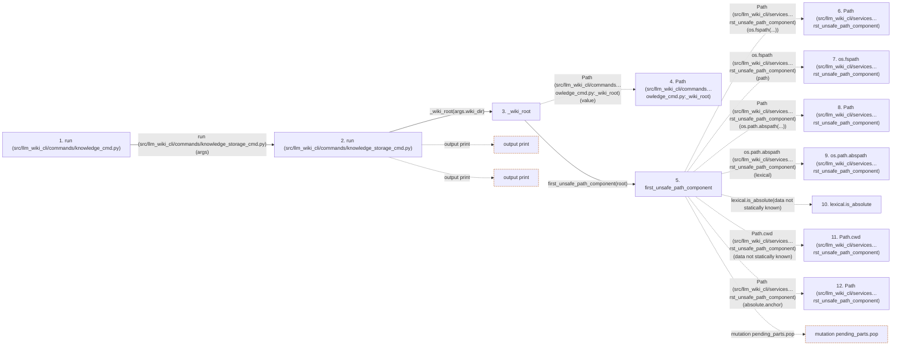

# run

**Entry point:** `run` (`api`)
**Source:** [knowledge_cmd](../modules/knowledge_cmd.md)
**Modules touched:** [analysis_compatibility](../modules/analysis_compatibility.md), [api](../modules/api.md), [canonical_json](../modules/canonical_json.md), [common](../modules/common.md), and 69 more

**Complete modules touched:**

- [analysis_compatibility](../modules/analysis_compatibility.md)
- [api](../modules/api.md)
- [canonical_json](../modules/canonical_json.md)
- [common](../modules/common.md)
- [concept_identity](../modules/concept_identity.md)
- [config](../modules/config.md)
- [context_packet](../modules/context_packet.md)
- [context_service](../modules/context_service.md)
- [data_flow](../modules/data_flow.md)
- [dependency_versions](../modules/dependency_versions.md)
- [documentation_queries](../modules/documentation_queries.md)
- [documentation_query_builder](../modules/documentation_query_builder.md)
- [entrypoints](../modules/entrypoints.md)
- [extraction_service](../modules/extraction_service.md)
- [filesystem_guard](../modules/filesystem_guard.md)
- [immutable](../modules/immutable.md)
- [implementation_evidence](../modules/implementation_evidence.md)
- [imports](../modules/imports.md)
- [infrastructure_inventory](../modules/infrastructure_inventory.md)
- [infrastructure_sync](../modules/infrastructure_sync.md)
- [io](../modules/io.md)
- [knowledge_artifacts](../modules/knowledge_artifacts.md)
- [knowledge_audit](../modules/knowledge_audit.md)
- [knowledge_cmd](../modules/knowledge_cmd.md)
- [knowledge_consumption](../modules/knowledge_consumption.md)
- [knowledge_coverage](../modules/knowledge_coverage.md)
- [knowledge_envelope](../modules/knowledge_envelope.md)
- [knowledge_evidence](../modules/knowledge_evidence.md)
- [knowledge_freshness](../modules/knowledge_freshness.md)
- [knowledge_governance](../modules/knowledge_governance.md)
- [knowledge_graph](../modules/knowledge_graph.md)
- [knowledge_index](../modules/knowledge_index.md)
- [knowledge_loader](../modules/knowledge_loader.md)
- [knowledge_model](../modules/knowledge_model.md)
- [knowledge_observability](../modules/knowledge_observability.md)
- [knowledge_orchestration](../modules/knowledge_orchestration.md)
- [knowledge_packs](../modules/knowledge_packs.md)
- [knowledge_reuse](../modules/knowledge_reuse.md)
- [knowledge_storage](../modules/knowledge_storage.md)
- [knowledge_storage_access](../modules/knowledge_storage_access.md)
- [knowledge_storage_cmd](../modules/knowledge_storage_cmd.md)
- [knowledge_storage_diagnostics](../modules/knowledge_storage_diagnostics.md)
- [knowledge_storage_io](../modules/knowledge_storage_io.md)
- [knowledge_storage_lifecycle](../modules/knowledge_storage_lifecycle.md)
- [knowledge_stream_audit](../modules/knowledge_stream_audit.md)
- [knowledge_verification](../modules/knowledge_verification.md)
- [maintenance_evidence](../modules/maintenance_evidence.md)
- [maintenance_projection](../modules/maintenance_projection.md)
- [maintenance_protocol](../modules/maintenance_protocol.md)
- [maintenance_service](../modules/maintenance_service.md)
- [maintenance_shapes](../modules/maintenance_shapes.md)
- [maintenance_state](../modules/maintenance_state.md)
- [maintenance_status](../modules/maintenance_status.md)
- [manifest_storage](../modules/manifest_storage.md)
- [plugins](../modules/plugins.md)
- [python_calls](../modules/python_calls.md)
- [python_implementation](../modules/python_implementation.md)
- [python_imports](../modules/python_imports.md)
- [section_ownership](../modules/section_ownership.md)
- [services_dependencies](../modules/services_dependencies.md)
- [source_selection](../modules/source_selection.md)
- [source_snapshot](../modules/source_snapshot.md)
- [storage_sort](../modules/storage_sort.md)
- [storage_spool](../modules/storage_spool.md)
- [sync_manifest](../modules/sync_manifest.md)
- [validation](../modules/validation.md)
- [verification_contracts](../modules/verification_contracts.md)
- [wiki_media](../modules/wiki_media.md)
- [wiki_surface](../modules/wiki_surface.md)
- [wiki_surface_index](../modules/wiki_surface_index.md)
- [wiki_write_basis](../modules/wiki_write_basis.md)
- [yaml_formats](../modules/yaml_formats.md)
- [yaml_syntax](../modules/yaml_syntax.md)

## Call sequence

> Static overview in presentation order, not runtime execution order. Arrows retain captured callers; representative internal continuations and boundary examples precede repeated helper detail.

```mermaid
sequenceDiagram
    participant p0 as run (src/llm_wiki_cli/commands/knowledge_cmd.py)
    participant p1 as run (src/llm_wiki_cli/commands/knowledge_storage_cmd.py)
    participant p2 as _run_init
    participant p3 as _run_status
    participant p4 as _run_coverage
    participant p5 as _run_move
    participant p6 as _run_alias
    participant p7 as _run_lifecycle
    participant p8 as _run_review
    participant p9 as _run_verify
    participant p10 as GovernanceError
    participant p11 as _wiki_root
    participant p12 as get_knowledge_coverage
    participant p13 as _run_existing_mutation
    participant p14 as migrate_knowledge_storage
    participant p15 as _init_ledger
    participant p16 as recover_knowledge_storage
    participant p17 as _projected_commit_plan
    participant p18 as export_knowledge_v1
    participant p19 as build_knowledge_read_view
    participant p20 as _scope_locator_for_uid
    participant p21 as knowledge_freshness_disclosure
    participant p22 as _lifecycle_mutation
    participant p23 as build_artifact_verification_context
    participant p24 as _governance_mutation_operation
    participant p25 as verify (src/llm_wiki_cli/services/verification_contracts.py)
    participant p26 as verify_and_write_receipt
    participant p27 as prune_knowledge_storage
    participant p28 as _assert_snapshot_unchanged
    participant p29 as getattr (src/llm_wiki_cli/commands…dge_cmd.py:_run_lifecycle)
    participant p30 as prepare
    p0->>p1: run (src/llm_wiki_cli/commands/knowledge_storage_cmd.py)
    p0->>p2: _run_init
    p0->>p3: _run_status
    p0->>p4: _run_coverage
    p0->>p5: _run_move
    p0->>p6: _run_alias
    p0->>p7: _run_lifecycle
    p0->>p8: _run_review
    p0->>p9: _run_verify
    p0->>p10: GovernanceError
    p1->>p11: _wiki_root
    p4->>p12: get_knowledge_coverage
    p6->>p13: _run_existing_mutation
    p1->>p14: migrate_knowledge_storage
    p2->>p15: _init_ledger
    p1->>p16: recover_knowledge_storage
    p2->>p17: _projected_commit_plan
    p1->>p18: export_knowledge_v1
    p3->>p19: build_knowledge_read_view
    p9->>p20: _scope_locator_for_uid
    p3->>p21: knowledge_freshness_disclosure
    p7->>p22: _lifecycle_mutation
    p9->>p23: build_artifact_verification_context
    p2->>p24: _governance_mutation_operation
    p9->>p25: verify (src/llm_wiki_cli/services/verification_contracts.py)
    p9->>p26: verify_and_write_receipt
    p1->>p27: prune_knowledge_storage
    p2->>p28: _assert_snapshot_unchanged
    p7-->>p29: getattr (src/llm_wiki_cli/commands…dge_cmd.py:_run_lifecycle)(args, 'successor_uid', None)
    p5-->>p30: prepare
```

<!-- Auto-generated from static call edges. Dashed arrows are external or unresolved calls. Reviewed runtime conditions and side effects belong in Behavior. -->

> Call sequence diagram shows 30 of 4362 interactions; 4332 omitted to keep the visualization within the 30-interaction and generated-diagram limits, with uncertain identities omitted rather than inferred.

> Captured boundary calls: external 1 of 1299 (1298 omitted); unresolved 1 of 1040 (1039 omitted). These counts cover the captured static trace.

Omitted captured detail, grouped by actual caller occurrence and target module:

| Caller | Parent step | Target module | Kind | Omitted interactions |
| --- | --- | --- | --- | --- |
| `src/llm_wiki_cli/commands/knowledge_cmd.py:_wiki_root` | 3 | - | external | 1 |
| `src/llm_wiki_cli/commands/knowledge_cmd.py:_wiki_root` | 3 | [src/llm_wiki_cli/services/io.py](../modules/io.md) | internal | 1 |
| `src/llm_wiki_cli/services/io.py:first_unsafe_path_component` | 5 | - | external | 20 |
| `src/llm_wiki_cli/services/io.py:first_unsafe_path_component` | 5 | - | unresolved | 5 |
| `src/llm_wiki_cli/commands/knowledge_cmd.py:_wiki_root` | 3 | [src/llm_wiki_cli/services/knowledge_governance.py](../modules/knowledge_governance.md) | internal | 3 |
| `src/llm_wiki_cli/commands/knowledge_cmd.py:_wiki_root` | 3 | - | unresolved | 2 |
| `src/llm_wiki_cli/services/knowledge_storage_lifecycle.py:migrate_knowledge_storage` | 36 | - | external | 3 |
| `src/llm_wiki_cli/services/knowledge_storage_lifecycle.py:migrate_knowledge_storage` | 36 | [src/llm_wiki_cli/services/knowledge_storage.py](../modules/knowledge_storage.md) | internal | 2 |
> Omission summary shows 8 of 1046 groups; 1038 further groups are not expanded here. Counts above include all omitted interactions.
> Detailed flow queries retain their own coverage and limits; omitted paths may execute at runtime.

> Trace truncated at the depth limit; deeper calls are omitted.

## Data flow

<!-- Auto-generated static analysis. Treat values and boundaries as best-effort hints, not runtime proof. -->

### Step data

| Step | Inputs | Reads | Writes | Returns |
|---|---|---|---|---|
| `run (src/llm_wiki_cli/commands/knowledge_cmd.py)` | `args` | `Lifecycle`, `Lifecycle`, `Lifecycle`, `Lifecycle` | - | - |
| `run (src/llm_wiki_cli/commands/knowledge_storage_cmd.py)` | `args` | - | - | - |
| `_wiki_root` | `value: str \| Path` | - | - | `root` |
| `Path (src/llm_wiki_cli/commands…owledge_cmd.py:_wiki_root)` | - | - | - | - |
| `first_unsafe_path_component` | `path: str \| Path`, `trusted_symlink_uids: Set[int] \| None`, `trusted_symlink_owner: Callable[[Path], bool] \| None` | `stat`, `os` | - | `lexical`, `None`, `current`, `current`, `current`, `current`, `current`, `None` |
| `Path (src/llm_wiki_cli/services…rst_unsafe_path_component)` | - | - | - | - |
| `os.fspath (src/llm_wiki_cli/services…rst_unsafe_path_component)` | - | - | - | - |
| `Path (src/llm_wiki_cli/services…rst_unsafe_path_component)` | - | - | - | - |
| `os.path.abspath (src/llm_wiki_cli/services…rst_unsafe_path_component)` | - | - | - | - |
| `lexical.is_absolute` | - | - | - | - |
| `Path.cwd (src/llm_wiki_cli/services…rst_unsafe_path_component)` | - | - | - | - |
| `Path (src/llm_wiki_cli/services…rst_unsafe_path_component)` | - | - | - | - |

### Call data

| From | To | Line | Call |
|---|---|---:|---|
| run (src/llm_wiki_cli/commands/knowledge_cmd.py) | run (src/llm_wiki_cli/commands/knowledge_storage_cmd.py) | 972 | `run_storage(args)` |
| run (src/llm_wiki_cli/commands/knowledge_storage_cmd.py) | _wiki_root | 17 | `_wiki_root(args.wiki_dir)` |
| _wiki_root | Path (src/llm_wiki_cli/commands…owledge_cmd.py:_wiki_root) | 107 | `Path(value)` |
| _wiki_root | first_unsafe_path_component | 108 | `first_unsafe_path_component(root)` |
| first_unsafe_path_component | Path (src/llm_wiki_cli/services…rst_unsafe_path_component) | 51 | `Path(os.fspath(...))` |
| first_unsafe_path_component | os.fspath (src/llm_wiki_cli/services…rst_unsafe_path_component) | 51 | `os.fspath(path)` |
| first_unsafe_path_component | Path (src/llm_wiki_cli/services…rst_unsafe_path_component) | 59 | `Path(os.path.abspath(...))` |
| first_unsafe_path_component | os.path.abspath (src/llm_wiki_cli/services…rst_unsafe_path_component) | 59 | `os.path.abspath(lexical)` |
| first_unsafe_path_component | lexical.is_absolute | 60 | `lexical.is_absolute(data not statically known)` |
| first_unsafe_path_component | Path.cwd (src/llm_wiki_cli/services…rst_unsafe_path_component) | 66 | `Path.cwd(data not statically known)` |
| first_unsafe_path_component | Path (src/llm_wiki_cli/services…rst_unsafe_path_component) | 67 | `Path(absolute.anchor)` |

### Boundary effects

| Kind | Target | Step | Line |
|---|---|---|---:|
| output | `print` | `run` | 56 |
| output | `print` | `run` | 58 |
| mutation | `pending_parts.pop` | `first_unsafe_path_component` | 71 |

### Static analysis gaps

| Kind | Step | Target | Line |
|---|---|---|---:|
| external_call | `first_unsafe_path_component` | `os.fspath` | 51 |
| external_call | `first_unsafe_path_component` | `os.path.abspath` | 59 |
| unresolved_call | `first_unsafe_path_component` | `lexical.is_absolute` | 60 |
| external_call | `first_unsafe_path_component` | `Path.cwd` | 66 |
| step_limit | `run` | `first 12 steps` | 0 |
| truncated_flow | `run` | `depth limit` | 0 |

## Behavior

This flow starts at `run` and is classified as `api`. The generated call and data-flow sections are bounded static projections; runtime conditions and side effects require source-level confirmation.
