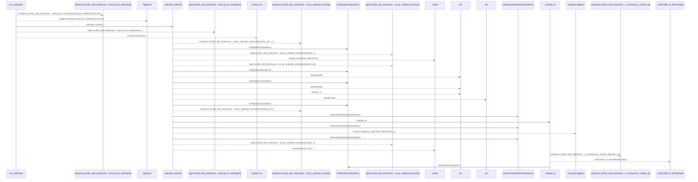
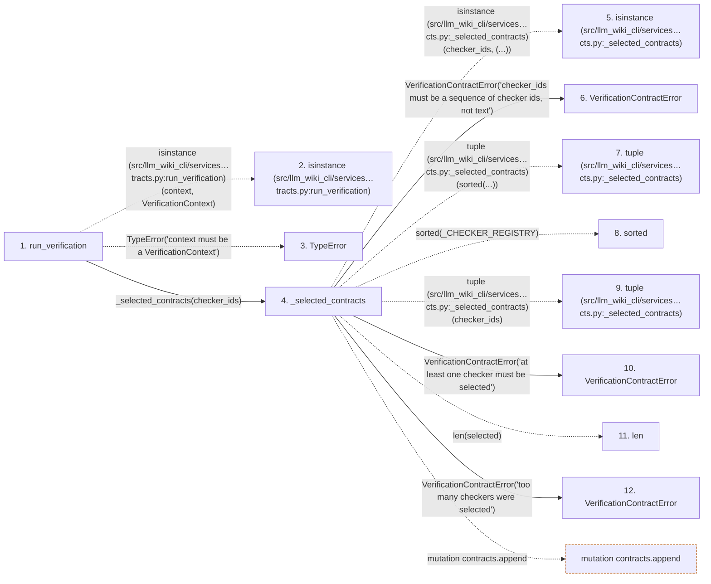

# run_verification

**Entry point:** `run_verification` (`api`)
**Source:** [verification_contracts](../modules/verification_contracts.md)
**Modules touched:** [verification_contracts](../modules/verification_contracts.md)

## Call sequence

> Static overview in presentation order, not runtime execution order. Arrows retain captured callers; representative internal continuations and boundary examples precede repeated helper detail.

<!-- Auto-generated from static call edges. Dashed arrows are external or unresolved calls. Reviewed runtime conditions and side effects belong in Behavior. -->

> Call sequence diagram shows 28 of 28 interactions; 0 omitted to keep the visualization within the 30-interaction and generated-diagram limits, with uncertain identities omitted rather than inferred.

> Captured boundary calls: external 15 of 15 (0 omitted); unresolved 3 of 3 (0 omitted). These counts cover the captured static trace.
> Detailed flow queries retain their own coverage and limits; omitted paths may execute at runtime.

## Data flow

<!-- Auto-generated static analysis. Treat values and boundaries as best-effort hints, not runtime proof. -->

### Analysis coverage

**Effect analysis partially available.** Flow assembly and source effect analysis are separate; empty observations do not prove an empty handler body.

Source steps: 11; effect analysis evaluated: 3, partial: 0, unavailable: 8. Counts include steps omitted from the displayed trace.

Collector observations for 3 source steps with known totals: observed: 14, emitted: 14, omitted: 0. Unavailable totals are excluded.

- Callable record unavailable for one or more source steps; those steps have no represented callable body.
- Effect collector totals unavailable; observed counts cover captured records only.

| Step | Callable record | Effect analysis | Collector totals | Observed | Emitted | Omitted |
|---|---|---|---|---:|---:|---:|
| `run_verification` | `available` | `evaluated` | `available` | `4` | `4` | `0` |
| `isinstance (src/llm_wiki_cli/services…tracts.py:run_verification)` | `not_applicable` | `not_applicable` | `not_applicable` | — | — | — |
| `TypeError` | `not_applicable` | `not_applicable` | `not_applicable` | — | — | — |
| `_selected_contracts` | `available` | `evaluated` | `available` | `7` | `7` | `0` |
| `isinstance (src/llm_wiki_cli/services…cts.py:_selected_contracts)` | `not_applicable` | `not_applicable` | `not_applicable` | — | — | — |
| `VerificationContractError` | `unavailable` | `unavailable` | `unavailable` | — | — | — |
| `tuple (src/llm_wiki_cli/services…cts.py:_selected_contracts)` | `not_applicable` | `not_applicable` | `not_applicable` | — | — | — |
| `sorted` | `not_applicable` | `not_applicable` | `not_applicable` | — | — | — |
| `tuple (src/llm_wiki_cli/services…cts.py:_selected_contracts)` | `not_applicable` | `not_applicable` | `not_applicable` | — | — | — |
| `VerificationContractError` | `unavailable` | `unavailable` | `unavailable` | — | — | — |
| `len` | `not_applicable` | `not_applicable` | `not_applicable` | — | — | — |
| `VerificationContractError` | `unavailable` | `unavailable` | `unavailable` | — | — | — |

### Step data

| Step | Inputs | Reads | Writes | Returns |
|---|---|---|---|---|
| `run_verification` | `context: VerificationContext`, `checker_ids: Sequence[str] \| None` | `VerificationContext` | - | `tuple(...)` |
| `isinstance (src/llm_wiki_cli/services…tracts.py:run_verification)` | - | - | - | - |
| `TypeError` | - | - | - | - |
| `_selected_contracts` | `checker_ids: Sequence[str] \| None` | `_CHECKER_REGISTRY`, `MAX_CHECKS_PER_RECEIPT`, `VerificationContractError`, `_CHECKER_REGISTRY` | - | `tuple(...)` |
| `isinstance (src/llm_wiki_cli/services…cts.py:_selected_contracts)` | - | - | - | - |
| `VerificationContractError` | - | - | - | - |
| `tuple (src/llm_wiki_cli/services…cts.py:_selected_contracts)` | - | - | - | - |
| `sorted` | - | - | - | - |
| `tuple (src/llm_wiki_cli/services…cts.py:_selected_contracts)` | - | - | - | - |
| `VerificationContractError` | - | - | - | - |
| `len` | - | - | - | - |
| `VerificationContractError` | - | - | - | - |

### Call data

| From | To | Line | Call |
|---|---|---:|---|
| run_verification | isinstance (src/llm_wiki_cli/services…tracts.py:run_verification) | 748 | `isinstance(context, VerificationContext)` |
| run_verification | TypeError | 749 | `TypeError('context must be a VerificationContext')` |
| run_verification | _selected_contracts | 750 | `_selected_contracts(checker_ids)` |
| _selected_contracts | isinstance (src/llm_wiki_cli/services…cts.py:_selected_contracts) | 710 | `isinstance(checker_ids, (...))` |
| _selected_contracts | VerificationContractError | 711 | `VerificationContractError('checker_ids must be a sequence of checker ids, not text')` |
| _selected_contracts | tuple (src/llm_wiki_cli/services…cts.py:_selected_contracts) | 715 | `tuple(sorted(...))` |
| _selected_contracts | sorted | 715 | `sorted(_CHECKER_REGISTRY)` |
| _selected_contracts | tuple (src/llm_wiki_cli/services…cts.py:_selected_contracts) | 717 | `tuple(checker_ids)` |
| _selected_contracts | VerificationContractError | 720 | `VerificationContractError('at least one checker must be selected')` |
| _selected_contracts | len | 721 | `len(selected)` |
| _selected_contracts | VerificationContractError | 722 | `VerificationContractError('too many checkers were selected')` |

### Boundary effects

| Kind | Target | Step | Line |
|---|---|---|---:|
| mutation | `contracts.append` | `_selected_contracts` | 736 |

### Static analysis gaps

| Kind | Step | Target | Line |
|---|---|---|---:|
| external_call | `run_verification` | `isinstance` | 748 |
| external_call | `run_verification` | `TypeError` | 749 |
| external_call | `_selected_contracts` | `isinstance` | 710 |
| external_call | `_selected_contracts` | `sorted` | 715 |
| step_limit | `run_verification` | `first 12 steps` | 0 |

## Behavior

This flow starts at `run_verification` and is classified as `api`. The generated call and data-flow sections are bounded static projections; runtime conditions and side effects require source-level confirmation.
