# serialize_knowledge_index

**Entry point:** `serialize_knowledge_index` (`api`)
**Source:** [knowledge_index](../modules/knowledge_index.md)
**Modules touched:** [concept_identity](../modules/concept_identity.md), [immutable](../modules/immutable.md), [implementation_evidence](../modules/implementation_evidence.md), and 18 more

**Complete modules touched:**

- [concept_identity](../modules/concept_identity.md)
- [immutable](../modules/immutable.md)
- [implementation_evidence](../modules/implementation_evidence.md)
- [knowledge_envelope](../modules/knowledge_envelope.md)
- [knowledge_evidence](../modules/knowledge_evidence.md)
- [knowledge_governance](../modules/knowledge_governance.md)
- [knowledge_graph](../modules/knowledge_graph.md)
- [knowledge_index](../modules/knowledge_index.md)
- [knowledge_links](../modules/knowledge_links.md)
- [knowledge_model](../modules/knowledge_model.md)
- [knowledge_reuse](../modules/knowledge_reuse.md)
- [knowledge_storage](../modules/knowledge_storage.md)
- [maintenance_evidence](../modules/maintenance_evidence.md)
- [maintenance_projection](../modules/maintenance_projection.md)
- [maintenance_shapes](../modules/maintenance_shapes.md)
- [maintenance_state](../modules/maintenance_state.md)
- [progress](../modules/progress.md)
- [section_ownership](../modules/section_ownership.md)
- [validation](../modules/validation.md)
- [wiki_media](../modules/wiki_media.md)
- [wiki_surface](../modules/wiki_surface.md)

## Call sequence

> Static overview in presentation order, not runtime execution order. Arrows retain captured callers; representative internal continuations and boundary examples precede repeated helper detail.

```mermaid
sequenceDiagram
    participant p0 as serialize_knowledge_index
    participant p1 as _serialize_payload
    participant p2 as knowledge_index_to_payload
    participant p3 as _model_to_payload
    participant p4 as validate_knowledge_index
    participant p5 as _knowledge_index_to_payload_unchecked
    participant p6 as parse_knowledge_index
    participant p7 as _validate_builder_model
    participant p8 as build_knowledge_index
    participant p9 as _first_difference
    participant p10 as _bundle_to_payload
    participant p11 as _record
    participant p12 as _validate_and_join_inputs
    participant p13 as _string
    participant p14 as _concept_for_page
    participant p15 as _parse_bundle
    participant p16 as _concept_to_payload
    participant p17 as _array (src/llm_wiki_cli/services/knowledge_model.py)
    participant p18 as _derived_relationship
    participant p19 as _relationship_to_payload
    participant p20 as _parse_concept
    participant p21 as _link_relationship
    participant p22 as _require_structure_state
    participant p23 as _parse_relationship
    participant p24 as _validated_reserved_extensions
    participant p25 as _validate_index_references
    participant p26 as validate_implementation_collection
    participant p27 as freeze
    participant p28 as validate_maintenance_projection
    participant p29 as json.dumps
    participant p30 as model.bundle.snapshot.extensions.get
    p0->>p1: _serialize_payload
    p0->>p2: knowledge_index_to_payload
    p2->>p3: _model_to_payload
    p2->>p4: validate_knowledge_index
    p3->>p5: _knowledge_index_to_payload_unchecked
    p4->>p6: parse_knowledge_index
    p4->>p7: _validate_builder_model
    p4->>p8: build_knowledge_index
    p4->>p9: _first_difference
    p5->>p10: _bundle_to_payload
    p6->>p11: _record
    p8->>p12: _validate_and_join_inputs
    p6->>p13: _string
    p8->>p14: _concept_for_page
    p6->>p15: _parse_bundle
    p5->>p16: _concept_to_payload
    p6->>p17: _array (src/llm_wiki_cli/services/knowledge_model.py)
    p8->>p18: _derived_relationship
    p5->>p19: _relationship_to_payload
    p6->>p20: _parse_concept
    p8->>p21: _link_relationship
    p7->>p22: _require_structure_state
    p6->>p23: _parse_relationship
    p6->>p24: _validated_reserved_extensions
    p6->>p25: _validate_index_references
    p6->>p26: validate_implementation_collection
    p8->>p27: freeze
    p6->>p28: validate_maintenance_projection
    p1-->>p29: json.dumps(payload, indent=2, sort_keys=True, ensure_ascii=False, allow_nan=False)
    p7-->>p30: model.bundle.snapshot.extensions.get(INVENTORY_HASH_EXTENSION)
```

<!-- Auto-generated from static call edges. Dashed arrows are external or unresolved calls. Reviewed runtime conditions and side effects belong in Behavior. -->

> Call sequence diagram shows 30 of 1188 interactions; 1158 omitted to keep the visualization within the 30-interaction and generated-diagram limits, with uncertain identities omitted rather than inferred.

> Captured boundary calls: external 1 of 289 (288 omitted); unresolved 1 of 177 (176 omitted). These counts cover the captured static trace.

Omitted captured detail, grouped by actual caller occurrence and target module:

| Caller | Parent step | Target module | Kind | Omitted interactions |
| --- | --- | --- | --- | --- |
| `src/llm_wiki_cli/services/knowledge_index.py:_serialize_payload` | 2 | [src/llm_wiki_cli/services/knowledge_model.py](../modules/knowledge_model.md) | internal | 1 |
| `src/llm_wiki_cli/services/knowledge_model.py:_bundle_to_payload` | 8 | [src/llm_wiki_cli/services/knowledge_model.py](../modules/knowledge_model.md) | internal | 8 |
| `src/llm_wiki_cli/services/knowledge_model.py:_emit_extensions` | 9 | - | external | 1 |
| `src/llm_wiki_cli/services/knowledge_model.py:_emit_extensions` | 9 | [src/llm_wiki_cli/services/knowledge_model.py](../modules/knowledge_model.md) | internal | 1 |
| `src/llm_wiki_cli/services/knowledge_model.py:_wire_enum` | 12 | - | external | 1 |
| `src/llm_wiki_cli/services/knowledge_model.py:_component_to_payload` | 16 | - | external | 1 |
| `src/llm_wiki_cli/services/knowledge_model.py:_component_to_payload` | 16 | [src/llm_wiki_cli/services/knowledge_model.py](../modules/knowledge_model.md) | internal | 1 |
| `src/llm_wiki_cli/services/knowledge_model.py:_knowledge_index_to_payload_unchecked` | 7 | - | external | 4 |
> Omission summary shows 8 of 233 groups; 225 further groups are not expanded here. Counts above include all omitted interactions.
> Detailed flow queries retain their own coverage and limits; omitted paths may execute at runtime.

> Trace truncated at the depth limit; deeper calls are omitted.

## Data flow

<!-- Auto-generated static analysis. Treat values and boundaries as best-effort hints, not runtime proof. -->

### Analysis coverage

**Effect analysis partially available.** Flow assembly and source effect analysis are separate; empty observations do not prove an empty handler body.

Source steps: 723; effect analysis evaluated: 414, partial: 0, unavailable: 309. Counts include steps omitted from the displayed trace.

- Callable record unavailable; the selected entry symbol has no represented callable body.
- Effect collector totals unavailable; observed counts cover captured records only.

| Step | Callable record | Effect analysis | Collector totals |
|---|---|---|---|
| `serialize_knowledge_index` | `available` | `evaluated` | `available` |
| `_serialize_payload` | `available` | `evaluated` | `available` |
| `json.dumps` | `not_applicable` | `not_applicable` | `not_applicable` |
| `KnowledgeModelError` | `unavailable` | `unavailable` | `unavailable` |
| `knowledge_index_to_payload` | `available` | `evaluated` | `available` |
| `_model_to_payload` | `available` | `evaluated` | `available` |
| `_knowledge_index_to_payload_unchecked` | `available` | `evaluated` | `available` |
| `_bundle_to_payload` | `available` | `evaluated` | `available` |
| `_emit_extensions` | `available` | `evaluated` | `available` |
| `isinstance (src/llm_wiki_cli/services…model.py:_emit_extensions)` | `not_applicable` | `not_applicable` | `not_applicable` |
| `_parse_extensions` | `available` | `evaluated` | `available` |
| `_wire_enum` | `available` | `evaluated` | `available` |

```mermaid
flowchart LR
    s1["1. serialize_knowledge_index"]
    s2["2. _serialize_payload"]
    s3["3. json.dumps"]
    s4["4. KnowledgeModelError"]
    s5["5. knowledge_index_to_payload"]
    s6["6. _model_to_payload"]
    s7["7. _knowledge_index_to_payload_unchecked"]
    s8["8. _bundle_to_payload"]
    s9["9. _emit_extensions"]
    s10["10. isinstance (src/llm_wiki_cli/services…model.py:_emit_extensions)"]
    s11["11. _parse_extensions"]
    s12["12. _wire_enum"]
    s1 -->|"_serialize_payload(knowledge_index_to_payload(...))"| s2
    s2 -. "json.dumps(payload, indent=2, sort_keys=True, ensure_ascii=False, allow_nan=False)" .-> s3
    s2 -->|"KnowledgeModelError('model', 'cannot be serialized as finite JSON')"| s4
    s1 -->|"knowledge_index_to_payload(value)"| s5
    s5 -->|"_model_to_payload(validate_knowledge_index(...))"| s6
    s6 -->|"_knowledge_index_to_payload_unchecked(model)"| s7
    s7 -->|"_bundle_to_payload(model.bundle)"| s8
    s8 -->|"_emit_extensions({...}, bundle.repository.extensions, 'bundle.repository.extensions')"| s9
    s9 -. "isinstance (src/llm_wiki_cli/services…model.py:_emit_extensions)(extensions, FrozenDict)" .-> s10
    s9 -->|"_parse_extensions(extensions, path)"| s11
    s8 -->|"_wire_enum(bundle.repository.working_tree)"| s12
    click s1 "../modules/knowledge_index.md"
    click s2 "../modules/knowledge_index.md"
    click s4 "../modules/knowledge_model.md"
    click s5 "../modules/knowledge_index.md"
    click s6 "../modules/knowledge_index.md"
    click s7 "../modules/knowledge_model.md"
    click s8 "../modules/knowledge_model.md"
    click s9 "../modules/knowledge_model.md"
    click s11 "../modules/knowledge_model.md"
    click s12 "../modules/knowledge_model.md"
```

### Step data

| Step | Inputs | Reads | Writes | Returns |
|---|---|---|---|---|
| `serialize_knowledge_index` | `value: KnowledgeIndex \| object` | - | - | `_serialize_payload(...)` |
| `_serialize_payload` | `payload: dict[str, Any]` | - | - | `...` |
| `json.dumps` | - | - | - | - |
| `KnowledgeModelError` | - | - | - | - |
| `knowledge_index_to_payload` | `value: KnowledgeIndex \| object` | - | - | `_model_to_payload(...)` |
| `_model_to_payload` | `model: KnowledgeIndex` | `KnowledgeModelError` | - | `_knowledge_index_to_payload_unchecked(...)` |
| `_knowledge_index_to_payload_unchecked` | `model: KnowledgeIndex` | `_canonical_relationship_key` | `producer[...]`, `producer[...]` | `_emit_extensions(...)` |
| `_bundle_to_payload` | `bundle: BundleRecord` | - | - | `_emit_extensions(...)` |
| `_emit_extensions` | `payload: dict[str, Any]`, `extensions: Extensions`, `path: str` | - | `payload[...]` | `payload` |
| `isinstance (src/llm_wiki_cli/services…model.py:_emit_extensions)` | - | - | - | - |
| `_parse_extensions` | `value: object`, `path: str` | - | `result[...]` | `result` |
| `_wire_enum` | `value: object` | `Enum` | - | `...` |

### Call data

| From | To | Line | Call |
|---|---|---:|---|
| serialize_knowledge_index | _serialize_payload | 449 | `_serialize_payload(knowledge_index_to_payload(...))` |
| _serialize_payload | json.dumps | 434 | `json.dumps(payload, indent=2, sort_keys=True, ensure_ascii=False, allow_nan=False)` |
| _serialize_payload | KnowledgeModelError | 440 | `KnowledgeModelError('model', 'cannot be serialized as finite JSON')` |
| serialize_knowledge_index | knowledge_index_to_payload | 449 | `knowledge_index_to_payload(value)` |
| knowledge_index_to_payload | _model_to_payload | 292 | `_model_to_payload(validate_knowledge_index(...))` |
| _model_to_payload | _knowledge_index_to_payload_unchecked | 298 | `_knowledge_index_to_payload_unchecked(model)` |
| _knowledge_index_to_payload_unchecked | _bundle_to_payload | 2224 | `_bundle_to_payload(model.bundle)` |
| _bundle_to_payload | _emit_extensions | 2043 | `_emit_extensions({...}, bundle.repository.extensions, 'bundle.repository.extensions')` |
| _emit_extensions | isinstance (src/llm_wiki_cli/services…model.py:_emit_extensions) | 2003 | `isinstance(extensions, FrozenDict)` |
| _emit_extensions | _parse_extensions | 2004 | `_parse_extensions(extensions, path)` |
| _bundle_to_payload | _wire_enum | 2047 | `_wire_enum(bundle.repository.working_tree)` |

### Boundary effects

*No boundary-effect observations were captured in this static trace.*

### Static analysis gaps

| Kind | Step | Target | Line |
|---|---|---|---:|
| external_call | `_serialize_payload` | `json.dumps` | 434 |
| external_call | `_emit_extensions` | `isinstance` | 2003 |
| step_limit | `serialize_knowledge_index` | `first 12 steps` | 0 |
| truncated_flow | `serialize_knowledge_index` | `depth limit` | 0 |

## Behavior

This flow starts at `serialize_knowledge_index` and is classified as `api`. The generated call and data-flow sections are bounded static projections; runtime conditions and side effects require source-level confirmation.
