# serialize_knowledge_index

**Entry point:** `serialize_knowledge_index` (`api`)
**Source:** [knowledge_model](../modules/knowledge_model.md)
**Modules touched:** [analysis_compatibility](../modules/analysis_compatibility.md), [concept_identity](../modules/concept_identity.md), [implementation_evidence](../modules/implementation_evidence.md), and 16 more

**Complete modules touched:**

- [analysis_compatibility](../modules/analysis_compatibility.md)
- [concept_identity](../modules/concept_identity.md)
- [implementation_evidence](../modules/implementation_evidence.md)
- [knowledge_evidence](../modules/knowledge_evidence.md)
- [knowledge_governance](../modules/knowledge_governance.md)
- [knowledge_graph](../modules/knowledge_graph.md)
- [knowledge_model](../modules/knowledge_model.md)
- [knowledge_reuse](../modules/knowledge_reuse.md)
- [knowledge_storage](../modules/knowledge_storage.md)
- [maintenance_evidence](../modules/maintenance_evidence.md)
- [maintenance_projection](../modules/maintenance_projection.md)
- [maintenance_shapes](../modules/maintenance_shapes.md)
- [maintenance_state](../modules/maintenance_state.md)
- [markdown_sections](../modules/markdown_sections.md)
- [python_implementation](../modules/python_implementation.md)
- [section_ownership](../modules/section_ownership.md)
- [validation](../modules/validation.md)
- [wiki_media](../modules/wiki_media.md)
- [wiki_surface](../modules/wiki_surface.md)

## Call sequence

> Static overview in presentation order, not runtime execution order. Arrows retain captured callers; siblings are shown before deeper helper detail.

```mermaid
sequenceDiagram
    participant p0 as serialize_knowledge_index
    participant p1 as json.dumps (src/llm_wiki_cli/services…serialize_knowledge_index)
    participant p2 as knowledge_index_to_payload
    participant p3 as KnowledgeModelError
    participant p4 as isinstance (src/llm_wiki_cli/services…nowledge_index_to_payload)
    participant p5 as TypeError (src/llm_wiki_cli/services…nowledge_index_to_payload)
    participant p6 as _emit_extensions
    participant p7 as _bundle_to_payload
    participant p8 as _concept_to_payload
    participant p9 as _relationship_to_payload
    participant p10 as parse_knowledge_index
    participant p11 as _knowledge_index_to_payload_unchecked
    participant p12 as isinstance (src/llm_wiki_cli/services…model.py:_emit_extensions)
    participant p13 as _wire_enum
    participant p14 as _record
    participant p15 as _parse_extensions
    participant p16 as _string
    participant p17 as sorted (src/llm_wiki_cli/services…ndex_to_payload_unchecked)
    participant p18 as _basis_to_payload
    participant p19 as _relationship_target_to_payload
    p0-->>p1: json.dumps (src/llm_wiki_cli/services…serialize_knowledge_index)(knowledge_index_to_payload(...), indent=2, sort_keys=True, ensure_ascii=False, allow_nan=False)
    p0->>p2: knowledge_index_to_payload
    p0->>p3: KnowledgeModelError
    p2-->>p4: isinstance (src/llm_wiki_cli/services…nowledge_index_to_payload)(model, KnowledgeIndex)
    p2-->>p5: TypeError (src/llm_wiki_cli/services…nowledge_index_to_payload)('model must be a KnowledgeIndex')
    p2->>p6: _emit_extensions
    p2->>p7: _bundle_to_payload
    p2->>p8: _concept_to_payload
    p2->>p9: _relationship_to_payload
    p2->>p3: KnowledgeModelError
    p2->>p10: parse_knowledge_index
    p2->>p11: _knowledge_index_to_payload_unchecked
    p6-->>p12: isinstance (src/llm_wiki_cli/services…model.py:_emit_extensions)(extensions, FrozenDict)
    p7->>p6: _emit_extensions
    p8->>p13: _wire_enum
    p9->>p13: _wire_enum
    p10->>p14: _record
    p11->>p7: _bundle_to_payload
    p6->>p15: _parse_extensions
    p7->>p13: _wire_enum
    p8->>p13: _wire_enum
    p9->>p6: _emit_extensions
    p10->>p16: _string
    p11-->>p17: sorted (src/llm_wiki_cli/services…ndex_to_payload_unchecked)(producer[...], key=...)
    p7->>p6: _emit_extensions
    p8->>p18: _basis_to_payload
    p9->>p19: _relationship_target_to_payload
    p10->>p3: KnowledgeModelError
    p11-->>p17: sorted (src/llm_wiki_cli/services…ndex_to_payload_unchecked)(producer[...], key=...)
    p7->>p6: _emit_extensions
```

<!-- Auto-generated from static call edges. Dashed arrows are external or unresolved calls. Reviewed runtime conditions and side effects belong in Behavior. -->

> Call sequence diagram shows 30 of 1280 interactions; 1250 omitted to keep the visualization within the 30-interaction and generated-diagram limits, with uncertain identities omitted rather than inferred.

> Captured boundary calls: external 6 of 335 (329 omitted); unresolved 0 of 203 (203 omitted). These counts cover the captured static trace.

Omitted captured detail, grouped by actual caller occurrence and target module:

| Caller | Parent step | Target module | Kind | Omitted interactions |
| --- | --- | --- | --- | --- |
| `src/llm_wiki_cli/services/knowledge_model.py:_parse_extensions` | 8 | [src/llm_wiki_cli/services/knowledge_model.py](../modules/knowledge_model.md) | internal | 7 |
| `src/llm_wiki_cli/services/knowledge_model.py:_object` | 9 | - | external | 1 |
| `src/llm_wiki_cli/services/knowledge_model.py:_object` | 9 | [src/llm_wiki_cli/services/validation.py](../modules/validation.md) | internal | 1 |
| `src/llm_wiki_cli/services/validation.py:require_mapping` | 11 | - | external | 2 |
| `src/llm_wiki_cli/services/validation.py:require_mapping` | 11 | - | unresolved | 1 |
| `src/llm_wiki_cli/services/knowledge_model.py:_object` | 9 | [src/llm_wiki_cli/services/knowledge_model.py](../modules/knowledge_model.md) | internal | 3 |
| `src/llm_wiki_cli/services/knowledge_model.py:_parse_extensions` | 8 | - | external | 1 |
| `src/llm_wiki_cli/services/knowledge_model.py:_parse_extensions` | 8 | - | unresolved | 1 |
> Omission summary shows 8 of 285 groups; 277 further groups are not expanded here. Counts above include all omitted interactions.
> Detailed flow queries retain their own coverage and limits; omitted paths may execute at runtime.

> Trace truncated at the depth limit; deeper calls are omitted.

## Data flow

```mermaid
flowchart LR
    s1["1. serialize_knowledge_index"]
    s2["2. json.dumps (src/llm_wiki_cli/services…serialize_knowledge_index)"]
    s3["3. knowledge_index_to_payload"]
    s4["4. isinstance (src/llm_wiki_cli/services…nowledge_index_to_payload)"]
    s5["5. TypeError (src/llm_wiki_cli/services…nowledge_index_to_payload)"]
    s6["6. _emit_extensions"]
    s7["7. isinstance (src/llm_wiki_cli/services…model.py:_emit_extensions)"]
    s8["8. _parse_extensions"]
    s9["9. _object (src/llm_wiki_cli/services/knowledge_model.py)"]
    s10["10. dict (src/llm_wiki_cli/services…nowledge_model.py:_object)"]
    s11["11. require_mapping"]
    s12["12. isinstance (src/llm_wiki_cli/services…dation.py:require_mapping)"]
    s1 -. "json.dumps (src/llm_wiki_cli/services…serialize_knowledge_index)(knowledge_index_to_payload(...), indent=2, sort_keys=True, ensure_ascii=False, allow_nan=False)" .-> s2
    s1 -->|"knowledge_index_to_payload(model)"| s3
    s3 -. "isinstance (src/llm_wiki_cli/services…nowledge_index_to_payload)(model, KnowledgeIndex)" .-> s4
    s3 -. "TypeError (src/llm_wiki_cli/services…nowledge_index_to_payload)('model must be a KnowledgeIndex')" .-> s5
    s3 -->|"_emit_extensions({...}, model.extensions, 'extensions')"| s6
    s6 -. "isinstance (src/llm_wiki_cli/services…model.py:_emit_extensions)(extensions, FrozenDict)" .-> s7
    s6 -->|"_parse_extensions(extensions, path)"| s8
    s8 -->|"_object (src/llm_wiki_cli/services/knowledge_model.py)(value, path)"| s9
    s9 -. "dict (src/llm_wiki_cli/services…nowledge_model.py:_object)(require_mapping(...))" .-> s10
    s9 -->|"require_mapping(…)"| s11
    s11 -. "isinstance (src/llm_wiki_cli/services…dation.py:require_mapping)(value, Mapping)" .-> s12
    click s1 "../modules/knowledge_model.md"
    click s3 "../modules/knowledge_model.md"
    click s6 "../modules/knowledge_model.md"
    click s8 "../modules/knowledge_model.md"
    click s9 "../modules/knowledge_model.md"
    click s11 "../modules/validation.md"
```

<!-- Auto-generated static analysis. Treat values and boundaries as best-effort hints, not runtime proof. -->

### Step data

| Step | Inputs | Reads | Writes | Returns |
|---|---|---|---|---|
| `serialize_knowledge_index` | `model: KnowledgeIndex` | - | - | `...` |
| `json.dumps (src/llm_wiki_cli/services…serialize_knowledge_index)` | - | - | - | - |
| `knowledge_index_to_payload` | `model: KnowledgeIndex` | `KnowledgeIndex`, `KnowledgeModelError` | - | `_knowledge_index_to_payload_unchecked(...)` |
| `isinstance (src/llm_wiki_cli/services…nowledge_index_to_payload)` | - | - | - | - |
| `TypeError (src/llm_wiki_cli/services…nowledge_index_to_payload)` | - | - | - | - |
| `_emit_extensions` | `payload: dict[str, Any]`, `extensions: Extensions`, `path: str` | - | `payload[...]` | `payload` |
| `isinstance (src/llm_wiki_cli/services…model.py:_emit_extensions)` | - | - | - | - |
| `_parse_extensions` | `value: object`, `path: str` | - | `result[...]` | `result` |
| `_object (src/llm_wiki_cli/services/knowledge_model.py)` | `value: object`, `path: str` | - | - | `dict(...)` |
| `dict (src/llm_wiki_cli/services…nowledge_model.py:_object)` | - | - | - | - |
| `require_mapping` | `value: object`, `error: Exception`, `require_string_keys: bool`, `key_error: Exception \| None`, `require_utf8_keys: bool`, `utf8_key_error: Exception \| None` | `Mapping` | - | `value` |
| `isinstance (src/llm_wiki_cli/services…dation.py:require_mapping)` | - | - | - | - |

### Call data

| From | To | Line | Call |
|---|---|---:|---|
| serialize_knowledge_index | json.dumps (src/llm_wiki_cli/services…serialize_knowledge_index) | 699 | `json.dumps(knowledge_index_to_payload(...), indent=2, sort_keys=True, ensure_ascii=False, allow_nan=False)` |
| serialize_knowledge_index | knowledge_index_to_payload | 700 | `knowledge_index_to_payload(model)` |
| knowledge_index_to_payload | isinstance (src/llm_wiki_cli/services…nowledge_index_to_payload) | 663 | `isinstance(model, KnowledgeIndex)` |
| knowledge_index_to_payload | TypeError (src/llm_wiki_cli/services…nowledge_index_to_payload) | 664 | `TypeError('model must be a KnowledgeIndex')` |
| knowledge_index_to_payload | _emit_extensions | 667 | `_emit_extensions({...}, model.extensions, 'extensions')` |
| _emit_extensions | isinstance (src/llm_wiki_cli/services…model.py:_emit_extensions) | 2003 | `isinstance(extensions, FrozenDict)` |
| _emit_extensions | _parse_extensions | 2004 | `_parse_extensions(extensions, path)` |
| _parse_extensions | _object (src/llm_wiki_cli/services/knowledge_model.py) | 1627 | `_object(value, path)` |
| _object (src/llm_wiki_cli/services/knowledge_model.py) | dict (src/llm_wiki_cli/services…nowledge_model.py:_object) | 1694 | `dict(require_mapping(...))` |
| _object (src/llm_wiki_cli/services/knowledge_model.py) | require_mapping | 1695 | `require_mapping(value, error=KnowledgeModelError(...), require_string_keys=True, key_error=KnowledgeModelError(...), require_utf8_keys=True, utf8_key_error=KnowledgeModelError(...))` |
| require_mapping | isinstance (src/llm_wiki_cli/services…dation.py:require_mapping) | 765 | `isinstance(value, Mapping)` |

### Boundary effects

*No boundary effects detected.*

### Static analysis gaps

| Kind | Step | Target | Line |
|---|---|---|---:|
| external_call | `serialize_knowledge_index` | `json.dumps` | 699 |
| external_call | `knowledge_index_to_payload` | `isinstance` | 663 |
| external_call | `knowledge_index_to_payload` | `TypeError` | 664 |
| external_call | `_emit_extensions` | `isinstance` | 2003 |
| external_call | `require_mapping` | `isinstance` | 765 |
| step_limit | `serialize_knowledge_index` | `first 12 steps` | 0 |
| truncated_flow | `serialize_knowledge_index` | `depth limit` | 0 |

## Behavior

This flow starts at `serialize_knowledge_index` and is classified as `api`. The generated call and data-flow sections are bounded static projections; runtime conditions and side effects require source-level confirmation.
