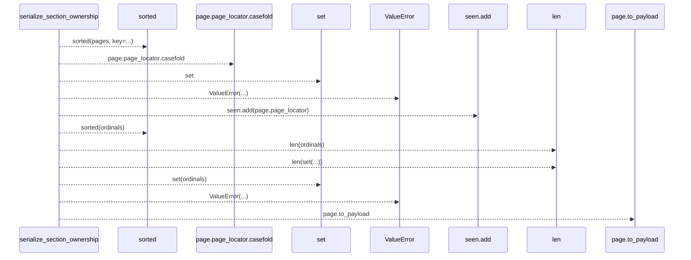
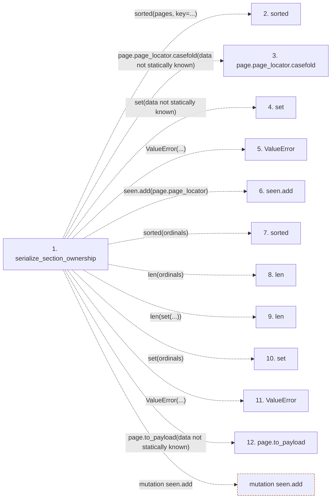

# serialize_section_ownership

**Entry point:** `serialize_section_ownership` (`api`)
**Source:** [section_ownership](../modules/section_ownership.md)
**Modules touched:** [section_ownership](../modules/section_ownership.md)

## Call sequence

> Static overview in presentation order, not runtime execution order. Arrows retain captured callers; representative internal continuations and boundary examples precede repeated helper detail.

<!-- Auto-generated from static call edges. Dashed arrows are external or unresolved calls. Reviewed runtime conditions and side effects belong in Behavior. -->

> Call sequence diagram shows 11 of 11 interactions; 0 omitted to keep the visualization within the 30-interaction and generated-diagram limits, with uncertain identities omitted rather than inferred.

> Captured boundary calls: external 8 of 8 (0 omitted); unresolved 3 of 3 (0 omitted). These counts cover the captured static trace.
> Detailed flow queries retain their own coverage and limits; omitted paths may execute at runtime.

## Data flow

<!-- Auto-generated static analysis. Treat values and boundaries as best-effort hints, not runtime proof. -->

### Analysis coverage

**Effect analysis evaluated.** Flow assembly and source effect analysis are separate; empty observations do not prove an empty handler body.

Source steps: 1; effect analysis evaluated: 1, partial: 0, unavailable: 0. Counts include steps omitted from the displayed trace.

Collector observations for 1 source steps with known totals: observed: 4, emitted: 4, omitted: 0. Unavailable totals are excluded.

### Step data

| Step | Inputs | Reads | Writes | Returns |
|---|---|---|---|---|
| `serialize_section_ownership` | `pages: Iterable[PageSectionObservations]` | `SECTION_OWNERSHIP_SCHEMA_VERSION` | - | `{...}` |
| `sorted` | - | - | - | - |
| `page.page_locator.casefold` | - | - | - | - |
| `set` | - | - | - | - |
| `ValueError` | - | - | - | - |
| `seen.add` | - | - | - | - |
| `sorted` | - | - | - | - |
| `len` | - | - | - | - |
| `len` | - | - | - | - |
| `set` | - | - | - | - |
| `ValueError` | - | - | - | - |
| `page.to_payload` | - | - | - | - |

### Call data

| From | To | Line | Call |
|---|---|---:|---|
| serialize_section_ownership | sorted | 619 | `sorted(pages, key=...)` |
| serialize_section_ownership | page.page_locator.casefold | 621 | `page.page_locator.casefold(data not statically known)` |
| serialize_section_ownership | set | 623 | `set(data not statically known)` |
| serialize_section_ownership | ValueError | 626 | `ValueError(...)` |
| serialize_section_ownership | seen.add | 627 | `seen.add(page.page_locator)` |
| serialize_section_ownership | sorted | 629 | `sorted(ordinals)` |
| serialize_section_ownership | len | 629 | `len(ordinals)` |
| serialize_section_ownership | len | 629 | `len(set(...))` |
| serialize_section_ownership | set | 629 | `set(ordinals)` |
| serialize_section_ownership | ValueError | 630 | `ValueError(...)` |
| serialize_section_ownership | page.to_payload | 635 | `page.to_payload(data not statically known)` |

### Boundary effects

| Kind | Target | Step | Line |
|---|---|---|---:|
| mutation | `seen.add` | `serialize_section_ownership` | 627 |

### Static analysis gaps

| Kind | Step | Target | Line |
|---|---|---|---:|
| external_call | `serialize_section_ownership` | `sorted` | 619 |
| unresolved_call | `serialize_section_ownership` | `page.page_locator.casefold` | 621 |
| external_call | `serialize_section_ownership` | `ValueError` | 626 |
| external_call | `serialize_section_ownership` | `sorted` | 629 |
| external_call | `serialize_section_ownership` | `ValueError` | 630 |
| unresolved_call | `serialize_section_ownership` | `page.to_payload` | 635 |

## Behavior

This flow starts at `serialize_section_ownership` and is classified as `api`. The generated call and data-flow sections are bounded static projections; runtime conditions and side effects require source-level confirmation.
