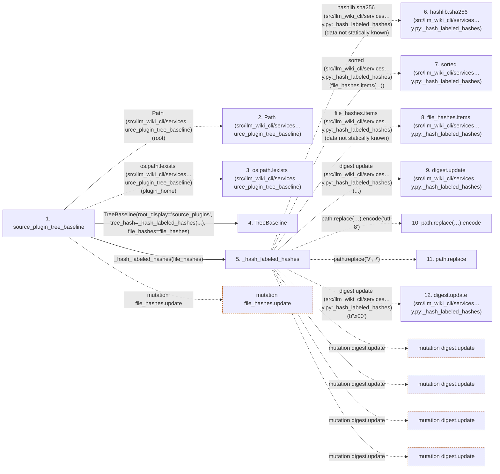

# source_plugin_tree_baseline

**Entry point:** `source_plugin_tree_baseline` (`api`)
**Source:** [documentation_policy](../modules/documentation_policy.md)
**Modules touched:** [documentation_policy](../modules/documentation_policy.md), [filesystem_guard](../modules/filesystem_guard.md)

## Call sequence

> Static overview in presentation order, not runtime execution order. Arrows retain captured callers; representative internal continuations and boundary examples precede repeated helper detail.

```mermaid
sequenceDiagram
    participant p0 as source_plugin_tree_baseline
    participant p1 as _lstat
    participant p2 as _assert_safe_directory
    participant p3 as capture_tree_baseline
    participant p4 as TreeBaseline
    participant p5 as _hash_labeled_hashes
    participant p6 as DocumentationPolicyError
    participant p7 as _assert_safe_regular_file
    participant p8 as _hash_file
    participant p9 as _resolve_existing_directory
    participant p10 as _walk_regular_files
    participant p11 as _resolve_path
    participant p12 as _guard_baseline_directory
    participant p13 as _hash_windows_file
    participant p14 as _assert_same_file_identity
    participant p15 as windows_object_identity
    participant p16 as guard_windows_directory_chain
    participant p17 as open_windows_readonly_file
    participant p18 as _assert_stable_windows_path_handle_metadata
    participant p19 as _assert_stable_file_metadata
    participant p20 as windows_object_identity_from_values
    participant p21 as _windows_path_handle_metadata
    participant p22 as _open_windows_readonly_file_handle
    participant p23 as _open_windows_directory_guard
    participant p24 as create_private_windows_directory
    participant p25 as _is_windows_reparse_point
    participant p26 as fresh_no_follow_stat
    participant p27 as _stable_metadata_signature
    participant p28 as WindowsDirectoryGuardError
    participant p29 as Path (src/llm_wiki_cli/services…urce_plugin_tree_baseline)
    participant p30 as path.relative_to(…).as_posix
    p0->>p1: _lstat
    p0->>p2: _assert_safe_directory
    p0->>p3: capture_tree_baseline
    p0->>p4: TreeBaseline
    p0->>p5: _hash_labeled_hashes
    p0->>p6: DocumentationPolicyError
    p0->>p7: _assert_safe_regular_file
    p0->>p8: _hash_file
    p3->>p9: _resolve_existing_directory
    p3->>p10: _walk_regular_files
    p9->>p11: _resolve_path
    p10->>p12: _guard_baseline_directory
    p8->>p13: _hash_windows_file
    p9->>p14: _assert_same_file_identity
    p14->>p15: windows_object_identity
    p12->>p16: guard_windows_directory_chain
    p13->>p17: open_windows_readonly_file
    p13->>p18: _assert_stable_windows_path_handle_metadata
    p13->>p19: _assert_stable_file_metadata
    p15->>p20: windows_object_identity_from_values
    p18->>p21: _windows_path_handle_metadata
    p17->>p22: _open_windows_readonly_file_handle
    p16->>p23: _open_windows_directory_guard
    p16->>p24: create_private_windows_directory
    p2->>p25: _is_windows_reparse_point
    p10->>p26: fresh_no_follow_stat
    p14->>p27: _stable_metadata_signature
    p16->>p28: WindowsDirectoryGuardError
    p0-->>p29: Path (src/llm_wiki_cli/services…urce_plugin_tree_baseline)(root)
    p0-->>p30: path.relative_to(…).as_posix
```

<!-- Auto-generated from static call edges. Dashed arrows are external or unresolved calls. Reviewed runtime conditions and side effects belong in Behavior. -->

> Call sequence diagram shows 30 of 338 interactions; 308 omitted to keep the visualization within the 30-interaction and generated-diagram limits, with uncertain identities omitted rather than inferred.

> Captured boundary calls: external 1 of 137 (136 omitted); unresolved 1 of 49 (48 omitted). These counts cover the captured static trace.

Omitted captured detail, grouped by actual caller occurrence and target module:

| Caller | Parent step | Target module | Kind | Omitted interactions |
| --- | --- | --- | --- | --- |
| `src/llm_wiki_cli/services/documentation_policy.py:source_plugin_tree_baseline` | 1 | - | external | 7 |
| `src/llm_wiki_cli/services/documentation_policy.py:_hash_labeled_hashes` | 5 | - | external | 2 |
| `src/llm_wiki_cli/services/documentation_policy.py:_hash_labeled_hashes` | 5 | - | unresolved | 9 |
| `src/llm_wiki_cli/services/documentation_policy.py:_lstat` | 17 | - | external | 1 |
| `src/llm_wiki_cli/services/documentation_policy.py:_lstat` | 17 | [src/llm_wiki_cli/services/documentation_policy.py](../modules/documentation_policy.md) | internal | 1 |
| `src/llm_wiki_cli/services/documentation_policy.py:_assert_safe_directory` | 20 | - | external | 2 |
| `src/llm_wiki_cli/services/documentation_policy.py:_assert_safe_directory` | 20 | [src/llm_wiki_cli/services/documentation_policy.py](../modules/documentation_policy.md) | internal | 3 |
| `src/llm_wiki_cli/services/documentation_policy.py:_is_windows_reparse_point` | 23 | - | external | 5 |
> Omission summary shows 8 of 63 groups; 55 further groups are not expanded here. Counts above include all omitted interactions.
> Detailed flow queries retain their own coverage and limits; omitted paths may execute at runtime.

> Trace truncated at the depth limit; deeper calls are omitted.

## Data flow

<!-- Auto-generated static analysis. Treat values and boundaries as best-effort hints, not runtime proof. -->

### Analysis coverage

**Effect analysis partially available.** Flow assembly and source effect analysis are separate; empty observations do not prove an empty handler body.

Source steps: 153; effect analysis evaluated: 88, partial: 7, unavailable: 58. Counts include steps omitted from the displayed trace.

Collector observations for 95 source steps with known totals: observed: 507, emitted: 498, omitted: 9. Unavailable totals are excluded.

- Callable record unavailable for one or more source steps; those steps have no represented callable body.
- Effect collector omitted observations before flow assembly; displayed effects are partial.
- Effect collector totals unavailable; observed counts cover captured records only.

| Step | Callable record | Effect analysis | Collector totals | Observed | Emitted | Omitted |
|---|---|---|---|---:|---:|---:|
| `source_plugin_tree_baseline` | `available` | `evaluated` | `available` | `8` | `8` | `0` |
| `Path (src/llm_wiki_cli/services…urce_plugin_tree_baseline)` | `not_applicable` | `not_applicable` | `not_applicable` | — | — | — |
| `os.path.lexists (src/llm_wiki_cli/services…urce_plugin_tree_baseline)` | `not_applicable` | `not_applicable` | `not_applicable` | — | — | — |
| `TreeBaseline` | `unavailable` | `unavailable` | `unavailable` | — | — | — |
| `_hash_labeled_hashes` | `available` | `evaluated` | `available` | `6` | `6` | `0` |
| `hashlib.sha256 (src/llm_wiki_cli/services…y.py:_hash_labeled_hashes)` | `not_applicable` | `not_applicable` | `not_applicable` | — | — | — |
| `sorted (src/llm_wiki_cli/services…y.py:_hash_labeled_hashes)` | `not_applicable` | `not_applicable` | `not_applicable` | — | — | — |
| `file_hashes.items (src/llm_wiki_cli/services…y.py:_hash_labeled_hashes)` | `not_applicable` | `not_applicable` | `not_applicable` | — | — | — |
| `digest.update (src/llm_wiki_cli/services…y.py:_hash_labeled_hashes)` | `not_applicable` | `not_applicable` | `not_applicable` | — | — | — |
| `path.replace(…).encode` | `not_applicable` | `not_applicable` | `not_applicable` | — | — | — |
| `path.replace` | `not_applicable` | `not_applicable` | `not_applicable` | — | — | — |
| `digest.update (src/llm_wiki_cli/services…y.py:_hash_labeled_hashes)` | `not_applicable` | `not_applicable` | `not_applicable` | — | — | — |

### Step data

| Step | Inputs | Reads | Writes | Returns |
|---|---|---|---|---|
| `source_plugin_tree_baseline` | `root: str \| Path` | `DEFAULT_MAX_BASELINE_FILE_BYTES`, `DEFAULT_MAX_BASELINE_FILE_BYTES`, `DEFAULT_MAX_BASELINE_FILES` | `file_hashes[...]` | `TreeBaseline(...)`, `TreeBaseline(...)` |
| `Path (src/llm_wiki_cli/services…urce_plugin_tree_baseline)` | - | - | - | - |
| `os.path.lexists (src/llm_wiki_cli/services…urce_plugin_tree_baseline)` | - | - | - | - |
| `TreeBaseline` | - | - | - | - |
| `_hash_labeled_hashes` | `file_hashes: dict[str, str]` | - | - | `...` |
| `hashlib.sha256 (src/llm_wiki_cli/services…y.py:_hash_labeled_hashes)` | - | - | - | - |
| `sorted (src/llm_wiki_cli/services…y.py:_hash_labeled_hashes)` | - | - | - | - |
| `file_hashes.items (src/llm_wiki_cli/services…y.py:_hash_labeled_hashes)` | - | - | - | - |
| `digest.update (src/llm_wiki_cli/services…y.py:_hash_labeled_hashes)` | - | - | - | - |
| `path.replace(…).encode` | - | - | - | - |
| `path.replace` | - | - | - | - |
| `digest.update (src/llm_wiki_cli/services…y.py:_hash_labeled_hashes)` | - | - | - | - |

### Call data

| From | To | Line | Call |
|---|---|---:|---|
| source_plugin_tree_baseline | Path (src/llm_wiki_cli/services…urce_plugin_tree_baseline) | 427 | `Path(root)` |
| source_plugin_tree_baseline | os.path.lexists (src/llm_wiki_cli/services…urce_plugin_tree_baseline) | 432 | `os.path.lexists(plugin_home)` |
| source_plugin_tree_baseline | TreeBaseline | 433 | `TreeBaseline(root_display='source_plugins', tree_hash=_hash_labeled_hashes(...), file_hashes=file_hashes)` |
| source_plugin_tree_baseline | _hash_labeled_hashes | 435 | `_hash_labeled_hashes(file_hashes)` |
| _hash_labeled_hashes | hashlib.sha256 (src/llm_wiki_cli/services…y.py:_hash_labeled_hashes) | 905 | `hashlib.sha256(data not statically known)` |
| _hash_labeled_hashes | sorted (src/llm_wiki_cli/services…y.py:_hash_labeled_hashes) | 906 | `sorted(file_hashes.items(...))` |
| _hash_labeled_hashes | file_hashes.items (src/llm_wiki_cli/services…y.py:_hash_labeled_hashes) | 906 | `file_hashes.items(data not statically known)` |
| _hash_labeled_hashes | digest.update (src/llm_wiki_cli/services…y.py:_hash_labeled_hashes) | 907 | `digest.update(...)` |
| _hash_labeled_hashes | path.replace(…).encode | 907 | `path.replace('\\', '/').encode('utf-8')` |
| _hash_labeled_hashes | path.replace | 907 | `path.replace('\\', '/')` |
| _hash_labeled_hashes | digest.update (src/llm_wiki_cli/services…y.py:_hash_labeled_hashes) | 908 | `digest.update(b'\x00')` |

### Boundary effects

| Kind | Target | Step | Line |
|---|---|---|---:|
| mutation | `file_hashes.update` | `source_plugin_tree_baseline` | 467 |
| mutation | `digest.update` | `_hash_labeled_hashes` | 907 |
| mutation | `digest.update` | `_hash_labeled_hashes` | 908 |
| mutation | `digest.update` | `_hash_labeled_hashes` | 909 |
| mutation | `digest.update` | `_hash_labeled_hashes` | 910 |

### Static analysis gaps

| Kind | Step | Target | Line |
|---|---|---|---:|
| external_call | `source_plugin_tree_baseline` | `os.path.lexists` | 432 |
| external_call | `_hash_labeled_hashes` | `hashlib.sha256` | 905 |
| external_call | `_hash_labeled_hashes` | `sorted` | 906 |
| unresolved_call | `_hash_labeled_hashes` | `file_hashes.items` | 906 |
| step_limit | `source_plugin_tree_baseline` | `first 12 steps` | 0 |
| truncated_flow | `source_plugin_tree_baseline` | `depth limit` | 0 |

## Behavior

This flow starts at `source_plugin_tree_baseline` and is classified as `api`. The generated call and data-flow sections are bounded static projections; runtime conditions and side effects require source-level confirmation.
