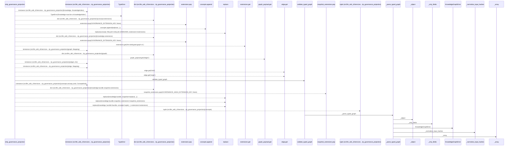
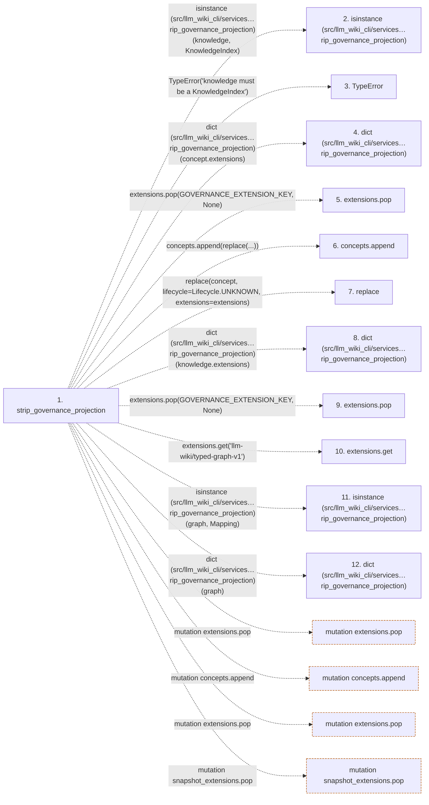

# strip_governance_projection

**Entry point:** `strip_governance_projection` (`api`)
**Source:** [knowledge_governance](../modules/knowledge_governance.md)
**Modules touched:** [knowledge_evidence](../modules/knowledge_evidence.md), [knowledge_governance](../modules/knowledge_governance.md), [knowledge_graph](../modules/knowledge_graph.md), [validation](../modules/validation.md), and 2 more

**Complete modules touched:**

- [knowledge_evidence](../modules/knowledge_evidence.md)
- [knowledge_governance](../modules/knowledge_governance.md)
- [knowledge_graph](../modules/knowledge_graph.md)
- [validation](../modules/validation.md)
- [wiki_media](../modules/wiki_media.md)
- [wiki_surface](../modules/wiki_surface.md)

## Call sequence

> Static overview in presentation order, not runtime execution order. Arrows retain captured callers; siblings are shown before deeper helper detail.

<!-- Auto-generated from static call edges. Dashed arrows are external or unresolved calls. Reviewed runtime conditions and side effects belong in Behavior. -->

> Call sequence diagram shows 30 of 357 interactions; 327 omitted to keep the visualization within the 30-interaction and generated-diagram limits, with uncertain identities omitted rather than inferred.

> Captured boundary calls: external 15 of 87 (72 omitted); unresolved 8 of 58 (50 omitted). These counts cover the captured static trace.

Omitted captured detail, grouped by actual caller occurrence and target module:

| Caller | Parent step | Target module | Kind | Omitted interactions |
| --- | --- | --- | --- | --- |
| `src/llm_wiki_cli/services/knowledge_graph.py:_object` | 20 | [src/llm_wiki_cli/services/validation.py](../modules/validation.md) | internal | 1 |
| `src/llm_wiki_cli/services/validation.py:require_mapping` | 21 | - | external | 2 |
| `src/llm_wiki_cli/services/validation.py:require_mapping` | 21 | - | unresolved | 1 |
| `src/llm_wiki_cli/services/knowledge_graph.py:_object` | 20 | [src/llm_wiki_cli/services/knowledge_graph.py](../modules/knowledge_graph.md) | internal | 2 |
| `src/llm_wiki_cli/services/knowledge_graph.py:_object` | 20 | - | external | 1 |
| `src/llm_wiki_cli/services/knowledge_graph.py:_only_fields` | 28 | [src/llm_wiki_cli/services/validation.py](../modules/validation.md) | internal | 1 |
| `src/llm_wiki_cli/services/validation.py:require_exact_fields` | 29 | - | external | 9 |
| `src/llm_wiki_cli/services/validation.py:require_exact_fields` | 29 | - | unresolved | 2 |
> Omission summary shows 8 of 105 groups; 97 further groups are not expanded here. Counts above include all omitted interactions.
> Detailed flow queries retain their own coverage and limits; omitted paths may execute at runtime.

> Trace truncated at the depth limit; deeper calls are omitted.

## Data flow

<!-- Auto-generated static analysis. Treat values and boundaries as best-effort hints, not runtime proof. -->

### Step data

| Step | Inputs | Reads | Writes | Returns |
|---|---|---|---|---|
| `strip_governance_projection` | `knowledge: KnowledgeIndex` | `KnowledgeIndex`, `GOVERNANCE_EXTENSION_KEY`, `Lifecycle`, `GOVERNANCE_EXTENSION_KEY`, `Mapping`, `Mapping`, `ConceptKind`, `GOVERNANCE_HASH_EXTENSION_KEY` | `graph_payload[...]`, `extensions[...]` | `replace(...)` |
| `isinstance (src/llm_wiki_cli/services…rip_governance_projection)` | - | - | - | - |
| `TypeError` | - | - | - | - |
| `dict (src/llm_wiki_cli/services…rip_governance_projection)` | - | - | - | - |
| `extensions.pop` | - | - | - | - |
| `concepts.append` | - | - | - | - |
| `replace` | - | - | - | - |
| `dict (src/llm_wiki_cli/services…rip_governance_projection)` | - | - | - | - |
| `extensions.pop` | - | - | - | - |
| `extensions.get` | - | - | - | - |
| `isinstance (src/llm_wiki_cli/services…rip_governance_projection)` | - | - | - | - |
| `dict (src/llm_wiki_cli/services…rip_governance_projection)` | - | - | - | - |

### Call data

| From | To | Line | Call |
|---|---|---:|---|
| strip_governance_projection | isinstance (src/llm_wiki_cli/services…rip_governance_projection) | 1626 | `isinstance(knowledge, KnowledgeIndex)` |
| strip_governance_projection | TypeError | 1627 | `TypeError('knowledge must be a KnowledgeIndex')` |
| strip_governance_projection | dict (src/llm_wiki_cli/services…rip_governance_projection) | 1630 | `dict(concept.extensions)` |
| strip_governance_projection | extensions.pop | 1631 | `extensions.pop(GOVERNANCE_EXTENSION_KEY, None)` |
| strip_governance_projection | concepts.append | 1632 | `concepts.append(replace(...))` |
| strip_governance_projection | replace | 1633 | `replace(concept, lifecycle=Lifecycle.UNKNOWN, extensions=extensions)` |
| strip_governance_projection | dict (src/llm_wiki_cli/services…rip_governance_projection) | 1639 | `dict(knowledge.extensions)` |
| strip_governance_projection | extensions.pop | 1640 | `extensions.pop(GOVERNANCE_EXTENSION_KEY, None)` |
| strip_governance_projection | extensions.get | 1641 | `extensions.get('llm-wiki/typed-graph-v1')` |
| strip_governance_projection | isinstance (src/llm_wiki_cli/services…rip_governance_projection) | 1642 | `isinstance(graph, Mapping)` |
| strip_governance_projection | dict (src/llm_wiki_cli/services…rip_governance_projection) | 1645 | `dict(graph)` |

### Boundary effects

| Kind | Target | Step | Line |
|---|---|---|---:|
| mutation | `extensions.pop` | `strip_governance_projection` | 1631 |
| mutation | `concepts.append` | `strip_governance_projection` | 1632 |
| mutation | `extensions.pop` | `strip_governance_projection` | 1640 |
| mutation | `snapshot_extensions.pop` | `strip_governance_projection` | 1669 |

### Static analysis gaps

| Kind | Step | Target | Line |
|---|---|---|---:|
| external_call | `strip_governance_projection` | `isinstance` | 1626 |
| external_call | `strip_governance_projection` | `TypeError` | 1627 |
| external_call | `strip_governance_projection` | `replace` | 1633 |
| unresolved_call | `strip_governance_projection` | `extensions.get` | 1641 |
| external_call | `strip_governance_projection` | `isinstance` | 1642 |
| step_limit | `strip_governance_projection` | `first 12 steps` | 0 |
| truncated_flow | `strip_governance_projection` | `depth limit` | 0 |

## Behavior

This flow starts at `strip_governance_projection` and is classified as `api`. The generated call and data-flow sections are bounded static projections; runtime conditions and side effects require source-level confirmation.
