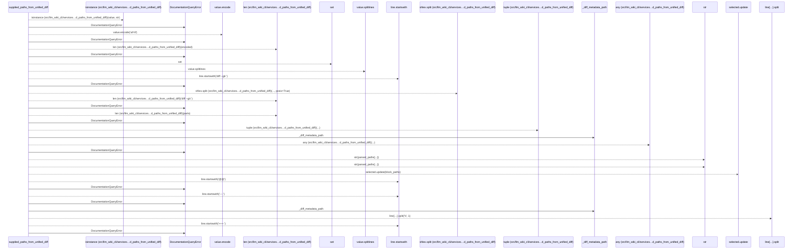
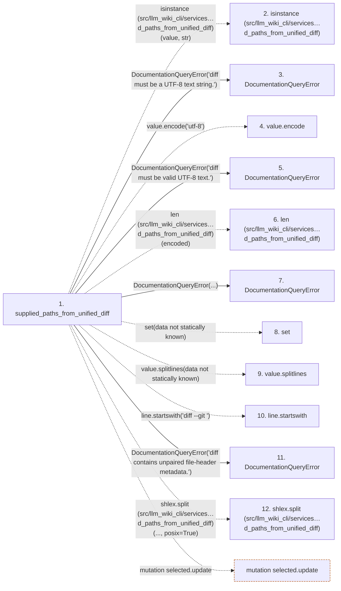

# supplied_paths_from_unified_diff

**Entry point:** `supplied_paths_from_unified_diff` (`api`)
**Source:** [documentation_query_builder](../modules/documentation_query_builder.md)
**Modules touched:** [documentation_queries](../modules/documentation_queries.md), [documentation_query_builder](../modules/documentation_query_builder.md), [validation](../modules/validation.md)

## Call sequence

> Static overview in presentation order, not runtime execution order. Arrows retain captured callers; siblings are shown before deeper helper detail.

<!-- Auto-generated from static call edges. Dashed arrows are external or unresolved calls. Reviewed runtime conditions and side effects belong in Behavior. -->

> Call sequence diagram shows 30 of 117 interactions; 87 omitted to keep the visualization within the 30-interaction and generated-diagram limits, with uncertain identities omitted rather than inferred.

> Captured boundary calls: external 10 of 36 (26 omitted); unresolved 8 of 31 (23 omitted). These counts cover the captured static trace.

Omitted captured detail, grouped by actual caller occurrence and target module:

| Caller | Parent step | Target module | Kind | Omitted interactions |
| --- | --- | --- | --- | --- |
| `src/llm_wiki_cli/services/documentation_query_builder.py:_diff_metadata_path` | 18 | - | unresolved | 2 |
| `src/llm_wiki_cli/services/documentation_query_builder.py:_diff_metadata_path` | 18 | - | external | 2 |
| `src/llm_wiki_cli/services/documentation_query_builder.py:_diff_metadata_path` | 18 | [src/llm_wiki_cli/services/documentation_queries.py](../modules/documentation_queries.md) | internal | 3 |
| `src/llm_wiki_cli/services/documentation_query_builder.py:_diff_metadata_path` | 18 | [src/llm_wiki_cli/services/documentation_query_builder.py](../modules/documentation_query_builder.md) | internal | 1 |
| `src/llm_wiki_cli/services/documentation_query_builder.py:normalize_supplied_paths` | 26 | [src/llm_wiki_cli/services/documentation_query_builder.py](../modules/documentation_query_builder.md) | internal | 2 |
| `src/llm_wiki_cli/services/documentation_query_builder.py:_portable_supplied_path` | 27 | [src/llm_wiki_cli/services/documentation_queries.py](../modules/documentation_queries.md) | internal | 1 |
| `src/llm_wiki_cli/services/documentation_query_builder.py:_portable_supplied_path` | 27 | [src/llm_wiki_cli/services/validation.py](../modules/validation.md) | internal | 1 |
| `src/llm_wiki_cli/services/validation.py:require_portable_relative_path` | 29 | - | external | 4 |
> Omission summary shows 8 of 27 groups; 19 further groups are not expanded here. Counts above include all omitted interactions.
> Detailed flow queries retain their own coverage and limits; omitted paths may execute at runtime.

> Trace truncated at the depth limit; deeper calls are omitted.

## Data flow

<!-- Auto-generated static analysis. Treat values and boundaries as best-effort hints, not runtime proof. -->

### Step data

| Step | Inputs | Reads | Writes | Returns |
|---|---|---|---|---|
| `supplied_paths_from_unified_diff` | `value: object` | `MAX_SUPPLIED_DIFF_BYTES`, `MAX_SUPPLIED_DIFF_BYTES`, `_UNSET_DIFF_HEADER`, `_UNSET_DIFF_HEADER`, `_UNSET_DIFF_HEADER`, `_UNSET_DIFF_HEADER`, `_UNSET_DIFF_HEADER`, `_UNSET_DIFF_HEADER` | - | `normalize_supplied_paths(...)` |
| `isinstance (src/llm_wiki_cli/services…d_paths_from_unified_diff)` | - | - | - | - |
| `DocumentationQueryError` | - | - | - | - |
| `value.encode` | - | - | - | - |
| `DocumentationQueryError` | - | - | - | - |
| `len (src/llm_wiki_cli/services…d_paths_from_unified_diff)` | - | - | - | - |
| `DocumentationQueryError` | - | - | - | - |
| `set` | - | - | - | - |
| `value.splitlines` | - | - | - | - |
| `line.startswith` | - | - | - | - |
| `DocumentationQueryError` | - | - | - | - |
| `shlex.split (src/llm_wiki_cli/services…d_paths_from_unified_diff)` | - | - | - | - |

### Call data

| From | To | Line | Call |
|---|---|---:|---|
| supplied_paths_from_unified_diff | isinstance (src/llm_wiki_cli/services…d_paths_from_unified_diff) | 174 | `isinstance(value, str)` |
| supplied_paths_from_unified_diff | DocumentationQueryError | 175 | `DocumentationQueryError('diff must be a UTF-8 text string.')` |
| supplied_paths_from_unified_diff | value.encode | 177 | `value.encode('utf-8')` |
| supplied_paths_from_unified_diff | DocumentationQueryError | 179 | `DocumentationQueryError('diff must be valid UTF-8 text.')` |
| supplied_paths_from_unified_diff | len (src/llm_wiki_cli/services…d_paths_from_unified_diff) | 180 | `len(encoded)` |
| supplied_paths_from_unified_diff | DocumentationQueryError | 181 | `DocumentationQueryError(...)` |
| supplied_paths_from_unified_diff | set | 185 | `set(data not statically known)` |
| supplied_paths_from_unified_diff | value.splitlines | 191 | `value.splitlines(data not statically known)` |
| supplied_paths_from_unified_diff | line.startswith | 192 | `line.startswith('diff --git ')` |
| supplied_paths_from_unified_diff | DocumentationQueryError | 194 | `DocumentationQueryError('diff contains unpaired file-header metadata.')` |
| supplied_paths_from_unified_diff | shlex.split (src/llm_wiki_cli/services…d_paths_from_unified_diff) | 198 | `shlex.split(..., posix=True)` |

### Boundary effects

| Kind | Target | Step | Line |
|---|---|---|---:|
| mutation | `selected.update` | `supplied_paths_from_unified_diff` | 215 |

### Static analysis gaps

| Kind | Step | Target | Line |
|---|---|---|---:|
| external_call | `supplied_paths_from_unified_diff` | `isinstance` | 174 |
| unresolved_call | `supplied_paths_from_unified_diff` | `value.encode` | 177 |
| unresolved_call | `supplied_paths_from_unified_diff` | `value.splitlines` | 191 |
| unresolved_call | `supplied_paths_from_unified_diff` | `line.startswith` | 192 |
| external_call | `supplied_paths_from_unified_diff` | `shlex.split` | 198 |
| step_limit | `supplied_paths_from_unified_diff` | `first 12 steps` | 0 |
| truncated_flow | `supplied_paths_from_unified_diff` | `depth limit` | 0 |

## Behavior

This flow starts at `supplied_paths_from_unified_diff` and is classified as `api`. The generated call and data-flow sections are bounded static projections; runtime conditions and side effects require source-level confirmation.
