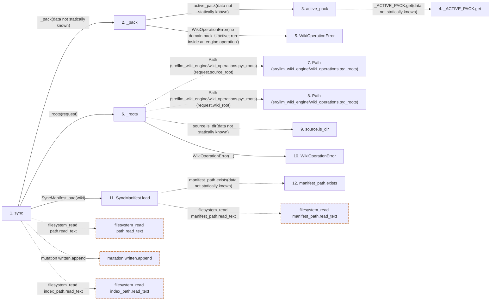

# sync

**Entry point:** `sync` (`api`)
**Source:** [wiki_operations](../modules/wiki_operations.md)
**Modules touched:** [canonical_json](../modules/canonical_json.md), [engine_events](../modules/engine_events.md), [filesystem_guard](../modules/filesystem_guard.md), [gitignore](../modules/gitignore.md), and 13 more

**Complete modules touched:**

- [canonical_json](../modules/canonical_json.md)
- [engine_events](../modules/engine_events.md)
- [filesystem_guard](../modules/filesystem_guard.md)
- [gitignore](../modules/gitignore.md)
- [host](../modules/host.md)
- [integrations](../modules/integrations.md)
- [knowledge_evidence](../modules/knowledge_evidence.md)
- [knowledge_storage](../modules/knowledge_storage.md)
- [knowledge_storage_io](../modules/knowledge_storage_io.md)
- [maintenance_state](../modules/maintenance_state.md)
- [manifest_storage](../modules/manifest_storage.md)
- [markdown_sections](../modules/markdown_sections.md)
- [pack_interfaces](../modules/pack_interfaces.md)
- [path_policy](../modules/path_policy.md)
- [sync_manifest](../modules/sync_manifest.md)
- [validation](../modules/validation.md)
- [wiki_operations](../modules/wiki_operations.md)

## Call sequence

> Static overview in presentation order, not runtime execution order. Arrows retain captured callers; representative internal continuations and boundary examples precede repeated helper detail.

```mermaid
sequenceDiagram
    participant p0 as sync
    participant p1 as _pack
    participant p2 as _roots
    participant p3 as SyncManifest.load
    participant p4 as _extract
    participant p5 as _classified_sources
    participant p6 as _render
    participant p7 as _keep_reviewed_text
    participant p8 as _manifest
    participant p9 as _content_hashes
    participant p10 as emit
    participant p11 as _append_log
    participant p12 as WikiOperationError
    participant p13 as _write
    participant p14 as _owned_pages
    participant p15 as _index_markdown
    participant p16 as SyncResult
    participant p17 as build_gitignore_matcher
    participant p18 as section_body
    participant p19 as SyncManifest.build_from_inventory
    participant p20 as replace_section_body
    participant p21 as _publish_message
    participant p22 as StorageReadSession.read
    participant p23 as SyncManifest.from_payload
    participant p24 as StorageReadSession.recheck
    participant p25 as _rendered_entity
    participant p26 as _module_markdown
    participant p27 as _require_relative_name
    participant p28 as _mapping_value
    participant p29 as sorted (src/llm_wiki_engine/wiki_operations.py:sync)
    participant p30 as pages.items
    p0->>p1: _pack
    p0->>p2: _roots
    p0->>p3: SyncManifest.load
    p0->>p4: _extract
    p0->>p5: _classified_sources
    p0->>p6: _render
    p0->>p7: _keep_reviewed_text
    p0->>p8: _manifest
    p0->>p9: _content_hashes
    p0->>p10: emit
    p0->>p11: _append_log
    p0->>p12: WikiOperationError
    p0->>p13: _write
    p0->>p14: _owned_pages
    p0->>p15: _index_markdown
    p0->>p16: SyncResult
    p5->>p17: build_gitignore_matcher
    p7->>p18: section_body
    p8->>p19: SyncManifest.build_from_inventory
    p7->>p20: replace_section_body
    p10->>p21: _publish_message
    p3->>p22: StorageReadSession.read
    p3->>p23: SyncManifest.from_payload
    p3->>p24: StorageReadSession.recheck
    p6->>p25: _rendered_entity
    p6->>p26: _module_markdown
    p22->>p27: _require_relative_name
    p23->>p28: _mapping_value
    p0-->>p29: sorted (src/llm_wiki_engine/wiki_operations.py:sync)(pages.items(...))
    p0-->>p30: pages.items
```

<!-- Auto-generated from static call edges. Dashed arrows are external or unresolved calls. Reviewed runtime conditions and side effects belong in Behavior. -->

> Call sequence diagram shows 30 of 814 interactions; 784 omitted to keep the visualization within the 30-interaction and generated-diagram limits, with uncertain identities omitted rather than inferred.

> Captured boundary calls: external 1 of 220 (219 omitted); unresolved 1 of 260 (259 omitted). These counts cover the captured static trace.

Omitted captured detail, grouped by actual caller occurrence and target module:

| Caller | Parent step | Target module | Kind | Omitted interactions |
| --- | --- | --- | --- | --- |
| `src/llm_wiki_engine/wiki_operations.py:_pack` | 2 | [src/llm_wiki_engine/pack_interfaces.py](../modules/pack_interfaces.md) | internal | 1 |
| `src/llm_wiki_engine/pack_interfaces.py:active_pack` | 3 | - | unresolved | 1 |
| `src/llm_wiki_engine/wiki_operations.py:_pack` | 2 | [src/llm_wiki_engine/wiki_operations.py](../modules/wiki_operations.md) | internal | 1 |
| `src/llm_wiki_engine/wiki_operations.py:_roots` | 6 | - | external | 2 |
| `src/llm_wiki_engine/wiki_operations.py:_roots` | 6 | - | unresolved | 1 |
| `src/llm_wiki_engine/wiki_operations.py:_roots` | 6 | [src/llm_wiki_engine/wiki_operations.py](../modules/wiki_operations.md) | internal | 1 |
| `src/llm_wiki_engine/sync_manifest.py:SyncManifest.load` | 11 | - | unresolved | 3 |
| `src/llm_wiki_engine/sync_manifest.py:SyncManifest.load` | 11 | - | external | 3 |
> Omission summary shows 8 of 242 groups; 234 further groups are not expanded here. Counts above include all omitted interactions.
> Detailed flow queries retain their own coverage and limits; omitted paths may execute at runtime.

> Trace truncated at the depth limit; deeper calls are omitted.

## Data flow

<!-- Auto-generated static analysis. Treat values and boundaries as best-effort hints, not runtime proof. -->

### Analysis coverage

**Effect analysis partially available.** Flow assembly and source effect analysis are separate; empty observations do not prove an empty handler body.

Source steps: 335; effect analysis evaluated: 207, partial: 10, unavailable: 118. Counts include steps omitted from the displayed trace.

Collector observations for 217 source steps with known totals: observed: 944, emitted: 891, omitted: 53. Unavailable totals are excluded.

- Callable record unavailable for one or more source steps; those steps have no represented callable body.
- Effect collector omitted observations before flow assembly; displayed effects are partial.
- Effect collector totals unavailable; observed counts cover captured records only.

| Step | Callable record | Effect analysis | Collector totals | Observed | Emitted | Omitted |
|---|---|---|---|---:|---:|---:|
| `sync` | `available` | `evaluated` | `available` | `8` | `8` | `0` |
| `_pack` | `available` | `evaluated` | `available` | `1` | `1` | `0` |
| `active_pack` | `available` | `evaluated` | `available` | `1` | `1` | `0` |
| `_ACTIVE_PACK.get` | `not_applicable` | `not_applicable` | `not_applicable` | — | — | — |
| `WikiOperationError` | `unavailable` | `unavailable` | `unavailable` | — | — | — |
| `_roots` | `available` | `evaluated` | `available` | `2` | `2` | `0` |
| `Path (src/llm_wiki_engine/wiki_operations.py:_roots)` | `not_applicable` | `not_applicable` | `not_applicable` | — | — | — |
| `Path (src/llm_wiki_engine/wiki_operations.py:_roots)` | `not_applicable` | `not_applicable` | `not_applicable` | — | — | — |
| `source.is_dir` | `not_applicable` | `not_applicable` | `not_applicable` | — | — | — |
| `WikiOperationError` | `unavailable` | `unavailable` | `unavailable` | — | — | — |
| `SyncManifest.load` | `available` | `evaluated` | `available` | `6` | `6` | `0` |
| `manifest_path.exists` | `not_applicable` | `not_applicable` | `not_applicable` | — | — | — |

### Step data

| Step | Inputs | Reads | Writes | Returns |
|---|---|---|---|---|
| `sync` | `request: SyncRequest` | `SyncManifestError`, `INDEX_PAGE` | - | `SyncResult(...)`, `SyncResult(...)` |
| `_pack` | - | - | - | `pack` |
| `active_pack` | - | - | - | `_ACTIVE_PACK.get(...)` |
| `_ACTIVE_PACK.get` | - | - | - | - |
| `WikiOperationError` | - | - | - | - |
| `_roots` | `request: Any` | - | - | `(...)` |
| `Path (src/llm_wiki_engine/wiki_operations.py:_roots)` | - | - | - | - |
| `Path (src/llm_wiki_engine/wiki_operations.py:_roots)` | - | - | - | - |
| `source.is_dir` | - | - | - | - |
| `WikiOperationError` | - | - | - | - |
| `SyncManifest.load` | `wiki_dir: Path` | `MANIFEST_FILENAME`, `MANIFEST_FILENAME` | - | `manifest`, `cls.from_payload(...)` |
| `manifest_path.exists` | - | - | - | - |

### Call data

| From | To | Line | Call |
|---|---|---:|---|
| sync | _pack | 367 | `_pack(data not statically known)` |
| _pack | active_pack | 119 | `active_pack(data not statically known)` |
| active_pack | _ACTIVE_PACK.get | 643 | `_ACTIVE_PACK.get(data not statically known)` |
| _pack | WikiOperationError | 121 | `WikiOperationError('no domain pack is active; run inside an engine operation')` |
| sync | _roots | 368 | `_roots(request)` |
| _roots | Path (src/llm_wiki_engine/wiki_operations.py:_roots) | 126 | `Path(request.source_root)` |
| _roots | Path (src/llm_wiki_engine/wiki_operations.py:_roots) | 127 | `Path(request.wiki_root)` |
| _roots | source.is_dir | 128 | `source.is_dir(data not statically known)` |
| _roots | WikiOperationError | 129 | `WikiOperationError(...)` |
| sync | SyncManifest.load | 370 | `SyncManifest.load(wiki)` |
| SyncManifest.load | manifest_path.exists | 1033 | `manifest_path.exists(data not statically known)` |

### Boundary effects

| Kind | Target | Step | Line |
|---|---|---|---:|
| filesystem_read | `path.read_text` | `sync` | 380 |
| mutation | `written.append` | `sync` | 384 |
| filesystem_read | `index_path.read_text` | `sync` | 390 |
| filesystem_read | `manifest_path.read_text` | `SyncManifest.load` | 1054 |

### Static analysis gaps

| Kind | Step | Target | Line |
|---|---|---|---:|
| unresolved_call | `active_pack` | `_ACTIVE_PACK.get` | 643 |
| unresolved_call | `_roots` | `source.is_dir` | 128 |
| unresolved_call | `SyncManifest.load` | `manifest_path.exists` | 1033 |
| step_limit | `sync` | `first 12 steps` | 0 |
| truncated_flow | `sync` | `depth limit` | 0 |

## Behavior

This flow starts at `sync` and is classified as `api`. The generated call and data-flow sections are bounded static projections; runtime conditions and side effects require source-level confirmation.
