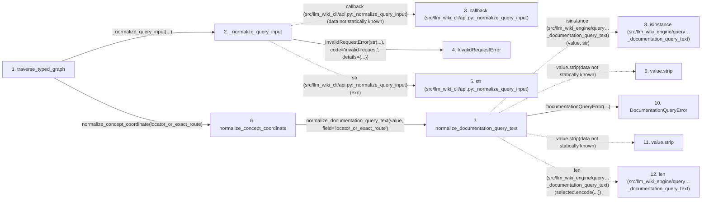

# traverse_typed_graph

**Entry point:** `traverse_typed_graph` (`api`)
**Source:** [api](../modules/api.md)
**Modules touched:** [api](../modules/api.md), [canonical_json](../modules/canonical_json.md), [common](../modules/common.md), [context_packet](../modules/context_packet.md), and 24 more

**Complete modules touched:**

- [api](../modules/api.md)
- [canonical_json](../modules/canonical_json.md)
- [common](../modules/common.md)
- [context_packet](../modules/context_packet.md)
- [context_packet_builder](../modules/context_packet_builder.md)
- [documentation_query_builder](../modules/documentation_query_builder.md)
- [domain_pack](../modules/domain_pack.md)
- [filesystem_guard](../modules/filesystem_guard.md)
- [gitignore](../modules/gitignore.md)
- [host](../modules/host.md)
- [integrations](../modules/integrations.md)
- [io](../modules/io.md)
- [knowledge_consumption](../modules/knowledge_consumption.md)
- [knowledge_governance](../modules/knowledge_governance.md)
- [knowledge_storage](../modules/knowledge_storage.md)
- [knowledge_storage_io](../modules/knowledge_storage_io.md)
- [maintenance_evidence](../modules/maintenance_evidence.md)
- [maintenance_shapes](../modules/maintenance_shapes.md)
- [maintenance_state](../modules/maintenance_state.md)
- [maintenance_status](../modules/maintenance_status.md)
- [path_policy](../modules/path_policy.md)
- [python_implementation](../modules/python_implementation.md)
- [query_request_format](../modules/query_request_format.md)
- [source_path_diagnostics](../modules/source_path_diagnostics.md)
- [source_selection](../modules/source_selection.md)
- [source_snapshot](../modules/source_snapshot.md)
- [sync_manifest](../modules/sync_manifest.md)
- [validation](../modules/validation.md)

## Call sequence

> Static overview in presentation order, not runtime execution order. Arrows retain captured callers; representative internal continuations and boundary examples precede repeated helper detail.

```mermaid
sequenceDiagram
    participant p0 as traverse_typed_graph
    participant p1 as _normalize_query_input
    participant p2 as normalize_concept_coordinate
    participant p3 as _normalize_query_choice
    participant p4 as _normalize_query_values
    participant p5 as _effective_query_limit
    participant p6 as _run_query
    participant p7 as _query_service
    participant p8 as InvalidRequestError
    participant p9 as normalize_documentation_query_text
    participant p10 as _normalize_query_limit
    participant p11 as build_documentation_query_service
    participant p12 as normalize_documentation_query_limit
    participant p13 as validate_source_root
    participant p14 as _validate_wiki_dir
    participant p15 as build_live_documentation_query_service
    participant p16 as validate_path
    participant p17 as normalize_supplied_paths
    participant p18 as resolve_source_selection
    participant p19 as capture_source_selection_inputs
    participant p20 as validate_live_query_source_selection
    participant p21 as windows_current_user_sid
    participant p22 as _source_anchor
    participant p23 as _wiki_anchor
    participant p24 as source_path_diagnostics
    participant p25 as first_unsafe_path_component
    participant p26 as _live_source_selection_identity
    participant p27 as confirmed_missing_source_paths (src/llm_wiki_cli/services/context_packet_builder.py)
    participant p28 as attach_implementation_read_view
    participant p29 as tuple (src/llm_wiki_cli/api.py:traverse_typed_graph)
    participant p30 as _query_service(…).traverse_typed_graph
    p0->>p1: _normalize_query_input
    p0->>p2: normalize_concept_coordinate
    p0->>p3: _normalize_query_choice
    p0->>p4: _normalize_query_values
    p0->>p5: _effective_query_limit
    p0->>p6: _run_query
    p0->>p7: _query_service
    p0->>p8: InvalidRequestError
    p2->>p9: normalize_documentation_query_text
    p5->>p10: _normalize_query_limit
    p7->>p11: build_documentation_query_service
    p10->>p12: normalize_documentation_query_limit
    p11->>p13: validate_source_root
    p11->>p14: _validate_wiki_dir
    p11->>p15: build_live_documentation_query_service
    p13->>p16: validate_path
    p15->>p17: normalize_supplied_paths
    p15->>p18: resolve_source_selection
    p15->>p19: capture_source_selection_inputs
    p15->>p20: validate_live_query_source_selection
    p13->>p21: windows_current_user_sid
    p15->>p22: _source_anchor
    p15->>p23: _wiki_anchor
    p15->>p24: source_path_diagnostics
    p13->>p25: first_unsafe_path_component
    p15->>p26: _live_source_selection_identity
    p15->>p27: confirmed_missing_source_paths (src/llm_wiki_cli/services/context_packet_builder.py)
    p15->>p28: attach_implementation_read_view
    p0-->>p29: tuple (src/llm_wiki_cli/api.py:traverse_typed_graph)(CORE_RELATIONSHIP_KINDS)
    p0-->>p30: _query_service(…).traverse_typed_graph(…)
```

<!-- Auto-generated from static call edges. Dashed arrows are external or unresolved calls. Reviewed runtime conditions and side effects belong in Behavior. -->

> Call sequence diagram shows 30 of 917 interactions; 887 omitted to keep the visualization within the 30-interaction and generated-diagram limits, with uncertain identities omitted rather than inferred.

> Captured boundary calls: external 1 of 373 (372 omitted); unresolved 1 of 197 (196 omitted). These counts cover the captured static trace.

Omitted captured detail, grouped by actual caller occurrence and target module:

| Caller | Parent step | Target module | Kind | Omitted interactions |
| --- | --- | --- | --- | --- |
| `src/llm_wiki_cli/api.py:_normalize_query_input` | 2 | - | unresolved | 1 |
| `src/llm_wiki_cli/api.py:_normalize_query_input` | 2 | [src/llm_wiki_cli/api.py](../modules/api.md) | internal | 1 |
| `src/llm_wiki_cli/api.py:_normalize_query_input` | 2 | - | external | 1 |
| `src/llm_wiki_engine/query_request_format.py:normalize_documentation_query_text` | 7 | - | external | 2 |
| `src/llm_wiki_engine/query_request_format.py:normalize_documentation_query_text` | 7 | - | unresolved | 3 |
| `src/llm_wiki_engine/query_request_format.py:normalize_documentation_query_text` | 7 | [src/llm_wiki_engine/query_request_format.py](../modules/query_request_format.md) | internal | 2 |
| `src/llm_wiki_engine/query_request_format.py:normalize_concept_coordinate` | 6 | - | unresolved | 2 |
| `src/llm_wiki_engine/query_request_format.py:normalize_concept_coordinate` | 6 | [src/llm_wiki_engine/query_request_format.py](../modules/query_request_format.md) | internal | 1 |
> Omission summary shows 8 of 218 groups; 210 further groups are not expanded here. Counts above include all omitted interactions.
> Detailed flow queries retain their own coverage and limits; omitted paths may execute at runtime.

> Trace truncated at the depth limit; deeper calls are omitted.

## Data flow

<!-- Auto-generated static analysis. Treat values and boundaries as best-effort hints, not runtime proof. -->

### Analysis coverage

**Effect analysis partially available.** Flow assembly and source effect analysis are separate; empty observations do not prove an empty handler body.

Source steps: 348; effect analysis evaluated: 222, partial: 14, unavailable: 112. Counts include steps omitted from the displayed trace.

Collector observations for 236 source steps with known totals: observed: 1412, emitted: 1325, omitted: 87. Unavailable totals are excluded.

- Callable record unavailable for one or more source steps; those steps have no represented callable body.
- Effect collector omitted observations before flow assembly; displayed effects are partial.
- Effect collector totals unavailable; observed counts cover captured records only.

| Step | Callable record | Effect analysis | Collector totals | Observed | Emitted | Omitted |
|---|---|---|---|---:|---:|---:|
| `traverse_typed_graph` | `available` | `partial` | `available` | `19` | `14` | `5` |
| `_normalize_query_input` | `available` | `evaluated` | `available` | `4` | `4` | `0` |
| `callback (src/llm_wiki_cli/api.py:_normalize_query_input)` | `not_applicable` | `not_applicable` | `not_applicable` | — | — | — |
| `InvalidRequestError` | `unavailable` | `unavailable` | `unavailable` | — | — | — |
| `str (src/llm_wiki_cli/api.py:_normalize_query_input)` | `not_applicable` | `not_applicable` | `not_applicable` | — | — | — |
| `normalize_concept_coordinate` | `available` | `evaluated` | `available` | `7` | `7` | `0` |
| `normalize_documentation_query_text` | `available` | `evaluated` | `available` | `5` | `5` | `0` |
| `isinstance (src/llm_wiki_engine/query…_documentation_query_text)` | `not_applicable` | `not_applicable` | `not_applicable` | — | — | — |
| `value.strip` | `not_applicable` | `not_applicable` | `not_applicable` | — | — | — |
| `DocumentationQueryError` | `unavailable` | `unavailable` | `unavailable` | — | — | — |
| `value.strip` | `not_applicable` | `not_applicable` | `not_applicable` | — | — | — |
| `len (src/llm_wiki_engine/query…_documentation_query_text)` | `not_applicable` | `not_applicable` | `not_applicable` | — | — | — |

### Step data

| Step | Inputs | Reads | Writes | Returns |
|---|---|---|---|---|
| `traverse_typed_graph` | `locator_or_exact_route: object`, `direction: str`, `kinds: Iterable[str] \| None`, `origins: Iterable[str] \| None`, `resolutions: Iterable[str] \| None`, `include_evidence: bool`, `service: DocumentationGraphQueryService \| None`, `src_dir: str` | `_TYPED_QUERY_DIRECTIONS`, `CORE_RELATIONSHIP_KINDS`, `GRAPH_ORIGINS`, `GRAPH_RESOLUTIONS`, `TypedGraphTraversalResult` | - | `cast(...)` |
| `_normalize_query_input` | `callback: Callable[[], _R]`, `field: str` | `DocumentationQueryError` | - | `callback(...)` |
| `callback (src/llm_wiki_cli/api.py:_normalize_query_input)` | - | - | - | - |
| `InvalidRequestError` | - | - | - | - |
| `str (src/llm_wiki_cli/api.py:_normalize_query_input)` | - | - | - | - |
| `normalize_concept_coordinate` | `value: object` | `wiki_surface`, `validate_concept_uid`, `validate_natural_key`, `ConceptIdentityError` | - | `wiki_surface.validate_exact_page_coordinate(...)`, `validator(...)` |
| `normalize_documentation_query_text` | `value: object`, `field: str` | `QUERY_IDENTITY_BYTE_LIMIT`, `QUERY_IDENTITY_BYTE_LIMIT` | - | `selected` |
| `isinstance (src/llm_wiki_engine/query…_documentation_query_text)` | - | - | - | - |
| `value.strip` | - | - | - | - |
| `DocumentationQueryError` | - | - | - | - |
| `value.strip` | - | - | - | - |
| `len (src/llm_wiki_engine/query…_documentation_query_text)` | - | - | - | - |

### Call data

| From | To | Line | Call |
|---|---|---:|---|
| traverse_typed_graph | _normalize_query_input | 2744 | `_normalize_query_input(...)` |
| _normalize_query_input | callback (src/llm_wiki_cli/api.py:_normalize_query_input) | 2274 | `callback(data not statically known)` |
| _normalize_query_input | InvalidRequestError | 2276 | `InvalidRequestError(str(...), code='invalid-request', details={...})` |
| _normalize_query_input | str (src/llm_wiki_cli/api.py:_normalize_query_input) | 2277 | `str(exc)` |
| traverse_typed_graph | normalize_concept_coordinate | 2745 | `normalize_concept_coordinate(locator_or_exact_route)` |
| normalize_concept_coordinate | normalize_documentation_query_text | 62 | `normalize_documentation_query_text(value, field='locator_or_exact_route')` |
| normalize_documentation_query_text | isinstance (src/llm_wiki_engine/query…_documentation_query_text) | 49 | `isinstance(value, str)` |
| normalize_documentation_query_text | value.strip | 49 | `value.strip(data not statically known)` |
| normalize_documentation_query_text | DocumentationQueryError | 50 | `DocumentationQueryError(...)` |
| normalize_documentation_query_text | value.strip | 51 | `value.strip(data not statically known)` |
| normalize_documentation_query_text | len (src/llm_wiki_engine/query…_documentation_query_text) | 52 | `len(selected.encode(...))` |

### Boundary effects

*No boundary-effect observations were captured in this static trace.*

### Static analysis gaps

| Kind | Step | Target | Line |
|---|---|---|---:|
| unresolved_call | `_normalize_query_input` | `callback` | 2274 |
| external_call | `normalize_documentation_query_text` | `isinstance` | 49 |
| unresolved_call | `normalize_documentation_query_text` | `value.strip` | 49 |
| unresolved_call | `normalize_documentation_query_text` | `value.strip` | 51 |
| step_limit | `traverse_typed_graph` | `first 12 steps` | 0 |
| truncated_flow | `traverse_typed_graph` | `depth limit` | 0 |

## Behavior

This flow starts at `traverse_typed_graph` and is classified as `api`. The generated call and data-flow sections are bounded static projections; runtime conditions and side effects require source-level confirmation.
