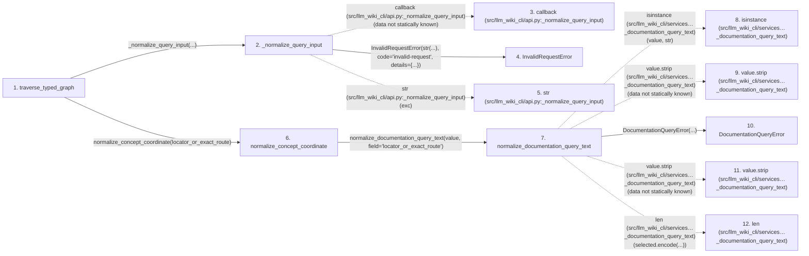

# traverse_typed_graph

**Entry point:** `traverse_typed_graph` (`api`)
**Source:** [api](../modules/api.md)
**Modules touched:** [api](../modules/api.md), [common](../modules/common.md), [config](../modules/config.md), [context_packet](../modules/context_packet.md), and 21 more

**Complete modules touched:**

- [api](../modules/api.md)
- [common](../modules/common.md)
- [config](../modules/config.md)
- [context_packet](../modules/context_packet.md)
- [documentation_queries](../modules/documentation_queries.md)
- [documentation_query_builder](../modules/documentation_query_builder.md)
- [filesystem_guard](../modules/filesystem_guard.md)
- [implementation_evidence](../modules/implementation_evidence.md)
- [io](../modules/io.md)
- [knowledge_consumption](../modules/knowledge_consumption.md)
- [knowledge_evidence](../modules/knowledge_evidence.md)
- [knowledge_governance](../modules/knowledge_governance.md)
- [knowledge_storage](../modules/knowledge_storage.md)
- [knowledge_storage_io](../modules/knowledge_storage_io.md)
- [maintenance_evidence](../modules/maintenance_evidence.md)
- [maintenance_shapes](../modules/maintenance_shapes.md)
- [maintenance_state](../modules/maintenance_state.md)
- [maintenance_status](../modules/maintenance_status.md)
- [python_implementation](../modules/python_implementation.md)
- [source_path_diagnostics](../modules/source_path_diagnostics.md)
- [source_selection](../modules/source_selection.md)
- [source_snapshot](../modules/source_snapshot.md)
- [sync_manifest](../modules/sync_manifest.md)
- [validation](../modules/validation.md)
- [wiki_surface](../modules/wiki_surface.md)

## Call sequence

> Static overview in presentation order, not runtime execution order. Arrows retain captured callers; representative internal continuations and boundary examples precede repeated helper detail.

```mermaid
sequenceDiagram
    participant p0 as traverse_typed_graph
    participant p1 as _normalize_query_input
    participant p2 as normalize_concept_coordinate
    participant p3 as _normalize_query_choice
    participant p4 as _normalize_query_values
    participant p5 as _effective_query_limit
    participant p6 as _run_query
    participant p7 as _query_service
    participant p8 as InvalidRequestError
    participant p9 as normalize_documentation_query_text
    participant p10 as _normalize_query_limit
    participant p11 as validate_exact_page_coordinate
    participant p12 as build_documentation_query_service
    participant p13 as normalize_documentation_query_limit
    participant p14 as validate_source_root
    participant p15 as _validate_wiki_dir
    participant p16 as _matches_directory_path
    participant p17 as _matches_directory_uri
    participant p18 as build_live_documentation_query_service
    participant p19 as validate_path
    participant p20 as normalize_supplied_paths
    participant p21 as is_safe_page_id
    participant p22 as resolve_source_selection
    participant p23 as canonical_path
    participant p24 as mcp_uri
    participant p25 as capture_source_selection_inputs
    participant p26 as validate_live_query_source_selection
    participant p27 as windows_current_user_sid
    participant p28 as _source_anchor
    participant p29 as tuple (src/llm_wiki_cli/api.py:traverse_typed_graph)
    participant p30 as _query_service(…).traverse_typed_graph
    p0->>p1: _normalize_query_input
    p0->>p2: normalize_concept_coordinate
    p0->>p3: _normalize_query_choice
    p0->>p4: _normalize_query_values
    p0->>p5: _effective_query_limit
    p0->>p6: _run_query
    p0->>p7: _query_service
    p0->>p8: InvalidRequestError
    p2->>p9: normalize_documentation_query_text
    p5->>p10: _normalize_query_limit
    p2->>p11: validate_exact_page_coordinate
    p7->>p12: build_documentation_query_service
    p10->>p13: normalize_documentation_query_limit
    p12->>p14: validate_source_root
    p12->>p15: _validate_wiki_dir
    p11->>p16: _matches_directory_path
    p11->>p17: _matches_directory_uri
    p12->>p18: build_live_documentation_query_service
    p14->>p19: validate_path
    p18->>p20: normalize_supplied_paths
    p16->>p21: is_safe_page_id
    p18->>p22: resolve_source_selection
    p16->>p23: canonical_path
    p17->>p24: mcp_uri
    p18->>p25: capture_source_selection_inputs
    p18->>p26: validate_live_query_source_selection
    p14->>p27: windows_current_user_sid
    p18->>p28: _source_anchor
    p0-->>p29: tuple (src/llm_wiki_cli/api.py:traverse_typed_graph)(CORE_RELATIONSHIP_KINDS)
    p0-->>p30: _query_service(…).traverse_typed_graph(…)
```

<!-- Auto-generated from static call edges. Dashed arrows are external or unresolved calls. Reviewed runtime conditions and side effects belong in Behavior. -->

> Call sequence diagram shows 30 of 991 interactions; 961 omitted to keep the visualization within the 30-interaction and generated-diagram limits, with uncertain identities omitted rather than inferred.

> Captured boundary calls: external 1 of 403 (402 omitted); unresolved 1 of 222 (221 omitted). These counts cover the captured static trace.

Omitted captured detail, grouped by actual caller occurrence and target module:

| Caller | Parent step | Target module | Kind | Omitted interactions |
| --- | --- | --- | --- | --- |
| `src/llm_wiki_cli/api.py:_normalize_query_input` | 2 | - | unresolved | 1 |
| `src/llm_wiki_cli/api.py:_normalize_query_input` | 2 | [src/llm_wiki_cli/api.py](../modules/api.md) | internal | 1 |
| `src/llm_wiki_cli/api.py:_normalize_query_input` | 2 | - | external | 1 |
| `src/llm_wiki_cli/services/documentation_query_builder.py:normalize_documentation_query_text` | 7 | - | external | 2 |
| `src/llm_wiki_cli/services/documentation_query_builder.py:normalize_documentation_query_text` | 7 | - | unresolved | 3 |
| `src/llm_wiki_cli/services/documentation_query_builder.py:normalize_documentation_query_text` | 7 | [src/llm_wiki_cli/services/documentation_queries.py](../modules/documentation_queries.md) | internal | 2 |
| `src/llm_wiki_cli/services/wiki_surface.py:validate_exact_page_coordinate` | 15 | - | external | 4 |
| `src/llm_wiki_cli/services/wiki_surface.py:validate_exact_page_coordinate` | 15 | - | unresolved | 2 |
> Omission summary shows 8 of 231 groups; 223 further groups are not expanded here. Counts above include all omitted interactions.
> Detailed flow queries retain their own coverage and limits; omitted paths may execute at runtime.

> Trace truncated at the depth limit; deeper calls are omitted.

## Data flow

<!-- Auto-generated static analysis. Treat values and boundaries as best-effort hints, not runtime proof. -->

### Step data

| Step | Inputs | Reads | Writes | Returns |
|---|---|---|---|---|
| `traverse_typed_graph` | `locator_or_exact_route: object`, `direction: str`, `kinds: Iterable[str] \| None`, `origins: Iterable[str] \| None`, `resolutions: Iterable[str] \| None`, `include_evidence: bool`, `service: DocumentationGraphQueryService \| None`, `src_dir: str` | `_TYPED_QUERY_DIRECTIONS`, `CORE_RELATIONSHIP_KINDS`, `GRAPH_ORIGINS`, `GRAPH_RESOLUTIONS`, `TypedGraphTraversalResult` | - | `cast(...)` |
| `_normalize_query_input` | `callback: Callable[[], _R]`, `field: str` | `DocumentationQueryError` | - | `callback(...)` |
| `callback (src/llm_wiki_cli/api.py:_normalize_query_input)` | - | - | - | - |
| `InvalidRequestError` | - | - | - | - |
| `str (src/llm_wiki_cli/api.py:_normalize_query_input)` | - | - | - | - |
| `normalize_concept_coordinate` | `value: object` | `wiki_surface`, `validate_concept_uid`, `validate_natural_key`, `ConceptIdentityError` | - | `wiki_surface.validate_exact_page_coordinate(...)`, `validator(...)` |
| `normalize_documentation_query_text` | `value: object`, `field: str` | `QUERY_IDENTITY_BYTE_LIMIT`, `QUERY_IDENTITY_BYTE_LIMIT` | - | `selected` |
| `isinstance (src/llm_wiki_cli/services…_documentation_query_text)` | - | - | - | - |
| `value.strip (src/llm_wiki_cli/services…_documentation_query_text)` | - | - | - | - |
| `DocumentationQueryError` | - | - | - | - |
| `value.strip (src/llm_wiki_cli/services…_documentation_query_text)` | - | - | - | - |
| `len (src/llm_wiki_cli/services…_documentation_query_text)` | - | - | - | - |

### Call data

| From | To | Line | Call |
|---|---|---:|---|
| traverse_typed_graph | _normalize_query_input | 2453 | `_normalize_query_input(...)` |
| _normalize_query_input | callback (src/llm_wiki_cli/api.py:_normalize_query_input) | 2008 | `callback(data not statically known)` |
| _normalize_query_input | InvalidRequestError | 2010 | `InvalidRequestError(str(...), code='invalid-request', details={...})` |
| _normalize_query_input | str (src/llm_wiki_cli/api.py:_normalize_query_input) | 2011 | `str(exc)` |
| traverse_typed_graph | normalize_concept_coordinate | 2454 | `normalize_concept_coordinate(locator_or_exact_route)` |
| normalize_concept_coordinate | normalize_documentation_query_text | 77 | `normalize_documentation_query_text(value, field='locator_or_exact_route')` |
| normalize_documentation_query_text | isinstance (src/llm_wiki_cli/services…_documentation_query_text) | 64 | `isinstance(value, str)` |
| normalize_documentation_query_text | value.strip (src/llm_wiki_cli/services…_documentation_query_text) | 64 | `value.strip(data not statically known)` |
| normalize_documentation_query_text | DocumentationQueryError | 65 | `DocumentationQueryError(...)` |
| normalize_documentation_query_text | value.strip (src/llm_wiki_cli/services…_documentation_query_text) | 66 | `value.strip(data not statically known)` |
| normalize_documentation_query_text | len (src/llm_wiki_cli/services…_documentation_query_text) | 67 | `len(selected.encode(...))` |

### Boundary effects

*No boundary effects detected.*

### Static analysis gaps

| Kind | Step | Target | Line |
|---|---|---|---:|
| unresolved_call | `_normalize_query_input` | `callback` | 2008 |
| external_call | `normalize_documentation_query_text` | `isinstance` | 64 |
| unresolved_call | `normalize_documentation_query_text` | `value.strip` | 64 |
| unresolved_call | `normalize_documentation_query_text` | `value.strip` | 66 |
| step_limit | `traverse_typed_graph` | `first 12 steps` | 0 |
| truncated_flow | `traverse_typed_graph` | `depth limit` | 0 |

## Behavior

This flow starts at `traverse_typed_graph` and is classified as `api`. The generated call and data-flow sections are bounded static projections; runtime conditions and side effects require source-level confirmation.
