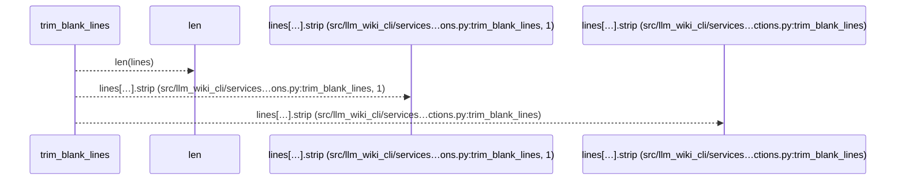
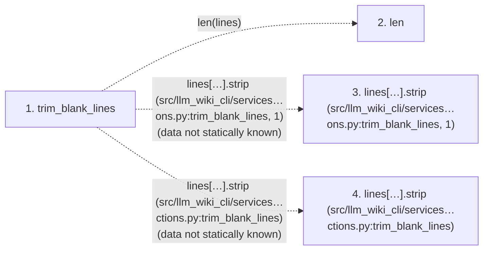

# trim_blank_lines

**Entry point:** `trim_blank_lines` (`api`)
**Source:** [markdown_sections](../modules/markdown_sections.md)
**Modules touched:** [markdown_sections](../modules/markdown_sections.md)

## Call sequence

> Static overview in presentation order, not runtime execution order. Arrows retain captured callers; representative internal continuations and boundary examples precede repeated helper detail.

<!-- Auto-generated from static call edges. Dashed arrows are external or unresolved calls. Reviewed runtime conditions and side effects belong in Behavior. -->

> Call sequence diagram shows 3 of 3 interactions; 0 omitted to keep the visualization within the 30-interaction and generated-diagram limits, with uncertain identities omitted rather than inferred.

> Captured boundary calls: external 1 of 1 (0 omitted); unresolved 2 of 2 (0 omitted). These counts cover the captured static trace.
> Detailed flow queries retain their own coverage and limits; omitted paths may execute at runtime.

## Data flow

<!-- Auto-generated static analysis. Treat values and boundaries as best-effort hints, not runtime proof. -->

### Analysis coverage

**Effect analysis evaluated.** Flow assembly and source effect analysis are separate; empty observations do not prove an empty handler body.

Source steps: 1; effect analysis evaluated: 1, partial: 0, unavailable: 0. Counts include steps omitted from the displayed trace.

Collector observations for 1 source steps with known totals: observed: 2, emitted: 2, omitted: 0. Unavailable totals are excluded.

### Step data

| Step | Inputs | Reads | Writes | Returns |
|---|---|---|---|---|
| `trim_blank_lines` | `lines: list[str]` | - | - | `...` |
| `len` | - | - | - | - |
| `lines[…].strip (src/llm_wiki_cli/services…ons.py:trim_blank_lines, 1)` | - | - | - | - |
| `lines[…].strip (src/llm_wiki_cli/services…ctions.py:trim_blank_lines)` | - | - | - | - |

### Call data

| From | To | Line | Call |
|---|---|---:|---|
| trim_blank_lines | len | 692 | `len(lines)` |
| trim_blank_lines | lines[…].strip (src/llm_wiki_cli/services…ons.py:trim_blank_lines, 1) | 693 | `lines[start].strip(data not statically known)` |
| trim_blank_lines | lines[…].strip (src/llm_wiki_cli/services…ctions.py:trim_blank_lines) | 695 | `lines[end - 1].strip(data not statically known)` |

### Boundary effects

*No boundary-effect observations were captured in this static trace.*

### Static analysis gaps

| Kind | Step | Target | Line |
|---|---|---|---:|
| unresolved_call | `trim_blank_lines` | `lines[start].strip` | 693 |
| unresolved_call | `trim_blank_lines` | `lines[end - 1].strip` | 695 |

## Behavior

This flow starts at `trim_blank_lines` and is classified as `api`. The generated call and data-flow sections are bounded static projections; runtime conditions and side effects require source-level confirmation.
