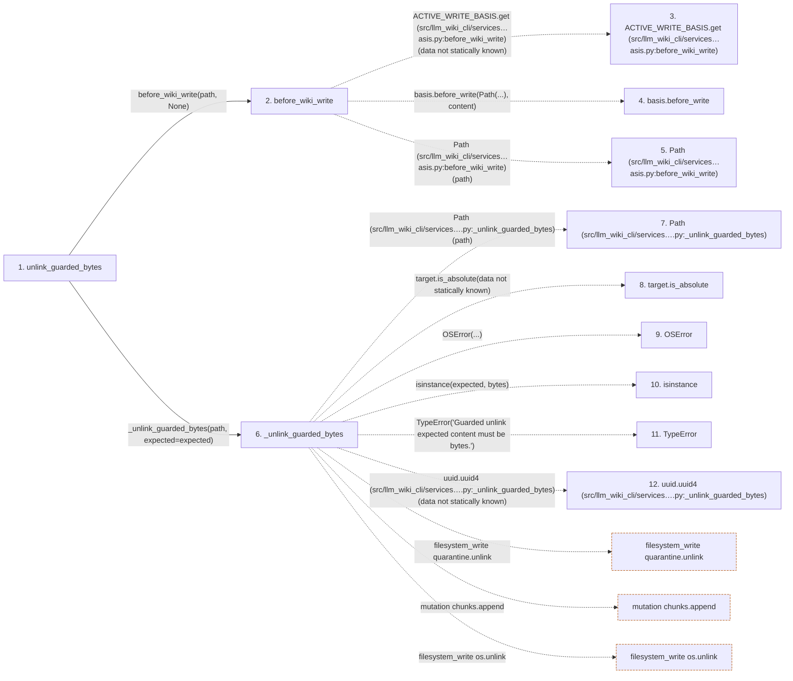

# unlink_guarded_bytes

**Entry point:** `unlink_guarded_bytes` (`api`)
**Source:** [filesystem_guard](../modules/filesystem_guard.md)
**Modules touched:** [filesystem_guard](../modules/filesystem_guard.md), [wiki_write_basis](../modules/wiki_write_basis.md)

## Call sequence

> Static overview in presentation order, not runtime execution order. Arrows retain captured callers; representative internal continuations and boundary examples precede repeated helper detail.

```mermaid
sequenceDiagram
    participant p0 as unlink_guarded_bytes
    participant p1 as _unlink_guarded_bytes
    participant p2 as before_wiki_write
    participant p3 as after_wiki_write
    participant p4 as guard_windows_directory_chain
    participant p5 as open_windows_readonly_file
    participant p6 as _restore_posix_quarantined_entry
    participant p7 as _open_windows_readonly_file_handle
    participant p8 as _open_windows_directory_guard
    participant p9 as windows_object_identity
    participant p10 as create_private_windows_directory
    participant p11 as windows_object_identity_from_values
    participant p12 as _private_windows_security_attributes
    participant p13 as move_windows_path_write_through
    participant p14 as _verify_windows_handle_restrictive_dacl
    participant p15 as _current_windows_user_sid
    participant p16 as WindowsFileGuardError
    participant p17 as WindowsDirectoryGuardError
    participant p18 as _restore_posix_entry_between
    participant p19 as _close_windows_handle
    participant p20 as _windows_api_path
    participant p21 as _WindowsDirectoryGuardUnavailableError
    participant p22 as WindowsDurabilityError
    participant p23 as WindowsIdentityUnavailableError
    participant p24 as WindowsObjectIdentity
    participant p25 as WindowsSecurityGuardError
    participant p26 as _windows_sid_string
    participant p27 as Path (src/llm_wiki_cli/services….py:_unlink_guarded_bytes)
    participant p28 as ACTIVE_WRITE_BASIS.get (src/llm_wiki_cli/services…asis.py:before_wiki_write)
    participant p29 as ACTIVE_WRITE_BASIS.get (src/llm_wiki_cli/services…basis.py:after_wiki_write)
    participant p30 as basis.before_write
    p0->>p1: _unlink_guarded_bytes
    p0->>p2: before_wiki_write
    p0->>p3: after_wiki_write
    p1->>p4: guard_windows_directory_chain
    p1->>p5: open_windows_readonly_file
    p1->>p6: _restore_posix_quarantined_entry
    p5->>p7: _open_windows_readonly_file_handle
    p4->>p8: _open_windows_directory_guard
    p5->>p9: windows_object_identity
    p4->>p10: create_private_windows_directory
    p9->>p11: windows_object_identity_from_values
    p10->>p12: _private_windows_security_attributes
    p10->>p13: move_windows_path_write_through
    p8->>p14: _verify_windows_handle_restrictive_dacl
    p14->>p15: _current_windows_user_sid
    p1->>p16: WindowsFileGuardError
    p4->>p17: WindowsDirectoryGuardError
    p6->>p18: _restore_posix_entry_between
    p5->>p19: _close_windows_handle
    p8->>p20: _windows_api_path
    p8->>p21: _WindowsDirectoryGuardUnavailableError
    p13->>p22: WindowsDurabilityError
    p11->>p23: WindowsIdentityUnavailableError
    p11->>p24: WindowsObjectIdentity
    p12->>p25: WindowsSecurityGuardError
    p14->>p26: _windows_sid_string
    p1-->>p27: Path (src/llm_wiki_cli/services….py:_unlink_guarded_bytes)(path)
    p2-->>p28: ACTIVE_WRITE_BASIS.get (src/llm_wiki_cli/services…asis.py:before_wiki_write)
    p3-->>p29: ACTIVE_WRITE_BASIS.get (src/llm_wiki_cli/services…basis.py:after_wiki_write)
    p2-->>p30: basis.before_write(Path(...), content)
```

<!-- Auto-generated from static call edges. Dashed arrows are external or unresolved calls. Reviewed runtime conditions and side effects belong in Behavior. -->

> Call sequence diagram shows 30 of 311 interactions; 281 omitted to keep the visualization within the 30-interaction and generated-diagram limits, with uncertain identities omitted rather than inferred.

> Captured boundary calls: external 1 of 185 (184 omitted); unresolved 3 of 41 (38 omitted). These counts cover the captured static trace.

Omitted captured detail, grouped by actual caller occurrence and target module:

| Caller | Parent step | Target module | Kind | Omitted interactions |
| --- | --- | --- | --- | --- |
| `src/llm_wiki_cli/services/wiki_write_basis.py:before_wiki_write` | 2 | - | external | 1 |
| `src/llm_wiki_cli/services/filesystem_guard.py:_unlink_guarded_bytes` | 6 | - | unresolved | 6 |
| `src/llm_wiki_cli/services/filesystem_guard.py:_unlink_guarded_bytes` | 6 | - | external | 27 |
| `src/llm_wiki_cli/services/filesystem_guard.py:guard_windows_directory_chain` | 13 | - | external | 9 |
| `src/llm_wiki_cli/services/filesystem_guard.py:guard_windows_directory_chain` | 13 | [src/llm_wiki_cli/services/filesystem_guard.py](../modules/filesystem_guard.md) | internal | 6 |
| `src/llm_wiki_cli/services/filesystem_guard.py:guard_windows_directory_chain` | 13 | - | unresolved | 4 |
| `src/llm_wiki_cli/services/filesystem_guard.py:_open_windows_directory_guard` | 21 | - | external | 14 |
| `src/llm_wiki_cli/services/filesystem_guard.py:_open_windows_directory_guard` | 21 | - | unresolved | 3 |
> Omission summary shows 8 of 40 groups; 32 further groups are not expanded here. Counts above include all omitted interactions.
> Detailed flow queries retain their own coverage and limits; omitted paths may execute at runtime.

> Trace truncated at the depth limit; deeper calls are omitted.

## Data flow

<!-- Auto-generated static analysis. Treat values and boundaries as best-effort hints, not runtime proof. -->

### Step data

| Step | Inputs | Reads | Writes | Returns |
|---|---|---|---|---|
| `unlink_guarded_bytes` | `path: Path`, `expected: bytes` | - | - | - |
| `before_wiki_write` | `path: str \| Path`, `content: bytes \| None` | - | - | - |
| `ACTIVE_WRITE_BASIS.get (src/llm_wiki_cli/services…asis.py:before_wiki_write)` | - | - | - | - |
| `basis.before_write` | - | - | - | - |
| `Path (src/llm_wiki_cli/services…asis.py:before_wiki_write)` | - | - | - | - |
| `_unlink_guarded_bytes` | `path: Path`, `expected: bytes` | `os`, `os`, `os`, `os`, `os` | - | `none` |
| `Path (src/llm_wiki_cli/services….py:_unlink_guarded_bytes)` | - | - | - | - |
| `target.is_absolute` | - | - | - | - |
| `OSError` | - | - | - | - |
| `isinstance` | - | - | - | - |
| `TypeError` | - | - | - | - |
| `uuid.uuid4 (src/llm_wiki_cli/services….py:_unlink_guarded_bytes)` | - | - | - | - |

### Call data

| From | To | Line | Call |
|---|---|---:|---|
| unlink_guarded_bytes | before_wiki_write | 1685 | `before_wiki_write(path, None)` |
| before_wiki_write | ACTIVE_WRITE_BASIS.get (src/llm_wiki_cli/services…asis.py:before_wiki_write) | 26 | `ACTIVE_WRITE_BASIS.get(data not statically known)` |
| before_wiki_write | basis.before_write | 28 | `basis.before_write(Path(...), content)` |
| before_wiki_write | Path (src/llm_wiki_cli/services…asis.py:before_wiki_write) | 28 | `Path(path)` |
| unlink_guarded_bytes | _unlink_guarded_bytes | 1686 | `_unlink_guarded_bytes(path, expected=expected)` |
| _unlink_guarded_bytes | Path (src/llm_wiki_cli/services….py:_unlink_guarded_bytes) | 1693 | `Path(path)` |
| _unlink_guarded_bytes | target.is_absolute | 1694 | `target.is_absolute(data not statically known)` |
| _unlink_guarded_bytes | OSError | 1695 | `OSError(...)` |
| _unlink_guarded_bytes | isinstance | 1696 | `isinstance(expected, bytes)` |
| _unlink_guarded_bytes | TypeError | 1697 | `TypeError('Guarded unlink expected content must be bytes.')` |
| _unlink_guarded_bytes | uuid.uuid4 (src/llm_wiki_cli/services….py:_unlink_guarded_bytes) | 1699 | `uuid.uuid4(data not statically known)` |

### Boundary effects

| Kind | Target | Step | Line |
|---|---|---|---:|
| filesystem_write | `quarantine.unlink` | `_unlink_guarded_bytes` | 1728 |
| mutation | `chunks.append` | `_unlink_guarded_bytes` | 1773 |
| filesystem_write | `os.unlink` | `_unlink_guarded_bytes` | 1780 |

### Static analysis gaps

| Kind | Step | Target | Line |
|---|---|---|---:|
| unresolved_call | `before_wiki_write` | `ACTIVE_WRITE_BASIS.get` | 26 |
| unresolved_call | `before_wiki_write` | `basis.before_write` | 28 |
| unresolved_call | `_unlink_guarded_bytes` | `target.is_absolute` | 1694 |
| external_call | `_unlink_guarded_bytes` | `OSError` | 1695 |
| external_call | `_unlink_guarded_bytes` | `isinstance` | 1696 |
| external_call | `_unlink_guarded_bytes` | `TypeError` | 1697 |
| external_call | `_unlink_guarded_bytes` | `uuid.uuid4` | 1699 |
| step_limit | `unlink_guarded_bytes` | `first 12 steps` | 0 |
| truncated_flow | `unlink_guarded_bytes` | `depth limit` | 0 |

## Behavior

This flow starts at `unlink_guarded_bytes` and is classified as `api`. The generated call and data-flow sections are bounded static projections; runtime conditions and side effects require source-level confirmation.
