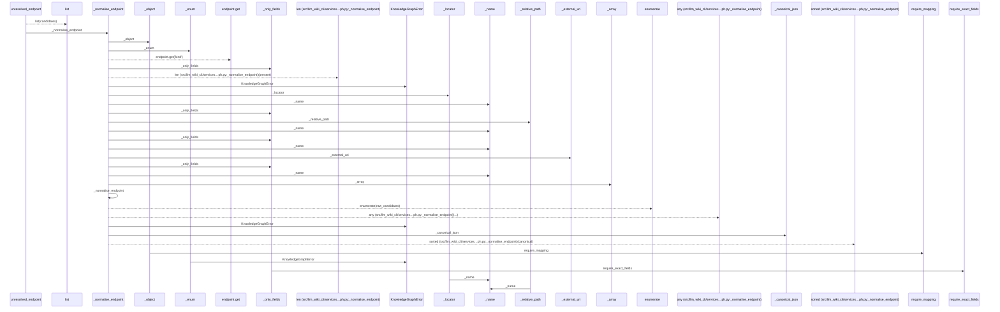
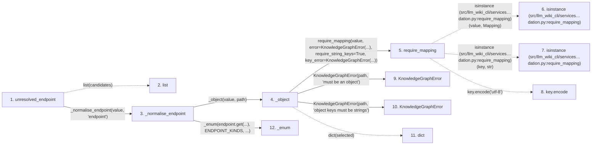

# unresolved_endpoint

**Entry point:** `unresolved_endpoint` (`api`)
**Source:** [knowledge_graph](../modules/knowledge_graph.md)
**Modules touched:** [knowledge_evidence](../modules/knowledge_evidence.md), [knowledge_graph](../modules/knowledge_graph.md), [validation](../modules/validation.md), [wiki_media](../modules/wiki_media.md), and 1 more

**Complete modules touched:**

- [knowledge_evidence](../modules/knowledge_evidence.md)
- [knowledge_graph](../modules/knowledge_graph.md)
- [validation](../modules/validation.md)
- [wiki_media](../modules/wiki_media.md)
- [wiki_surface](../modules/wiki_surface.md)

## Call sequence

> Static overview in presentation order, not runtime execution order. Arrows retain captured callers; siblings are shown before deeper helper detail.

<!-- Auto-generated from static call edges. Dashed arrows are external or unresolved calls. Reviewed runtime conditions and side effects belong in Behavior. -->

> Call sequence diagram shows 30 of 217 interactions; 187 omitted to keep the visualization within the 30-interaction and generated-diagram limits, with uncertain identities omitted rather than inferred.

> Captured boundary calls: external 5 of 64 (59 omitted); unresolved 1 of 56 (55 omitted). These counts cover the captured static trace.

Omitted captured detail, grouped by actual caller occurrence and target module:

| Caller | Parent step | Target module | Kind | Omitted interactions |
| --- | --- | --- | --- | --- |
| `src/llm_wiki_cli/services/validation.py:require_mapping` | 5 | - | external | 2 |
| `src/llm_wiki_cli/services/validation.py:require_mapping` | 5 | - | unresolved | 1 |
| `src/llm_wiki_cli/services/knowledge_graph.py:_object` | 4 | [src/llm_wiki_cli/services/knowledge_graph.py](../modules/knowledge_graph.md) | internal | 2 |
| `src/llm_wiki_cli/services/knowledge_graph.py:_object` | 4 | - | external | 1 |
| `src/llm_wiki_cli/services/knowledge_graph.py:_enum` | 12 | - | unresolved | 1 |
| `src/llm_wiki_cli/services/knowledge_graph.py:_enum` | 12 | - | external | 1 |
| `src/llm_wiki_cli/services/knowledge_graph.py:_enum` | 12 | [src/llm_wiki_cli/services/validation.py](../modules/validation.md) | internal | 1 |
| `src/llm_wiki_cli/services/validation.py:require_choice` | 16 | [src/llm_wiki_cli/services/validation.py](../modules/validation.md) | internal | 1 |
> Omission summary shows 8 of 71 groups; 63 further groups are not expanded here. Counts above include all omitted interactions.
> Detailed flow queries retain their own coverage and limits; omitted paths may execute at runtime.

> Trace truncated at the depth limit; deeper calls are omitted.

## Data flow

<!-- Auto-generated static analysis. Treat values and boundaries as best-effort hints, not runtime proof. -->

### Step data

| Step | Inputs | Reads | Writes | Returns |
|---|---|---|---|---|
| `unresolved_endpoint` | `raw_target: str`, `candidates: Sequence[Mapping[str, Any]]` | - | `value[...]` | `_normalise_endpoint(...)` |
| `list` | - | - | - | - |
| `_normalise_endpoint` | `value: object`, `path: str` | `ENDPOINT_KINDS` | `result[...]`, `result[...]` | `{...}`, `{...}`, `{...}`, `result`, `result` |
| `_object` | `value: object`, `path: str` | - | - | `dict(...)` |
| `require_mapping` | `value: object`, `error: Exception`, `require_string_keys: bool`, `key_error: Exception \| None`, `require_utf8_keys: bool`, `utf8_key_error: Exception \| None` | `Mapping` | - | `value` |
| `isinstance (src/llm_wiki_cli/services…dation.py:require_mapping)` | - | - | - | - |
| `isinstance (src/llm_wiki_cli/services…dation.py:require_mapping)` | - | - | - | - |
| `key.encode` | - | - | - | - |
| `KnowledgeGraphError` | - | - | - | - |
| `KnowledgeGraphError` | - | - | - | - |
| `dict` | - | - | - | - |
| `_enum` | `value: object`, `values: Sequence[str]`, `path: str` | - | - | `require_choice(...)` |

### Call data

| From | To | Line | Call |
|---|---|---:|---|
| unresolved_endpoint | list | 296 | `list(candidates)` |
| unresolved_endpoint | _normalise_endpoint | 297 | `_normalise_endpoint(value, 'endpoint')` |
| _normalise_endpoint | _object | 1411 | `_object(value, path)` |
| _object | require_mapping | 2309 | `require_mapping(value, error=KnowledgeGraphError(...), require_string_keys=True, key_error=KnowledgeGraphError(...))` |
| require_mapping | isinstance (src/llm_wiki_cli/services…dation.py:require_mapping) | 765 | `isinstance(value, Mapping)` |
| require_mapping | isinstance (src/llm_wiki_cli/services…dation.py:require_mapping) | 769 | `isinstance(key, str)` |
| require_mapping | key.encode | 774 | `key.encode('utf-8')` |
| _object | KnowledgeGraphError | 2311 | `KnowledgeGraphError(path, 'must be an object')` |
| _object | KnowledgeGraphError | 2313 | `KnowledgeGraphError(path, 'object keys must be strings')` |
| _object | dict | 2315 | `dict(selected)` |
| _normalise_endpoint | _enum | 1412 | `_enum(endpoint.get(...), ENDPOINT_KINDS, ...)` |

### Boundary effects

*No boundary effects detected.*

### Static analysis gaps

| Kind | Step | Target | Line |
|---|---|---|---:|
| external_call | `require_mapping` | `isinstance` | 765 |
| external_call | `require_mapping` | `isinstance` | 769 |
| unresolved_call | `require_mapping` | `key.encode` | 774 |
| step_limit | `unresolved_endpoint` | `first 12 steps` | 0 |
| truncated_flow | `unresolved_endpoint` | `depth limit` | 0 |

## Behavior

This flow starts at `unresolved_endpoint` and is classified as `api`. The generated call and data-flow sections are bounded static projections; runtime conditions and side effects require source-level confirmation.
